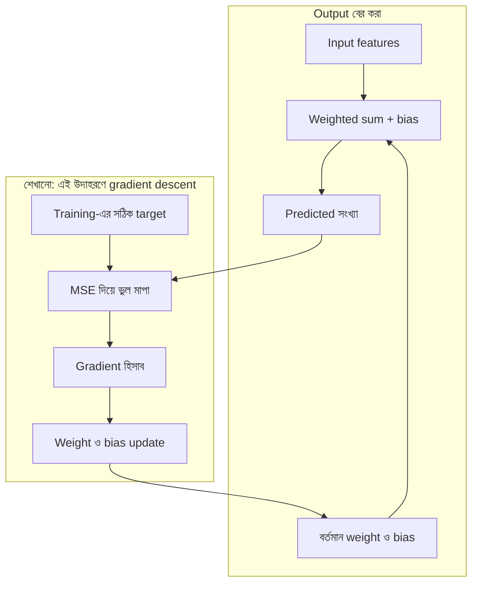
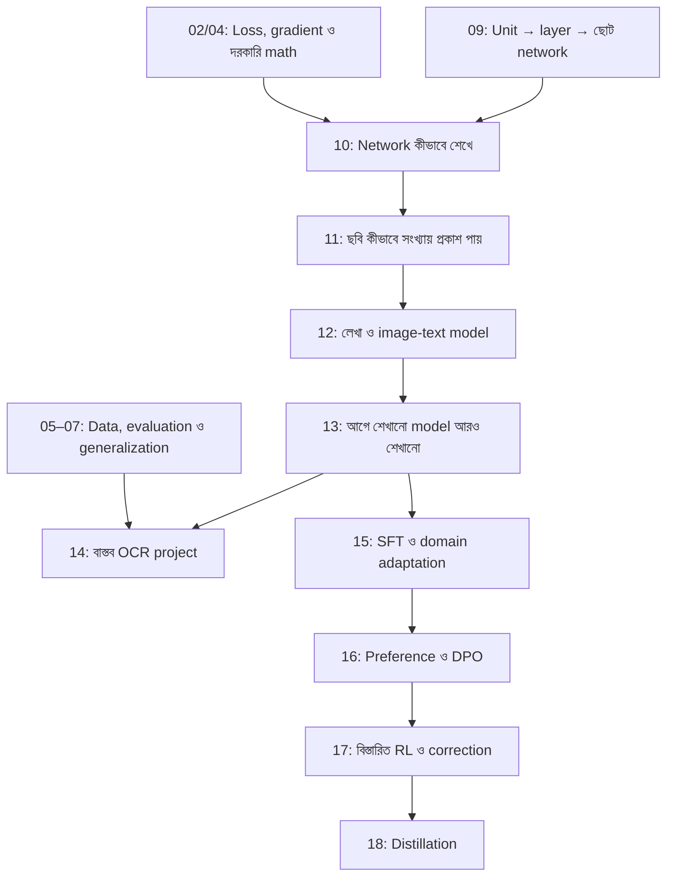

# Machine Learning — Model ও Math-এর মানচিত্র

এই map-এর কাজ হলো প্রতিটি নতুন ধারণাকে তার নির্দিষ্ট জায়গায় রাখা। Model-এর নাম, তার ভেতরের গাণিতিক operation এবং training-এর পদ্ধতি আলাদা বিষয়। নতুন model পড়ার আগে এই map-এ তার অবস্থান দেখা হবে; বিস্তারিত হিসাব থাকবে সংশ্লিষ্ট lecture-এ।

## ১. নামটি কোন ধরনের জিনিস?

| স্তর | যে প্রশ্নের উত্তর দেয় | উদাহরণ |
|---|---|---|
| শেখার ধারা — learning setting | শেখার তথ্য বা feedback কোথা থেকে আসে? | Supervised, Unsupervised, Reinforcement |
| কাজ — task | কী ফল দরকার? | সংখ্যার মান, category, cluster, ধারাবাহিক action নির্বাচন |
| Model / পদ্ধতি | কোন গঠন বা নিয়ম দিয়ে কাজটি হবে? | Linear Regression, Logistic Regression, Decision Tree, K-Means; RL-এ Q-table ও policy |
| Architecture | Component, shape ও connection কীভাবে সাজানো? | Dense layer-এর সংখ্যা ও unit, activation, output head; tree-এর branch গঠন |
| Output-এর হিসাব | শেখানো মান ব্যবহার করে ফল কীভাবে বের হয়? | Weighted sum, sigmoid, tree traversal, nearest centroid, Q-value দেখে action বাছাই |
| শেখার লক্ষ্য — objective | কোন মাপের ভিত্তিতে উন্নতি হবে? | Prediction loss কমানো, cluster-এর ভেতরের distance কমানো, expected return বাড়ানো |
| শেখানোর পদ্ধতি — training/update | শেখার মতো মানগুলো কীভাবে বদলায়? | Gradient descent, tree split নির্বাচন, centroid average, Q-learning update |

এগুলো বোঝার জন্য আলাদা প্রশ্ন, বাধ্যতামূলক execution sequence নয়। **Q-learning মূলত শেখানোর algorithm; তার tabular সংস্করণে শেখা মান রাখা হয় Q-table-এ।** একইভাবে K-Means নামটি clustering পদ্ধতি ও তার fitting algorithm বোঝাতে ব্যবহৃত হয়।

একই model family একাধিক কাজে ব্যবহার হতে পারে: Decision Tree দিয়ে regression ও classification দুটোই হয়। একই training পদ্ধতিও একাধিক model-এ লাগে: gradient descent Linear ও Logistic Regression দুটোতেই ব্যবহার করা যায়। তাই ML-এর সব সম্পর্ক একটি কঠোর গাছের মতো নয়।

## ২. একটি Model-এর ভেতরে দুটি আলাদা পথ

**Output / inference পথ:** ইতিমধ্যে শেখানো মান ব্যবহার করে নতুন input-এর ফল বের করা।

**Training পথ:** শেখার তথ্য দিয়ে সেই মানগুলো তৈরি বা উন্নত করা।

Linear Regression-এর উদাহরণ:

Prediction-এর সময় target, MSE ও parameter update দরকার হয় না। Training-এর সময় output বের করার হিসাবটিও বারবার ব্যবহৃত হয়। Unsupervised ও RL-এ training feedback আলাদা, তাই তাদের পথে supervised-এর target বসানো যাবে না।

## ৩. এখন পর্যন্ত দেখা Model/Algorithm-গুলোর অবস্থান

প্রথমে শুধু এই পরিচয়গুলো দেখা হবে; একই সঙ্গে সব formula মুখস্থ করার তালিকা নয়।

| Model / পদ্ধতি | শেখার ধারা ও কাজ | Output কী? | কী শেখে বা বদলায়? |
|---|---|---|---|
| Linear Regression | Supervised → সংখ্যার মান predict | একটি সংখ্যা | Weight ও bias |
| Binary Logistic Regression | Supervised → দুই class-এর classification | Class 1-এর probability; threshold দিয়ে class | Weight ও bias |
| সাধারণ Decision Tree | Supervised → regression বা classification | Leaf-এর সংখ্যা বা class/probability | Split-এর feature ও সীমা; leaf-এর prediction |
| K-Means | Unsupervised → clustering | Cluster assignment | Centroid-এর অবস্থান; fitting-এ assignment-ও বদলায় |
| Tabular Q-learning | Reinforcement → ধারাবাহিক সিদ্ধান্ত শেখা | Q-table-ভিত্তিক policy থেকে action | State–action জোড়ার Q-value |

### একই ছকে Math-এর ভূমিকা

| Model / পদ্ধতি | Output-এর হিসাব | শেখার লক্ষ্য / feedback | এই নোটে ব্যবহৃত update |
|---|---|---|---|
| Linear Regression | `Xw + b` | MSE কমানো | Gradient → weight/bias update |
| Binary Logistic Regression | `Xw + b` → sigmoid | সাধারণত binary cross-entropy কমানো; বিস্তারিত পরে | Gradient descent ব্যবহার করা যায়; বিস্তারিত পরে |
| সাধারণ Decision Tree | শর্ত পরীক্ষা → branch → leaf | Regression-এ squared error বা classification-এ impurity কমায় এমন split; বিস্তারিত পরে | Feature/threshold বেছে split করা; gradient descent নয় |
| K-Means | Point থেকে centroid-এর distance → কাছের cluster | নির্বাচিত centroid থেকে squared distance-এর মোট যোগফল কমানো | Assignment → group-এর mean দিয়ে centroid update |
| Tabular Q-learning | Q-values → exploration/greedy নিয়মে action | Reward থেকে expected discounted return বাড়ানোর মতো action-values শেখা | Reward + পরের Q-estimate → TD error → Q-value update |

Table-এ objective ও update আলাদা কলাম: **MSE বলে ভুল কত, gradient descent বলে মান কীভাবে বদলাবে।** RL-এর TD error একটি update signal; সেটি environment-এর reward-এর সমার্থক নয়।

## ৪. Math-এর সাধারণ উপকরণ: একাধিক Model-এ পুনর্ব্যবহার

কোনো operation একটি model-এর একার সম্পত্তি নয়। একই গুণ, average বা derivative ভিন্ন কাজে ভিন্ন অর্থে ব্যবহৃত হয়।

| Math / ধারণা | মূল ভূমিকা | কোর্সের পরিচিত ব্যবহার |
|---|---|---|
| Vector ও matrix | অনেক সংখ্যা সাজিয়ে রাখা | Features, weights, একসঙ্গে অনেক data point |
| Dot product / matrix multiplication | Weighted sum একসঙ্গে বের করা | Linear ও Logistic Regression-এর score |
| Sigmoid | Score-কে 0 ও 1-এর মাঝে রূপান্তর | Binary Logistic Regression-এর probability estimate |
| Difference, square ও sum | পার্থক্যের মাত্রা মাপা | MSE-তে prediction বনাম target; K-Means-এ point বনাম centroid |
| Mean / average | কয়েকটি মানের গড় | MSE-তে squared error-এর গড়; K-Means-এ centroid |
| Derivative / gradient | Parameter বদলালে objective কোন দিকে বদলায় | Gradient descent-এর দিক নির্ধারণ |
| Comparison ও branch | শর্ত অনুযায়ী পথ বাছাই | Decision Tree |
| Maximum ও weighted update | বড় estimate বাছাই ও নতুন তথ্যের দিকে সরানো | Tabular Q-learning |

**যেমন square দেখলেই MSE ধরে নেওয়া যাবে না:** কীসের পার্থক্য square হচ্ছে এবং কেন হচ্ছে, সেটাই তার পরিচয়।

## ৫. Formula-র ঠিকানা

প্রতিটি formula-এর আগে তিনটি পরিচয় থাকবে: **কোন model → কোন পর্যায় → কী উদ্দেশ্য**।

| Formula | ঠিকানা | কী ফল দেয় |
|---|---|---|
| `ŷ = Xw + b` | Linear Regression → output | Predicted সংখ্যা |
| `p = sigmoid(Xw + b)` | Binary Logistic Regression → output | Probability estimate |
| `MSE = mean((ŷ − y)²)` | এই Linear Regression উদাহরণ → training objective / error measurement | একটি loss-এর মান |
| `w_new = w_old − α × gradient` | Gradient descent-ভিত্তিক training → update | নতুন weight |
| `c_new = mean(group-এর points)` | K-Means → centroid update | নতুন কেন্দ্র |
| `Q_new = Q_old + α × TD_error` | Tabular Q-learning → update | একটি state–action-এর নতুন value estimate |

`α` সাধারণত learning rate। `w` weight, `b` bias, `c` centroid ও `Q` action-value—সবকিছু একই ধরনের learned মান নয়। `y` target আর `ŷ` prediction। একই অক্ষর অন্য প্রসঙ্গে অন্য অর্থে এলে lecture-এ তার অর্থ আবার দেওয়া হবে।

## ৬. পড়ার পথ: ভিত্তি থেকে Real System

এখন ১৮টা module-এর সব lecture লেখা আছে। দুটো পড়ার পথ [Course Outline](00-course-outline.md)-এ দেওয়া আছে: গোড়া থেকে (01 → … → 18 → 14) অথবা architecture থেকে (09 → 10 → 12 → 13 → 15 → 16 → 17 → 18 → 14)। কোনো শব্দ আটকালে [শব্দকোষ](02-glossary.md) দেখো। আগে ব্যবহৃত সব শব্দ জানা আছে ধরে নেওয়া হয় না; প্রতি lecture-এ একটি নতুন ধারণা।

এটি পড়ার dependency map, model-এর computation diagram নয়। Evaluation-এর practical বা model comparison আগে এলে Module 05–07-এর দরকারি অংশও আগে পড়তে হবে।

| ধাপ | পড়ার স্থান | অবস্থা |
|---|---|---|
| ভিত্তি: Architecture | [Module 09](module-09-model-architecture/README.md) | ৯টি lecture লেখা; পড়া শেষ ধরা হয়নি |
| Training | [Module 10](module-10-neural-network-training/README.md) | ৮টি lecture: loss থেকে backpropagation, optimizer, training loop |
| ছবি থেকে representation | [Module 11](module-11-image-representation-and-vision/README.md) | ৭টি lecture |
| লেখা ও multimodal model | [Module 12](module-12-text-sequences-and-multimodal-models/README.md) | bridge + ৮টি lecture |
| Fine-tuning | [Module 13](module-13-pretraining-finetuning-and-lora/README.md) | bridge + ১৪টি lecture: LoRA, quantization, variants, তুলনা |
| SFT ও domain adaptation | [Module 15](module-15-domain-and-task-adaptation/README.md) | ৮টি lecture |
| Preference ও DPO | [Module 16](module-16-preference-learning-and-dpo/README.md) | ৮টি lecture |
| RL ও feedback | [Module 17](module-17-reinforcement-learning-and-feedback/README.md) | ১৬টি lecture |
| Distillation | [Module 18](module-18-knowledge-distillation/README.md) | ৮টি lecture |
| শেষে: OCR project | [Module 14](module-14-ocr-system-case-study/README.md) | ৮টি lecture; বাস্তব project-এ আগের ধারণা খুঁজে দেখা |

### Module 09-এর ভেতরের পথ

**Input/output → parameters → একটি unit → activation → hidden layer → forward pass → shape/count → architecture বনাম training → design।**

যে কোনো lecture-এ অজানা prerequisite এলে সেখানেই ছোট ব্যাখ্যা বা আগে পড়ার lecture যুক্ত হবে। একাধিক নতুন term জমিয়ে শেষে বোঝার চাপ দেওয়া হবে না।

### সংরক্ষিত Fundamentals ও অন্য শাখা

| বিষয় | নোট / পরিকল্পনা |
|---|---|
| Linear Regression-এর output | [Prediction, weight ও bias](module-02-linear-regression/lecture-01-prediction-weight-and-bias.md) |
| Loss ও update | [MSE](module-02-linear-regression/lecture-02-error-and-mean-squared-error.md), [gradient descent](module-02-linear-regression/lecture-03-gradient-descent-training.md) |
| Math practice | [Module 04](module-04-math-foundations-practice/README.md) (৪টি lecture লেখা) |
| Data preparation ও splits | [Module 05](module-05-data-preparation-and-splits/README.md) (৫টি lecture লেখা) |
| Evaluation ও baselines | [Module 06](module-06-model-evaluation-and-baselines/README.md) (৫টি lecture লেখা) |
| Generalization | [Module 07](module-07-generalization-and-overfitting/README.md) (৫টি lecture লেখা) |
| End-to-end practical | [Module 08](module-08-end-to-end-ml-project/README.md) (৫টি lecture লেখা) |
| Classification | [Module 03](module-03-logistic-regression/README.md): sigmoid → log loss → training |
| Tree পরিচিতি | [Decision Tree-এর অংশ](module-01-ml-fundamentals-and-math-basics/lecture-06-linear-algebra-basics.md) |
| Unsupervised ও RL পরিচিতি | [K-Means](module-01-ml-fundamentals-and-math-basics/lecture-04-how-unsupervised-learning-works.md), [Q-learning](module-01-ml-fundamentals-and-math-basics/lecture-05-how-reinforcement-learning-works.md) |

নোট থাকা, পড়া এবং নিজে প্রয়োগ করতে পারা আলাদা অবস্থা। এখানে প্রস্তুত material ও ভবিষ্যৎ পরিকল্পনা চিহ্নিত আছে; বোঝা সম্পন্ন হয়েছে বলে স্বয়ংক্রিয়ভাবে চিহ্ন দেওয়া হবে না।

## ৭. নতুন Variant এলে কোথায় বসবে

নতুন নাম এলেই সম্পূর্ণ নতুন math হিসেবে শুরু হবে না। পরিচিত পদ্ধতি থেকে **কোন অংশটি বদলেছে** আগে চিহ্নিত করা হবে।

- Input/representation বদলেছে কি?
- Output বের করার নিয়ম বদলেছে কি?
- Objective-এ নতুন শর্ত বা penalty এসেছে কি?
- Update পদ্ধতি বদলেছে কি?
- একাধিক model একসঙ্গে ব্যবহার হচ্ছে কি?

উদাহরণ হিসেবে Linear Regression-এ feature বাড়লে weight-এর সংখ্যা বাড়ে; core weighted-sum কাঠামো একই থাকে। Regularization এলে objective-এ penalty যোগ হতে পারে; সেটি পরে আলাদা নোটে শেখা হবে। Neural network বহু learning setting-এ ব্যবহার করা যায়, তাই তাকে শুধু supervised-এর একচেটিয়া শাখা হিসেবে রাখা হবে না।

ভবিষ্যতের lecture-এ প্রথমে map-এর অবস্থান, তারপর output ও training-এর আলাদা পথ, এরপর একটি ছোট numerical example থাকবে। নতুন ধারণা একসঙ্গে অনেক শাখায় ছড়িয়ে না দিয়ে বর্তমান model-এর সঙ্গে তার সম্পর্ক দেখানো হবে।

## Fine-Tuning-এর দুই অক্ষ

আগে শেখানো model-এর adaptation-এ **কোন parameters update হবে** (full/selective/PEFT) এবং **কোন objective বা feedback থেকে শেখানো হবে** (SFT/preference/reward) আলাদা সিদ্ধান্ত। তাই LoRA + SFT একসঙ্গে সম্ভব। Quantization সংখ্যা সংরক্ষণের precision বদলায়; SFT loss-এর বিকল্প নয়। [প্রধান পদ্ধতির পরিচয় ও এক উদাহরণ](module-13-pretraining-finetuning-and-lora/lecture-02-finetuning-methods-map.md)। বিস্তারিত পাঠ [Module 13](module-13-pretraining-finetuning-and-lora/README.md)-এর lecture 06–14-এ।

LoRA output-এর focused পাঠ: [Input, forward pass ও activation](module-13-pretraining-finetuning-and-lora/lecture-03-lora-forward-pass-and-activation.md)। একই layer input থেকে base ও low-rank branch হিসাব হয়; ফল যোগ হয়ে মূল architecture-এর পরের operation-এ যায়।

## বিস্তৃত Adaptation পাঠের অবস্থান

| দিক | কী বদলায় | নির্ধারিত পাঠ |
|---|---|---|
| LoRA variants | Parameterization, rank allocation, scaling বা initialization | [Module 13](module-13-pretraining-finetuning-and-lora/README.md) |
| Quantization / QLoRA | Weight storage precision; matrix shape নয় | [Quantization](module-13-pretraining-finetuning-and-lora/lecture-05-quantization-and-qlora.md) |
| SFT / task tuning | Supervised target ও objective | [Module 15](module-15-domain-and-task-adaptation/README.md) |
| Domain adaptation / CPT | Data distribution ও training stage; CPT-তে pretraining objective | [Module 15](module-15-domain-and-task-adaptation/README.md) |
| DPO | Preference objective ও reference-relative comparison | [Module 16](module-16-preference-learning-and-dpo/README.md) |
| RL | Generated actions/output-এর reward থেকে policy update | [Module 17](module-17-reinforcement-learning-and-feedback/README.md) |
| Distillation | Teacher থেকে learning signal | [Module 18](module-18-knowledge-distillation/README.md) |

**Correction** একটি data/feedback ধারণা; নিজে RL-এর সমার্থক নয়। [OCR example দিয়ে target/preference/reward](module-17-reinforcement-learning-and-feedback/lecture-01-correction-target-preference-and-reward.md)। Module 15–18-এর সব lecture লেখা আছে; লেখা থাকা শেখা সম্পন্ন হওয়া নয়।

Parameter freeze মানে computation বন্ধ নয়। LoRA-তে W হিসাব করে কিন্তু A/B update হয়; count ও value পরিবর্তন আলাদা। [Lecture 04](module-13-pretraining-finetuning-and-lora/lecture-04-lora-matrix-pairs-and-effective-weights.md)। Quantization shape বজায় রেখে মানের approximation করে; [precision ও output পরিবর্তন](module-13-pretraining-finetuning-and-lora/lecture-05-quantization-and-qlora.md)।

Output logits হলো input-নির্ভর calculation-এর ফল; parameters, loss বা reward নয়। Lossless encoding original bytes ফেরত দেয়; lossy quantization আনুমানিক values দেয়। [output scores](module-12-text-sequences-and-multimodal-models/bridge-01-output-scores-and-selection.md) ও [lossless compression](module-13-pretraining-finetuning-and-lora/bridge-01-lossless-compression.md) bridge পাঠ দুটো এই পার্থক্য শেখায়।
