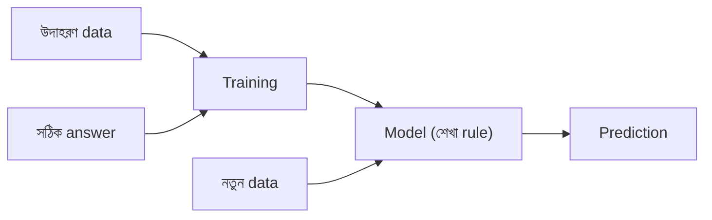

# Lecture 01 — Machine Learning কী?

> আগে যা জানা থাকলে ভালো: শুধু এটুকু যে প্রোগ্রাম মানে কম্পিউটারকে দেওয়া নির্দেশ। এই lecture শেষে পারবে: "rule হাতে লেখা" আর "উদাহরণ থেকে rule শেখা"-র পার্থক্য বলতে এবং **training** ও **prediction** আলাদা করতে।

## সমস্যাটা কী?

ধরো তুমি spam email আটকানোর প্রোগ্রাম লিখছ। প্রথমে একটা rule লিখলে: "mail-এ `free` শব্দ ৩ বারের বেশি থাকলে spam।" কয়েকদিন পর spammer-রা `fr33` লিখতে শুরু করল, তোমার rule আর কাজ করে না। তখন আবার নতুন rule লিখতে হয়, তারপর আবার।

আরও কঠিন কাজ আছে। একটা ছবি দেখে বলতে হবে মানুষটা খুশি না রাগী। "ঠোঁটের কোণ এত ডিগ্রি উঠলে খুশি" ধরনের rule কেউ লিখে শেষ করতে পারবে না।

এই দুই জায়গায় সমস্যা একই: rule লেখা কঠিন, আর লিখলেও দ্রুত পুরোনো হয়ে যায়।

## ধারণাটা সহজ ভাষায়

Machine Learning (ML) উল্টো পথে যায়। rule লিখে দেওয়ার বদলে আমরা কম্পিউটারকে **অনেক উদাহরণ** দিই, প্রতিটার সঙ্গে **সঠিক উত্তর** বলে দিই। কম্পিউটার নিজে সেই উদাহরণ থেকে rule খুঁজে বের করে।

- সাধারণ প্রোগ্রামিং: rule + data → answer
- ML: data + answer → rule

ML-এ শেখা সেই rule-টাকে বলে **model**। কাজটা দুই ধাপে হয়:

- **Training:** উদাহরণ ও সঠিক উত্তর দেখে model তৈরি হয়। এখানে answer একজন শিক্ষকের মতো আগে থেকে দেওয়া থাকে।
- **Prediction:** তৈরি model-কে সম্পূর্ণ নতুন data দেওয়া হয়, সে নিজে answer বের করে। এখন আর সঠিক উত্তর দেওয়া থাকে না, model-ই বলে।

Gmail-এর spam filter, ব্যাংকের জালিয়াতি ধরা, YouTube-এর recommendation, ছবি চেনা সবই এভাবে বানানো হয়। এগুলো বানান ML engineer ও data scientist-রা, আর ব্যবহার করে যেসব প্রতিষ্ঠানের হাতে অনেক data আছে কিন্তু সিদ্ধান্তের rule লিখে দেওয়ার মতো কেউ নেই।

## ছোট একটা উদাহরণ

আমাদের ৪টা email আছে। প্রতিটায় `free` শব্দ কয়বার আছে এবং সেটা আসলে spam কি না, জানা আছে:

| `free` কতবার | আসল উত্তর |
|---|---|
| 0 | ok |
| 1 | ok |
| 5 | spam |
| 6 | spam |

Rule-এর আকার আমরা ধরে নিলাম: "সংখ্যা `t`-এর বেশি হলে spam।" শুধু `t` কত, সেটা জানি না। `t` বের করাই এখানে training।

- `t = 0.5` ধরলে: 0 → ok (ঠিক), 1 → spam (ভুল), 5 → spam, 6 → spam। চারটার মধ্যে 3টা ঠিক।
- `t = 3` ধরলে: চারটাই ঠিক।

1-এর বেশি আর 5-এর কম যে কোনো `t`-ই চারটা ঠিক করে। দুই দলের ঠিক মাঝখানে (3) নিলে দুই দিকেই ভুলের সুযোগ কম থাকে, তাই `t = 3` বেছে নিলাম। এটাই এই ছোট model।

এখন prediction: নতুন একটা mail এল যাতে `free` 4 বার আছে। 4 > 3, তাই model বলল spam। এই mail-এর সঠিক উত্তর আমরা জানি না, model নিজে বলল।

## কোড

```python
data = [(0, "ok"), (1, "ok"), (5, "spam"), (6, "spam")]
for t in [0.5, 1.5, 3, 5.5]:
    correct = sum((count > t) == (label == "spam") for count, label in data)
    print("t =", t, "-> ঠিক:", correct, "/ 4")
# output:
# t = 0.5 -> ঠিক: 3 / 4
# t = 1.5 -> ঠিক: 4 / 4
# t = 3 -> ঠিক: 4 / 4
# t = 5.5 -> ঠিক: 3 / 4
```

`count > t` মানে "spam বলছি", `label == "spam"` মানে "আসলেই spam"; দুটো মিললে উত্তর ঠিক।

সাবধান: এখানে একটামাত্র সংখ্যা (feature) ও একটামাত্র `t` ছিল। বাস্তব model-এ হাজার feature আর লক্ষ parameter থাকে, কিন্তু কাজের ধরন একই: উদাহরণ দেখে মান খুঁজে বের করা।

## ছবি



## মনে রাখার সারকথা

- ML-এ rule লিখি না; উদাহরণ ও সঠিক উত্তর দিয়ে কম্পিউটারকে rule খুঁজতে দিই।
- Training-এ সঠিক উত্তর দেওয়া থাকে, prediction-এ model নিজে উত্তর বের করে।
- শেখা rule-টার নাম model।

## নিজে করো

১. কোন কাজে rule হাতে লেখা সহজ আর কোনটায় ML লাগবে? (ক) Celsius থেকে Fahrenheit-এ রূপান্তর (খ) ছবি দেখে বিড়াল না কুকুর বলা।
২. উপরের model-এ (`t = 3`) নতুন mail-এ `free` 2 বার ও 7 বার থাকলে prediction কী?
৩. data-তে আরেকটা সারি যোগ হলো: `(4, "ok")`। এবার `t = 3` কয়টা ঠিক করে? আর `t = 4.5` কয়টা?

<details><summary>উত্তর</summary>

১. (ক) rule সহজ: `F = C × 9/5 + 32`, ML লাগে না। (খ) ML লাগবে, কারণ "বিড়ালের কান কেমন" ধরনের rule লেখা যায় না।

২. 2 > 3 নয় → ok। 7 > 3 → spam।

৩. এখন data: 0 ok, 1 ok, 4 ok, 5 spam, 6 spam। `t = 3` ধরলে 4 > 3 বলে spam বলে, কিন্তু আসল উত্তর ok, তাই 5টার মধ্যে 4টা ঠিক। `t = 4.5` ধরলে সবগুলো ঠিক, 5/5। নতুন উদাহরণ এলে সবচেয়ে ভালো `t` বদলে গেল। এটাই training।

</details>

## পরের পাঠ

শেখার সংকেত সবসময় "সঠিক উত্তর" নয়। কখনো সেটা data-র গঠন, কখনো কাজের ফল। [Lecture 02](lecture-02-types-and-terminology.md)-এ তিন ধরনের শেখা আর দরকারি শব্দগুলো দেখব।
