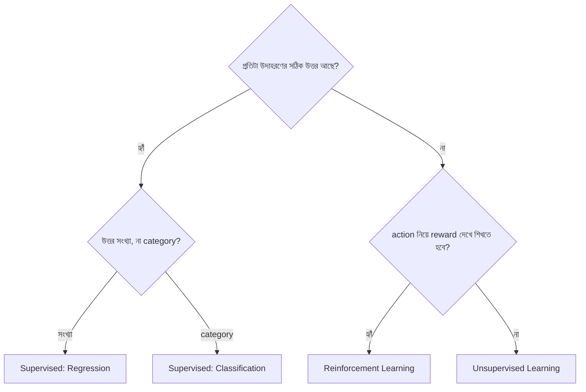

# Lecture 02 — ML-এর তিন ধরন ও দরকারি শব্দ

> আগে যা জানা থাকলে ভালো: [Lecture 01](lecture-01-what-is-ml.md) — model, training ও prediction। এই lecture শেষে পারবে: একটা কাজ দেখে বলতে সেটা কোন ধরনের শেখা, আর feature, label, model শব্দগুলো ঠিক জায়গায় বসাতে।

## সমস্যাটা কী?

কাজ শুরুর আগে প্রশ্ন করতে হয়: আমার হাতে কী আছে? কোথাও দেখা যায় প্রতিটা উদাহরণের সঙ্গে সঠিক উত্তর আছে। কোথাও শুধু অনেক data আছে, উত্তর কেউ লিখে রাখেনি। কোথাও আবার কোনো data-ই নেই, সিদ্ধান্ত নিয়ে ফল দেখে দেখে শিখতে হবে। হাতের জিনিস না বুঝে পদ্ধতি বাছলে কাজই এগোয় না।

## ধারণাটা সহজ ভাষায়

শেখার সংকেত (কোথা থেকে model বুঝবে সে ঠিক করছে কি না) কোথা থেকে আসে, তার ওপর ভিত্তি করে তিন ধরন:

| ধরন | হাতে কী আছে | উদাহরণ |
|---|---|---|
| **Supervised learning** | data + প্রতিটার সঠিক উত্তর | বাড়ির মাপ থেকে দাম অনুমান |
| **Unsupervised learning** | শুধু data, কোনো সঠিক উত্তর নেই | customer-দের কেনার ধরন অনুযায়ী দল করা |
| **Reinforcement learning (RL)** | কাজ করার সুযোগ ও ফল (reward) | খেলায় একটার পর একটা চাল দিয়ে জেতা শেখা |

Supervised-এ উত্তরের ধরন দেখে দুই ভাগ:

- **Regression:** উত্তর একটা সংখ্যা (বাড়ির দাম, কালকের তাপমাত্রা)।
- **Classification:** উত্তর একটা category (spam না ok, রোগ আছে না নেই)।

Unsupervised-এর একটা পরিচিত কাজ হলো **clustering**: কাছাকাছি জিনিসগুলোকে একদলে ফেলা। দল কী নামে ডাকা হবে, সেটা কেউ বলে দেয় না। এটা [Lecture 04](lecture-04-how-unsupervised-learning-works.md)-এ হাতে হিসাব করে দেখব।

RL-এ model (এখানে নাম **agent**) নিজে action নেয়, তারপর ফল হিসেবে reward পায়। reward অনেক সময় দেরিতে আসে। এটা [Lecture 05](lecture-05-how-reinforcement-learning-works.md)-এ দেখব।

সাবধান: ML-এর সব ধরন এই তিনটিতে সীমাবদ্ধ নয়, তবে শুরুর জন্য এটুকুই যথেষ্ট।

## ছোট একটা উদাহরণ

একটা ছোট table নাও, যেটা দিয়ে বাড়ির দাম অনুমান করা হবে:

| আয়তন (বর্গফুট) | রুম | দাম (লাখ টাকা) |
|---|---|---|
| 1000 | 2 | 50 |
| 1500 | 3 | 70 |
| 800 | 2 | 35 |

এই table থেকে শব্দগুলো:

- প্রতিটা সারি একটা **উদাহরণ** (example বা sample)। এখানে 3টা উদাহরণ।
- **Feature:** model যে তথ্য দেখে সিদ্ধান্ত নেয়। এখানে আয়তন ও রুম।
- **Label** (বা **target**): যেটা অনুমান করতে চাই। এখানে দাম।
- **Dataset:** উদাহরণের পুরো সংগ্রহ, এই table-টা।
- **Model:** data থেকে শেখা rule।
- **Training:** model-কে শেখানোর প্রক্রিয়া।
- **Inference** (বা prediction): শেখা model দিয়ে নতুন input-এর উত্তর বের করা।

দাম সংখ্যা, আর উত্তর data-তে দেওয়া আছে, তাই এটা supervised **regression**।

Table-এর "দাম" কলামটা না থাকলে? তখন শুধু feature থাকে। তখন আমরা বড়জোর বাড়িগুলো মিল অনুযায়ী দল করতে পারতাম। সেটা unsupervised।

## ছবি

কোন ধরন বাছবে তা ঠিক করার প্রশ্ন:

## মনে রাখার সারকথা

- Supervised-এ সঠিক উত্তর দেওয়া থাকে, Unsupervised-এ থাকে না, RL-এ ফল (reward) দেখে শেখা হয়।
- Supervised-এর উত্তর সংখ্যা হলে regression, category হলে classification।
- Feature হলো input-এর তথ্য, label হলো যা অনুমান করতে চাই।

## নিজে করো

১. "কাল বৃষ্টি হবে কি না" অনুমান করতে হবে, আগের অনেক দিনের আবহাওয়া ও "বৃষ্টি হয়েছিল/হয়নি" data আছে। এটা কোন ধরন?
২. "আগামী মাসে দোকানে কত টাকার বিক্রি হবে" অনুমান করতে হবে, আগের মাসগুলোর বিক্রির হিসাব আছে। এটা কোন ধরন?
৩. একটা দোকানের ১০০০ customer-এর কেনাকাটার তালিকা আছে, কিন্তু কেউ আগে থেকে দল ঠিক করেনি। তুমি তাদের কয়েকটা দলে ভাগ করতে চাও। কোন ধরন? এখানে label আছে কি?

উত্তর

১. Supervised, Classification। উত্তর "হবে" বা "হবে না" নামের category, আর সঠিক উত্তর data-তে আছে।

২. Supervised, Regression। উত্তর একটা টাকার সংখ্যা।

৩. Unsupervised, Clustering। Label নেই; দল কোন কোন customer নিয়ে হবে সেটা model data-র মিল দেখে ঠিক করবে।

## পরের পাঠ

Supervised হলো সবচেয়ে বেশি ব্যবহার হওয়া ধরন, আর পরের module-গুলোও তার ওপরই দাঁড়িয়ে। [Lecture 03](lecture-03-how-supervised-learning-works.md)-এ দেখব ভেতরে ভেতরে সে কীভাবে শেখে।
