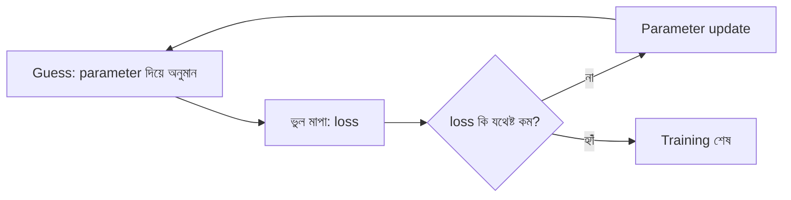

# Lecture 03 — Supervised Learning কীভাবে শেখে

> আগে যা জানা থাকলে ভালো: [Lecture 02](lecture-02-types-and-terminology.md) — supervised learning, feature ও label। এই lecture শেষে পারবে: training-এর তিন ধাপ (guess, ভুল মাপা, মান বদলানো) বলতে এবং ৩টা সংখ্যার হিসাবে দেখাতে কোন মান ভালো।

## সমস্যাটা কী?

Model-এর ভেতরে কিছু সংখ্যা থাকে যেগুলো কেউ বলে দেয়নি। যেমন: "আয়তন ১ বর্গফুট বাড়লে দাম কত বাড়ে?" এই সংখ্যাগুলোকে বলে **parameter**। কোন মান ঠিক, সেটা আগে থেকে জানা নেই। সবগুলো সম্ভাব্য মান এলোমেলো চেষ্টা করাও সম্ভব নয়। তাহলে model কীভাবে ঠিক মান খুঁজে পায়?

## ধারণাটা সহজ ভাষায়

Supervised model তিনটা ধাপ বারবার চালায়:

1. **Guess:** এখনকার parameter দিয়ে উদাহরণগুলোর উত্তর অনুমান করে (এটাই prediction)।
2. **ভুল মাপা:** অনুমান আর সঠিক উত্তরের পার্থক্য দেখে। অনেক উদাহরণের ভুল মিলিয়ে একটা সংখ্যা বানানো হয়, যার নাম **loss**। loss যত কম, model তত ভালো।
3. **মান বদলানো:** loss কমে এমন দিকে parameter-গুলো একটু বদলায়। এর নাম **update**।

এই তিন ধাপ বারবার চললে loss ধীরে ধীরে কমে। এই পুরো প্রক্রিয়ার নাম training। Classification-এও একই তিন ধাপ; শুধু উত্তরটা category।

## ছোট একটা উদাহরণ

সবচেয়ে ছোট model: `উত্তর = w × x`। এখানে `w` একটাই parameter। Data:

| x | সঠিক y |
|---|---|
| 1 | 3 |
| 2 | 6 |
| 3 | 9 |

তিনটা `w` চেষ্টা করি। প্রতিটার জন্য ভুল = অনুমান − সঠিক উত্তর, তারপর ভুলগুলোর square করে গড় নিই। (square করা ও গড়ের কারণ [Module 02-এর Lecture 02](../module-02-linear-regression/lecture-02-error-and-mean-squared-error.md)-এ বিস্তারিত দেখব। এখন শুধু জেনে রাখো: loss একটাই সংখ্যা, ছোট হলে ভালো।)

| `w` | অনুমান | ভুল | ভুলের square | loss (গড়) |
|---|---|---|---|---|
| 1 | 1, 2, 3 | −2, −4, −6 | 4, 16, 36 | 56/3 = 18.667 |
| 2 | 2, 4, 6 | −1, −2, −3 | 1, 4, 9 | 14/3 = 4.667 |
| 3 | 3, 6, 9 | 0, 0, 0 | 0, 0, 0 | 0 |

`w = 3` দিলে loss 0, তাই এই data-র জন্য সেটাই সেরা মান। Training মানে ঠিক এই খোঁজা। প্রশ্ন শুধু: কম্পিউটার কি সব মান চেষ্টা করবে? না। সে **ভুলের দিক** দেখে `w` বদলায়, আর এই দিক বের করার উপায় [Lecture 08](lecture-08-calculus-intuition.md) ও [Module 02-এর Lecture 03](../module-02-linear-regression/lecture-03-gradient-descent-training.md)-এ আছে।

খেয়াল করো: `w = 2` আর `w = 4` ধরলে দুটো-তেই loss 4.667। শুধু loss দেখে বলা যায় না ঠিক মান ছোট দিকে না বড় দিকে। তাই update-এর জন্য loss ছাড়াও "কোন দিকে যাব" জানা দরকার।

## ছবি

## নতুন data-তে ভালো হচ্ছে তো?

Training data-র loss কমানোই শেষ লক্ষ্য নয়। Model যদি উদাহরণগুলো শুধু মুখস্থ করে, তাহলে training data-য় loss 0 হলেও নতুন data-য় সে ফেল করবে। তাই data-র একটা অংশ **test set** হিসেবে আলাদা করে রাখা হয়, যেটা training-এর সময় model দেখে না। দুই জায়গায় loss মেপে মিলিয়ে দেখা হয়:

| অবস্থা | Training loss | Test loss | মানে |
|---|---|---|---|
| **Underfitting** | বেশি | বেশি | model ঠিকমতো শেখেইনি |
| **Overfitting** | কম | বেশি | model মুখস্থ করেছে, নতুন data-য় পারছে না |
| ভালো | কম | কম, কাছাকাছি | আসল pattern শিখেছে |

হাতে-কলমে এটা [Module 02-এর Lecture 05](../module-02-linear-regression/lecture-05-checking-on-new-data.md)-এ দেখব, আর বিস্তারিত Module 05–07-এ।

## মনে রাখার সারকথা

- Training = guess, ভুল মাপা (loss), parameter update — এই তিন ধাপের পুনরাবৃত্তি।
- Loss একটা সংখ্যা; ছোট হলে model ভালো। Parameter বদলে loss কমানোই শেখা।
- Training data-য় loss কম হলেই যথেষ্ট নয়; আলাদা test data-য় যাচাই করতে হয়।

## নিজে করো

১. উপরের model-এ `w = 2` হলে `x = 3`-এর অনুমান কত? ভুল কত? (সঠিক y = 9)
২. `w = 4` ধরলে তিনটা উদাহরণের ভুল ও loss বের করো।
৩. `w = 3` model-এ নতুন `x = 4` এলে prediction কত? এই model-টা training data-য় loss 0 পেল, এ থেকে নতুন data-র ভুল সম্পর্কে নিশ্চিত কিছু বলা যায় কি?

উত্তর

১. অনুমান 2 × 3 = 6। ভুল = 6 − 9 = −3।

২. `w = 4`: অনুমান 4, 8, 12। ভুল 1, 2, 3। Square 1, 4, 9। loss = 14/3 = 4.667। (এটা `w = 2`-এর loss-এর সমান, কিন্তু ভুলের দিক উল্টো।)

৩. Prediction 3 × 4 = 12। না, নিশ্চিত কিছু বলা যায় না। training data-য় ভুল নেই, কিন্তু নতুন data-য় model কেমন করবে তা আলাদা test data দিয়ে দেখতে হয়।

## পরের পাঠ

এখন পর্যন্ত সব ছিল "সঠিক উত্তর আছে" অবস্থায়। সঠিক উত্তর না থাকলে কী হয়, [Lecture 04](lecture-04-how-unsupervised-learning-works.md)-এ K-Means দিয়ে দেখব।
