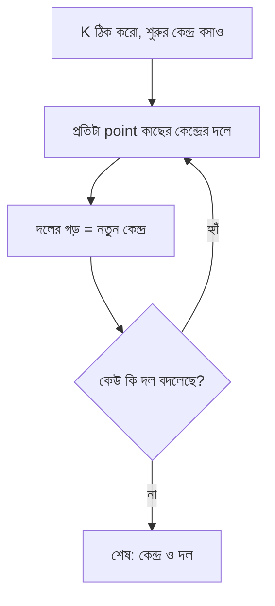

# Lecture 04 — Unsupervised Learning: K-Means

> আগে যা জানা থাকলে ভালো: [Lecture 02](lecture-02-types-and-terminology.md) — unsupervised learning ও clustering। এই lecture শেষে পারবে: K-Means-এর ধাপগুলো ছোট সংখ্যার ওপর হাতে চালিয়ে দেখাতে।

[Map-এ অবস্থান](../01-learning-map.md): Unsupervised → clustering → K-Means। Output হলো কোন point কোন দলে; training-এ দল ঠিক করা আর কেন্দ্র সরানো পর্যায়ক্রমে চলে।

## সমস্যাটা কী?

একটা দোকানের হাজারটা customer-এর মাসিক কেনাকাটার পরিমাণ জানা আছে। কেউ বলেনি কারা "কম কেনে" আর কারা "বেশি কেনে"। সঠিক উত্তর নেই, তাই আগের lecture-এর মতো "অনুমান মিলিয়ে দেখা" সম্ভব নয়। তবু কাছাকাছি পরিমাণের customer-দের একদলে ফেলতে পারলে বিজ্ঞাপন বা offer ঠিক করা সহজ হতো। Data analyst-রা এই কাজ করেন **K-Means** দিয়ে।

## ধারণাটা সহজ ভাষায়

K-Means ধাপে ধাপে কাজ করে:

1. দল কয়টা চাই সেটা আগে ঠিক করা, সংখ্যাটার নাম **K**। (K-Means নিজে K ঠিক করে না।)
2. প্রতিটা দলের একটা কেন্দ্র থাকে, নাম **centroid**। শুরুতে কয়েকটা কেন্দ্র অনুমানে বসানো হয়।
3. **Assignment:** প্রতিটা point তার সবচেয়ে কাছের কেন্দ্রের দলে যায়।
4. **Update:** প্রতিটা দলের point-গুলোর গড় (mean) হয় সেই দলের নতুন কেন্দ্র।
5. ৩ ও ৪ ধাপ বারবার চলে, যতক্ষণ না কেউ আর দল বদলায়।

এখানে "কাছে" মানে দুটো সংখ্যার পার্থক্য কত।

## ছোট একটা উদাহরণ

একটাই feature, চারটা point: **1, 2, 8, 9**। দুটো দল চাই, তাই `K = 2`। শুরুর কেন্দ্র ধরলাম `c₁ = 1` আর `c₂ = 8`।

**ধাপ ১ — Assignment।** প্রতিটা point-এর দুই কেন্দ্র থেকে দূরত্ব দেখে কাছেরটা বাছি:

| point | c₁ = 1 থেকে দূরত্ব | c₂ = 8 থেকে দূরত্ব | দল |
|---|---|---|---|
| 1 | 0 | 7 | A |
| 2 | 1 | 6 | A |
| 8 | 7 | 0 | B |
| 9 | 8 | 1 | B |

দল A = [1, 2], দল B = [8, 9]। A, B শুধু নাম; এগুলো আগে থেকে দেওয়া সঠিক উত্তর নয়।

**ধাপ ২ — Centroid update।** প্রতিটা দলের গড়:

```text
নতুন c₁ = (1 + 2) / 2 = 1.5
নতুন c₂ = (8 + 9) / 2 = 8.5
```

**ধাপ ৩ — আবার assignment।** নতুন কেন্দ্র 1.5 ও 8.5 দিয়ে দূরত্ব দেখলে আবার একই ভাগ আসে: A = [1, 2], B = [8, 9]। কেউ দল বদলায়নি, তাই থামি। শেখা model হলো দুটো কেন্দ্র: 1.5 ও 8.5।

**Prediction।** নতুন point 7 এল। 1.5 থেকে দূরত্ব 5.5, 8.5 থেকে 1.5। কাছের কেন্দ্র 8.5, তাই 7 যাবে দল B-তে। দলটার অর্থ ("বেশি কেনে") আমাদের data দেখে নিজে ঠিক করতে হয়; model নাম দেয় না।

## Formula ও লক্ষ্য

K-Means-এ দূরত্বের বদলে সাধারণত **দূরত্বের square** ব্যবহার হয়। কোন কেন্দ্র কাছে সেটা square করলেও একই থাকে, তাই ফল বদলায় না।

`d²(x, c) = (x − c)²` (এখানে `x` একটা point, `c` একটা কেন্দ্র)

Feature একাধিক হলে প্রতিটা feature-এর পার্থক্যের square যোগ হয়: `(x₁ − c₁)² + (x₂ − c₂)² + …`

K-Means-এর **লক্ষ্য (objective)** হলো: প্রতিটা point থেকে তার দলের কেন্দ্র পর্যন্ত square-দূরত্বের মোট যোগফল কমানো। আমাদের উদাহরণে:

```text
শুরুর কেন্দ্র (1, 8): 0 + 1 + 0 + 1 = 2
নতুন কেন্দ্র (1.5, 8.5): 0.25 + 0.25 + 0.25 + 0.25 = 1
```

(যেমন, point 2 থেকে 1.5-এর পার্থক্য 0.5, square 0.25।) মোট যোগফল 2 থেকে 1 হয়েছে। সঠিক উত্তর ছাড়াই একটা সংখ্যা ছোট হয়েছে, এটাই K-Means-এর "শেখা"। এখানে gradient দরকার হয়নি; গড় নেওয়াই update।

## ছবি



## মনে রাখার সারকথা

- K-Means: কাছের কেন্দ্রে point পাঠাও, তারপর দলের গড়কে নতুন কেন্দ্র বানাও, এটা বারবার।
- লক্ষ্য হলো point ও তার কেন্দ্রের square-দূরত্বের মোট যোগফল কমানো। সঠিক উত্তরের দরকার নেই।
- শুরুর কেন্দ্র আলাদা হলে ফল আলাদা হতে পারে, আর K আমাদেরই ঠিক করতে হয়।

সাবধান: feature-গুলোর scale খুব আলাদা হলে (যেমন আয় হাজারে, বয়স দশকে) বড় সংখ্যার feature দূরত্বে বেশি প্রভাব ফেলে। এজন্য আগে scale ঠিক করা হয় ([Lecture 07](lecture-07-probability-and-statistics-basics.md))।

## নিজে করো

১. শেখা কেন্দ্র 1.5 ও 8.5 হলে নতুন point 3 কোন দলে যাবে?
২. এবার শুরুর কেন্দ্র নাও `c₁ = 1`, `c₂ = 2` (point একই: 1, 2, 8, 9)। প্রথম assignment-এ কোন দলে কোন point পড়ে? তারপর নতুন কেন্দ্র কত?
৩. ২ নং প্রশ্নের নতুন কেন্দ্র দিয়ে আবার assignment করো। তারপর আবার কেন্দ্র বের করো। শেষে কোথায় থামে?

<details><summary>উত্তর</summary>

১. 1.5 থেকে square-দূরত্ব (3 − 1.5)² = 2.25। 8.5 থেকে (3 − 8.5)² = 30.25। কাছের 1.5, তাই দল A।

২. Point 1: c₁ থেকে 0, c₂ থেকে 1 → A। Point 2: c₁ থেকে 1, c₂ থেকে 0 → B। Point 8: 7 ও 6 → B। Point 9: 8 ও 7 → B। তাই A = [1], B = [2, 8, 9]। নতুন কেন্দ্র: c₁ = 1, c₂ = (2 + 8 + 9)/3 = 19/3 = 6.333। (এই ধাপে মোট objective ছিল 0 + 0 + 36 + 49 = 85, আর নতুন কেন্দ্র দিয়ে একই ভাগে 28.667।)

৩. কেন্দ্র 1 ও 6.333। Point 1 → A। Point 2: 1 থেকে 1, 6.333 থেকে 4.333 → A। Point 8: 7 ও 1.667 → B। Point 9 → B। এখন A = [1, 2], B = [8, 9]। নতুন কেন্দ্র 1.5 ও 8.5, আগের উদাহরণের ফলেই পৌঁছালাম। আরেকবার করলে কেউ দল বদলায় না, তাই থামে। এই উদাহরণ দেখায় কেন বারবার করতে হয়: প্রথম চেষ্টা ভালো ছিল না, কয়েক ধাপে ঠিক হয়েছে।

</details>

## পরের পাঠ

তৃতীয় ধরনে সঠিক উত্তরও নেই, দলও নেই; আছে শুধু কাজের ফল। [Lecture 05](lecture-05-how-reinforcement-learning-works.md)-এ Q-learning দিয়ে সেটা দেখব।
