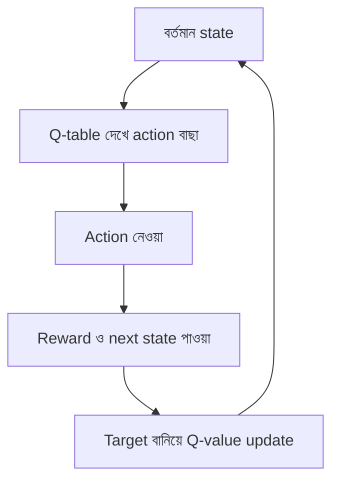

# Lecture 05 — Reinforcement Learning: Q-learning

> আগে যা জানা থাকলে ভালো: [Lecture 02](lecture-02-types-and-terminology.md) — RL-এর পরিচয়, আর [Lecture 03](lecture-03-how-supervised-learning-works.md)-এর "ভুল মেপে মান বদলানো"। এই lecture শেষে পারবে: Q-table দেখে action বাছতে এবং একটা Q-value update হাতে করে দেখাতে।

[Map-এ অবস্থান](../01-learning-map.md): Reinforcement → ধারাবাহিক সিদ্ধান্ত → tabular Q-learning। Action বাছা আর Q-value বদলানো আলাদা ধাপ।

## সমস্যাটা কী?

একটা robot একটা করিডোরে হাঁটছে, শেষে গেলে পুরস্কার। কোন চালটা ঠিক ছিল, কেউ প্রতি ধাপে বলে দেয় না। পুরস্কার আসে অনেক চাল পরে, আর তখন বুঝতে হয় আগের কোন চালগুলো কাজে লেগেছিল। "সঠিক উত্তর" দিয়ে শেখানো যায় না, কারণ সঠিক উত্তরই জানা নেই। শেখার একমাত্র উপায় চেষ্টা করে ফল দেখা।

## ধারণাটা সহজ ভাষায়

কিছু শব্দ আগে ঠিক করি:

| শব্দ | সহজ অর্থ |
|---|---|
| **Agent** | যে সিদ্ধান্ত নেয় ও শেখে (robot) |
| **State** (`s`) | এখন কোন অবস্থায় আছে (কোন ঘরে) |
| **Action** (`a`) | agent যে চাল দেয় (বাঁয়ে বা ডানে যাওয়া) |
| **Reward** (`r`) | চালের পর পাওয়া সংখ্যা (পুরস্কার বা শাস্তি) |
| **Next state** (`s′`) | চালের পরে যে অবস্থায় পৌঁছায় |

Reward কোনো "সঠিক উত্তর" নয়। অনেক চালে reward 0 আসতে পারে, তবু সেই চালগুলো দরকারি ছিল।

Agent একটা **Q-table** রাখে: প্রতিটা (state, action) জোড়ার জন্য একটা সংখ্যা `Q(s, a)`। এর মানে: "এই state-এ এই action নিলে, এরপর ভালোভাবে চললে, মোট কত reward পাওয়ার আশা আছে।" এটা একটা **অনুমান**, আর probability নয়, তাই 1-এর বেশি হতে পারে।

Action বাছার সাধারণ নিয়ম: বেশিরভাগ সময় Q-table-এ সবচেয়ে বড় মানের action নাও (**exploitation**)। কখনো কখনো এলোমেলো একটা নাও, যাতে নতুন কিছু জানা যায় (**exploration**)। এই নিয়মকে **epsilon-greedy** বলে।

দূরের reward কম গুরুত্ব পায়, এটা ঠিক করে **discount factor γ** (gamma), যার মান সাধারণত 0 থেকে 1-এর মধ্যে। γ = 0.9 মানে পরের ধাপের reward-এর দাম 0.9 গুণ।

## ছোট একটা উদাহরণ

করিডোর: ঘর A, ঘর B, ঘর C। Agent এখন B-তে (`s = B`)। সে ডানে গেল (`a = ডান`), reward পেল `r = 1`, পৌঁছাল C-তে (`s′ = C`)। Q-table-এর কিছু মান:

| | Q(B, ডান) আগে | Q(C, বাঁ) | Q(C, ডান) |
|---|---|---|---|
| মান | 2 | 3 | 6 |

Update তিন ধাপে। γ = 0.9 আর learning rate α = 0.1। (**α** বলে পুরোনো অনুমান নতুন তথ্যের দিকে কতটা সরবে।)

```text
Target = r + γ × (C-তে সবচেয়ে বড় Q) = 1 + 0.9 × 6 = 6.4
Error  = Target − পুরোনো Q(B, ডান)    = 6.4 − 2     = 4.4
নতুন Q(B, ডান) = 2 + 0.1 × 4.4                       = 2.44
```

Q(B, ডান) 2 থেকে 2.44 হলো। পুরো target-এ একবারে লাফ দেয়নি, তার দিকে একটু সরেছে। আরও অভিজ্ঞতা এলে আরও সরবে। এই Error-এর নাম **TD error**। Target কোনো মানুষের দেওয়া সঠিক উত্তর নয়; এটা পাওয়া reward আর পরের state-এর বর্তমান অনুমান মিশিয়ে বানানো।

**Episode শেষ হলে।** C যদি শেষ ঘর হয়, সেখান থেকে আর কোনো reward আসবে না। তখন Target শুধু `r`:

```text
Target = 1
নতুন Q = 2 + 0.1 × (1 − 2) = 1.9
```

## ছবি



## মনে রাখার সারকথা

- RL-এ সঠিক উত্তর নেই; agent action নিয়ে reward দেখে শেখে।
- Q(s, a) হলো ভবিষ্যৎ reward-এর অনুমান। Update: `নতুন Q = পুরোনো Q + α × (Target − পুরোনো Q)`, যেখানে `Target = r + γ × পরের সর্বোচ্চ Q`।
- Episode শেষ হলে Target শুধু `r`।

সাবধান: Table কেবল ছোট সমস্যায় চলে (অল্প state ও action)। State খুব বেশি হলে Q-value অনুমান করতে neural network লাগে; সেটা পরের module-গুলোতে ([Module 17](../module-17-reinforcement-learning-and-feedback/README.md)) আসবে।

## নিজে করো

১. Q(s, a) = 4, r = 2, পরের state-এর সর্বোচ্চ Q = 5, γ = 0.8, α = 0.5। Target, TD error ও নতুন Q বের করো।
২. একই সংখ্যা, কিন্তু পরের state টা episode-এর শেষ। নতুন Q কত?
৩. প্রথম উদাহরণের সংখ্যা (Q = 2, r = 1, পরের সর্বোচ্চ Q = 6, α = 0.1) নিয়ে γ = 0 ধরো। নতুন Q কত? γ = 0 মানে agent কী বিবেচনা করছে?

<details><summary>উত্তর</summary>

১. Target = 2 + 0.8 × 5 = 6। Error = 6 − 4 = 2। নতুন Q = 4 + 0.5 × 2 = 5।

২. Target = r = 2। Error = 2 − 4 = −2। নতুন Q = 4 + 0.5 × (−2) = 3।

৩. Target = 1 + 0 × 6 = 1। Error = 1 − 2 = −1। নতুন Q = 2 + 0.1 × (−1) = 1.9। γ = 0 মানে agent শুধু এখনকার reward দেখছে, ভবিষ্যৎ নয়।

</details>

## পরের পাঠ

তিন ধরনের শেখা দেখা হলো। এবার গণিতের উপকরণ: সবচেয়ে আগে কীভাবে অনেকগুলো সংখ্যা একসঙ্গে রাখা ও হিসাব করা হয়, [Lecture 06](lecture-06-linear-algebra-basics.md)-এ।
