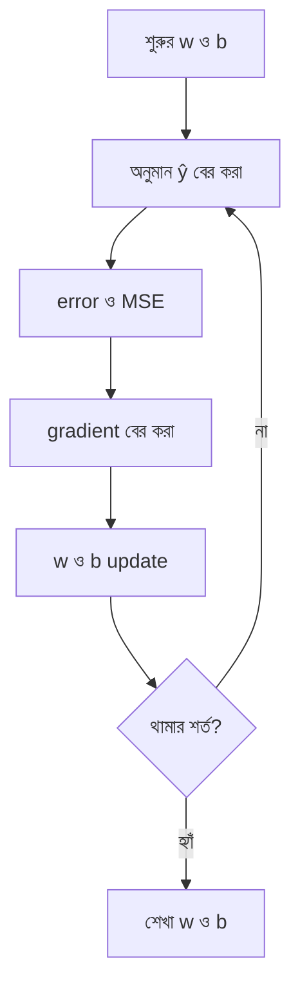

# Lecture 03 — Gradient Descent: Weight ও Bias শেখা

> আগে যা জানা থাকলে ভালো: [Lecture 02](lecture-02-error-and-mean-squared-error.md) — MSE, আর [Module 01, Lecture 08](../module-01-ml-fundamentals-and-math-basics/lecture-08-calculus-intuition.md) — slope ও gradient descent। এই lecture শেষে পারবে: `w` ও `b`-এর এক ধাপ update হাতে করে MSE কমতে দেখাতে।

[Map-এ অবস্থান](../01-learning-map.md): Supervised → Linear Regression → training-এর update। Gradient descent একটা update-এর পদ্ধতি; MSE হলো যার ভুল কমানো হচ্ছে।

## সমস্যাটা কী?

MSE দিয়ে ভুল মাপা গেল। কিন্তু শুরুতে `w = 1`, `b = 0` দিয়ে MSE 6.5। এখন `w` ও `b` কোন দিকে কতটা বদলাব? এলোমেলো মান চেষ্টা করতে থাকলে সময় নষ্ট হয়, আর বড় model-এ তা অসম্ভব। দরকার এমন একটা নিয়ম যা MSE থেকেই বলে দেয়: "`w` এই দিকে সরাও, `b` ওই দিকে।"

## ধারণাটা সহজ ভাষায়

Module 01-এ দেখেছ: কোনো parameter একটু বাড়ালে loss কত বদলায়, সেই হারটা হলো তার **slope**। `w` ও `b` দুটোর slope-এর তালিকা হলো **gradient**। নিয়মটা:

- Slope ঋণাত্মক → parameter বাড়াও।
- Slope ধনাত্মক → parameter কমাও।
- Slope-এর মান যত বড়, ধাক্কা তত বেশি।

আমাদের data আগের মতোই: `x = [1, 2]`, `y = [3, 5]`। শুরুর মান `w = 1`, `b = 0`; অনুমান `[1, 2]`, error `[−2, −3]`, MSE 6.5।

**হাতে slope যাচাই:** `w` একটু বাড়িয়ে 1.01 করলে অনুমান 1.01 ও 2.02, error −1.99 ও −2.98, MSE হয় (3.9601 + 8.8804) / 2 = 6.42025। 0.01 বাড়ানোয় MSE কমল প্রায় 0.08, অর্থাৎ slope প্রায় −8। একইভাবে `b` 0.01 বাড়ালে MSE হয় 6.4501, কমল প্রায় 0.05, slope প্রায় −5।

## ছোট একটা উদাহরণ

এই ধরনের হিসাব বারবার করার বদলে সূত্র আছে। MSE-কে differentiate করলে (সূত্র বের করা Module 04-এ আসবে) পাওয়া যায়:

```text
errorᵢ = (w × xᵢ + b) − yᵢ

g_w = (2/n) × Σ (errorᵢ × xᵢ)
g_b = (2/n) × Σ errorᵢ
```

`g_w` ও `g_b` হলো `w` ও `b`-এর slope। `n` = উদাহরণের সংখ্যা। আমাদের `n = 2`:

```text
g_w = (2/2) × [(−2 × 1) + (−3 × 2)] = −2 − 6 = −8
g_b = (2/2) × [(−2) + (−3)]          = −5
```

হাতে-নাড়িয়ে পাওয়া −8 ও −5-এর সঙ্গে মিলল। দুটো slope-ই ঋণাত্মক, তাই `w` ও `b` দুটোই বাড়াতে হবে।

**Update।** নিয়ম: `নতুন মান = পুরোনো মান − α × slope`, যেখানে **α** (alpha) হলো **learning rate**, ধাপের বড়-ছোট ঠিক করে। ধরি α = 0.1। দুটো gradient একই পুরোনো মান থেকে হিসাব করে তারপর দুটো parameter বদলাতে হয়:

```text
নতুন w = 1 − 0.1 × (−8) = 1.8
নতুন b = 0 − 0.1 × (−5) = 0.5
```

নতুন model `ŷ = 1.8x + 0.5`:

| x | y | অনুমান | error | error² |
|---|---|---|---|---|
| 1 | 3 | 2.3 | −0.7 | 0.49 |
| 2 | 5 | 4.1 | −0.9 | 0.81 |

```text
নতুন MSE = (0.49 + 0.81) / 2 = 0.65
```

এক ধাপেই MSE **6.5 থেকে 0.65** হয়ে গেল। কেউ সঠিক `w`, `b` বলে দেয়নি; error থেকেই দিক বেরিয়েছে।

## বারবার update-ই training

একই কাজ নতুন `w`, `b` দিয়ে আবার করো: অনুমান, error, gradient, update। প্রতি ধাপে gradient নতুন করে হিসাব করতে হয়; পুরোনোটা বারবার ব্যবহার করা চলে না। প্রথম কয়েক ধাপ (α = 0.1):

| ধাপ | w | b | MSE |
|---|---|---|---|
| 0 | 1 | 0 | 6.5 |
| 1 | 1.8 | 0.5 | 0.65 |
| 2 | 2.05 | 0.66 | 0.0708 |
| 3 | 2.127 | 0.713 | 0.0133 |

(ধাপ 2: নতুন gradient `g_w = −2.5`, `g_b = −1.6`, তাই `w = 1.8 + 0.25 = 2.05`, `b = 0.5 + 0.16 = 0.66`।) `w` ও `b` ধীরে ধীরে এমন মানের দিকে যাচ্ছে যেখানে MSE প্রায় 0। এই data-র সঠিক মান আসলে `w = 2`, `b = 1`, যা Lecture 01-এর অনুশীলনে আমরা হাতে বের করেছি। এখানে কম্পিউটার এক লাফে সেখানে যায়নি; ধাপে ধাপে এগিয়েছে।

এই উদাহরণে প্রতি update-এ পুরো data ব্যবহার করা হয়েছে, একে **batch gradient descent** বলে।



**Learning rate সম্পর্কে:** ছোট হলে শেখা ধীর। বড় হলে লাফ লক্ষ্য পার হয়ে যায়। উদাহরণ: এই একই data-য় α = 0.5 নিলে MSE হয় 6.5 → 38.25 → 225.28 → …, বাড়তেই থাকে। α-এর কোনো সর্বজনীন "ঠিক" মান নেই; data ও model দেখে বাছতে হয়। α-কে বলে **hyperparameter**: training-এর আগে আমরা ঠিক করি, model নিজে শেখে না।

## মনে রাখার সারকথা

- Gradient বলে `w` ও `b` বদলালে MSE কোন দিকে কত বদলায়; update হলো `নতুন = পুরোনো − α × gradient`।
- এক ধাপে MSE কমে; বারবার করলে `w`, `b` ভালো মানের কাছে পৌঁছায়। এটাই training।
- Learning rate বেশি বড় হলে loss কমার বদলে বাড়তে পারে।

## নিজে করো

১. শুরুর `w = 1`, `b = 0`, α = 0.05 নিয়ে এক ধাপ update করো। নতুন `w`, `b` কত?
২. নতুন `w`, `b` দিয়ে MSE কত?
৩. কেন প্রতি ধাপে gradient আবার হিসাব করতে হয়?

<details><summary>উত্তর</summary>

১. `g_w = −8`, `g_b = −5` (আগের মতোই)। নতুন w = 1 − 0.05 × (−8) = 1.4। নতুন b = 0 − 0.05 × (−5) = 0.25।

২. অনুমান: 1.4 × 1 + 0.25 = 1.65 আর 1.4 × 2 + 0.25 = 3.05। Error: 1.65 − 3 = −1.35, 3.05 − 5 = −1.95। Square: 1.8225, 3.8025। MSE = 5.625 / 2 = 2.8125। (এটা 0.65-এর চেয়ে ধীর, কারণ α ছোট।)

৩. `w` ও `b` বদলে গেলে অনুমান, error ও slope সবই বদলে যায়। পুরোনো gradient আর বর্তমান অবস্থার দিক বলে না।

</details>

## পরের পাঠ

এখন পর্যন্ত একটাই feature ছিল। বাড়ির দাম আয়তন ছাড়াও রুম, বয়সের ওপর নির্ভর করে। একাধিক feature হলে একই নিয়ম কীভাবে চলে, [Lecture 04](lecture-04-many-features-and-dot-product.md)-এ।
