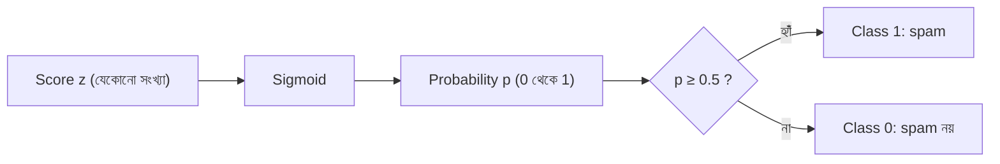

# Lecture 01 — Sigmoid: যেকোনো score-কে 0 থেকে 1-এর probability বানানো

> আগে যা জানা থাকলে ভালো: [Linear Regression-এর prediction, weight ও bias](../module-02-linear-regression/lecture-01-prediction-weight-and-bias.md) — অর্থাৎ `z = w × x + b` কীভাবে বের হয়। এই lecture শেষে পারবে: sigmoid দিয়ে যেকোনো score থেকে probability বের করতে এবং 0.5 সীমা দিয়ে class বলতে। ([Map-এ অবস্থান](../01-learning-map.md): Logistic Regression → output-এর হিসাব)

## সমস্যাটা কী?

ধরো একটা email spam কি না বলতে হবে। Linear Regression-এর মতো `z = w × x + b` হিসাব করলে z যেকোনো সংখ্যা হতে পারে: 3.7, −12, 0.2। কিন্তু আমরা জানতে চাই "spam হওয়ার সম্ভাবনা কত?" আর সম্ভাবনা (**probability**) সবসময় 0 থেকে 1-এর মধ্যে থাকে। "সম্ভাবনা −12" বা "সম্ভাবনা 3.7" বলার কোনো মানে নেই।

তাই এমন একটা উপায় দরকার, যা যেকোনো সংখ্যাকে 0 আর 1-এর মাঝখানে এনে ফেলে। সেই উপায়ের নাম **sigmoid**। Spam filter, ব্যাংকের জালিয়াতি ধরা, রোগের ঝুঁকি অনুমান — যেখানেই উত্তর "হ্যাঁ" অথবা "না", সেখানে এই ধারণা কাজে লাগে।

## ধারণাটা সহজ ভাষায়

**Score (z)** হলো feature আর weight দিয়ে বানানো একটা সংখ্যা। z বড় ধনাত্মক হলে মনে হয় "এটা spam", z বড় ঋণাত্মক হলে মনে হয় "এটা spam নয়", আর z শূন্য মানে model দোটানায়।

**Sigmoid** এই z-কে একটা probability `p`-তে বদলে দেয়। তিনটা কথা মনে রাখলেই যথেষ্ট:

1. z = 0 হলে p = 0.5 (ঠিক আধাআধি)।
2. z যত বড় হয়, p তত 1-এর কাছে যায়; কিন্তু কখনো ঠিক 1 হয় না।
3. z যত ছোট (ঋণাত্মক) হয়, p তত 0-এর কাছে যায়; কিন্তু কখনো ঠিক 0 হয় না।

আরেকটা সুন্দর নিয়ম: z-এর চিহ্ন উল্টালে p আর `1 − p` অদলবদল হয়ে যায়। z = 2 হলে p ≈ 0.881, আর z = −2 হলে p ≈ 0.119; দুটো মিলে 1।

এখানে **class 1** মানে যে ঘটনার probability আমরা মাপছি, যেমন spam = 1, spam নয় = 0। Sigmoid-এর ফলটা class 1-এর probability।

**Threshold** মানে সিদ্ধান্তের সীমা। সীমা 0.5 হলে `p ≥ 0.5` হলে class 1 বলা হয়। Sigmoid-এ z = 0 হলেই p = 0.5, তাই এই সীমায় নিয়মটা দাঁড়ায়: **z ≥ 0 হলে class 1**।

## ছোট একটা উদাহরণ

z = 2 নিয়ে sigmoid হাতে হিসাব করি:

1. `e⁻² ≈ 0.135` (e একটা ধ্রুবক, প্রায় 2.718)
2. `1 + 0.135 = 1.135`
3. `1 / 1.135 ≈ 0.881`

মানে model বলছে, email-টা spam হওয়ার সম্ভাবনা প্রায় 88.1%। সীমা 0.5 হলে সিদ্ধান্ত: spam।

আর z = −2 হলে: `e² ≈ 7.389`, `1 + 7.389 = 8.389`, `1 / 8.389 ≈ 0.119`। সম্ভাবনা মাত্র 11.9%, তাই সিদ্ধান্ত: spam নয়।

## Formula ও কোড

উদাহরণের একই হিসাবের সংক্ষিপ্ত রূপ:

`σ(z) = 1 / (1 + e^(−z))`

এখানে `σ` (সিগমা) হলো sigmoid-এর চিহ্ন, `z` score, আর `e^(−z)` মানে e-কে −z ঘাত দেওয়া।

```python
import math

def sigmoid(z):
    return 1 / (1 + math.exp(-z))

for z in [-4, -2, -1, 0, 1, 2, 4]:
    print(z, round(sigmoid(z), 3))
```

```text
# output:
-4 0.018
-2 0.119
-1 0.269
0 0.5
1 0.731
2 0.881
4 0.982
```

লক্ষ করো, z = 4 হলেও p মাত্র 0.982; z যত বাড়ে p-এর বাড়া তত ধীর হয়। এই curve দেখতে মসৃণ S-এর মতো, তাই নাম sigmoid।

সাবধান: z যদি অনেক বড় ঋণাত্মক হয় (যেমন −1000), এই সরল Python কোডে `math.exp(1000)` ব্যর্থ হয়। ছোট উদাহরণে এটা ঘটে না; বাস্তব library এই কাজ অন্যভাবে সামলায়।

## ছবি



Sigmoid নিজে ডেটা থেকে কিছু শেখে না; এটা একটা স্থির নিয়ম। শেখার জিনিস হলো z বানানোর weight ও bias।

## মনে রাখার সারকথা

- Sigmoid যেকোনো সংখ্যাকে 0 আর 1-এর মাঝে এনে probability বানায়।
- z = 0 হলে p = 0.5; z বড় হলে p → 1, z ছোট হলে p → 0।
- সীমা 0.5 হলে "p ≥ 0.5" আর "z ≥ 0" একই কথা।

## নিজে করো

১. `σ(0)` কত? হিসাব করে দেখাও।

২. z = 1 হলে `σ(1)` বের করো। (সাহায্য: `e⁻¹ ≈ 0.368`)

৩. z = −1 হলে p কত? তারপর দেখাও `σ(−1) + σ(1) = 1`।

৪. একটা email-এর z = 2.5। class কী হবে (সীমা 0.5)? আর z = −3 হলে?

৫. কোনো z-এর জন্য কি `σ(z) = 1` হতে পারে? কেন পারে না?

<details>
<summary>উত্তর</summary>

১. `e⁰ = 1`, তাই `1 / (1 + 1) = 0.5`।

২. `1 + 0.368 = 1.368`, `1 / 1.368 ≈ 0.731`।

৩. `σ(−1) ≈ 0.269`, `σ(1) ≈ 0.731`; যোগফল `0.269 + 0.731 = 1`।

৪. z = 2.5 হলে p ≈ 0.924, যা 0.5-এর বেশি, তাই class 1 (spam)। z = −3 হলে p ≈ 0.047, যা 0.5-এর কম, তাই class 0 (spam নয়)।

৫. না। `e^(−z)` কখনো ঠিক 0 হয় না (সবসময় ধনাত্মক), তাই হরটা সবসময় 1-এর চেয়ে সামান্য বড়, আর ফল 1-এর চেয়ে সামান্য ছোট থাকে। z = 10 হলেও `σ(10) ≈ 0.99995`।

</details>

## পরের পাঠ

Sigmoid শুধু একটা ধাপ। পরের lecture-এ feature থেকে z, z থেকে p, আর p থেকে class — পুরো model একসঙ্গে দেখব, সঙ্গে দেখব কোথায় গিয়ে সিদ্ধান্ত বদলে যায়: [Lecture 02 — Logistic model ও decision boundary](lecture-02-logistic-model-and-decision-boundary.md)।
