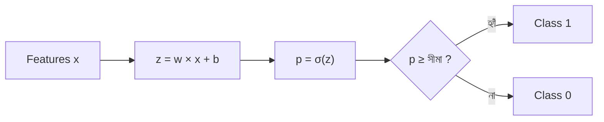

# Lecture 02 — Logistic model ও Decision boundary

> আগে যা জানা থাকলে ভালো: [Sigmoid — score থেকে probability](lecture-01-sigmoid.md)। এই lecture শেষে পারবে: feature থেকে probability ও class বের করতে, আর কোন input-এ সিদ্ধান্ত বদলায় (decision boundary) তা খুঁজে বের করতে। ([Map-এ অবস্থান](../01-learning-map.md): Logistic Regression → output-এর হিসাব; training নয়)

## সমস্যাটা কী?

Sigmoid একা কিছু করে না; তাকে একটা score দিতে হয়। আবার শুধু probability জানলে চলে না, আমাদের সিদ্ধান্ত লাগে: পাস না ফেল, spam না spam নয়। একটা ছাত্র কত ঘণ্টা পড়লে model-এর সিদ্ধান্ত "ফেল" থেকে "পাস"-এ বদলায়? সেই সীমারেখা জানা না থাকলে model-এর আচরণ বোঝা যায় না।

## ধারণাটা সহজ ভাষায়

**Logistic Regression model** হলো দুই ধাপের হিসাব:

1. Linear Regression-এর মতোই score বানাও: `z = w × x + b`
2. Sigmoid দিয়ে probability বানাও: `p = σ(z)`

তারপর সীমা (threshold) দিয়ে class বলো। এই পুরো পথটা শুধু **output বের করার পথ**: weight আর bias আগে থেকে দেওয়া আছে ধরে নিচ্ছি। সেগুলো ডেটা থেকে কীভাবে শেখা হয়, সেটা পরের lecture-গুলোর কাজ।

**Decision boundary** হলো সেই জায়গা, যেখানে model-এর সিদ্ধান্ত এক class থেকে অন্য class-এ বদলায়। সীমা 0.5 হলে সেটা সেখানেই, যেখানে `p = 0.5`, অর্থাৎ `z = 0`। তাই boundary খুঁজতে হলে সমীকরণ `w × x + b = 0` সমাধান করতে হয়।

## ছোট একটা উদাহরণ: পড়ার ঘণ্টা থেকে পাস

x = পড়ার ঘণ্টা। ধরো `w = 1.5` আর `b = −6`। তাহলে `z = 1.5 × x − 6`।

| x (ঘণ্টা) | z | p = σ(z) | সিদ্ধান্ত (সীমা 0.5) |
|---|---|---|---|
| 1 | −4.5 | 0.011 | ফেল |
| 2 | −3.0 | 0.047 | ফেল |
| 3 | −1.5 | 0.182 | ফেল |
| 4 | 0.0 | 0.500 | সীমায় (p ≥ 0.5, তাই পাস) |
| 5 | 1.5 | 0.818 | পাস |
| 6 | 3.0 | 0.953 | পাস |

Boundary: `1.5 × x − 6 = 0`, তাই `x = 6 / 1.5 = 4` ঘণ্টা। 4 ঘণ্টার কম পড়লে model "ফেল" বলে, বেশি পড়লে "পাস"। সাধারণ সূত্র: `x = −b / w`।

**w আর b-এর কাজ আলাদা।** b বদলালে boundary সরে যায়। w-এর মান বড় হলে boundary-র দুই পাশে probability আরও তাড়াতাড়ি বদলায়। যেমন `w = 3, b = −12` নিলে boundary একই থাকে (x = 4), কিন্তু x = 3 হলে p হয় 0.047 (আগে ছিল 0.182)। w ঋণাত্মক হলে x বাড়লে p কমে।

## একাধিক feature হলে

দুটো feature: `x₁` = পড়ার ঘণ্টা, `x₂` = আগের পরীক্ষার নম্বর (10 এর মধ্যে)। ধরো `w₁ = 1`, `w₂ = 1`, `b = −5`। তাহলে `z = x₁ + x₂ − 5`।

| (x₁, x₂) | z | p | সিদ্ধান্ত |
|---|---|---|---|
| (1, 1) | −3 | 0.047 | ফেল |
| (2, 3) | 0 | 0.500 | সীমায় |
| (4, 3) | 2 | 0.881 | পাস |
| (1, 5) | 1 | 0.731 | পাস |

Boundary হলো `x₁ + x₂ = 5`। এটা একটা **সরলরেখা**; দুই feature-এর মানচিত্রে রেখার একপাশে "পাস", অন্যপাশে "ফেল"। Feature তিনটা হলে রেখা না হয়ে সমতল হয়। একটা সীমাবদ্ধতা: Logistic Regression-এর boundary সবসময় এই ধরনের সোজা, বাঁকা নয়।

## সীমা (threshold) বদলালে কী হয়?

সীমা বদলালে p বদলায় না, শুধু সিদ্ধান্তের নিয়ম বদলায়। সীমা 0.8 করলে p ≥ 0.8 লাগবে, আর sigmoid-এ `σ(1.386) = 0.8`। তাই z ≥ 1.386 লাগবে:

| সীমা | z অন্তত কত লাগে | boundary x (z = 1.5x − 6 হলে) |
|---|---|---|
| 0.2 | −1.386 | 3.08 |
| 0.5 | 0 | 4.00 |
| 0.8 | 1.386 | 4.92 |

কে সীমা ঠিক করে? যে model ব্যবহার করছে। ভালো email ভুল করে spam হয়ে গেলে ক্ষতি বেশি হলে সীমা বাড়ানো হয় (spam বলতে বেশি নিশ্চিত হতে হবে)। এটা পরে Module 06-এ আরও বিস্তারিতভাবে আসবে।

## Formula ও কোড

```text
z = w₁x₁ + w₂x₂ + … + b      (output-এর প্রথম ধাপ)
p = σ(z)                      (probability)
class = 1 যদি p ≥ সীমা, না হলে 0
boundary (সীমা 0.5): z = 0
```

```python
import math

def sigmoid(z):
    return 1 / (1 + math.exp(-z))

w, b = 1.5, -6
for x in [3, 4, 5]:
    z = w * x + b
    p = sigmoid(z)
    print(x, z, round(p, 3), "পাস" if p >= 0.5 else "ফেল")
```

```text
# output:
3 -1.5 0.182 ফেল
4 0.0 0.5 পাস
5 1.5 0.818 পাস
```

## ছবি



## মনে রাখার সারকথা

- Logistic model = linear score `z`, তারপর sigmoid দিয়ে `p`, তারপর সীমা দিয়ে class।
- Decision boundary হলো যেখানে `z = 0` (সীমা 0.5 হলে); এক feature হলে `x = −b / w`।
- সীমা বদলালে p একই থাকে, শুধু সিদ্ধান্ত বদলায়।

## নিজে করো

১. `w = 2`, `b = −6` হলে boundary কোথায়? x = 4 হলে p ও class কী?

২. `w = −1`, `b = 5`। boundary কোথায়? x = 7 হলে p কত? x বাড়লে p বাড়ে না কমে?

৩. `z = 2x₁ + x₂ − 7`। বিন্দু (2, 3), (3, 2), (1, 2)-এর জন্য z, p ও class বের করো। Boundary-র সমীকরণ কী?

৪. `z = 1.5x − 6` model-এ সীমা 0.9 করলে z অন্তত 2.197 লাগে। তাহলে x অন্তত কত হতে হবে?

৫. কোনো model p = 0.3 বলেছে। সীমা 0.5 হলে class কী? সীমা 0.25 হলে?

<details>
<summary>উত্তর</summary>

১. `2x − 6 = 0` থেকে x = 3। x = 4 হলে z = 2, p = σ(2) ≈ 0.881, class 1।

২. `−x + 5 = 0` থেকে x = 5। x = 7 হলে z = −2, p ≈ 0.119। w ঋণাত্মক, তাই x বাড়লে p কমে।

৩. (2, 3): z = 0, p = 0.5, সীমায় (class 1)। (3, 2): z = 1, p ≈ 0.731, class 1। (1, 2): z = −3, p ≈ 0.047, class 0। Boundary: `2x₁ + x₂ = 7`।

৪. `1.5x − 6 ≥ 2.197` থেকে `1.5x ≥ 8.197`, তাই x ≥ 5.465 (প্রায়)।

৫. সীমা 0.5 হলে 0.3 < 0.5, তাই class 0। সীমা 0.25 হলে 0.3 ≥ 0.25, তাই class 1।

</details>

## পরের পাঠ

এখানে w আর b হাতে দেওয়া ছিল। ডেটা থেকে ভালো w, b বাছতে হলে আগে "কোনটা বেশি ভুল" মাপার একটা নিয়ম দরকার: [Lecture 03 — Log loss](lecture-03-log-loss.md)।
