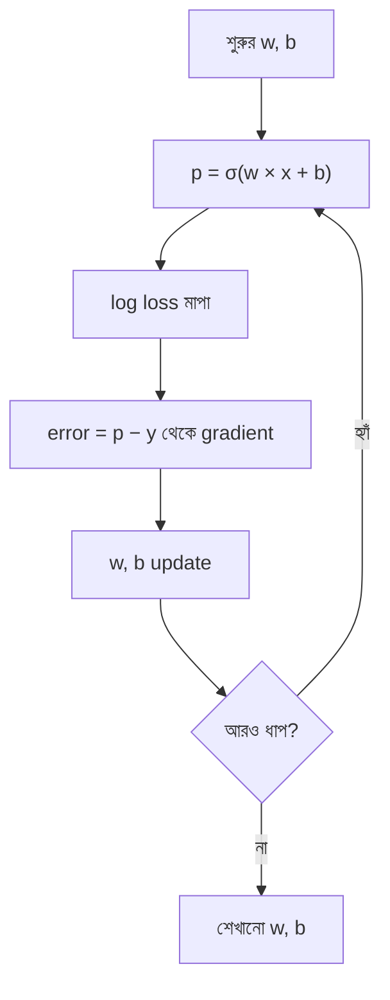

# Lecture 04 — Gradient descent দিয়ে Logistic Regression শেখানো

> আগে যা জানা থাকলে ভালো: [Log loss](lecture-03-log-loss.md) এবং [Linear Regression-এর gradient descent](../module-02-linear-regression/lecture-03-gradient-descent-training.md)। এই lecture শেষে পারবে: Logistic Regression-এর এক ধাপ update হাতে করতে, আর বলতে পারবে Linear Regression-এর সঙ্গে কোথায় মিল, কোথায় অমিল। ([Map-এ অবস্থান](../01-learning-map.md): Logistic Regression → training/update)

## সমস্যাটা কী?

Log loss দিয়ে আমরা বলতে পারি কোন `w, b` ভালো। কিন্তু সব সম্ভাব্য `w, b` একটা একটা করে চেষ্টা করা যায় না। দরকার এমন একটা নিয়ম, যা বর্তমান `w, b` থেকে বলে দেয়: "w একটু বাড়াও, b একটু কমাও, তাহলে loss কমবে।" Linear Regression-এ এই কাজ করেছে gradient descent। সুখবর হলো, এখানেও একই পদ্ধতি চলে।

## ধারণাটা সহজ ভাষায়

Training-এর তিনটা ধাপ আলাদা রাখো:

1. **Output:** বর্তমান `w, b` দিয়ে `p = σ(w × x + b)` বের করা।
2. **ভুল মাপা:** `p` ও সত্যি `y` থেকে log loss।
3. **Update:** gradient দিয়ে `w, b` বদলানো।

Log loss-এর gradient লিখলে একটা চমৎকার সরল রূপ আসে। প্রথমে `error = p − y` ধরো। তাহলে:

```text
g_w = গড় (error × x)
g_b = গড় (error)
```

অর্থাৎ প্রতিটা উদাহরণের `error × x` যোগ করে উদাহরণের সংখ্যা দিয়ে ভাগ। (এটা sigmoid-এর ঢাল আর log-এর ঢাল কাটাকাটি হয়ে পাওয়া যায়। হিসাব ঠিক আছে কি না নিচে সংখ্যা দিয়ে মিলিয়ে দেখব।)

error-এর চিহ্ন থেকেই বোঝা যায় কী ঘটবে। `y = 1` কিন্তু `p = 0.2` হলে `error = −0.8`, ঋণাত্মক। তাহলে `x > 0` হলে gradient ঋণাত্মক, আর `w − α × gradient` নিয়মে w বাড়ে, ফলে p বাড়ে, যা ঠিক যা দরকার ছিল।

## Linear Regression-এর সঙ্গে তুলনা

| | Linear Regression | Logistic Regression |
|---|---|---|
| Output | `ŷ = w × x + b` | `p = σ(w × x + b)` |
| ভুল মাপা | MSE | log loss |
| error | `ŷ − y` | `p − y` |
| `g_w` | `(2/n) × Σ(error × x)` | `(1/n) × Σ(error × x)` |
| `g_b` | `(2/n) × Σ(error)` | `(1/n) × Σ(error)` |
| Update | `w − α × g_w`, `b − α × g_b` | একই |

তিনটা জিনিস বদলেছে: output-এ sigmoid এসেছে, loss বদলেছে, আর error এখন `p − y`। Gradient-এর কাঠামো আর update-এর নিয়ম একই। Linear-এ `2` আছে, কারণ square-এর derivative থেকে `2` আসে; log loss-এর gradient-এ সেটা আসে না।

## ছোট একটা উদাহরণ: এক ধাপ

Dataset: x = [1, 2, 3, 4], y = [0, 0, 1, 1]। শুরুতে `w = 0`, `b = 0`, learning rate `α = 0.5`।

**ধাপ ১: output।** `z = 0` সবার জন্য, তাই `p = 0.5` সবার।

**ধাপ ২: error আর gradient।**

| x | y | p | error = p − y | error × x |
|---|---|---|---|---|
| 1 | 0 | 0.5 | 0.5 | 0.5 |
| 2 | 0 | 0.5 | 0.5 | 1.0 |
| 3 | 1 | 0.5 | −0.5 | −1.5 |
| 4 | 1 | 0.5 | −0.5 | −2.0 |

`g_w = (0.5 + 1.0 − 1.5 − 2.0) / 4 = −0.5`
`g_b = (0.5 + 0.5 − 0.5 − 0.5) / 4 = 0`

**ধাপ ৩: update।**

`নতুন w = 0 − 0.5 × (−0.5) = 0.25`
`নতুন b = 0 − 0.5 × 0 = 0`

**যাচাই:** গড় log loss `0.6931` থেকে `0.625` হলো। কমেছে।

**Gradient ঠিক আছে কি না একটা পরীক্ষা:** `w`-কে ঠিক `0.001` বাড়িয়ে loss মাপলে loss প্রায় `0.0005` কমে, অর্থাৎ ঢাল ≈ `−0.5`। এটাই `g_w`। হিসাবের সূত্র ঠিক।

**দ্বিতীয় ধাপ** (w = 0.25, b = 0 থেকে):

| x | y | p | error | error × x |
|---|---|---|---|---|
| 1 | 0 | 0.562 | 0.562 | 0.562 |
| 2 | 0 | 0.622 | 0.622 | 1.244 |
| 3 | 1 | 0.679 | −0.321 | −0.963 |
| 4 | 1 | 0.731 | −0.269 | −1.076 |

`g_w ≈ −0.058`, `g_b ≈ 0.149`। Update: `w = 0.25 − 0.5 × (−0.058) ≈ 0.279`, `b = 0 − 0.5 × 0.149 ≈ −0.074`। Loss নামল `0.612`-এ। এবার b-ও বদলাল।

সাবধান: এখানে সংখ্যাগুলো Python-এর পূর্ণ মান থেকে 3 দশমিকে ছাঁটা। হাতে ছাঁটা মান নিয়ে হিসাব করলে শেষ অঙ্কে সামান্য ফারাক হতে পারে।

বারবার এই ধাপ করলে (এই হিসাবে) loss `0.693 → 0.625 → 0.612 → 0.600 …` নামতে থাকে। এটাই training।

## ছবি



## মনে রাখার সারকথা

- Logistic Regression-এর gradient সরল: `g_w = গড়(error × x)`, `g_b = গড়(error)`, যেখানে `error = p − y`।
- Linear Regression থেকে বদলেছে output (sigmoid), loss (log loss) আর error-এর সংজ্ঞা; update-এর নিয়ম একই।
- Update শুধু `w, b` বদলায়; data (`x, y`) বদলায় না।

## নিজে করো

১. দুটো উদাহরণ: `x = [1, 2]`, `y = [1, 0]`, model বলেছে `p = [0.8, 0.3]`। `g_w` আর `g_b` বের করো।

২. প্রশ্ন ১-এর gradient নিয়ে `w = 1`, `b = 0`, `α = 0.1` হলে নতুন `w, b` কত?

৩. একটা উদাহরণ: `x = 2`, `y = 1`। শুরুতে `w = 0, b = 0`, `α = 1`। এক ধাপ update করো। নতুন `p` কত? loss আগে-পরে কত?

৪. `y = 1`, `p = 0.2`, `x = 3`। error কী? এই উদাহরণের জন্য w বাড়বে না কমবে?

৫. `x = [1, 2, 3, 4]`, `y = [1, 0, 0, 1]`, শুরুতে `w = 0, b = 0`। `g_w` ও `g_b` বের করো। এটা থেকে কী বোঝা যায়?

<details>
<summary>উত্তর</summary>

১. error = `[0.8 − 1, 0.3 − 0] = [−0.2, 0.3]`। `g_w = (−0.2 × 1 + 0.3 × 2) / 2 = 0.4 / 2 = 0.2`। `g_b = (−0.2 + 0.3) / 2 = 0.05`।

২. `w = 1 − 0.1 × 0.2 = 0.98`, `b = 0 − 0.1 × 0.05 = −0.005`।

৩. `p = 0.5`, `error = −0.5`। `g_w = −0.5 × 2 = −1`, `g_b = −0.5`। নতুন `w = 0 − 1 × (−1) = 1`, `b = 0 − 1 × (−0.5) = 0.5`। নতুন `z = 1 × 2 + 0.5 = 2.5`, `p ≈ 0.924`। Loss `−ln(0.5) = 0.693` থেকে `−ln(0.924) ≈ 0.079`।

৪. `error = 0.2 − 1 = −0.8`। `g = −0.8 × 3 = −2.4`, ঋণাত্মক। `w − α × (ঋণাত্মক)` মানে w বাড়বে, এতে p বাড়বে, যা `y = 1`-এর জন্য ঠিক।

৫. `p = 0.5` সবার জন্য, error = `[−0.5, 0.5, 0.5, −0.5]`। `error × x = [−0.5, 1, 1.5, −2]`, যোগফল 0, তাই `g_w = 0`। `g_b = 0`ও। Gradient শূন্য মানে এই অবস্থা থেকে gradient descent আর নড়ে না। এই ডেটায় x আর y-এর সোজা কোনো সম্পর্ক নেই (মাঝের দুটো 0, দুই প্রান্ত 1), তাই `w = 0, b = 0` সত্যিই সবচেয়ে ভালো সরল model।

</details>

## পরের পাঠ

হাতে এক-দুই ধাপ হলো। এবার এই পুরো পথ (output, loss, gradient, update) Python-এ বসিয়ে হাজার ধাপ চালাব: [Lecture 05 — Python-এ Logistic Regression](lecture-05-logistic-regression-in-python.md)।
