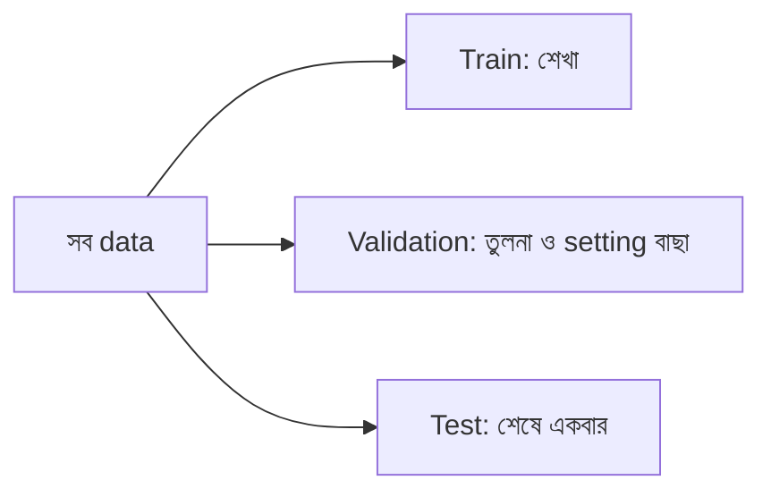

# Lecture 03 — Train, Validation ও Test: data তিন ভাগ করা

> আগে যা জানা থাকলে ভালো: [Encoding ও Scaling](lecture-02-encoding-and-scaling.md) (data এখন সংখ্যায়), আর Module 02-এর [error ও MSE](../module-02-linear-regression/lecture-02-error-and-mean-squared-error.md)। এই lecture শেষে পারবে: একটা dataset-কে train, validation ও test-এ ভাগ করতে, আর প্রতিটা অংশ কেন আলাদা তা বলতে।

## সমস্যাটা কী?

Model কেমন হলো দেখার সবচেয়ে সহজ উপায়: যে data দিয়ে শিখিয়েছি, তার উপরেই ভুল মাপা। কিন্তু এতে একটা বড় ফাঁদ আছে। এমন একটা model ভাবো যে শুধু উত্তর **মুখস্থ** করে। Training data-তে তার ভুল শূন্য, অথচ নতুন কোনো বাড়ি দেখালে সে কিছুই পারে না। আমরা model বানাই নতুন, না-দেখা data-র জন্য। তাই মাপতে হবে এমন data দিয়ে, যা model শেখার সময় দেখেনি।

## ধারণাটা সহজ ভাষায়

পরীক্ষার প্রস্তুতির কথা ভাবো। এখানে উপমাটা কাজে লাগে, কারণ তিনটা আলাদা ভূমিকা মনে রাখা কঠিন:

- **Practice প্রশ্ন** দিয়ে তুমি পড়ো ও শেখো।
- **Mock test** দিয়ে দেখো কোন পদ্ধতিতে পড়লে ভালো হয়, আর সেই অনুযায়ী পদ্ধতি বদলাও।
- **আসল পরীক্ষা** একবারই দাও, আর তার নম্বরই তোমার আসল মান।

Data-ও তিন ভাগে ভাগ হয়:

| ভাগ | কাজ | কখন ব্যবহার |
|---|---|---|
| **Train set** | model-এর weight/bias শেখা | training-এর সময়, বারবার |
| **Validation set** | model তুলনা করা, setting বাছা (যেমন learning rate) | training-এর পর, প্রয়োজনমতো বারবার |
| **Test set** | সবশেষে model-এর আসল মান জানা | একবারই, সব সিদ্ধান্ত শেষ হলে |

Test set কেন শুধু শেষে? Validation দেখে দেখে আমরা model বদলাই। তাই কিছুটা হলেও model validation-এর সঙ্গে খাপ খেয়ে যায়। Test-ও যদি বারবার দেখে সিদ্ধান্ত নিই, তাহলে সেটাও আসলে validation হয়ে যায়, আর আমাদের হাতে আর কোনো নিরপেক্ষ মাপ থাকে না।

প্রচলিত অনুপাত 60/20/20 বা 70/15/15। Data কম হলে validation-এর জন্য [cross-validation](../module-06-model-evaluation-and-baselines/lecture-05-cross-validation-and-final-test.md) নামের পদ্ধতিও আছে (Module 06)।

## ছোট একটা উদাহরণ

১০টা বাড়ির `(আয়তন, দাম)`:

`(800, 40), (900, 52), (1000, 50), (1100, 66), (1200, 58), (1300, 75), (1400, 70), (1500, 88), (1600, 80), (1700, 96)`

**ধাপ ১: আগে এলোমেলো করি (shuffle)।** Data যদি আয়তনের ক্রমে সাজানো থাকে, প্রথম ৬টা নিলে শুধু ছোট বাড়ি train-এ যাবে। তাই shuffle করে তারপর ভাগ করি। Shuffle-এ একটা **seed** (নির্দিষ্ট সংখ্যা) দিলে প্রতিবার একই ক্রম আসে, ফল পুনরায় মেলানো যায়।

**ধাপ ২: ভাগ করি।** ১০টা row-তে 6 / 2 / 2:

- **train:** `(900,52), (1300,75), (1400,70), (800,40), (1700,96), (1200,58)`
- **validation:** `(1500,88), (1000,50)`
- **test:** `(1600,80), (1100,66)` — এখন এগুলো ছুঁব না।

**ধাপ ৩: মুখস্থ-model দিয়ে দেখি ফাঁদটা।** এই model নতুন বাড়ির জন্য train data-র সবচেয়ে কাছের আয়তনের বাড়ির দাম বলে দেয়।

- Train-এর বাড়ি `(900, 52)`: সবচেয়ে কাছের ওই বাড়িটাই, উত্তর 52, ভুল 0। সব train row-তেই ভুল **0**।
- Validation `(1500, 88)`: train-এ কাছের আয়তন 1400 (দূরত্ব 100), যার দাম 70। ভুল |70 − 88| = **18**।
- Validation `(1000, 50)`: কাছের আয়তন 900 (দূরত্ব 100), দাম 52। ভুল |52 − 50| = **2**।
- Validation-এ গড় ভুল = (18 + 2) / 2 = **10**।

Train-এ ভুল 0, অথচ নতুন data-য় 10। শুধু train দেখলে আমরা ভাবতাম model নিখুঁত।

## Formula / কোড

```python
import random

# (area, price) for 10 houses
data = [(800, 40), (900, 52), (1000, 50), (1100, 66), (1200, 58),
        (1300, 75), (1400, 70), (1500, 88), (1600, 80), (1700, 96)]

random.Random(3).shuffle(data)          # fixed seed -> same split every run
train, val, test = data[:6], data[6:8], data[8:]
print("train:", train)
print("val  :", val)
print("test :", test)

# a "memorizer": answers with the price of the closest house it has seen
def memorizer(area, seen):
    return min(seen, key=lambda h: abs(h[0] - area))[1]

def avg_error(rows, seen):
    errs = [abs(memorizer(a, seen) - p) for a, p in rows]
    return sum(errs) / len(errs)

print("error on train:", avg_error(train, train))
print("error on val  :", avg_error(val, train))
```

```text
# output:
# train: [(900, 52), (1300, 75), (1400, 70), (800, 40), (1700, 96), (1200, 58)]
# val  : [(1500, 88), (1000, 50)]
# test : [(1600, 80), (1100, 66)]
# error on train: 0.0
# error on val  : 10.0
```

এখানে test set-এ কোনো হিসাবই চালাইনি।

সাবধান: এই shuffle-এর ক্রম (seed 3) Python-এর `random` module-এর। অন্য seed দিলে ভাগ অন্যরকম হবে।

## ছবি



## মনে রাখার সারকথা

- যে data দিয়ে শিখেছ, তা দিয়ে মাপলে ফল বাড়িয়ে দেখায় (মুখস্থ model-এর train ভুল 0, validation ভুল 10)।
- Train শেখার জন্য, validation বাছাইয়ের জন্য, test শুধু শেষে একবার আসল মান জানার জন্য।
- Split-এর আগে shuffle করো আর seed ঠিক রাখো, নইলে ফল পুনরায় মেলানো যায় না। (ব্যতিক্রম: সময়ের ক্রম থাকলে, [Lecture 05](lecture-05-time-and-group-splits.md))

## নিজে করো

১. ১০০টা row-কে 70/15/15 ভাগ করলে প্রতিটা ভাগে কয়টা row?

২. কেউ validation দেখে model-এর setting বদলাতে বদলাতে test-এর ফলও বারবার দেখছে। এতে কী সমস্যা?

৩. উপরের train-এর বাড়িগুলো দিয়ে মুখস্থ-model-কে একটা নতুন কাল্পনিক বাড়ির আয়তন 1150 জিজ্ঞেস করলে সে কত দাম বলবে?

<details><summary>উত্তর</summary>

১. **70, 15, 15**।

২. Test set-ও validation-এর মতো ব্যবহৃত হয়ে যায়। তখন model test-এর সঙ্গে খাপ খেয়ে যায়, আর test-এর ফল আর নতুন data-য় আসল মান দেখায় না। নিরপেক্ষ মাপ হারিয়ে যায়।

৩. Train-এর আয়তনগুলো: 800, 900, 1200, 1300, 1400, 1700। 1150-এর সবচেয়ে কাছে 1200 (দূরত্ব 50)। তার দাম **58**।

</details>

## পরের পাঠ

ভাগ করার পরও একটা ভুল সহজে হয়ে যায়: ভাগ করার আগেই অন্য data-র তথ্য training-এ ঢুকে পড়া। এটাই [পরের lecture — Data Leakage](lecture-04-data-leakage.md)।
