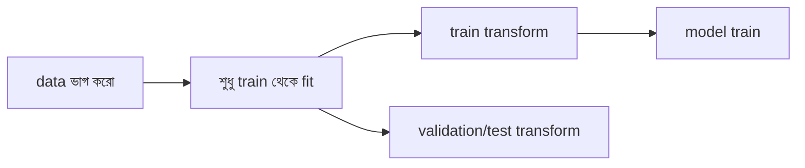

# Lecture 04 — Data Leakage: যে তথ্য আসল সময়ে থাকবে না, তা training-এ ঢুকে পড়া

> আগে যা জানা থাকলে ভালো: [Train, Validation ও Test](lecture-03-train-validation-test-split.md) আর [Scaling](lecture-02-encoding-and-scaling.md)। এই lecture শেষে পারবে: দুই ধরনের leakage চিনতে, আর preprocessing-এর সঠিক ক্রম মনে রাখতে।

## সমস্যাটা কী?

ধরো একটা ব্যাংক ঋণ খেলাপি হবে কি না predict করার model বানাল। Validation-এ model প্রায় নিখুঁত ফল দিল। সবাই খুশি। কিন্তু বাস্তবে চালু করার পর model-টা প্রায় কোনো কাজেই এল না। কারণ model এমন একটা তথ্য দেখে শিখেছিল, যা ঋণ দেওয়ার সময় আসলে কারো হাতে থাকে না। একে বলে **data leakage**: training বা মূল্যায়নের সময় এমন তথ্য ঢুকে পড়া, যা আসল পরিস্থিতিতে আগে থেকে জানা যেত না। ফল দেখে মনে হয় model দারুণ, অথচ সেই ফল মিথ্যা।

## ধারণাটা সহজ ভাষায়

Leakage প্রধানত দুইভাবে হয়।

**১. Target leakage।** কোনো feature-এর মধ্যেই উত্তর লুকিয়ে আছে, কারণ feature-টা তৈরি হয় উত্তর জানার **পরে**। ঋণের উদাহরণে `recovery_calls` (আদায়ের জন্য কতবার ফোন করা হয়েছে) এমন feature। খেলাপি হওয়ার পরেই এই ফোন শুরু হয়।

**২. Preprocessing leakage।** Data ভাগ করার **আগে** scaling বা median-এর মতো হিসাব সব data মিলিয়ে করা। তখন validation বা test-এর তথ্য (যেমন তাদের max মান) training-এর হিসাবে ঢুকে যায়।

নিয়ম একটাই: **model আসল পরিস্থিতিতে যা জানতে পারবে না, training-এর সময়ও তা জানতে দিয়ো না।** এজন্য preprocessing-এর ক্রম হবে:

1. আগে data ভাগ করো (train / validation / test)।
2. Scaling, median, one-hot-এর category তালিকা **শুধু train থেকে** শেখো (এই ধাপকে **fit** বলে)।
3. সেই একই মান দিয়ে validation ও test রূপান্তর করো (এই ধাপকে **transform** বলে)। Validation ও test থেকে নতুন করে কিছু শিখো না।

আরেক ধরনের leakage হলো একই row (বা প্রায় একই row) train ও test দুটোতেই থাকা। এটা [পরের lecture](lecture-05-time-and-group-splits.md)-এ আসবে।

## ছোট একটা উদাহরণ

### ভুল করলে কী হয়: ঋণের উদাহরণ

আটটা ঋণ। `income` হাজার টাকায়, `defaulted = 1` মানে খেলাপি হয়েছে।

| income | recovery_calls | defaulted |
|---|---|---|
| 30 | 0 | 0 |
| 20 | 5 | 1 |
| 50 | 0 | 0 |
| 25 | 4 | 1 |
| 40 | 0 | 0 |
| 22 | 6 | 1 |
| 35 | 0 | 0 |
| 24 | 0 | 0 |

দুটো সহজ নিয়ম:

- **Leaky নিয়ম:** `recovery_calls ≥ 1` হলে খেলাপি বলো।
- **Honest নিয়ম:** `income < 30` হলে খেলাপি বলো।

সংগ্রহ করা data-য় মেলালে:

- Leaky: ৮টার ৮টাই ঠিক, accuracy **1.0**।
- Honest: শুধু id 8 (income 24, কিন্তু খেলাপি হয়নি) ভুল, ৭টা ঠিক, accuracy **0.875**।

Leaky নিয়মকে দারুণ মনে হচ্ছে। কিন্তু ব্যাংক যখন ঋণ **দিচ্ছে**, তখন কোনো আদায়ের ফোন হয়নি, সবার `recovery_calls = 0`। সেই অবস্থায়:

- Leaky নিয়ম সবাইকে "খেলাপি হবে না" বলে। ঠিক হয় শুধু যারা আসলে খেলাপি হয়নি: ৮টার ৫টা, accuracy **0.625**। আর তিনজন সত্যিকারের খেলাপির একজনকেও ধরে না।
- Honest নিয়ম আগের মতোই কাজ করে, accuracy **0.875**।

যে নিয়ম সংগ্রহ করা data-য় সেরা ছিল, আসল কাজে সেটাই খারাপ।

### Preprocessing leakage: scaling

Train-এর আয়তন `[800, 1000, 1200]`, test-এর একটা বাড়ি `1600`।

- **ভুল:** train আর test মিলিয়ে min = 800, max = 1600। Train-এর `1000` হয় (1000 − 800) / 800 = 0.25, আর test-এর `1600` হয় **1.0**। মনে হয় test-এর বাড়ি train-এর সীমার ভেতরেই, অথচ model শেখার সময় এই max জানার কথা নয়।
- **ঠিক:** শুধু train থেকে min = 800, max = 1200। Train-এর `1000` হয় **0.5**, আর test-এর `1600` হয় (1600 − 800) / 400 = **2.0**। এটাই সত্যি ছবি: model এমন একটা বাড়ি পেয়েছে যা train-এর পরিসরের বাইরে।

## Formula / কোড

```python
# (income in thousand Tk, recovery_calls, defaulted?)  defaulted: 1 = yes
loans = [(30, 0, 0), (20, 5, 1), (50, 0, 0), (25, 4, 1),
         (40, 0, 0), (22, 6, 1), (35, 0, 0), (24, 0, 0)]

def accuracy(rule, rows):
    ok = sum(rule(inc, calls) == d for inc, calls, d in rows)
    return ok / len(rows)

leaky  = lambda inc, calls: 1 if calls >= 1 else 0   # uses recovery_calls
honest = lambda inc, calls: 1 if inc < 30 else 0     # uses income only

print("leaky  on collected data:", accuracy(leaky, loans))
print("honest on collected data:", accuracy(honest, loans))

# real life: when the bank decides, no recovery call exists yet -> calls = 0
real = [(inc, 0, d) for inc, calls, d in loans]
print("leaky  in real use     :", accuracy(leaky, real))
print("honest in real use     :", accuracy(honest, real))
```

```text
# output:
# leaky  on collected data: 1.0
# honest on collected data: 0.875
# leaky  in real use     : 0.625
# honest in real use     : 0.875
```

Scaling-এর সঠিক রূপ:

```python
train_area = [800, 1000, 1200]
test_area = 1600

lo, hi = min(train_area), max(train_area)      # learn from train only
scale = lambda x: round((x - lo) / (hi - lo), 3)
print([scale(a) for a in train_area], scale(test_area))
```

```text
# output:
# [0.0, 0.5, 1.0] 2.0
```

## ছবি



## মনে রাখার সারকথা

- Leakage মানে আসল সময়ে অজানা তথ্য training/মূল্যায়নে ঢুকে পড়া; ফল অবাস্তব রকম ভালো দেখায়।
- অতিরিক্ত ভালো ফল পেলে আগে সন্দেহ করো: কোনো feature কি উত্তর জানার পরে তৈরি?
- আগে split, তারপর শুধু train থেকে fit, তারপর validation/test-কে transform।

## নিজে করো

১. ছাত্র পাস করবে কি না predict করছ। Feature: `attendance %`, `hours_studied`, `final_grade_letter`। কোনটা leakage?

২. Train `[10, 20, 30]`, test মান `50`। শুধু train-এর min/max দিয়ে min-max করলে `50`-এর নতুন মান কত? ভুলভাবে সব data (train + test) মিলিয়ে করলে কত হতো?

৩. Train-এর age `[5, 7, 9]`, test-এর age `[20, ফাঁকা]`। ফাঁকা ঘর ভরার median কোথা থেকে নেবে, আর মান কত?

<details><summary>উত্তর</summary>

১. **`final_grade_letter`**। পাস-ফেল জানার পরেই এটা পাওয়া যায়, ফলে এতে উত্তর লুকানো।

২. ঠিক: (50 − 10) / (30 − 10) = 40 / 20 = **2.0**। ভুল: min 10, max 50, তাই (50 − 10) / 40 = **1.0**।

৩. শুধু train থেকে: `5, 7, 9`-এর median **7**। Test-এর `20` বা অন্য কোনো test মান মিশিয়ে নিলে (যেমন `5, 7, 9, 20`-এর median 8) সেটা leakage।

</details>

## পরের পাঠ

আপাতত data এলোমেলো করে ভাগ করেছি। কিন্তু data-র মধ্যে সময়ের ক্রম বা একই ব্যক্তির একাধিক row থাকলে এলোমেলো ভাগও leakage ঘটায়। [পরের lecture](lecture-05-time-and-group-splits.md)-এ তার সমাধান।
