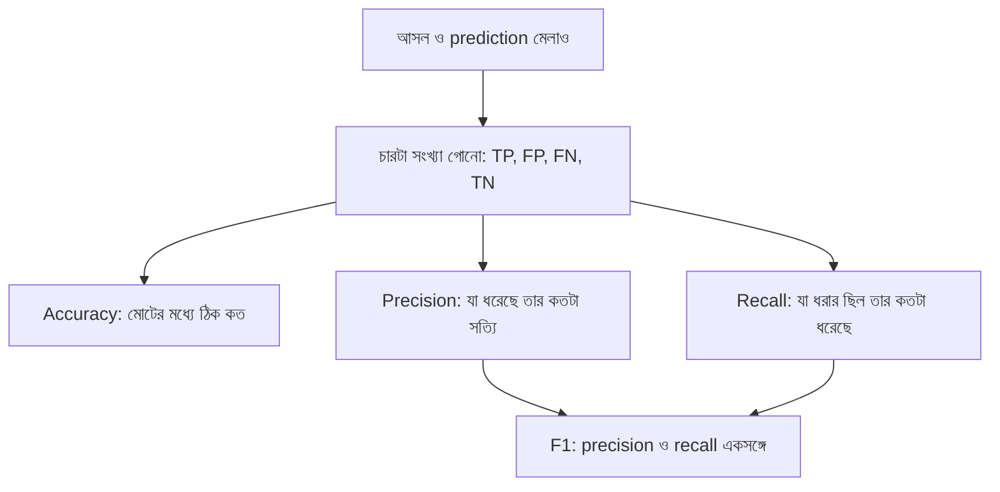

# Lecture 03 — Classification Metrics: Confusion Matrix, Precision, Recall ও F1

> আগে যা জানা থাকলে ভালো: [Baseline](lecture-01-baselines.md) (majority baseline ও accuracy) আর Module 01-এর [classification-এর পরিচয়](../module-01-ml-fundamentals-and-math-basics/lecture-02-types-and-terminology.md)। এই lecture শেষে পারবে: ১০টা prediction থেকে confusion matrix বানিয়ে accuracy, precision, recall ও F1 বের করতে।

## সমস্যাটা কী?

Spam filter ১০টা ইমেইলের ৭টা ঠিক বলেছে। "৭০% ঠিক" শুনে মনে হয় মোটামুটি। কিন্তু ৩টা ভুল সব এক ধরনের নয়। একটা সাধারণ ইমেইলকে spam বলা (জরুরি চিঠি হারিয়ে যেতে পারে) আর একটা spam-কে ঢুকতে দেওয়া (বিরক্তিকর, কিন্তু ক্ষতি কম) আলাদা সমস্যা। শুধু "কয়টা ঠিক" দিয়ে এই পার্থক্য ধরা যায় না। ভুলগুলো ধরন অনুযায়ী ভাগ করে দেখতে হয়।

## ধারণাটা সহজ ভাষায়

যে class-টা আমরা খুঁজছি, সেটাকে বলা হয় **positive** (এখানে spam)। অন্যটা **negative**। প্রতিটা ইমেইলের জন্য দুটো জিনিস আছে: আসলে কী, আর model কী বলল। এতে চার রকম ফল হয়:

| | Model বলল spam | Model বলল spam নয় |
|---|---|---|
| **আসলে spam** | **TP** (True Positive): ঠিক ধরেছে | **FN** (False Negative): spam ছেড়ে দিয়েছে |
| **আসলে spam নয়** | **FP** (False Positive): ভুল করে spam বলেছে | **TN** (True Negative): ঠিক ছেড়েছে |

এই ২×২ ছকের নাম **confusion matrix**। এর চারটা সংখ্যা থেকেই বাকি সব metric বের হয়।

- **Accuracy** = (TP + TN) / সব। মোট কত শতাংশ ঠিক।
- **Precision** = TP / (TP + FP)। Model যা-কে spam বলেছে, তার মধ্যে কত শতাংশ সত্যিই spam। "model-এর spam দাবি কতটা নির্ভরযোগ্য?"
- **Recall** = TP / (TP + FN)। আসল spam-গুলোর মধ্যে কত শতাংশ model ধরতে পেরেছে। "কোনো spam কি ফসকে যাচ্ছে?"
- **F1** = precision ও recall-এর **harmonic mean** = `2 × P × R / (P + R)`। দুটোকে এক সংখ্যায় আনে।

F1 সাধারণ গড় নয় কেন? কারণ একটা মান খুব কম হলে F1 সেটাকে লুকাতে দেয় না। যেমন model মাত্র একটা ইমেইলকে spam বলল (সেটা ঠিক), আর ১০টা spam-এর বাকি ৯টা ছেড়ে দিল: precision = 1.0, recall = 0.1। সাধারণ গড় = 0.55, শুনতে মোটামুটি। কিন্তু F1 = 2 × 1.0 × 0.1 / 1.1 = **0.182**, যা model-এর আসল দুর্বলতা দেখায়।

## ছোট একটা উদাহরণ

১০টা ইমেইল। প্রথম ৪টা আসলে spam (1), বাকি ৬টা নয় (0)।

| আসল | 1 | 1 | 1 | 1 | 0 | 0 | 0 | 0 | 0 | 0 |
|---|---|---|---|---|---|---|---|---|---|---|
| Model | 1 | 1 | 1 | 0 | 1 | 1 | 0 | 0 | 0 | 0 |

গুনে দেখি:

- **TP:** আসল 1, model 1 → প্রথম তিনটা। **3**
- **FN:** আসল 1, model 0 → চার নম্বর। **1**
- **FP:** আসল 0, model 1 → পাঁচ ও ছয় নম্বর। **2**
- **TN:** আসল 0, model 0 → শেষ চারটা। **4**

(যোগফল 3 + 1 + 2 + 4 = 10, মিলে গেল।)

| | Model: spam | Model: spam নয় |
|---|---|---|
| **আসলে spam** | 3 | 1 |
| **আসলে spam নয়** | 2 | 4 |

এখন metric:

- Accuracy = (3 + 4) / 10 = **0.7**
- Precision = 3 / (3 + 2) = 3 / 5 = **0.6**
- Recall = 3 / (3 + 1) = 3 / 4 = **0.75**
- F1 = 2 × 0.6 × 0.75 / (0.6 + 0.75) = 0.9 / 1.35 = **0.667**

পড়া: Model যাদের spam বলেছে, তাদের 60% সত্যি spam। আর আসল spam-এর 75% সে ধরেছে।

## Formula / কোড

উপরের গোনা ও হিসাবটাই code-এ:

```python
actual    = [1, 1, 1, 1, 0, 0, 0, 0, 0, 0]   # 1 = spam
predicted = [1, 1, 1, 0, 1, 1, 0, 0, 0, 0]

pairs = list(zip(actual, predicted))
tp = sum(a == 1 and p == 1 for a, p in pairs)
fn = sum(a == 1 and p == 0 for a, p in pairs)
fp = sum(a == 0 and p == 1 for a, p in pairs)
tn = sum(a == 0 and p == 0 for a, p in pairs)
print("TP, FN, FP, TN =", tp, fn, fp, tn)

accuracy = (tp + tn) / len(pairs)
precision = tp / (tp + fp)
recall = tp / (tp + fn)
f1 = 2 * precision * recall / (precision + recall)
print("accuracy =", accuracy, " precision =", precision, " recall =", recall, " F1 =", round(f1, 3))

# a model that flags only 1 of 10 spam mails, but that one is right
p, r = 1.0, 0.1
print("average =", (p + r) / 2, " F1 =", round(2 * p * r / (p + r), 3))
```

```text
# output:
# TP, FN, FP, TN = 3 1 2 4
# accuracy = 0.7  precision = 0.6  recall = 0.75  F1 = 0.667
# average = 0.55  F1 = 0.182
```

সাবধান: `TP + FP` শূন্য হলে (model কাউকেই positive বলেনি) precision-এর হিসাব 0 ÷ 0 হয়ে যায়; তখন precision "নির্ধারিত নয়" ধরা হয়।

## ছবি



## মনে রাখার সারকথা

- Confusion matrix-এর চারটা ঘর (TP, FP, FN, TN) থেকে সব classification metric বের হয়।
- Precision = ধরা-গুলোর মধ্যে সত্যি কতটা; Recall = সত্যি-গুলোর মধ্যে ধরা কতটা।
- F1 precision ও recall-এর harmonic mean; একটা কম হলে F1-ও কম।

## নিজে করো

১. আসল `[1, 1, 0, 0, 0]`, model `[1, 0, 1, 0, 0]`। TP, FN, FP, TN আর precision, recall, F1, accuracy কত?

২. TP = 8, FP = 2, FN = 8। Precision, recall, F1 কত?

৩. ১০টা ইমেইলের (৪টা spam, ৬টা নয়) সবগুলোকে model "spam" বলল। Accuracy, precision, recall কত?

<details><summary>উত্তর</summary>

১. TP = 1 (প্রথমটা), FN = 1 (দ্বিতীয়টা), FP = 1 (তৃতীয়টা), TN = 2 (চতুর্থ ও পঞ্চম)। Precision = 1/2 = **0.5**, recall = 1/2 = **0.5**, F1 = **0.5**, accuracy = (1 + 2)/5 = **0.6**।

২. Precision = 8 / (8 + 2) = **0.8**। Recall = 8 / (8 + 8) = **0.5**। F1 = 2 × 0.8 × 0.5 / 1.3 = 0.8 / 1.3 = **0.615**।

৩. TP = 4, FP = 6, FN = 0, TN = 0। Accuracy = 4 / 10 = **0.4**। Precision = 4 / 10 = **0.4**। Recall = 4 / 4 = **1.0** (একটা spam-ও ফসকায়নি, কিন্তু ৬টা সাধারণ ইমেইলকেও spam বলেছে)।

</details>

## পরের পাঠ

আজকের model শুধু "spam" বা "নয়" বলেছে। কিন্তু আসলে model আগে একটা সম্ভাবনা (probability) দেয়, আর আমরা কোন সীমায় "spam" বলব তা বেছে নিই। সেই সীমা বদলালে precision ও recall কীভাবে বদলায়, আর কখন কোন metric বেছে নেব, তা [পরের lecture](lecture-04-threshold-imbalance-and-metric-choice.md)-এ।
