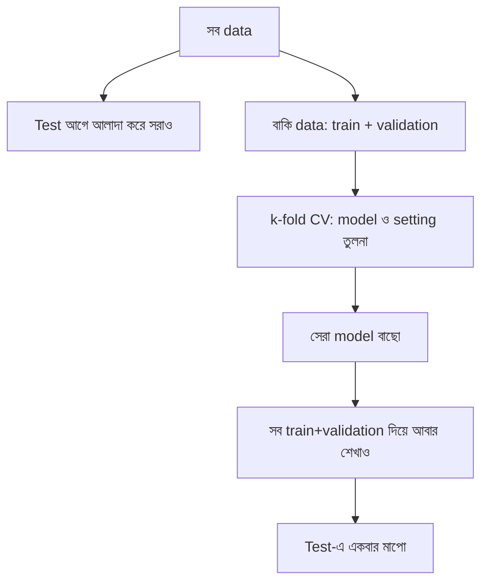

# Lecture 05 — Cross-validation ও Final Test: কম data-য় নির্ভরযোগ্য মাপ

> আগে যা জানা থাকলে ভালো: [Train/Validation/Test split](../module-05-data-preparation-and-splits/lecture-03-train-validation-test-split.md), [Baseline](lecture-01-baselines.md) আর [Regression metrics](lecture-02-regression-metrics.md) (এখানে MAE ব্যবহার হবে)। এই lecture শেষে পারবে: k-fold cross-validation হাতে করতে, আর test set কখন ও কীভাবে একবারই ব্যবহার করতে হয় তা বলতে।

## সমস্যাটা কী?

Data কম হলে validation set-ও ছোট হয়। মাত্র ২টা বাড়ি দিয়ে মাপলে ফল নির্ভর করে ঠিক কোন ২টা বাড়ি validation-এ পড়ল তার উপর। কপাল ভালো হলে model ভালো দেখায়, খারাপ হলে খারাপ। একটা ভাগের ফলে ভরসা করা যায় না। আবার data কম বলে validation-এর জন্য বেশি অংশ আলাদা করে রাখাও কষ্টকর, কারণ তাহলে model-এর শেখার data কমে যায়।

## ধারণাটা সহজ ভাষায়

**Cross-validation (CV)** মানে একটাই ভাগের বদলে বারবার ভাগ করা, যাতে প্রতিটা row একবার validation-এর ভূমিকায় আসে।

**k-fold CV** এভাবে চলে (এখানে k = 4):

1. Train+validation data-কে 4টা প্রায় সমান ভাগে ভাগ করো। প্রতিটা ভাগের নাম **fold**।
2. প্রথমবার fold 1 validation, বাকি তিনটা train। Model শেখাও, validation fold-এ ভুল মাপো।
3. দ্বিতীয়বার fold 2 validation, বাকিরা train। এভাবে চারবার।
4. চারটা ভুলের **গড়** নাও। সঙ্গে দেখো চারটা কতটা ছড়ানো।

এতে প্রতিটা row একবার validation-এ আর বাকি বার train-এ যায়। একটা ভাগের কাকতালীয়তা কমে।

CV কেবল **model তুলনা ও setting বাছার** জন্য। আর test set-এর নিয়ম আগের মতোই:

- আগে থেকেই test set আলাদা করে সরিয়ে রাখো।
- বাকি data-য় CV দিয়ে model ও setting বাছো।
- বাছা হয়ে গেলে সেই model সব বাকি data (train + validation) দিয়ে আবার শেখাও।
- **এবার test set-এ একবারই** মাপো, আর সেই সংখ্যাই রিপোর্ট করো।

Test দেখার পর ফল পছন্দ না হলে model বদলে আবার test দেখা চলবে না। তা করলে test আর নিরপেক্ষ থাকে না।

## ছোট একটা উদাহরণ

Module 05-এর ১০টা বাড়ি থেকে ২টা (`(1600,80), (1100,66)`) test হিসেবে আগেই সরানো আছে। বাকি ৮টা:

`(900,52), (1300,75), (1400,70), (800,40), (1700,96), (1200,58), (1500,88), (1000,50)`

এদের ৪টা fold-এ ভাগ করি, প্রতিটায় ২টা বাড়ি। দুটো model তুলনা: **mean baseline** আর **linear model**। প্রতিবার train fold থেকে শিখে validation fold-এ গড় ভুল (MAE) মাপি।

| fold | validation-এর বাড়ি | baseline MAE | linear MAE |
|---|---|---|---|
| 1 | (900,52), (1700,96) | 22.0 | 4.06 |
| 2 | (1300,75), (1200,58) | 8.5 | 5.49 |
| 3 | (1400,70), (1500,88) | 17.17 | 5.97 |
| 4 | (800,40), (1000,50) | 28.17 | 2.9 |
| **গড়** | | **18.96** | **4.61** |

Fold 1-এর baseline হাতে মিলিয়ে দেখি। Train = বাকি ৬টা বাড়ি, দাম 75, 58, 70, 88, 40, 50, গড় = 381 / 6 = 63.5। Validation-এ ভুল |63.5 − 52| = 11.5 আর |63.5 − 96| = 32.5। গড় = 44 / 2 = **22.0**। মিলেছে।

পড়া: চারটা fold-এই linear baseline-এর চেয়ে অনেক ভালো। গড় 4.61 বনাম 18.96। Linear বেছে নিই।

**এবার final।** Linear model-কে সব ৮টা বাড়ি দিয়ে আবার শেখাই (`w ≈ 0.0609`, `b ≈ −8.42`)। তারপর test-এ প্রথম ও শেষবারের মতো মাপি:

- `(1600, 80)`: prediction 88.94, ভুল 8.94
- `(1100, 66)`: prediction 58.52, ভুল 7.48
- Test MAE = (8.94 + 7.48) / 2 = **8.21**

তুলনার জন্য baseline-এর test MAE: গড় দাম = 529 / 8 = 66.125; ভুল 13.875 ও 0.125, গড় **7.0**।

এখানে test-এ baseline-ই সামান্য এগিয়ে! এর কারণ test-এ আছে মাত্র ২টা বাড়ি, আর তার একটা (1100, 66) প্রায় ঠিক baseline-এর অনুমানের কাছাকাছি। এত ছোট test-এর একটা সংখ্যা নড়বড়ে। ৮টা বাড়ির ৪ fold-এর ফল (4.61 বনাম 18.96) অনেক বেশি তথ্য দেয়। বাস্তব প্রকল্পে test set-এ শত শত row রাখা হয়। আর এখন test-এর ফল দেখে model বদলালে test-এর নিরপেক্ষতা নষ্ট হবে, তাই বদলাব না।

## Formula / কোড

কোনো নতুন formula নেই। এটা শুধু "ভাগ করো, শেখাও, মাপো, গড় নাও"-র পুনরাবৃত্তি।

```python
# 8 houses kept for model selection; 2 more were set aside as the final test
dev = [(900, 52), (1300, 75), (1400, 70), (800, 40),
       (1700, 96), (1200, 58), (1500, 88), (1000, 50)]
test = [(1600, 80), (1100, 66)]

def fit_mean(train):
    m = sum(p for _, p in train) / len(train)
    return lambda a: m

def fit_linear(train):
    mx = sum(a for a, _ in train) / len(train)
    my = sum(p for _, p in train) / len(train)
    w = sum((a - mx) * (p - my) for a, p in train) / sum((a - mx) ** 2 for a, _ in train)
    return lambda a: w * a + (my - w * mx)

def avg_error(pairs, f):
    return sum(abs(f(a) - p) for a, p in pairs) / len(pairs)

k = 4
folds = [dev[i::k] for i in range(k)]        # every 4th house -> fold i
for name, fit in [("mean baseline", fit_mean), ("linear", fit_linear)]:
    scores = []
    for i in range(k):
        val = folds[i]
        train = [r for j in range(k) if j != i for r in folds[j]]
        scores.append(avg_error(val, fit(train)))
    print(name, [round(s, 2) for s in scores], "average:", round(sum(scores) / k, 2))

# refit on all development data, then look at the test set once
for name, fit in [("mean baseline", fit_mean), ("linear", fit_linear)]:
    print("final test error,", name, ":", round(avg_error(test, fit(dev)), 2))
```

```text
# output:
# mean baseline [22.0, 8.5, 17.17, 28.17] average: 18.96
# linear [4.06, 5.49, 5.97, 2.9] average: 4.61
# final test error, mean baseline : 7.0
# final test error, linear : 8.21
```

সাবধান: Scaling বা median-এর মতো preprocessing থাকলে প্রতিটা fold-এ **শুধু সেই fold-এর train অংশ** থেকে শিখতে হয় ([Data Leakage](../module-05-data-preparation-and-splits/lecture-04-data-leakage.md))। আর সময় বা group থাকলে fold-ও সেই নিয়মে বানাতে হয় ([Time ও Group split](../module-05-data-preparation-and-splits/lecture-05-time-and-group-splits.md))।

## ছবি



## মনে রাখার সারকথা

- k-fold CV: data k ভাগ, প্রতিবার একটা fold validation, বাকিরা train, k বারের ভুলের গড় নাও।
- CV model তুলনা ও setting বাছার জন্য; test set শুরুতেই সরিয়ে রেখে শেষে একবারই ব্যবহার।
- খুব ছোট test-এর একটা সংখ্যার উপর বেশি ভরসা কোরো না; আর test দেখার পর model বদলে আবার test দেখো না।

## নিজে করো

১. ২০টা row-এ 5-fold CV করলে প্রতিবার কয়টা row validation-এ, কয়টা train-এ?

২. 4-fold CV-র চারটা MAE: `4, 6, 5, 9`। গড় কত? সবচেয়ে ভালো ও সবচেয়ে খারাপ fold-এর তফাত কত?

৩. Model X-এর fold-ফল `[5, 5, 5, 5]`, Model Y-এর `[2, 2, 2, 12]`। কার গড় কম? তবু কেন Y নিয়ে সতর্ক হবে?

<details><summary>উত্তর</summary>

১. ২০ / 5 = **4টা validation-এ**, বাকি **16টা train-এ**।

২. গড় = (4 + 6 + 5 + 9) / 4 = 24 / 4 = **6**। তফাত = 9 − 4 = **5**।

৩. X-এর গড় = **5**। Y-এর গড় = (2 + 2 + 2 + 12) / 4 = **4.5**, তাই Y-এর গড় কম। কিন্তু Y একটা fold-এ 12 ভুল করেছে, যা অস্থিরতা বা কোনো বিশেষ ধরনের data-তে দুর্বলতার ইঙ্গিত। সিদ্ধান্তের আগে ওই fold-এর বাড়িগুলো দেখা উচিত। শুধু গড় নয়, ছড়ানোও দেখতে হয়।

</details>

## পরের পাঠ

Module 06 এখানে শেষ: baseline, regression ও classification metric, threshold, আর নির্ভরযোগ্য মূল্যায়নের নিয়ম। পরের ধাপ হলো model-এর ফল কেন train-এ ভালো আর নতুন data-য় খারাপ হয় তা বোঝা: [Module 07 — Generalization ও Overfitting](../module-07-generalization-and-overfitting/README.md)।
