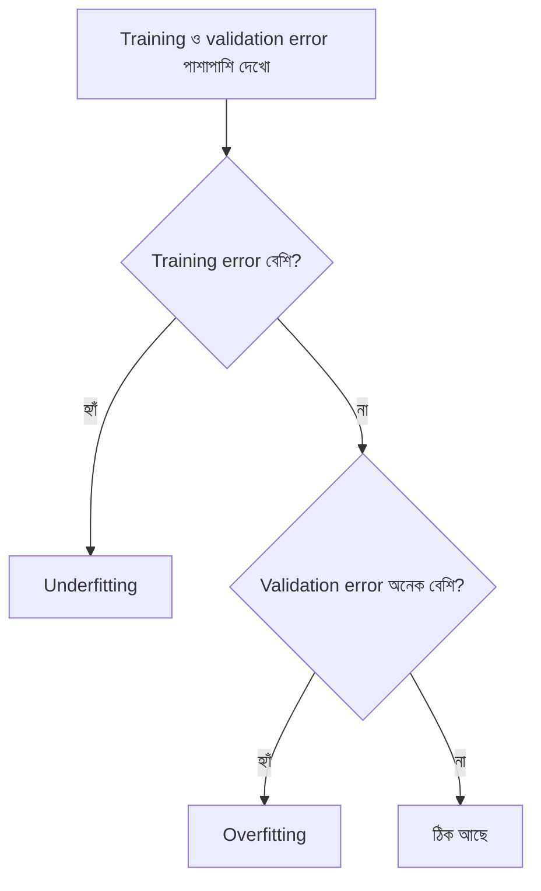

# Lecture 01 — Underfitting আর Overfitting: দুটো error পাশাপাশি দেখা

> আগে যা জানা থাকলে ভালো: [MSE](../module-02-linear-regression/lecture-02-error-and-mean-squared-error.md) এবং [train/validation/test split](../module-05-data-preparation-and-splits/lecture-03-train-validation-test-split.md)। এই lecture শেষে পারবে: train error আর validation error-এর সংখ্যা দেখে বলতে model underfit করছে, overfit করছে, নাকি ঠিক আছে।

## সমস্যাটা কী?

Model train করার পর training data-তে error খুব কম দেখলে খুশি হতে ইচ্ছে করে। কিন্তু model আমরা বানাই নতুন data-র জন্য: কাল যে বাড়ির ভাড়া জানতে চাইবে, তার জন্য। যে data দিয়ে model শিখেছে, সেখানে ভালো করা সহজ, কারণ উত্তরগুলো সে আগেই দেখে ফেলেছে। তাই শুধু training error দেখে model ভালো কি না বলা যায় না। ML engineer-রা প্রতিটা training run-এর পর যে দুটো সংখ্যা পাশাপাশি রাখেন, এই lecture সেগুলোর কথা।

## ধারণাটা সহজ ভাষায়

নতুন data-তেও ভালো করার ক্ষমতাকে বলে **generalization**। সেটা মাপতে দুটো error দেখা হয়:

- **Training error**: যে data দিয়ে model শিখেছে, তার ওপর error।
- **Validation error**: যে data model শেখার সময় দেখেনি (আলাদা করে সরিয়ে রাখা হয়েছিল), তার ওপর error।

দুটো সংখ্যা মিলিয়ে তিনটা অবস্থা পাওয়া যায়:

| অবস্থা | Training error | Validation error | মানে |
|---|---|---|---|
| **Underfitting** | বেশি | বেশি | Model এত সরল যে data-র মূল pattern-ই ধরতে পারেনি |
| ঠিক আছে | কম | কম, training-এর কাছাকাছি | Pattern ধরেছে, নতুন data-তেও চলছে |
| **Overfitting** | খুব কম | অনেক বেশি | Pattern-এর সঙ্গে data-র এলোমেলো ওঠানামাও (**noise**) মুখস্থ করে ফেলেছে |

Noise মানে মাপার ছোটখাটো ভুল বা আকস্মিক পার্থক্য, যা আসল pattern-এর অংশ নয়। যেমন দুটো একই রকম বাড়ির ভাড়া সামান্য আলাদা হতেই পারে।

Overfitting বোঝার জন্য একটা উপমা কাজে লাগে। কেউ গত বছরের প্রশ্নের উত্তর হুবহু মুখস্থ করলে ওই প্রশ্নে ১০০ পাবে, কিন্তু নতুন প্রশ্নে আটকে যাবে। Overfit করা model-ও training data মুখস্থ করে।

দুটো জিনিস মনে রাখতে হবে:

- Error "বেশি" না "কম", তা তুলনা করে বোঝা যায়। তুলনার জন্য [baseline](../module-06-model-evaluation-and-baselines/lecture-01-baselines.md) বা অন্য model-এর error দেখা হয়।
- দুটো error-এর ফারাক (**gap**) অর্থাৎ `validation − training` একা যথেষ্ট নয়। Gap ছোট কিন্তু দুটো error-ই বেশি হলে সেটা underfitting।

## ছোট একটা উদাহরণ

৪টা training point আর ২টা validation point নিই (সংখ্যাগুলো বানানো):

- Training: `(1, 2)`, `(2, 4)`, `(3, 5)`, `(4, 7)`
- Validation: `(1.4, 3)`, `(3.6, 6)`

তিনটা model:

- **A**: সবসময় training-এর `y`-এর গড় বলে, অর্থাৎ `4.5`।
- **B**: সরলরেখা `ŷ = 1.6x + 0.5` (এই training data-র জন্য সবচেয়ে ভালো রেখা)।
- **C**: মুখস্থ model। নতুন `x`-এর জন্য training-এর সবচেয়ে কাছের `x`-এর উত্তরটাই বলে দেয়।

**Training error (MSE):**

- A: error `−2.5, −0.5, 0.5, 2.5`। Square `6.25, 0.25, 0.25, 6.25`। গড় `13 / 4 = 3.25`।
- B: prediction `2.1, 3.7, 5.3, 6.9`। Error `0.1, −0.3, 0.3, −0.1`। Square `0.01, 0.09, 0.09, 0.01`। গড় `0.2 / 4 = 0.05`।
- C: নিজের মুখস্থ করা point-গুলোতে হুবহু মেলে, তাই `0`।

**Validation error (MSE):**

- A: prediction `4.5, 4.5`। Error `1.5, −1.5`। গড় `(2.25 + 2.25) / 2 = 2.25`।
- B: `x = 1.4` → prediction `2.74`, error `−0.26`। `x = 3.6` → prediction `6.26`, error `0.26`। গড় `≈ 0.068`।
- C: `x = 1.4`-এর কাছের training `x` হলো `1`, উত্তর `2`, error `−1`। `x = 3.6`-এর কাছের হলো `4`, উত্তর `7`, error `1`। গড় `1.0`।

| Model | Training MSE | Validation MSE | অবস্থা |
|---|---|---|---|
| A (গড়) | 3.25 | 2.25 | দুটোই বেশি: underfitting |
| B (রেখা) | 0.05 | 0.068 | দুটোই কম, কাছাকাছি: ঠিক আছে |
| C (মুখস্থ) | 0 | 1.0 | Training-এ নিখুঁত, validation-এ খারাপ: overfitting |

C-এর training error সবচেয়ে কম, অথচ নতুন data-তে সে B-এর চেয়ে অনেক খারাপ। এ কারণেই training error দেখে model বাছা যায় না।

Python-এ একই হিসাব মিলিয়ে নিই:

```python
train = [(1, 2), (2, 4), (3, 5), (4, 7)]
val = [(1.4, 3), (3.6, 6)]

def mean_model(x): return 4.5
def line_model(x): return 1.6 * x + 0.5
def memo_model(x): return min(train, key=lambda p: abs(p[0] - x))[1]

def mse_of(model, data):
    return sum((model(x) - y) ** 2 for x, y in data) / len(data)

for name, m in [("A গড়", mean_model), ("B রেখা", line_model), ("C মুখস্থ", memo_model)]:
    print(name, "train:", round(mse_of(m, train), 3), "val:", round(mse_of(m, val), 3))

# output:
# A গড় train: 3.25 val: 2.25
# B রেখা train: 0.05 val: 0.068
# C মুখস্থ train: 0.0 val: 1.0
```

## Polynomial দিয়ে একই ঘটনা

এবার একটু বড় উদাহরণ। এখানে model হলো **polynomial**: `ŷ = w₀ + w₁x + w₂x² + …`। সর্বোচ্চ ঘাত (power) যত, তাকে বলে **degree**। Degree 0 মানে একটা স্থির সংখ্যা, degree 1 মানে সরলরেখা, degree 2 মানে একটা বাঁক। Degree যত বাড়ে, model তত বেশি বাঁকতে পারে। (এটা নিয়ে [পরের lecture](lecture-02-capacity-and-data-size.md)-এ আলাদা কথা হবে।)

Data বানানো হয়েছে একটা বাঁকা সম্পর্ক (`y = 0.5 + 5x − 4x²`) থেকে, তার সঙ্গে একটু noise যোগ করে। Training-এ ৮টা point, validation-এ ২০০টা। নিচের helper `fit` দেয় কোনো degree-র সেরা weight। এর ভেতরটা এখন বোঝার দরকার নেই; Module 02-এর gradient descent-এর বদলে এটা এক ধাপে উত্তর বের করে দেয়। পরের সব lecture-এ এই একই helper লাগবে।

<details>
<summary>Helper code (ভেতরটা বোঝা জরুরি নয়, হুবহু কপি করলেই হবে)</summary>

```python
import random

def fit(xs, ys, degree, lam=0.0):
    """Polynomial-এর সেরা weight বের করে: w0 + w1*x + w2*x^2 + ..."""
    n, m = len(xs), degree + 1
    A = [[x ** j for j in range(m)] for x in xs]
    M = [[sum(A[k][i] * A[k][j] for k in range(n)) + (n * lam if i == j and i > 0 else 0)
          for j in range(m)] + [sum(A[k][i] * ys[k] for k in range(n))] for i in range(m)]
    for c in range(m):                        # Gaussian elimination
        p = max(range(c, m), key=lambda r: abs(M[r][c]))
        M[c], M[p] = M[p], M[c]
        for r in range(m):
            if r != c:
                f = M[r][c] / M[c][c]
                M[r] = [a - f * b for a, b in zip(M[r], M[c])]
    return [M[i][m] / M[i][i] for i in range(m)]

def predict(w, x):
    return sum(wj * x ** j for j, wj in enumerate(w))

def mse(w, xs, ys):
    return sum((predict(w, x) - y) ** 2 for x, y in zip(xs, ys)) / len(xs)

def make_data(n, seed, noise=0.3, grid=True):
    rnd = random.Random(seed)
    xs = [i / (n - 1) for i in range(n)] if grid else sorted(rnd.uniform(0, 1) for _ in range(n))
    return xs, [0.5 + 5 * x - 4 * x * x + rnd.gauss(0, noise) for x in xs]
```

</details>

এই helper-এর নিচে বসাও:

```python
xtr, ytr = make_data(8, 59)                    # 8টা training point
xva, yva = make_data(200, 106, grid=False)     # 200টা validation point

for d in (0, 1, 2, 7):
    w = fit(xtr, ytr, d)
    tr, va = mse(w, xtr, ytr), mse(w, xva, yva)
    print(f"degree {d}: train={tr:.3f}  val={va:.3f}  gap={va - tr:.3f}")

# output:
# degree 0: train=0.210  val=0.257  gap=0.046
# degree 1: train=0.180  val=0.190  gap=0.010
# degree 2: train=0.058  val=0.109  gap=0.051
# degree 7: train=0.000  val=0.261  gap=0.261
```

ফল পড়ার নিয়ম আগের table-এর মতোই:

- **Degree 0 ও 1**: দুটো error-ই বেশি (0.2-এর কাছাকাছি)। Gap ছোট, তবু model underfit, কারণ degree 2 দেখিয়ে দিয়েছে আরও ভালো করা সম্ভব। রেখা দিয়ে বাঁকা pattern ধরা যায় না।
- **Degree 2**: training `0.058`, validation `0.109`। দুটোই কম। Data যে বাঁকা সম্পর্ক থেকে এসেছে, model-ও সেই আকারের, তাই এটা ঠিক আছে।
- **Degree 7**: training error `0.000`, কিন্তু validation `0.261`। ৮টা point-এর জন্য ৮টা weight থাকায় curve প্রতিটা point ছুঁয়ে যেতে পেরেছে, noise-সহ। এটাই overfitting।

## ছবি



## মনে রাখার সারকথা

- Training error কম হলেই model ভালো নয়; নতুন data-র error (validation error) আসল পরীক্ষা।
- দুটোই বেশি হলে underfitting; training কম কিন্তু validation অনেক বেশি হলে overfitting।
- "বেশি" না "কম" তা বোঝা যায় baseline বা অন্য model-এর সঙ্গে তুলনা করে।

## নিজে করো

১. Training error `0.02`, validation error `0.90`। এটা underfitting না overfitting?

২. Training error `2.1`, validation error `2.3`, আর baseline (গড় বলা model) validation-এ পায় `2.4`। Model-টা সম্পর্কে কী বলবে?

৩. Training data `(1, 2), (2, 4), (3, 6)` আর validation data `(4, 9), (5, 10)`। Model `ŷ = 2x`। Training MSE ও validation MSE বের করো।

<details>
<summary>উত্তর</summary>

১. Overfitting। Training-এ প্রায় নিখুঁত, validation-এ অনেক খারাপ; gap বিশাল।

২. দুটো error-ই বেশি, আর validation error baseline-এর প্রায় সমান। Model প্রায় কিছুই শেখেনি, অর্থাৎ underfitting।

৩. Prediction training-এ `2, 4, 6`, error সব `0`, তাই training MSE `0`। Validation-এ prediction `8, 10`, error `−1, 0`, গড় `(1 + 0) / 2 = 0.5`। Training শূন্য, validation `0.5`: এই ছোট data-তে ফারাকটা overfitting-এর দিকে ইঙ্গিত দেয়, তবে মাত্র ২টা validation point দিয়ে নিশ্চিত হওয়া যায় না।

</details>

## পরের পাঠ

Overfitting-এর কারণ ছিল model-এর বাঁকার ক্ষমতা (degree) অনেক বেশি আর data মাত্র ৮টা। এই দুটো জিনিসের সম্পর্ক নিয়ে [Lecture 02 — Capacity ও data-র পরিমাণ](lecture-02-capacity-and-data-size.md)।
