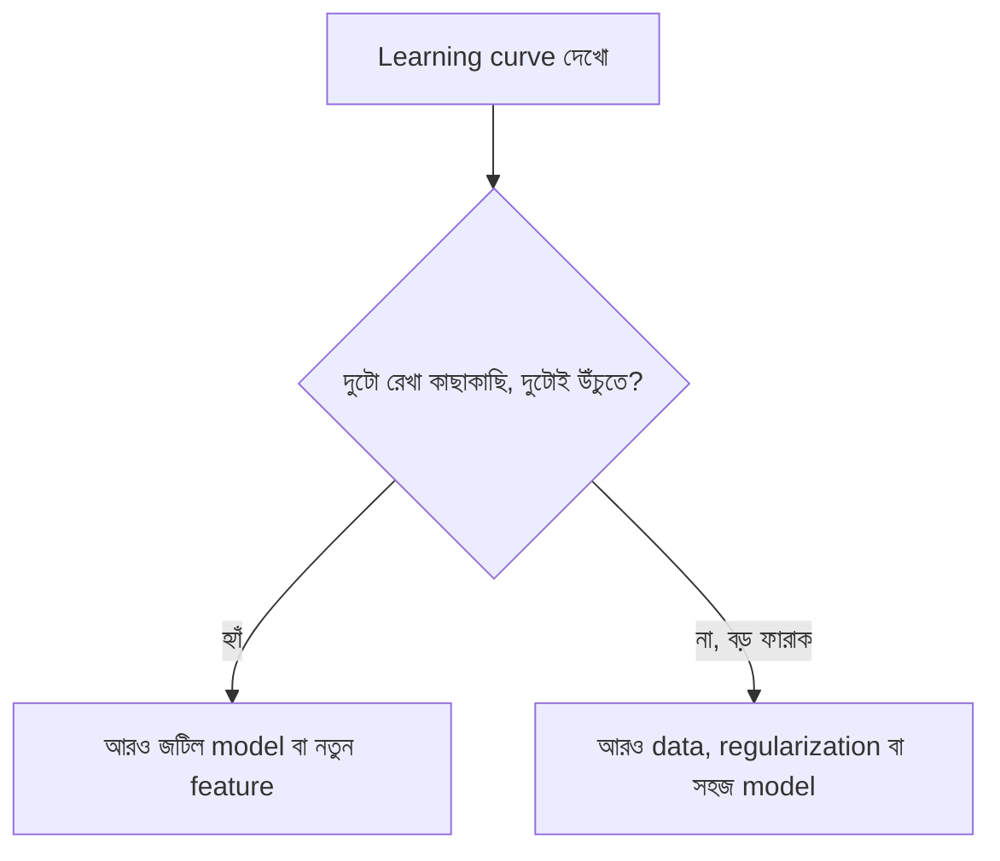

# Lecture 04 — Learning curve আর error analysis: সমস্যা কোথায়?

> আগে যা জানা থাকলে ভালো: [Lecture 01 — Underfitting আর Overfitting](lecture-01-underfitting-and-overfitting.md) এবং [Lecture 02 — Capacity ও data-র পরিমাণ](lecture-02-capacity-and-data-size.md)। এই lecture শেষে পারবে: training data-র পরিমাণ বাড়িয়ে error-এর রেখা দেখে বলতে আরও data লাগবে নাকি আরও জটিল model, আর validation-এর ভুলগুলো দেখে model-এর দুর্বলতা খুঁজতে।

## সমস্যাটা কী?

Validation error বেশি এলে পরের পদক্ষেপ কী? আরও data জোগাড় করবে (সময় আর টাকা লাগে), model জটিল করবে, নাকি regularization বাড়াবে? ভুল পথ বাছলে সপ্তাহ নষ্ট হয়। দুটো সস্তা পরীক্ষা এই সিদ্ধান্তে সাহায্য করে: **learning curve** আর **error analysis**। ML team-রা বড় data জোগাড় বা বড় model train করার আগে এই দুটো দেখে নেয়।

## ধারণাটা সহজ ভাষায়

### Learning curve

**Learning curve** হলো training set-এর আকার বাড়িয়ে training error আর validation error কীভাবে বদলায় তার ছক। Data-র পরিমাণ ছাড়া সব কিছু স্থির থাকে। দুটো আলাদা চেহারা দেখা যায়:

| চেহারা | কী দেখা যায় | মানে | কী কাজে লাগবে |
|---|---|---|---|
| দুটো রেখা কাছাকাছি, দুটোই উঁচুতে আটকে আছে | Data বাড়ালেও error নামে না | Model এত সরল যে সব data দিয়েও pattern ধরতে পারছে না (underfitting) | জটিল model, নতুন feature। আরও data বৃথা |
| বড় ফারাক: training নিচে, validation উপরে, data বাড়ালে ফারাক কমে | Validation error ধীরে নামছে | Model বেশি জটিল, data অল্প (overfitting) | আরও data, regularization বা সহজ model |

(প্রথম অবস্থাকে ML-এ **high bias**, দ্বিতীয়টিকে **high variance** বলে। নাম দুটো পরে অনেক জায়গায় পাবে।)

### Error analysis

শুধু একটা গড় সংখ্যা (MSE) দেখলে জানা যায় না ভুলটা কোথায়। **Error analysis** মানে validation-এর ভুলগুলো আলাদা করে দেখা: কোন কোন উদাহরণে সবচেয়ে বেশি ভুল, কোন অঞ্চলে model সবসময় বেশি বা কম বলছে। যদি ভুলগুলো এলোমেলো থাকে, তাহলে সম্ভবত সেটা noise। আর যদি ভুলে কোনো ছক (pattern) থাকে, তাহলে model কিছু একটা ধরতে পারছে না।

বাস্তবে একজন engineer এভাবে দেখে: বাড়ির ভাড়ার model কি সবসময় ছোট ফ্ল্যাটে বেশি বলছে? কোনো একটা এলাকায় কি ভুল বেশি? ওই ফল দেখেই ঠিক হয় কোন feature বা data যোগ করতে হবে।

## ছোট একটা উদাহরণ: error-এর ছক

৫টা point: `(0, 1), (1, 2), (2, 2), (3, 2), (4, 1)`। দেখতে একটা উল্টানো বাঁকের মতো: মাঝখানে উঁচু, দুই প্রান্তে নিচু।

এই data-য় সেরা সরলরেখা সমতল: `ŷ = 1.6` (সব `y`-এর গড়, কারণ রেখার ঢাল `0`)। Error `= prediction − actual`:

- `x = 0`: `1.6 − 1 = +0.6`
- `x = 1`: `1.6 − 2 = −0.4`
- `x = 2`: `1.6 − 2 = −0.4`
- `x = 3`: `1.6 − 2 = −0.4`
- `x = 4`: `1.6 − 1 = +0.6`

চিহ্নগুলো `+ − − − +`। এটা এলোমেলো নয়: দুই প্রান্তে model বেশি বলছে, মাঝখানে কম। এই ছকটাই বলছে যে data-তে একটা বাঁক আছে যা রেখা ধরতে পারছে না। আরেকটু জটিল model (এখানে degree 2) দিলে ছকটা মিলিয়ে যাবে। এর নাম **systematic error**।

```python
pts = [(0, 1), (1, 2), (2, 2), (3, 2), (4, 1)]
print("errors:", [round(1.6 - y, 3) for x, y in pts])

# output:
# errors: [0.6, -0.4, -0.4, -0.4, 0.6]
```

## কোড: learning curve

Lecture 01-এর helper লাগবে।

<details>
<summary>Helper code (Lecture 01-এর হুবহু একই)</summary>

```python
import random

def fit(xs, ys, degree, lam=0.0):
    """Polynomial-এর সেরা weight বের করে: w0 + w1*x + w2*x^2 + ..."""
    n, m = len(xs), degree + 1
    A = [[x ** j for j in range(m)] for x in xs]
    M = [[sum(A[k][i] * A[k][j] for k in range(n)) + (n * lam if i == j and i > 0 else 0)
          for j in range(m)] + [sum(A[k][i] * ys[k] for k in range(n))] for i in range(m)]
    for c in range(m):                        # Gaussian elimination
        p = max(range(c, m), key=lambda r: abs(M[r][c]))
        M[c], M[p] = M[p], M[c]
        for r in range(m):
            if r != c:
                f = M[r][c] / M[c][c]
                M[r] = [a - f * b for a, b in zip(M[r], M[c])]
    return [M[i][m] / M[i][i] for i in range(m)]

def predict(w, x):
    return sum(wj * x ** j for j, wj in enumerate(w))

def mse(w, xs, ys):
    return sum((predict(w, x) - y) ** 2 for x, y in zip(xs, ys)) / len(xs)

def make_data(n, seed, noise=0.3, grid=True):
    rnd = random.Random(seed)
    xs = [i / (n - 1) for i in range(n)] if grid else sorted(rnd.uniform(0, 1) for _ in range(n))
    return xs, [0.5 + 5 * x - 4 * x * x + rnd.gauss(0, noise) for x in xs]
```

</details>

Training point-এর সংখ্যা `n` ৮ থেকে ১২৮ পর্যন্ত বাড়াই। দুটো model: degree 1 (সরল) আর degree 5 (জটিল)। এক-দুটো এলোমেলো data-র প্রভাব কাটাতে প্রতিটা `n`-এর জন্য ২০ বার আলাদা data বানিয়ে error-এর গড় নিই।

```python
xva, yva = make_data(200, 106, grid=False)

print("n_train   deg1 train/val    deg5 train/val")
for n in (8, 16, 32, 64, 128):
    row = []
    for d in (1, 5):
        tr = va = 0
        for s in range(20):                        # ২০ বার আলাদা data
            xtr, ytr = make_data(n, 1000 + s)
            w = fit(xtr, ytr, d)
            tr += mse(w, xtr, ytr) / 20
            va += mse(w, xva, yva) / 20
        row.append(f"{tr:.3f} / {va:.3f}")
    print(f"{n:>7}   {row[0]}      {row[1]}")

# output:
# n_train   deg1 train/val    deg5 train/val
#       8   0.229 / 0.215      0.023 / 0.149
#      16   0.187 / 0.187      0.053 / 0.118
#      32   0.177 / 0.178      0.073 / 0.106
#      64   0.192 / 0.172      0.077 / 0.096
#     128   0.186 / 0.170      0.084 / 0.093
```

**Degree 1:** training আর validation দুটোই প্রায় `0.17`–`0.19`-এ আটকে আছে এবং কাছাকাছি। ১২৮টা data নিলেও নামছে না। এটা প্রথম চেহারা: আরও data বৃথা, model-এর ক্ষমতা বাড়াতে হবে।

**Degree 5:** `n = 8`-এ ফারাক বিশাল (training `0.023`, validation `0.149`)। Data বাড়ার সঙ্গে ফারাক কমছে, `n = 128`-এ `0.084` আর `0.093`। এটা দ্বিতীয় চেহারা: এখানে আরও data কাজে লাগছে। শেষে validation error `0.093`-এ থামছে, যা data-র নিজস্ব noise-এর সীমার (প্রায় `0.09`, [Lecture 02](lecture-02-capacity-and-data-size.md)) কাছাকাছি। এর নিচে নামার জায়গা আর নেই।



## কোড: error analysis

৩২টা training point, ২০০টা validation point। Validation-কে `x`-এর তিনটা অঞ্চলে ভাগ করে প্রতিটায় গড় error (prediction − actual) দেখি, আর সবচেয়ে বড় তিন ভুলের `x` মান।

```python
xtr, ytr = make_data(32, 59)
for d in (1, 2):
    w = fit(xtr, ytr, d)
    print(f"degree {d}: val mse={mse(w, xva, yva):.3f}")
    for lo, hi in ((0, 0.25), (0.25, 0.75), (0.75, 1.01)):
        errs = [predict(w, x) - y for x, y in zip(xva, yva) if lo <= x < hi]
        print(f"  x in [{lo}, {min(hi, 1)}): n={len(errs)}  mean error={sum(errs) / len(errs):+.3f}")
    worst = sorted(zip(xva, yva), key=lambda p: -abs(predict(w, p[0]) - p[1]))[:3]
    print("  worst x:", [round(x, 2) for x, y in worst])

# output:
# degree 1: val mse=0.171
#   x in [0, 0.25): n=55  mean error=+0.245
#   x in [0.25, 0.75): n=98  mean error=-0.275
#   x in [0.75, 1): n=47  mean error=+0.117
#   worst x: [0.32, 0.45, 0.11]
# degree 2: val mse=0.093
#   x in [0, 0.25): n=55  mean error=+0.079
#   x in [0.25, 0.75): n=98  mean error=-0.067
#   x in [0.75, 1): n=47  mean error=-0.040
#   worst x: [0.32, 0.11, 0.45]
```

Degree 1 (রেখা)-তে ছকটা আগের ছোট উদাহরণের মতোই: দুই প্রান্তে গড় error ধনাত্মক (`+0.245`, `+0.117`), মাঝে ঋণাত্মক (`−0.275`)। মানে model দুই প্রান্তে বেশি বলছে, মাঝখানে কম। এটা systematic error, কারণ data-র বাঁকটা রেখা ধরতে পারছে না। Degree 2-তে তিন অঞ্চলের গড় error অনেক ছোট (`±0.08`-এর মধ্যে), ছকটা প্রায় নেই, আর validation MSE প্রায় অর্ধেক (`0.171` থেকে `0.093`)।

সাবধান: কিছু ভুল থেকেই যাবে, কারণ noise কমানো যায় না। লক্ষ্য হলো ভুলের মধ্যে ছক খোঁজা, ভুল শূন্য করা নয়।

## মনে রাখার সারকথা

- Learning curve-এ দুটো রেখা কাছাকাছি কিন্তু উঁচু থাকলে model খুব সরল (আরও data বৃথা); বড় ফারাক থাকলে overfitting (আরও data, regularization বা সহজ model কাজে দেয়)।
- Error analysis মানে validation-এর ভুল ভাগ করে দেখা। ভুলে ছক (যেমন `+ − − − +`) থাকলে model কিছু ধরতে পারছে না।
- গড় MSE একা সমস্যার কারণ বলে না; কারণ খুঁজতে ভুলগুলো দেখতে হয়।

## নিজে করো

১. Degree 1 model-এর learning curve-এ `n = 16`-তে training `0.30`, validation `0.32`; `n = 128`-এ `0.31`, `0.31`। আরও data দিলে কি কাজ হবে?

২. ৬টা validation উদাহরণে error (`prediction − actual`) যথাক্রমে `x = 1, 2, 3, 4, 5, 6`-এর জন্য: `−2.0, −1.0, −0.2, +0.3, +1.1, +2.2`। এই ছক কী বলে?

৩. ২ নম্বর প্রশ্নের error-গুলোর MSE বের করো।

<details>
<summary>উত্তর</summary>

১. না। দুটো error কাছাকাছি আর data বাড়লেও নামছে না, তাই model খুব সরল। জটিল model বা নতুন feature লাগবে।

২. ছকটা `− − − + + +`: `x` বাড়ার সঙ্গে error ঋণাত্মক থেকে ধনাত্মক হচ্ছে। Model ছোট `x`-এ আসলের চেয়ে কম বলছে, বড় `x`-এ বেশি বলছে। ভুলটা `x`-এর সঙ্গে নিয়ম মেনে বদলাচ্ছে, noise-এর মতো এলোমেলো নয়। এটা systematic error; model আসল সম্পর্কের কিছু একটা ধরতে পারছে না।

৩. Square: `4.0, 1.0, 0.04, 0.09, 1.21, 4.84`। যোগফল `11.18`। গড় `11.18 / 6 ≈ 1.863`।

</details>

## পরের পাঠ

এখন পর্যন্ত আমরা `λ` আর degree-এর মতো কিছু মান নিজেরা বেছে নিয়েছি। এই ধরনের সেটিংকে কীভাবে ঠিকমতো বাছতে হয়, আর কোন ভুল করা যাবে না, তা [Lecture 05 — Hyperparameter বাছাই](lecture-05-choosing-hyperparameters.md)-এ।
