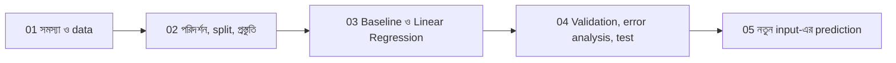

# Lecture 01 — সমস্যা ঠিক করা আর ছোট একটা dataset বানানো

> আগে যা জানা থাকলে ভালো: [Linear Regression-এর prediction](../module-02-linear-regression/lecture-01-prediction-weight-and-bias.md)। এই lecture শেষে পারবে: একটা ML সমস্যাকে "input থেকে target" ভাষায় লিখতে, আর seed-সহ একটা ছোট dataset code দিয়ে বানাতে।

## সমস্যাটা কী?

ML project-এ অনেকে সরাসরি model লিখতে বসে যায়। পরে দেখা যায়, কী predict করছে, কীসের ওপর ভর করে, আর কত ভালো হলে "ভালো", এই তিনটার কোনোটাই ঠিক করা ছিল না। তখন model-এর ফল দেখেও বোঝা যায় না কাজ হলো কি না। তাই project শুরু হয় model দিয়ে নয়, **সমস্যার সংজ্ঞা** দিয়ে। এই module-এর ৫টা lecture মিলে একটা ছোট project হবে, আর প্রতিটা lecture-এর code জুড়ে একটা চলমান script তৈরি হবে।

## ধারণাটা সহজ ভাষায়

আমাদের project: **একটা ফ্ল্যাটের মাসিক ভাড়া অনুমান করা**। ঘটনাটা বাস্তব: ভাড়াটিয়া, বাড়িওয়ালা আর বাড়ি-ভাড়ার প্ল্যাটফর্ম এমন অনুমান চায়, যাতে ন্যায্য ভাড়া ঠিক করা যায়।

সমস্যাটাকে তিনটা অংশে লিখি:

| অংশ | এই project-এ |
|---|---|
| **Feature** (input) | `size` (বর্গফুট) আর `rooms` (ঘরের সংখ্যা) |
| **Target** (যা predict করব) | `rent` (মাসিক ভাড়া, হাজার টাকায়) |
| **কাজের ধরন** | Regression, কারণ target একটা সংখ্যা |

প্রতিটা সারি (row) একটা ফ্ল্যাট। Dataset-এ এমন ৪০টা সারি থাকবে।

**সফল হওয়ার মাপকাঠি আগেই ঠিক করা:** আমাদের model-কে ভালো বলব যদি সে সবচেয়ে সহজ উপায়ের চেয়ে ভালো করে। সবচেয়ে সহজ উপায় হলো সব ফ্ল্যাটের জন্য একই ভাড়া (training data-র গড়) বলা। একে বলে **baseline** ([Module 06: Baseline](../module-06-model-evaluation-and-baselines/lecture-01-baselines.md))। ভুল মাপব দুটো সংখ্যায়, দুটোই হাজার টাকার এককে ([Module 06: Regression metric](../module-06-model-evaluation-and-baselines/lecture-02-regression-metrics.md)): **MAE** (গড়ে কত হাজার টাকা ভুল) আর **RMSE** (বড় ভুলকে বেশি গুরুত্ব দেওয়া মাপ)। এগুলো তৃতীয় lecture-এ হিসাব করব।

**Data বানানো কেন?** হাতে বাস্তব ফ্ল্যাটের data নেই, আর আমরা চাই সবাই একই সংখ্যা পাক। তাই code দিয়ে data বানাব, `random.seed(42)` দিয়ে, যাতে প্রতিবার চালালে একই ৪০টা সারি আসে। বাস্তব project-এ এই ধাপে data সংগ্রহ বা download হয়।

সাবধান: এই data আমরা জানা নিয়মে বানাচ্ছি: `ভাড়া = 3 + 0.010 × size + 2.0 × rooms + noise` (noise হলো এলোমেলো ওঠানামা, গড় `0`, ছড়ানো প্রায় `1.2`)। তাই পরে দেখতে পারব model আসল নিয়মের কাছে পৌঁছাল কি না। বাস্তব data-তে এই নিয়ম কেউ জানে না।

## ছোট একটা উদাহরণ

একটা ফ্ল্যাট: `size = 1054`, `rooms = 4`।

- নিয়ম থেকে noise ছাড়া ভাড়া: `3 + 0.010 × 1054 + 2.0 × 4 = 3 + 10.54 + 8 = 21.54`
- Data-তে লেখা ভাড়া `22.8`, অর্থাৎ noise `22.8 − 21.54 = 1.26`

আরেকটা: `size = 800`, `rooms = 2` হলে noise ছাড়া ভাড়া `3 + 8 + 4 = 15`। Dataset-এ প্রতিটা সারিতে এমন একটা এলোমেলো যোগ-বিয়োগ থাকে, যা কোনো model-ই আগে থেকে বলতে পারে না।

## কোড: dataset বানানো

Python 3 standard library ছাড়া কিছু লাগে না। প্রথম অংশে data বানাই। এই কোডে ইচ্ছে করে একটা সারির `rooms` মান ফাঁকা (`None`) রাখা হয়েছে, কারণ বাস্তব data প্রায়ই অসম্পূর্ণ থাকে। পরের lecture-এ সেটা সামলাব।

```python
import random, math, statistics
random.seed(42)                                  # seed স্থির, তাই প্রতিবার একই data
rows = []                                        # প্রতিটা সারি: [size, rooms, rent]
for _ in range(40):
    size = random.randint(400, 1400)                                   # বর্গফুট
    rooms = max(1, min(4, round(size / 350 + random.gauss(0, 0.5))))   # ঘর (১ থেকে ৪)
    rent = 3 + 0.010 * size + 2.0 * rooms + random.gauss(0, 1.2)       # ভাড়া, হাজার টাকা
    rows.append([size, rooms, round(rent, 1)])
rows[7][1] = None                                # একটা ঘরের সংখ্যা অজানা, বাস্তব data-র মতো
```

এবার সারির সংখ্যা আর প্রথম ৫টা সারি দেখি:

```python
print("সারির সংখ্যা:", len(rows))
for r in rows[:5]:
    print(r)

# output:
# সারির সংখ্যা: 40
# [1054, 4, 22.8]
# [650, 2, 15.4]
# [1092, 3, 18.4]
# [1004, 3, 19.2]
# [623, 2, 14.8]
```

প্রতিটা সারির ক্রম `[size, rooms, rent]`। প্রথম সারি: ১০৫৪ বর্গফুট, ৪ ঘর, ভাড়া ২২.৮ হাজার টাকা। এটাই উপরের হাতে-হিসাবের সারি, মিলে গেল।

## ছবি

পুরো project-এর পথ:



## মনে রাখার সারকথা

- Project শুরু হয় সমস্যার সংজ্ঞা দিয়ে: feature কী, target কী, কাজ regression না classification, আর সফলতা কীভাবে মাপব।
- Baseline (সবার জন্য গড় বলা) আগে ঠিক করা থাকলে model-এর ফল অর্থপূর্ণ হয়।
- `random.seed` স্থির করলে এলোমেলো data-ও প্রতিবার একই আসে, তাই ফল যাচাই করা যায়।

## নিজে করো

১. এই project-এ feature আর target কোনগুলো?

২. `size = 800`, `rooms = 2` ফ্ল্যাটের noise ছাড়া ভাড়া কত?

৩. `random.seed(42)` লাইনটা মুছে ফেললে কী সমস্যা হবে?

<details>
<summary>উত্তর</summary>

১. Feature: `size` আর `rooms`। Target: `rent`।

২. `3 + 0.010 × 800 + 2.0 × 2 = 3 + 8 + 4 = 15` হাজার টাকা।

৩. প্রতিবার চালালে আলাদা data আসবে, তাই lecture-এ ছাপা সংখ্যার সঙ্গে নিজের ফল মিলবে না, আর কোনো পরিবর্তনের ফল তুলনা করাও কঠিন হবে।

</details>

## পরের পাঠ

Dataset তৈরি, কিন্তু model-এ দেওয়ার আগে data দেখতে হবে, ভাগ করতে হবে, আর ফাঁকা মান ও scale ঠিক করতে হবে। সেটা [Lecture 02 — পরিদর্শন, split ও প্রস্তুতি](lecture-02-inspect-split-preprocess.md)।
