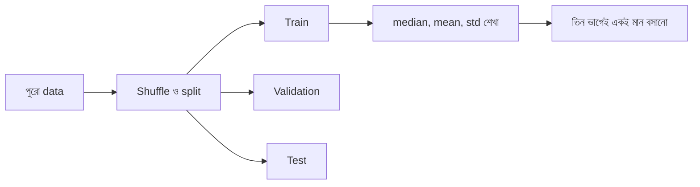

# Lecture 02 — Data দেখা, ভাগ করা আর প্রস্তুত করা

> আগে যা জানা থাকলে ভালো: [Lecture 01 — সমস্যা ও dataset](lecture-01-problem-and-dataset.md), [Data পরিদর্শন](../module-05-data-preparation-and-splits/lecture-01-inspecting-a-dataset.md), [Scaling](../module-05-data-preparation-and-splits/lecture-02-encoding-and-scaling.md) আর [Train/validation/test split](../module-05-data-preparation-and-splits/lecture-03-train-validation-test-split.md)। এই lecture শেষে পারবে: data পরিদর্শন, split আর preprocessing ঠিক ক্রমে করতে, আর কেন ক্রমটা গুরুত্বপূর্ণ তা বলতে।

## সমস্যাটা কী?

আমাদের dataset-এ একটা ঘর ফাঁকা। আবার `size`-এর মান হাজারের ঘরে আর `rooms`-এর মান ১ থেকে ৪, দুটোর মাপ অনেক আলাদা। এমন data সরাসরি gradient descent-এ দিলে শেখা ধীর বা এলোমেলো হতে পারে। এগুলো ঠিক করা চাই। কিন্তু ক্রম ভুল হলে একটা লুকোনো ভুল হয়: test data-র তথ্য ঢুকে পড়ে training-এ। সেই ভুলের নাম **data leakage** ([Module 05: Data leakage](../module-05-data-preparation-and-splits/lecture-04-data-leakage.md))। ফলে test-এর ফল আসল চেয়ে ভালো দেখায়।

## ধারণাটা সহজ ভাষায়

তিনটা কাজ, **এই ক্রমে**:

1. **পরিদর্শন**: কটা সারি, কোথায় ফাঁকা, মানগুলো যুক্তিসংগত সীমায় আছে কি না। ভুল মান training-এর আগেই ধরা সহজ।
2. **ভাগ করা (split)**: সারিগুলো এলোমেলো করে তিন ভাগে ভাঙা: **train** (শেখার জন্য), **validation** (model বাছা বা তুলনার জন্য), **test** (সবশেষে একবার চূড়ান্ত মাপার জন্য)। এখানে ৪০টা সারি ভাগ হবে `24 / 8 / 8` (৬০% / ২০% / ২০%)।
3. **প্রস্তুতি (preprocessing)**: ফাঁকা মান ভরা আর **standardization**, অর্থাৎ প্রতিটা feature থেকে তার গড় বাদ দিয়ে **standard deviation (std)**, মানে "গড় থেকে সাধারণত কতটা দূরে", দিয়ে ভাগ: `(মান − গড়) / std`। এতে প্রতিটা feature প্রায় `−2` থেকে `+2`-এর মধ্যে আসে।

**মূল নিয়ম:** গড়, std, median-এর মতো যেকোনো সংখ্যা **শুধু train data থেকে** হিসাব হবে। তারপর সেই একই সংখ্যা validation, test আর ভবিষ্যতের নতুন input-এও বসবে। পুরো data-র গড় নিলে test-এর তথ্য training-এ ঢুকে যেত, আর test আর "অদেখা" থাকত না। এই ভুল এড়াতেই split আগে, preprocessing পরে।

Target `y` (ভাড়া) scale করা হবে না। তাই model-এর error পরে সরাসরি হাজার টাকায় পড়া যাবে।



## ছোট একটা উদাহরণ

**Standardization:** train-এর তিনটা `size`: `400, 800, 1200`।

- গড় `= (400 + 800 + 1200) / 3 = 800`
- Std: বিচ্যুতি `−400, 0, 400`। বর্গ `160000, 0, 160000`। গড় `106666.7`। Square root `≈ 326.6`
- Scale হওয়া মান: `(400 − 800)/326.6 = −1.22`, `0`, `+1.22`
- পরে নতুন `size = 1000` এলে: `(1000 − 800)/326.6 = 0.61`। এখানে `800` আর `326.6` train-এরই, নতুন করে হিসাব নয়।

**ফাঁকা মান ভরা:** train-এর `rooms` যদি `1, 2, 3, 3, 4` হয়, median (সাজানোর পর মাঝের মান) `3`। কোনো সারিতে `rooms` ফাঁকা থাকলে সেখানে `3` বসবে। Median বেছেছি কারণ এটা অস্বাভাবিক বড়-ছোট মানে সহজে নড়ে না।

## কোড

**ধাপ ১: পরিদর্শন।** আগের lecture-এর `rows` ব্যবহার হচ্ছে। (নিচের সব code আগের code-এর নিচে বসে চলবে।)

```python
missing = [i for i, r in enumerate(rows) if None in r]
print("missing আছে এমন সারি:", missing)
for name, j in (("size", 0), ("rooms", 1), ("rent", 2)):
    vals = [r[j] for r in rows if r[j] is not None]
    print(f"{name}: min={min(vals)} max={max(vals)} mean={sum(vals) / len(vals):.2f}")

# output:
# missing আছে এমন সারি: [7]
# size: min=448 max=1347 mean=899.38
# rooms: min=1 max=4 mean=2.67
# rent: min=9.0 max=24.3 mean=17.57
```

ফাঁকা মান আছে মাত্র একটা সারিতে (`7` নম্বর, গোনা শুরু `0` থেকে)। সব সীমা যুক্তিসংগত: `size` ৪৪৮ থেকে ১৩৪৭, `rooms` ১ থেকে ৪, ভাড়া ৯.০ থেকে ২৪.৩। কোনো অদ্ভুত মান নেই।

**ধাপ ২: split।** আগে `shuffle`, তারপর কেটে তিন ভাগ। (Data কোনো ক্রমে সাজানো থাকলে না মেশালে train-এ শুধু ছোট ফ্ল্যাট পড়ে যেতে পারে। তাই মেশানো সব সময়ের অভ্যাস।)

```python
random.shuffle(rows)                             # আগে এলোমেলো করো, তারপর কাটো
train, val, test = rows[:24], rows[24:32], rows[32:]
print("train/val/test:", len(train), len(val), len(test))
print("missing সারি কোন ভাগে: train =", sum(None in r for r in train),
      " val =", sum(None in r for r in val), " test =", sum(None in r for r in test))

# output:
# train/val/test: 24 8 8
# missing সারি কোন ভাগে: train = 0  val = 0  test = 1
```

ফাঁকা মানের সারিটা পড়েছে test-এ। তবুও তার ফাঁকা মান ভরতে আমরা train-এর median-ই ব্যবহার করব, test-এর তথ্য নয়।

**ধাপ ৩: median দিয়ে ভরা** (median শুধু train থেকে):

```python
# শুধু train থেকে শেখা মান; val/test-এ এটাই বসবে
rooms_median = statistics.median([r[1] for r in train if r[1] is not None])
print("train-এর rooms median:", rooms_median)

def fill(rs):
    return [[s, rooms_median if rm is None else rm, y] for s, rm, y in rs]

train, val, test = fill(train), fill(val), fill(test)

# output:
# train-এর rooms median: 3.0
```

**ধাপ ৪: standardization** (গড় ও std শুধু train থেকে, প্রয়োগ তিন ভাগেই):

```python
means = [sum(r[j] for r in train) / len(train) for j in (0, 1)]
stds = [math.sqrt(sum((r[j] - means[j]) ** 2 for r in train) / len(train)) for j in (0, 1)]
print("train mean:", [round(m, 2) for m in means], " std:", [round(s, 2) for s in stds])

def scale(rs):                                   # (মান − mean) / std; target y আলাদা
    return [[(r[j] - means[j]) / stds[j] for j in (0, 1)] for r in rs], [r[2] for r in rs]

Xtr, ytr = scale(train)
Xva, yva = scale(val)
Xte, yte = scale(test)
print("train-এর প্রথম সারি:", train[0][:2], "-> scaled:", [round(v, 2) for v in Xtr[0]])

# output:
# train mean: [872.08, 2.5]  std: [271.82, 0.91]
# train-এর প্রথম সারি: [650, 2] -> scaled: [-0.82, -0.55]
```

Train-এর প্রথম সারি ছিল `[650, 2]`। গড় `872.08`, std `271.82` দিয়ে `(650 − 872.08)/271.82 = −0.82` আর `(2 − 2.5)/0.91 = −0.55`। কোডের ফলের সঙ্গে মিলল।

সাবধান: ৮টা সারির validation আর test খুব ছোট। এত অল্প সারিতে ফল এদিক-ওদিক হয়, সেটা চতুর্থ lecture-এ দেখব। বাস্তব project-এ আরও বেশি data বা cross-validation ([Module 06](../module-06-model-evaluation-and-baselines/lecture-05-cross-validation-and-final-test.md)) দরকার।

## মনে রাখার সারকথা

- ক্রম: পরিদর্শন, তারপর split, তারপর preprocessing।
- Median, গড়, std শুধু train থেকে শেখা হয়; সেই একই মান validation, test আর নতুন input-এ বসে।
- Split-এর আগে সারি এলোমেলো করা চাই, আর test থাকে শেষ পর্যন্ত অচোঁয়া।

## নিজে করো

১. Train-এর `size` `200, 400, 600` হলে গড়, std আর `size = 500`-এর scaled মান কত?

২. Train-এর `rooms` `1, 2, 2, 4` (আর একটা ফাঁকা)। ফাঁকা ঘরে কী বসবে?

৩. কেউ আগে পুরো ৪০টা সারির গড় নিয়ে scale করল, তারপর split করল। কী ভুল হলো?

<details>
<summary>উত্তর</summary>

১. গড় `400`। বিচ্যুতি `−200, 0, 200`; বর্গ `40000, 0, 40000`; গড় `26666.7`; std `≈ 163.3`। `size = 500` → `(500 − 400)/163.3 ≈ 0.61`।

২. সাজালে `1, 2, 2, 4`; মাঝের দুটো `2` ও `2`, তাই median `2`। ফাঁকা ঘরে `2`।

৩. গড়ে test-এর সারিও ঢুকে গেছে, অর্থাৎ data leakage। Test-এর কিছু তথ্য training-এ চলে গেছে, তাই test আর পুরোপুরি অদেখা নেই।

</details>

## পরের পাঠ

Data প্রস্তুত। এবার সবচেয়ে সহজ baseline আর Linear Regression train করব: [Lecture 03 — Baseline ও Linear Regression](lecture-03-baseline-and-linear-regression.md)।
