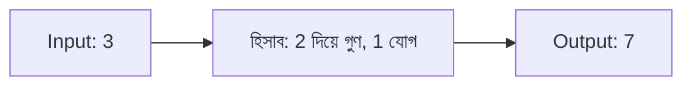

# Lecture 01 — Model-এর হিসাব: Input, হিসাব, Output

> আগে যা জানা থাকলে ভালো: model একটা কিছু predict করে — [Linear Regression-এর prediction](../module-02-linear-regression/lecture-01-prediction-weight-and-bias.md)। এই lecture শেষে পারবে: যেকোনো model-এর হিসাবে input, হিসাব আর output আলাদা করে চিনতে।

## সমস্যাটা কী?

ধরো কেউ বলল, "model দিয়ে বাড়ির দাম বের করো।" কিন্তু model-এর ভেতরে ঠিক কী ঘটছে, সেটা না জানলে বোঝা যায় না কোন অংশ বদলালে কী হবে। তাই আগে একটা model-কে তিন ভাগে ভাগ করে দেখা দরকার।

## ধারণাটা সহজ ভাষায়

Model হলো একটা হিসাবের যন্ত্র। এর তিনটা অংশ:

- **Input**: যে তথ্য ভেতরে ঢোকে। যেমন বাড়ির আয়তন।
- **হিসাব**: ভেতরের নিয়ম, যেটা input নিয়ে কাজ করে।
- **Output**: হিসাবের ফল। যেমন বাড়ির দাম।

নতুন input দিয়ে এই পথে ফল বের করাকে বলে **prediction** (অন্য নাম **inference**)। এই পথে শুধু সামনের দিকে যাওয়া হয়: input থেকে output।

## ছোট একটা উদাহরণ

একটা ছোট model-এর নিয়ম: **input-কে 2 দিয়ে গুণ করো, তারপর 1 যোগ করো।**

```text
Input 3 হলে: 2 × 3 + 1 = 7   → output 7
Input 4 হলে: 2 × 4 + 1 = 9   → output 9
```

দুইবারেই input বদলেছে, আর নিয়ম একই আছে। নিয়মের 2 আর 1 কিন্তু input নয়; ওরা হিসাবের নিজের অংশ। ওদের নিয়ে পরের lecture-এ কথা হবে।

## কোড

একই কাজ Python-এ:

```python
def model(x):
    return 2 * x + 1

print(model(3))
print(model(4))
# output:
# 7
# 9
```

## ছবি



## মনে রাখার সারকথা

- Model-এর তিন অংশ: input, হিসাব, output।
- নতুন input দিলে হিসাবের নিয়ম একই থাকে, শুধু output বদলায়।
- Output বের করা (prediction) আর model-কে শেখানো (training) আলাদা কাজ। এখন শুধু প্রথমটা দেখছি।

## নিজে করো

১. একই নিয়মে input 5 হলে output কত?
২. নিয়ম বদলে "3 দিয়ে গুণ, 2 যোগ" হলে input 2-এর output কত?
৩. কোনটা input, কোনটা output: "বাড়ির আয়তন 1200 বর্গফুট দিলে model বলল 60 লাখ টাকা"?

<details><summary>উত্তর</summary>

১. `2 × 5 + 1 = 11`।
২. `3 × 2 + 2 = 8`।
৩. Input হলো 1200 বর্গফুট, output হলো 60 লাখ টাকা।

</details>

## পরের পাঠ

নিয়মের ভেতরের 2 আর 1 আসলে কী, আর ওরা input থেকে কীভাবে আলাদা: [Lecture 02 — Parameters](lecture-02-parameters-and-hyperparameters.md)।
