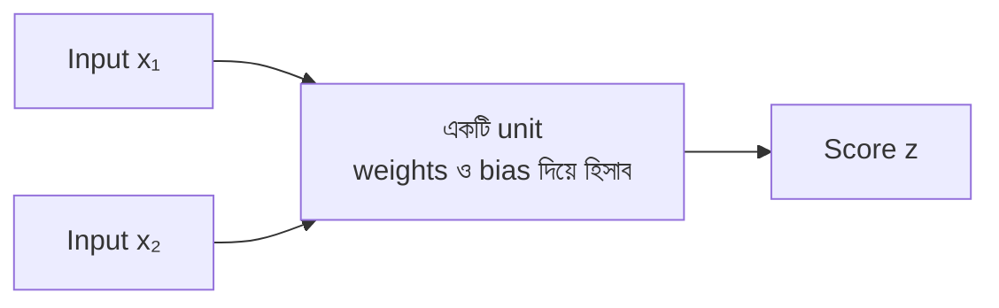

# Lecture 03 — একটি Unit: কয়েকটি input থেকে একটি ফল

> আগে যা জানা থাকলে ভালো: [Parameters (weight ও bias)](lecture-02-parameters-and-hyperparameters.md)। এই lecture শেষে পারবে: দুই বা তিনটা input নিয়ে একটা unit-এর score হাতে হিসাব করতে।

## সমস্যাটা কী?

এতক্ষণ input ছিল একটা সংখ্যা। কিন্তু বাস্তবে একটা বাড়ি সম্পর্কে অনেক তথ্য থাকে: আয়তন, বয়স, রুমের সংখ্যা। এই কয়েকটা তথ্য একসঙ্গে নিয়ে একটা ফল বানানোর ছোট একক দরকার। সেটাই **unit**, যাকে **neuron**-ও বলা হয়। বড় বড় network এই ছোট unit দিয়েই তৈরি।

## ধারণাটা সহজ ভাষায়

একটা unit তিন ধাপে কাজ করে:

1. প্রতিটা input-কে **নিজের weight** দিয়ে গুণ করে।
2. গুণফলগুলো যোগ করে।
3. শেষে **bias** যোগ করে।

এই ফলকে বলে **score**, আর `z` দিয়ে লেখা হয়। মনে রাখার নিয়ম: **যতগুলো input, ততগুলো weight; আর bias থাকে একটাই।**

পরের lecture-এ দেখব, score-কে আরেকটা ধাপ পার করিয়ে unit-এর আসল output বানানো হয় (activation)। এই lecture-এ শুধু score পর্যন্ত যাব।

## ছোট একটা উদাহরণ

Input `[2, 1]`। এটা একটাই উদাহরণ, যার দুটো সংখ্যা আছে। Unit-এর weights `[1, 1]`, bias `0`।

```text
প্রথম input:  2 × 1 = 2
দ্বিতীয় input: 1 × 1 = 1
যোগ করে, bias যোগ: 2 + 1 + 0 = 3
```

Score হলো 3। এই unit-টাকে আমরা **Unit A** বলব; পরের lecture-গুলোতে এটাই বারবার আসবে।

## Formula ও কোড

উপরের কাজটারই সংক্ষিপ্ত রূপ:

`z = x₁ × w₁ + x₂ × w₂ + b`

এখানে `x₁, x₂` input, `w₁, w₂` তাদের weight, `b` bias, আর `z` score। সংখ্যা বসালে: `z = 2×1 + 1×1 + 0 = 3`।

```python
def unit(inputs, weights, bias):
    # প্রতিটা input × নিজের weight, সব যোগ, শেষে bias
    total = 0
    for x, w in zip(inputs, weights):
        total += x * w
    return total + bias

print(unit([2, 1], [1, 1], 0))
print(unit([2, 1], [1, -1], 0))
# output:
# 3
# 1
```

একই input, কিন্তু weights আলাদা হলে ফল আলাদা (3 আর 1)। ঠিক এই কারণেই পরে একাধিক unit পাশাপাশি রাখা কাজের।

## "Neuron" নামটা কেন

Neuron শব্দটা এসেছে মস্তিষ্কের স্নায়ুকোষ থেকে। স্নায়ুকোষ অন্য কোষ থেকে সংকেত নেয়, আর অন্য কোষে সংকেত পাঠায়। Artificial neuron এই ধারণার খুব সরল গাণিতিক রূপ: input নাও, weight দিয়ে প্রভাব ঠিক করো, একটা ফল দাও। অনেক unit একে অন্যের ফল ব্যবহার করে জুড়ে গেলে তাকে **neural network** বলে। নাম মস্তিষ্কের মতো হলেও unit আসলে শুধু গুণ-যোগের হিসাব।

## ছবি



## মনে রাখার সারকথা

- Unit: প্রতিটা input × নিজের weight, সব যোগ, তারপর bias যোগ।
- n টা input হলে n টা weight আর 1টা bias লাগে।
- একই input, ভিন্ন weights হলে ভিন্ন score।

## নিজে করো

১. Input `[3, 2]`, weights `[2, −1]`, bias `1` হলে score কত?
২. Input `[1, 4]`, weights `[0.5, 2]`, bias `−3` হলে score কত?
৩. একটা unit-এ তিনটা input আসে। তার weight আর bias কয়টা করে?

<details><summary>উত্তর</summary>

১. `3×2 + 2×(−1) + 1 = 6 − 2 + 1 = 5`।
২. `1×0.5 + 4×2 − 3 = 0.5 + 8 − 3 = 5.5`।
৩. 3টা weight (প্রতি input-এর জন্য একটা) আর 1টা bias।

</details>

## পরের পাঠ

Score পেলাম, কিন্তু সেটাই কি unit-এর শেষ ফল? পরের ধাপে score-কে বদলে নেওয়া হয়: [Lecture 04 — Activation](lecture-04-activation.md)।
