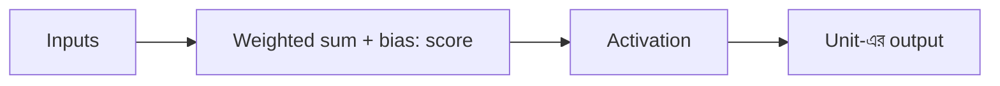

# Lecture 04 — Activation: Score-কে বদলে নেওয়া

> আগে যা জানা থাকলে ভালো: [একটি unit-এর score](lecture-03-one-neuron.md)। এই lecture শেষে পারবে: ReLU ও sigmoid-এর হিসাব করতে, আর বলতে কেন activation ছাড়া network-এর layer বাড়িয়ে লাভ হয় না।

## সমস্যাটা কী?

Unit-এর score শুধু গুণ আর যোগ দিয়ে তৈরি। এখন ধরো আমরা এমন দুটো unit পরপর বসালাম, যাদের কোনো বাড়তি ধাপ নেই। দেখা যায়, দুটো মিলে যা করে, একটা unit একাই তা করতে পারত। তাহলে layer বাড়িয়ে লাভ কী? এই সমস্যা সারাতে score-এর পরে আরেকটা ধাপ লাগে: **activation function**। এটা score-কে একটা নিয়ম দিয়ে বদলে unit-এর আসল output বানায়।

Unit-এর পূর্ণ হিসাব তাই: **weighted sum + bias → score → activation → output।**



## দুটো activation

### ReLU

নিয়ম খুব সহজ: **score negative হলে 0, নইলে যা ছিল তা-ই।**

```text
ReLU(−2) = 0
ReLU(0)  = 0
ReLU(3)  = 3
```

Hidden layer-এ (পরের lecture) সাধারণত ReLU-ই ব্যবহার হয়।

### Sigmoid

Sigmoid যেকোনো সংখ্যাকে **0 আর 1-এর মাঝে** এনে দেয়। সূত্র: `sigmoid(z) = 1 / (1 + e^(−z))`। বড় positive score 1-এর কাছে যায়, বড় negative score 0-এর কাছে যায়, আর 0 যায় ঠিক 0.5-এ।

| z | −4 | −2 | 0 | 2 | 4 |
|---|---|---|---|---|---|
| sigmoid(z) | 0.018 | 0.119 | 0.5 | 0.881 | 0.982 |

তাই yes/no ধরনের কাজে (spam কি না) শেষ unit-এ sigmoid বসিয়ে ফলটাকে probability হিসেবে পড়া যায়। এই sigmoid আগে [Logistic Regression-এর পাঠে](../module-03-logistic-regression/lecture-01-sigmoid.md) দেখা হয়েছে।

```python
import math

def relu(z):
    return max(0, z)

def sigmoid(z):
    return 1 / (1 + math.exp(-z))

for z in [-2, 0, 3]:
    print("ReLU(", z, ") =", relu(z))
for z in [-2, 0, 2]:
    print("sigmoid(", z, ") =", round(sigmoid(z), 3))
# output:
# ReLU( -2 ) = 0
# ReLU( 0 ) = 0
# ReLU( 3 ) = 3
# sigmoid( -2 ) = 0.119
# sigmoid( 0 ) = 0.5
# sigmoid( 2 ) = 0.881
```

## কেন activation লাগে

দুটো unit পরপর বসালাম, কোনো activation ছাড়া:

```text
প্রথম unit:  h = 2x + 1
দ্বিতীয় unit: y = 3h + 4

বসিয়ে দিলে: y = 3(2x + 1) + 4 = 6x + 7
```

দুই ধাপ মিলে আসলে একটাই `6x + 7`। একটা unit দিয়েই এটা হয়ে যেত। তাই শুধু গুণ-যোগের layer যত বাড়াও, model-এর ক্ষমতা বাড়ে না।

এবার প্রথম ধাপের পরে ReLU বসাই: `h = ReLU(2x + 1)`, `y = 3h + 4`।

| x | ReLU ছাড়া: `6x + 7` | ReLU-সহ: `3 × ReLU(2x + 1) + 4` |
|---|---|---|
| −2 | −5 | 4 |
| −1 | 1 | 4 |
| 0 | 7 | 7 |
| 1 | 13 | 13 |

ReLU ছাড়া ফল সোজা একটা রেখা ধরে চলে। ReLU-সহ ফল x-এর ছোট মানে 4-এ আটকে থাকে, তারপর বাড়তে শুরু করে। অর্থাৎ রেখায় একটা **বাঁক** এসেছে। এমন বাঁক জোড়া দিয়ে অনেক unit মিলে জটিল সম্পর্কও ধরতে পারে। এই বাঁক আনাটাই activation-এর আসল কাজ।

সাবধান: ReLU-এর output 0 হলে unit "মরে যায়" না। অন্য input-এ একই unit-এর score positive হতে পারে।

## আরও যা জানা ভালো

- Output-এ কোন activation বসবে, কাজের উপর নির্ভর করে: সংখ্যা predict করলে সাধারণত কিছুই বসে না (output-এর মান যা-ই হতে পারে), yes/no হলে sigmoid। এর বিস্তারিত [Lecture 09](lecture-09-designing-a-model-architecture.md)-এ।
- GELU, tanh, softmax নামের আরও activation আছে। যে module-এ লাগবে, সেখানেই শেখা হবে; এখন মুখস্থ করার দরকার নেই।
- ReLU আর sigmoid-এর নিজের কোনো শেখার মতো parameter নেই। Training-এ activation-এর derivative লাগে; সেটা [Module 10](../module-10-neural-network-training/lecture-01-loss-gradient-and-backpropagation.md)-এ আসবে।

## মনে রাখার সারকথা

- Activation score-কে বদলে unit-এর output বানায়: ReLU নেগেটিভকে 0 করে, sigmoid সবকিছুকে 0–1-এর মাঝে আনে।
- Activation ছাড়া অনেক layer মিলে একটা layer-এর সমান কাজই করে।
- Activation রেখায় বাঁক আনে, তাই network জটিল সম্পর্ক ধরতে পারে।

## নিজে করো

১. `ReLU(−5)` আর `ReLU(4)` কত?
২. `sigmoid(0)` কত?
৩. `h = ReLU(2x + 1)`, `y = 3h + 4` হলে `x = −3`-এ y কত? আর ReLU না থাকলে (`y = 6x + 7`) কত?

<details><summary>উত্তর</summary>

১. `ReLU(−5) = 0`, `ReLU(4) = 4`।
২. `0.5`, কারণ `1 / (1 + e⁰) = 1 / 2`।
৩. `2×(−3) + 1 = −5`, ReLU-র পরে `0`, তাই `y = 3×0 + 4 = 4`। ReLU ছাড়া `y = 6×(−3) + 7 = −11`। দুটো ফল আলাদা, এটাই বাঁকের প্রমাণ।

</details>

## পরের পাঠ

একটা unit-এর পুরো হিসাব এখন জানা। অনেক unit একসঙ্গে সাজালে কী হয়: [Lecture 05 — পাশাপাশি Unit ও পরপর Layer](lecture-05-hidden-layer.md)।
