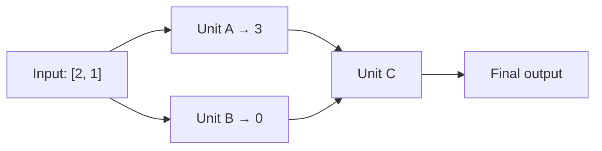

# Lecture 05 — পাশাপাশি Unit ও পরপর Layer

> আগে যা জানা থাকলে ভালো: [একটি unit](lecture-03-one-neuron.md) ও [activation](lecture-04-activation.md)। এই lecture শেষে পারবে: দুই unit-এর একটা layer হাতে হিসাব করতে, আর পরের layer-এর input কোথা থেকে আসে তা বলতে।

## সমস্যাটা কী?

একটা unit একটা মাত্র ফল দেয়। একই input থেকে একটা মাত্র হিসাব দিয়ে জটিল সম্পর্ক ধরা কঠিন। তাই একই input নিয়ে একাধিক আলাদা হিসাব দরকার, আর তারপর সেই ফলগুলো নিয়ে আবার হিসাব। এখানে দুটো আলাদা ধারণা আছে: **পাশাপাশি** unit আর **পরপর** layer।

## ধারণা ১: পাশাপাশি unit মিলে একটা layer

Lecture 03-এর Unit A-এর পাশে আরেকটা Unit B রাখি। দুটোই **একই input** পায়, কিন্তু প্রত্যেকের weights আলাদা। A-র ফল B পায় না, B-র ফল A পায় না। এমন পাশাপাশি unit-এর দলকে **layer** বলে।

Input `[2, 1]`। দুটো unit-এই bias 0 আর activation ReLU।

| Unit | Weights | Score | ReLU-র পরে output |
|---|---|---|---|
| A | `[1, 1]` | `2×1 + 1×1 = 3` | 3 |
| B | `[−1, 1]` | `2×(−1) + 1×1 = −1` | 0 |

Layer-এর output হলো দুটো ফল পাশাপাশি: **`[3, 0]`**। এগুলো যোগ করা হয়নি, আলাদাই থাকে।

সাবধান: input ভাগ হয়নি। A শুধু 2 আর B শুধু 1 পায়নি; দুজনেই পুরো `[2, 1]` পেয়েছে। ফল আলাদা হয়েছে weights আলাদা বলে। B-র output 0 হয়েছে ReLU-র কারণে, B মুছে যায়নি।

## ধারণা ২: পরপর layer

এবার তৃতীয় একটা Unit C বসাই, যেটা A আর B-র ফল `[3, 0]` input হিসেবে নেবে। C মূল `[2, 1]` সরাসরি পায় না।

| সম্পর্ক | Input কোথা থেকে আসে |
|---|---|
| একই layer-এর A আর B | দুজনেই মূল `[2, 1]` পায় |
| পরের layer-এর C | A আর B-র ফল `[3, 0]` পায় |

সহজ করে বললে: **পাশাপাশি unit একই তথ্য থেকে আলাদা ফল বানায়। পরপর layer আগের layer-এর ফল থেকে নতুন ফল বানায়।**

ছবিতে X থেকে A আর B দুজনের কাছেই তীর আছে। A থেকে B-তে তীর নেই। C-র হিসাব পুরোটা [পরের lecture](lecture-06-forward-pass.md)-এ আছে।

## দুটো নাম: hidden আর dense

- **Hidden layer**: input আর final output-এর মাঝের layer। এখানে A আর B-র layer hidden। "Hidden" মানে মাঝখানে আছে। ওর মান দেখা যায় না, এমন নয়।
- **Output layer**: শেষ layer। এখানে C।
- **Dense** (বা fully connected) layer: যেখানে প্রতিটা unit আগের সব মান পায়। A আর B দুজনেই সব input পেয়েছে, তাই এই layer dense।

## মনে রাখার সারকথা

- পাশাপাশি unit একই input নেয় এবং আলাদা ফল দেয়; সেই ফলগুলো সাজালে layer-এর output হয় (যেমন `[3, 0]`)।
- পরের layer আগের layer-এর ফলকে নিজের input বানায়।
- Hidden মানে input আর output-এর মাঝখানে থাকা layer।

## নিজে করো

১. Input `[4, 1]` হলে A আর B-র output কত? (A: weights `[1, 1]`, B: weights `[−1, 1]`, bias 0, ReLU)
২. Unit B-র weights বদলে `[0, 2]` করলে, input `[2, 1]`-এ B-র output কত?
৩. Unit C-র input কয়টা সংখ্যা, আর কোথা থেকে আসে?

উত্তর

১. A: `4 + 1 = 5`, ReLU-র পরে 5। B: `−4 + 1 = −3`, ReLU-র পরে 0। Layer-এর output `[5, 0]`।
২. `2×0 + 1×2 = 2`, ReLU(2) = 2।
৩. দুটো সংখ্যা, কারণ hidden layer-এ দুটো unit (A, B)। সংখ্যা দুটো আসে A আর B-র output থেকে।

## পরের পাঠ

এই পুরো network-এ input ঢুকে final output বের হওয়ার হিসাব একবার শুরু থেকে শেষ পর্যন্ত: [Lecture 06 — Forward Pass](lecture-06-forward-pass.md)।
