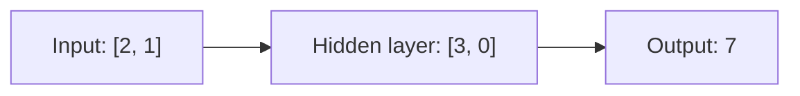

# Lecture 06 — Forward Pass: ছোট Network-এর পুরো হিসাব

> আগে যা জানা থাকলে ভালো: [hidden layer ও পরপর layer](lecture-05-hidden-layer.md)। এই lecture শেষে পারবে: দুই layer-এর একটা ছোট network-এর input থেকে output পর্যন্ত পুরো হিসাব নিজে করতে।

## সমস্যাটা কী?

Unit আর layer আলাদা আলাদা বোঝা হলো। কিন্তু model আসলে একটা input নিয়ে শুরু থেকে শেষ পর্যন্ত কী করে, সেটা একবার পুরোটা না দেখলে ছবিটা সম্পূর্ণ হয় না। Input থেকে output পর্যন্ত এই একমুখী হিসাবের নাম **forward pass**। Prediction বের করার সময় model ঠিক এটাই করে।

## Network-টা কেমন

নাম `2 → 2 → 1`: দুটো input, hidden layer-এ দুটো unit (A, B), output layer-এ একটা unit (C)। Parameters এখানে হিসাব বোঝানোর জন্য বেছে নেওয়া; training করে পাওয়া নয়।

| Unit | কী input পায় | Weights | Bias | Activation |
|---|---|---|---|---|
| A | মূল input `[2, 1]` | `[1, 1]` | 0 | ReLU |
| B | মূল input `[2, 1]` | `[−1, 1]` | 0 | ReLU |
| C | A ও B-র output | `[2, 1]` | 1 | নেই |

C-র শেষে কোনো activation নেই, কারণ আমরা সরাসরি একটা সংখ্যা চাই (যেমন দাম)।

## ধাপে ধাপে হিসাব

**ধাপ ১: hidden layer।** A আর B একই input `[2, 1]` নেয়।

```text
A-র score  = 2×1 + 1×1 + 0     = 3     → ReLU(3)  = 3
B-র score  = 2×(−1) + 1×1 + 0  = −1    → ReLU(−1) = 0
Hidden layer-এর output: [3, 0]
```

**ধাপ ২: output unit।** C মূল input পায় না। সে পায় `[3, 0]`।

```text
C-র score = 3×2 + 0×1 + 1 = 7     (activation নেই, তাই output = 7)
```

**Prediction: 7।**

সাবধান: C-র weights `[2, 1]` দেখতে মূল input `[2, 1]`-এর মতো, কিন্তু ওরা আলাদা জিনিস। `[2, 1]` C-র weights (parameters), আর C-র প্রকৃত input হলো `[3, 0]`।



## কোড

```python
def relu(z):
    return max(0, z)

def unit(inputs, weights, bias):
    return sum(x * w for x, w in zip(inputs, weights)) + bias

x = [2, 1]

# hidden layer: A ও B একই x পায়
score_a = unit(x, [1, 1], 0)
score_b = unit(x, [-1, 1], 0)
hidden = [relu(score_a), relu(score_b)]

# output unit C: hidden-এর ফল পায়, activation নেই
y = unit(hidden, [2, 1], 1)

print("score A, B:", score_a, score_b)
print("hidden:", hidden)
print("output:", y)
# output:
# score A, B: 3 -1
# hidden: [3, 0]
# output: 7
```

কোডের ফল হাতে-হিসাবের সঙ্গে মিলেছে: hidden `[3, 0]`, output 7।

এই পুরো pass-এ কোনো weight বদলায়নি। আর model 7 বলেছে মানেই 7 ঠিক, তা নয়। ঠিক কি না বোঝা যায় আসল target-এর সঙ্গে মিলিয়ে, যেটা training-এর কাজ ([Lecture 08](lecture-08-architecture-vs-training.md))।

## মনে রাখার সারকথা

- Forward pass: input → প্রতিটা layer পরপর → output। Parameters শুধু ব্যবহার হয়, বদলায় না।
- একই layer-এর unit-রা একই input পায়; পরের layer আগের layer-এর output পায়।
- ধাপগুলো আলাদা রাখো: input, প্রতি unit-এর score, activation-এর পরের output, শেষে prediction।

## নিজে করো

একই network-এ (parameters অপরিবর্তিত):

১. Input `[1, 2]` হলে hidden layer-এর output আর final prediction কত?
২. Input `[0, 3]` হলে prediction কত?
৩. Input `[4, 1]` হলে prediction কত?

<details><summary>উত্তর</summary>

১. A: `1 + 2 = 3`, ReLU → 3। B: `−1 + 2 = 1`, ReLU → 1। Hidden `[3, 1]`। Prediction `3×2 + 1×1 + 1 = 8`।
২. A: `0 + 3 = 3` → 3। B: `0 + 3 = 3` → 3। Hidden `[3, 3]`। Prediction `3×2 + 3×1 + 1 = 10`।
৩. A: `4 + 1 = 5` → 5। B: `−4 + 1 = −3` → 0। Hidden `[5, 0]`। Prediction `5×2 + 0×1 + 1 = 11`।

</details>

## পরের পাঠ

এই network-এ কয়টা weight আর bias আছে, আর layer জোড়া লাগাতে সংখ্যাগুলো কীভাবে মিলতে হয়: [Lecture 07 — Shape ও Parameter Count](lecture-07-shapes-and-parameter-count.md)।
