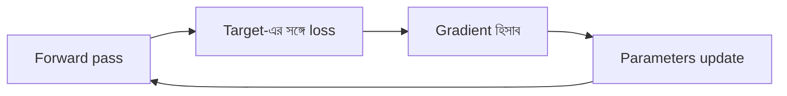

# Lecture 08 — Architecture, Parameters ও Training আলাদা করা

> আগে যা জানা থাকলে ভালো: [forward pass](lecture-06-forward-pass.md) ও [parameter count](lecture-07-shapes-and-parameter-count.md)। এই lecture শেষে পারবে: "model খারাপ চলছে" শুনলে বলতে কোন অংশ বদলানো যায় — গঠন, মান, না শেখানোর setting।

## সমস্যাটা কী?

"Model" শব্দটা অনেক কিছু বোঝাতে পারে: network-এর ছবি, তার ভেতরের সংখ্যা, আবার শেখানোর পদ্ধতিও। এগুলো গুলিয়ে ফেললে "ফল খারাপ, এখন কী বদলাব?" প্রশ্নের উত্তর পাওয়া যায় না। তাই তিনটাকে আলাদা করে চিনতে হবে।

## ধারণাটা সহজ ভাষায়

- **Architecture**: গঠন। কয়টা layer, প্রতিটায় কয়টা unit, কোন activation, কে কার ফল পায়। যেমন `2 → 2 → 1`।
- **Parameters**: ওই গঠনের ভেতরের weight আর bias-এর বর্তমান মান।
- **Training**: parameters-এর মান ঠিক করার প্রক্রিয়া। গঠন এতে সাধারণত বদলায় না।

একই architecture-এ ভিন্ন parameters বসালে ভিন্ন ফল আসে। তাই শুধু network-এর ছবি দেখে বলা যায় না model কী করবে।

## ছোট একটা উদাহরণ

Input `[2, 1]`, একই `2 → 2 → 1` architecture। দুই সেট parameters:

| | A-র weights | B-র weights | C-র weights ও bias | Prediction |
|---|---|---|---|---|
| সেট ১ | `[1, 1]` | `[−1, 1]` | `[2, 1]`, bias 1 | **7** |
| সেট ২ | `[0, 1]` | `[1, 0]` | `[1, 1]`, bias 0 | **3** |

গঠন একই, মান আলাদা, তাই ফল আলাদা (7 আর 3)। সেট ২-এর হিসাব: A = ReLU(0×2 + 1×1) = 1, B = ReLU(1×2 + 0×1) = 2, prediction = 1×1 + 2×1 + 0 = 3।

## Training-এ কী কী ঘটে

ধরো আসল উত্তর (target) 5, আর model সেট ১-এ 7 বলেছে। Training-এর এক পাক এভাবে চলে:

1. **Forward pass**: prediction বের করা। (7)
2. **Loss**: prediction কতটা ভুল তা একটা সংখ্যায় মাপা। একটা সহজ মাপ হলো ভুলের বর্গ: `(7 − 5)² = 4`।
3. **Gradient**: প্রতিটা parameter সামান্য বদলালে loss কোন দিকে কতটা বদলাবে, তা হিসাব করা।
4. **Update**: সেই দিক ধরে parameters সামান্য বদলে দেওয়া, যাতে loss কমে।

এরপর আবার forward pass, আবার loss, এভাবে চলতে থাকে।



Neural network-এ gradient হিসাব করার পদ্ধতির নাম **backpropagation**। আর gradient দিয়ে parameters বদলায় **optimizer** (যেমন gradient descent)। দুটো আলাদা কাজ: একজন "কোন দিকে" বের করে, অন্যজন সেই দিকে "বদলায়"। এর গণিত [Module 10](../module-10-neural-network-training/lecture-01-loss-gradient-and-backpropagation.md)-এ আসবে। একটা weight-এর gradient descent আগেই দেখা হয়েছে [এখানে](../module-02-linear-regression/lecture-03-gradient-descent-training.md)।

সাধারণ prediction-এর সময় শুধু ধাপ ১ চলে। Loss, gradient আর update লাগে না।

## কোন পরিবর্তন কোন ভাগে পড়ে

| পরিবর্তন | কোন ভাগ |
|---|---|
| Hidden unit 2 থেকে 4 করা | Architecture |
| আরেকটা hidden layer যোগ করা | Architecture |
| Weights `[1, 1]` থেকে `[1.2, 0.9]` হওয়া | Parameters (training-এর ফল) |
| শেখানোর গতি (learning rate) কমানো | Training setting |

এগুলো আলাদা সিদ্ধান্ত। একসঙ্গে দুটো বদলালে ফল কেন বদলাল তা বোঝা যায় না, তাই design করার সময় একবারে একটা বদলানো ভালো।

## কোড

```python
def relu(z):
    return max(0, z)

def unit(inputs, weights, bias):
    return sum(x * w for x, w in zip(inputs, weights)) + bias

def network(x, p):
    # architecture: 2 -> 2 -> 1 (সব সময় একই)
    h = [relu(unit(x, p["A"], 0)), relu(unit(x, p["B"], 0))]
    return unit(h, p["C"], p["c_bias"])

set1 = {"A": [1, 1], "B": [-1, 1], "C": [2, 1], "c_bias": 1}
set2 = {"A": [0, 1], "B": [1, 0], "C": [1, 1], "c_bias": 0}

print(network([2, 1], set1))
print(network([2, 1], set2))

prediction, target = 7, 5
print((prediction - target) ** 2)
# output:
# 7
# 3
# 4
```

## মনে রাখার সারকথা

- Architecture হলো গঠন, parameters হলো ভেতরের মান, training হলো সেই মান ঠিক করার প্রক্রিয়া।
- Training-এর এক পাক: forward → loss → gradient → update। Prediction-এ শুধু forward।
- Backpropagation gradient বের করে; optimizer parameters বদলায়।

## নিজে করো

১. Hidden unit 2 থেকে 3 করা: architecture, parameters, নাকি training setting-এর পরিবর্তন?
২. Learning rate 0.1 থেকে 0.01 করা কোন ভাগে পড়ে?
৩. Prediction 8, target 5 হলে ভুলের বর্গ (loss) কত? ওপরের 7-এর ক্ষেত্রে loss ছিল 4। কোনটা বেশি ভুল?

<details><summary>উত্তর</summary>

১. Architecture। Unit সংখ্যা বদলালে গঠন বদলায়। এতে parameter count-ও বদলায়।
২. Training setting। গঠন বা parameter-এর মান নিজে বদলায়নি; শেখানোর গতি বদলেছে।
৩. `(8 − 5)² = 9`। 9 > 4, তাই prediction 8 বেশি ভুল।

</details>

## পরের পাঠ

এই ভাগগুলো হাতে নিয়ে নিজের কাজের জন্য architecture কীভাবে বেছে নিতে হয়: [Lecture 09 — Architecture Design](lecture-09-designing-a-model-architecture.md)।
