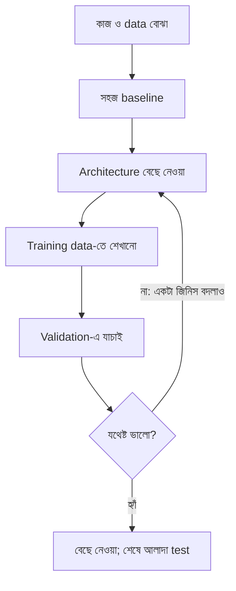

# Lecture 09 — Architecture কীভাবে বেছে নেওয়া হয়

> আগে যা জানা থাকলে ভালো: [Architecture, parameters ও training-এর ভাগ](lecture-08-architecture-vs-training.md) এবং [parameter count](lecture-07-shapes-and-parameter-count.md)। এই lecture শেষে পারবে: একটা সহজ কাজের জন্য input, output, hidden layer ও activation বেছে নিয়ে তার parameter count বলতে।

## সমস্যাটা কী?

Unit, layer, activation সব জানা হলো। এবার একটা আসল কাজ এল: "বাড়ির দাম predict করো।" কয়টা layer দেব? কয়টা unit? শেষে কোন activation? সবচেয়ে বড় network বানালেই কি সবচেয়ে ভালো ফল? না। ML engineer-রা এখানে একটা নির্দিষ্ট ক্রম মেনে ভাবেন।

## ধারণাটা সহজ ভাষায়: পাঁচটা প্রশ্ন

**১. Output কী চাই?** এটা আগে ঠিক হয়, কারণ শেষ layer এর উপর নির্ভর করে।

| কাজ | Output unit | শেষ activation |
|---|---|---|
| সংখ্যা predict (দাম, তাপমাত্রা) | 1টা | নেই |
| Yes/no (spam কি না) | 1টা | sigmoid (probability পাওয়ার জন্য) |

সংখ্যা predict করার সময় sigmoid দিলে ফল 0–1-এর মধ্যে আটকে যাবে। দাম তো 60 লাখও হতে পারে। তাই সেখানে sigmoid দেওয়া যায় না। দুইয়ের বেশি class-এর কাজে (যেমন কোন অক্ষর) softmax নামের আরেকটা activation লাগে; সেটা পরে Module 12-এ।

**২. Input কী কী?** কয়টা feature, কী তাদের মানে, সংখ্যায় প্রকাশ করা আছে কি না। এটাই network-এর প্রথম layer-এর input সংখ্যা ঠিক করে। এই lecture-এ ধরে নিচ্ছি input কয়েকটা সংখ্যা। ছবি আর লেখার input অন্যভাবে সাজাতে হয়, সেটা Module 11 ও 12-এ।

**৩. সহজ baseline দিয়ে শুরু করো।** বাড়ির তিনটা feature থেকে দাম বের করতে প্রথমে Linear Regression চালানো যায়। এটা যথেষ্ট ভালো হলে hidden layer-এর দরকারই নেই। Baseline-এর চেয়ে ভালো না হলে জটিল model রাখার কোনো মানে নেই।

**৪. দরকার হলে ছোট network বানাও।** তখন তিনটা সিদ্ধান্ত: hidden layer কয়টা, প্রতিটায় unit কয়টা, activation কোনটা (hidden-এ সাধারণত ReLU)। এগুলো আমরা বেছে নিই; data এদের সরাসরি বলে দেয় না। একটা সম্ভাব্য গঠন `3 → 4 → 1`।

**৫. Validation-এ যাচাই করো।** শেখানো model-কে training-এ দেখা হয়নি এমন data-তে পরীক্ষা করে দেখা হয় আসলেই ভালো কি না। ভালো না হলে একটা জিনিস বদলে আবার চেষ্টা। বিস্তারিত পাওয়া যাবে [train/validation/test split](../module-05-data-preparation-and-splits/lecture-03-train-validation-test-split.md)-এর পাঠে।

## ছোট একটা উদাহরণ

বাড়ির দাম: ৩টা input (আয়তন, রুমের সংখ্যা, বয়স), ১টা সংখ্যা output।

| Model | গঠন | Parameter |
|---|---|---|
| Baseline: Linear Regression | `3 → 1` | `(3 + 1) × 1 = 4` |
| ছোট neural network | `3 → 4 → 1` | `(3 + 1) × 4 + (4 + 1) × 1 = 21` |

Network-এ 21টা parameter, baseline-এ 4টা। বেশি parameter মানে বেশি জটিল সম্পর্ক ধরার সুযোগ, কিন্তু সঙ্গে বেশি data লাগে, আর training data মুখস্থ করে ফেলার (overfitting) ঝুঁকিও বাড়ে। তাই "বেশি layer মানেই ভালো" নয়। Validation-এ network baseline-কে হারালেই তাকে রাখা হয়।

```python
def dense_params(n_inputs, n_units):
    return (n_inputs + 1) * n_units

print(dense_params(3, 1))
print(dense_params(3, 4) + dense_params(4, 1))
# output:
# 4
# 21
```

## ছবি



সাবধান: চূড়ান্ত test set বারবার দেখে design বদলালে test আর নিরপেক্ষ থাকে না। Design-এর সিদ্ধান্ত validation দিয়ে নিতে হয়; test শেষে একবার।

## দুটো ভুল ধারণা

- **Pixel-এর সংখ্যা মানে layer-এর সংখ্যা নয়।** `100 × 100` RGB ছবিতে `100 × 100 × 3 = 30,000` মান আছে, কিন্তু তার মানে 30,000 layer নয়। এটা data-র shape। Layer-এর সংখ্যা মানে কয়টা ধাপ পরপর হিসাব হচ্ছে।
- **Model আর পুরো ML system এক নয়।** Model হলো input থেকে output-এর হিসাব। Data জোগাড়, পরিষ্কার করা, API দিয়ে চালু রাখা, নজরদারি: এগুলো পুরো system-এর অংশ। এই module শুধু model-এর ভেতরের গঠন নিয়ে।

একটা বাস্তব project-এ এই ভাবনা কীভাবে খাটে তা পরে [Module 14](../module-14-ocr-system-case-study/README.md)-এ দেখা হবে।

## মনে রাখার সারকথা

- আগে output (কী চাই), তারপর input, তারপর সহজ baseline, তারপর ছোট network, শেষে validation।
- Output activation কাজ ঠিক করে: সংখ্যায় কিছু নয়, yes/no-তে sigmoid।
- বেশি parameter মানেই ভালো নয়; baseline-কে হারালেই জটিল model রাখো।

## নিজে করো

১. Spam ধরার model: 10টা feature input, hidden layer-এ 5টা unit, 1টা output। গঠন লেখো, শেষ activation বলো, আর parameter গুনে দেখাও।
২. দাম predict করার network-এর শেষ unit-এ sigmoid দিলে কী সমস্যা?
৩. "Hidden layer বাড়ালাম" আর "learning rate কমালাম" — কোনটা architecture-এর পরিবর্তন?

<details><summary>উত্তর</summary>

১. গঠন `10 → 5 → 1`। শেষ activation sigmoid। Parameter: `(10 + 1) × 5 = 55`, `(5 + 1) × 1 = 6`, মোট `61`।
২. Output 0–1-এর মাঝে আটকে যাবে, কিন্তু দাম 60 লাখের মতো বড় সংখ্যা। তাই সংখ্যা predict-এ শেষে activation দেওয়া হয় না।
৩. "Hidden layer বাড়ালাম" architecture-এর পরিবর্তন। Learning rate training setting।

</details>

## পরের পাঠ

Module 09 শেষ। Network কীভাবে শেখে (loss, gradient, backpropagation) তার জন্য [Module 10](../module-10-neural-network-training/README.md)। এক পাতায় সব ধারণার মানচিত্র দেখতে চাইলে [Reference](reference-architecture-overview.md)।
