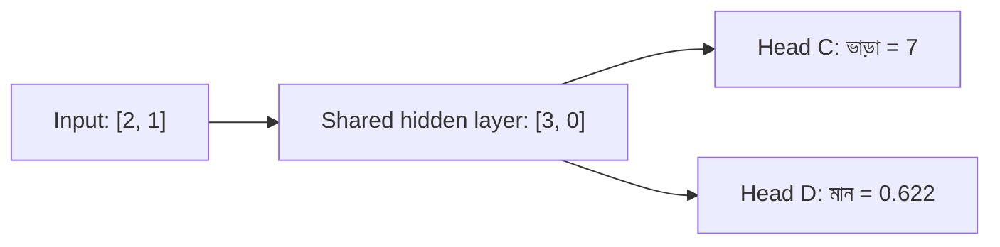

# Lecture 10 — একাধিক Output: এক score, নাকি কয়েকটা Head?

> আগে যা জানা থাকলে ভালো: [Forward pass](lecture-06-forward-pass.md) এবং [Architecture বেছে নেওয়া](lecture-09-designing-a-model-architecture.md)। এই lecture শেষে পারবে: একটা model থেকে দুটো ফল চাইলে "এক score + নিয়ম" আর "দুটো output unit"-এর মধ্যে বেছে নিতে, আর দুটোর parameter ও loss হিসাব করতে।

## সমস্যাটা কী?

এলাকার তথ্য (আয়তন, রুমের সংখ্যা) থেকে model দুটো জিনিস বলবে: **ভাড়া কত** (একটা সংখ্যা) আর **বাসাটা ভালো মানের কি না** (yes/no)। এ পর্যন্ত আমরা একটাই output unit দেখেছি। দুটো ফল কীভাবে পাব? একটা score থেকে দুটোই বের করব, নাকি দুটো আলাদা output রাখব?

## ধারণাটা সহজ ভাষায়

**পথ ১: এক score + নিয়ম।** Model একটাই সংখ্যা `s` দেয়। তারপর হাতে-লেখা নিয়ম: "`s` থেকে ভাড়া এই সূত্রে, আর `s` একটা সীমার বেশি হলে মান ভালো।" দুটো ফল একই সংখ্যা থেকে আসে, তাই পরস্পরবিরোধী হয় না। কিন্তু নিয়মটা model শেখেনি, আমরা লিখেছি। সম্পর্কটা আগে থেকে জানা থাকলে তবেই এটা খাটে।

**পথ ২: একাধিক output।** Hidden layer একটাই থাকে, তার উপরে একাধিক output unit বসে। প্রতিটা output unit-কে বলে একেকটা **head**। প্রতিটা head-এর নিজের weights, bias, activation আর target থাকে। Hidden layer সবার জন্য এক (**shared**), তাই এলাকা সম্পর্কে যা শেখে তা দুই head-ই কাজে লাগায়।

| | পথ ১: এক score + নিয়ম | পথ ২: দুই head |
|---|---|---|
| দ্বিতীয় ফল আসে | হাতে-লেখা নিয়ম থেকে | data থেকে শেখা weights থেকে |
| Label লাগে | শুধু ভাড়ার | ভাড়া **আর** মান, দুটোরই |
| পরস্পরবিরোধী ফল | হয় না | হতে পারে |

**দুটোই ঠিক হলে কি পথ ২ ভালো?** তিনটা শর্ত একসঙ্গে মিললে:

1. দুটো ফলই সত্যিই দরকার।
2. দুটোর জন্যই আসল label আছে।
3. একটা আরেকটার সরল সূত্র নয়। "ভাড়া ৮ হাজারের বেশি হলেই ভালো" হলে দ্বিতীয় head শুধু বাড়তি জটিলতা।

শর্ত না মিললে পথ ১-ই সহজ ও নিরাপদ। আর কাজ দুটো একেবারে সম্পর্কহীন হলে shared hidden layer উল্টো ক্ষতি করতে পারে; তখন আলাদা model ভালো।

Head-এর activation ফলের ধরনে ঠিক হয়: সংখ্যায় কিছু নয়, yes/no-তে sigmoid। তিন বা তার বেশি ভাগ থেকে একটা বাছতে হলে (যেমন এলাকার ধরন) প্রতি ভাগে একটা unit আর softmax, যা [Module 12](../module-12-text-sequences-and-multimodal-models/lecture-03-logits-and-softmax.md)-এ।

সাবধান: এলাকার নাম বা কোড input হলে আগে সংখ্যায় বদলাতে হয় ([Encoding](../module-05-data-preparation-and-splits/lecture-02-encoding-and-scaling.md))। নইলে কোড `1205` কে `1100`-এর চেয়ে "বড়" ধরে নেওয়া হয়।

## ছোট একটা উদাহরণ

[Lecture 06-এর network](lecture-06-forward-pass.md): input `[2, 1]`, hidden `[3, 0]`। আগের unit C এখন ভাড়ার head। পাশে নতুন head D (মান)।

| Head | Hidden থেকে input | Weights | Bias | Activation |
|---|---|---|---|---|
| C (ভাড়া) | `[3, 0]` | `[2, 1]` | 1 | নেই |
| D (মান) | `[3, 0]` | `[0.5, −1]` | −1 | sigmoid |

```text
C-র score = 3×2 + 0×1 + 1       = 7     → ভাড়া 7
D-র score = 3×0.5 + 0×(−1) − 1  = 0.5   → sigmoid(0.5) = 0.622
```

Parameter ([Lecture 07-এর সূত্র](lecture-07-shapes-and-parameter-count.md)): shared hidden `(2+1)×2 = 6`, head C `3`, head D `3`, মোট `12`। দুটো সম্পূর্ণ আলাদা network বানালে `(6+3)×2 = 18`।

Loss: দুই head-এর ভুল আলাদা মেপে যোগ করা হয়। আসল ভাড়া 8, আসল মান "ভালো" (target 1) হলে:

```text
ভাড়ার loss = (7 − 8)²    = 1      (MSE)
মানের loss  = −ln(0.622)  = 0.474  (log loss)
মোট loss    = 1 + 0.474   = 1.474
```

সাবধান: ভাড়া টাকায় (10000 বনাম 12000) হলে ভাড়ার loss `4,000,000` হয় আর মানের head কার্যত শেখে না। তাই ভাড়া ছোট scale-এ (হাজারে) আনা হয়, নইলে `মোট = ভাড়ার loss + λ × মানের loss` লেখা হয়। `λ` আমাদের বেছে দেওয়া hyperparameter। Loss-এর বিস্তারিত: [MSE](../module-02-linear-regression/lecture-02-error-and-mean-squared-error.md), [log loss](../module-03-logistic-regression/lecture-03-log-loss.md)।

## কোড

```python
import math

def relu(z): return max(0, z)
def sigmoid(z): return 1 / (1 + math.exp(-z))
def unit(xs, ws, b): return sum(x * w for x, w in zip(xs, ws)) + b

x = [2, 1]
hidden = [relu(unit(x, [1, 1], 0)), relu(unit(x, [-1, 1], 0))]  # shared

rent = unit(hidden, [2, 1], 1)                  # head C, no activation
quality = sigmoid(unit(hidden, [0.5, -1], -1))  # head D, sigmoid

total = (rent - 8) ** 2 + (-math.log(quality))
print("hidden:", hidden)
print("rent:", rent, "quality:", round(quality, 3))
print("total loss:", round(total, 3))
# output:
# hidden: [3, 0]
# rent: 7 quality: 0.622
# total loss: 1.474
```

## ছবি



## মনে রাখার সারকথা

- Hidden layer-এর উপরে একাধিক head বসানো যায়; প্রতিটার নিজের activation ও target।
- দুটো ফল দরকার, দুটোর label আছে, আর একটা আরেকটার সূত্র নয়: তখন দুই head। নইলে এক score + নিয়ম।
- মোট loss = প্রতি head-এর loss-এর যোগ; scale মেলাতে হবে, নইলে বড় loss ছোটটাকে চাপা দেয়।

## নিজে করো

১. এই network-এ input `[1, 2]` হলে hidden, ভাড়া আর মানের score কত? (`sigmoid(−0.5) ≈ 0.378` ধরো।)
২. Shared hidden `3 → 4`, তার উপরে head তিনটা (ভাড়া ১টা unit, মান ১টা, এলাকার ধরন ৩টা): মোট parameter কত?
৩. কোন ক্ষেত্রে দ্বিতীয় head না রেখে এক score + নিয়ম ভালো?

<details><summary>উত্তর</summary>

১. A: `1 + 2 = 3` → 3। B: `−1 + 2 = 1` → 1। Hidden `[3, 1]`। ভাড়া `3×2 + 1×1 + 1 = 8`। মানের score `3×0.5 + 1×(−1) − 1 = −0.5`, probability ≈ 0.378।
২. Hidden `(3+1)×4 = 16`। ভাড়া `(4+1)×1 = 5`। মান `5`। এলাকার ধরন `(4+1)×3 = 15`। মোট `16 + 5 + 5 + 15 = 41`।
৩. দ্বিতীয় ফল প্রথমটা থেকে পরিষ্কার সূত্রে বের হলে, অথবা দ্বিতীয় ফলের আসল label না থাকলে।

</details>

## পরের পাঠ

Module 09 শেষ। Network কীভাবে শেখে, অর্থাৎ loss থেকে parameter বদলানো: [Module 10](../module-10-neural-network-training/README.md)। এক পাতায় সব ধারণা দেখতে [Reference](reference-architecture-overview.md)।
