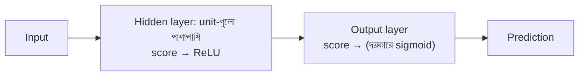

# Reference — Architecture-এর এক-পাতার মানচিত্র

> **এটা beginner-এর প্রথম পাঠ নয়; ফিরে দেখার জন্য।** আগে [Lecture 01 থেকে 09](README.md) ক্রমে পড়ো। সব lecture পড়া হলে কোনটা কোথায় ছিল মনে করতে এই পাতা কাজে লাগবে।

[Map-এ অবস্থান](../01-learning-map.md)

## এক নজরে ধারণাগুলো

| ধারণা | এক লাইনে | কোথায় শেখা |
|---|---|---|
| Input, হিসাব, output | Model-এর তিন অংশ | [Lecture 01](lecture-01-input-computation-output.md) |
| Parameter | হিসাবের ভেতরের শেখা মান (weight, bias) | [Lecture 02](lecture-02-parameters-and-hyperparameters.md) |
| Hyperparameter | আমাদের বেছে দেওয়া setting, যেমন unit সংখ্যা | [Lecture 02](lecture-02-parameters-and-hyperparameters.md) |
| Unit (neuron) | input × weight-এর যোগফল + bias = score | [Lecture 03](lecture-03-one-neuron.md) |
| Activation | score-কে বদলে output বানায় (ReLU, sigmoid) | [Lecture 04](lecture-04-activation.md) |
| Layer | পাশাপাশি unit-এর দল; পরের layer আগের ফল নেয় | [Lecture 05](lecture-05-hidden-layer.md) |
| Forward pass | input থেকে output পর্যন্ত পুরো হিসাব | [Lecture 06](lecture-06-forward-pass.md) |
| Shape ও count | `(input + 1) × unit`; layer জোড়া লাগার নিয়ম | [Lecture 07](lecture-07-shapes-and-parameter-count.md) |
| Architecture বনাম training | গঠন, মান আর শেখানো আলাদা | [Lecture 08](lecture-08-architecture-vs-training.md) |
| Design | output → input → baseline → network → validation | [Lecture 09](lecture-09-designing-a-model-architecture.md) |

## পুরো ছবি

Training হলো এই ছবির বাইরের কাজ: prediction আর target থেকে loss, তারপর gradient, তারপর parameters update ([Lecture 08](lecture-08-architecture-vs-training.md), পরে [Module 10](../module-10-neural-network-training/README.md))।

## সূত্র ও সংখ্যা এক জায়গায়

| কী | সূত্র | উদাহরণ |
|---|---|---|
| Unit-এর score | `z = x₁w₁ + x₂w₂ + b` | input `[2, 1]`, weights `[1, 1]`, bias 0 → 3 |
| ReLU | `max(0, z)` | `ReLU(−1) = 0`, `ReLU(3) = 3` |
| Sigmoid | `1 / (1 + e^(−z))` | `sigmoid(0) = 0.5` |
| Dense layer-এর parameter | `(input + 1) × unit` | `2 → 2 → 1`: 6 + 3 = 9 |
| দুই layer জোড়া লাগা | `(a×b)·(b×c) = (a×c)` | `(1×2)·(2×2)·(2×1) = (1×1)` |

চলমান উদাহরণ: input `[2, 1]` → hidden `[3, 0]` → output `7`।

## পরিচিত model-এর সঙ্গে সম্পর্ক

| Model | Architecture হিসেবে |
|---|---|
| Linear Regression | input → একটা unit (activation নেই) → সংখ্যা |
| Logistic Regression | input → একটা unit → sigmoid → probability |
| ছোট neural network | input → hidden layer (ReLU) → output layer |
| Decision Tree | এই module-এর unit/layer দিয়ে হয় না; শর্ত ও branch-এর গঠন |

Linear আর Logistic Regression মূলত hidden layer ছাড়া network। Hidden layer যোগ হলেই তারা neural network-এর দিকে যায়।

## প্রায়ই গুলিয়ে যায় যে কথাগুলো

- **পাশাপাশি বনাম পরপর:** একই layer-এর unit একই input পায়; পরের layer আগের layer-এর output পায়।
- **Hidden বনাম dense:** Hidden মানে মাঝের layer। Dense মানে প্রতি unit আগের সব মান পায়। দুটো আলাদা পরিচয়।
- **মান বনাম সংখ্যা:** Training-এ parameter-এর মান বদলায়; তাদের সংখ্যা বদলায় না। সংখ্যা বদলায় গঠন বদলালে।
- **Backpropagation বনাম optimizer:** একজন gradient বের করে, আরেকজন সেই gradient দিয়ে parameters বদলায়।
- **Architecture বনাম পুরো system:** Model-এর গঠন আর data থেকে deployment পর্যন্ত পুরো ব্যবস্থা এক জিনিস নয়।

## এরপর

শেখা (training): [Module 10](../module-10-neural-network-training/README.md)। বাস্তব project: [Module 14](../module-14-ocr-system-case-study/README.md)।
