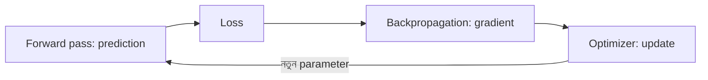

# Lecture 01 — Network কীভাবে শেখে: পুরো ছবিটা

> আগে যা জানা থাকলে ভালো: [ছোট network-এর forward pass](../module-09-model-architecture/lecture-06-forward-pass.md) এবং [MSE](../module-02-linear-regression/lecture-02-error-and-mean-squared-error.md)। এই lecture শেষে পারবে: training-এর চার ধাপের ক্রম বলতে এবং একটি weight-এর update হাতে হিসাব করতে। হিসাবের ভেতরের গল্প (derivative, chain rule, backpropagation) পরের lecture-গুলোতে আসবে।

## সমস্যাটা কী?

Module 09-এর `2 → 2 → 1` network-এ input `[2, 1]` দিলে output এসেছিল `7`। ধরো আসল উত্তর `5`। Network-এ মোট 9টি parameter আছে। প্রশ্ন হলো: কোন parameter কতটা বদলালে output `5`-এর কাছে আসবে?

আন্দাজে একটা একটা করে বদলিয়ে দেখা চলে না। বড় model-এ parameter থাকে কোটি কোটি। তাই দরকার এমন একটা উপায়, যা **এক হিসাবেই** প্রতিটি parameter-কে বলে দেবে: "তুমি এই দিকে, এতটুকু সরো।" এই উপায়টাই neural network training-এর মূল।

## ধারণাটা সহজ ভাষায়

Training একটা চার ধাপের চক্র। প্রতিবার এই চার ধাপ ঘুরে parameter একটু ভালো হয়।

| ধাপ | কী হয় | নাম |
|---|---|---|
| 1 | বর্তমান parameter দিয়ে output বের করা | **forward pass** |
| 2 | output কতটা ভুল তা একটা সংখ্যায় মাপা | **loss** |
| 3 | প্রতিটি parameter-এর জন্য "একটু বদলালে loss কতটা বদলায়" বের করা | **gradient** (হিসাব করার পদ্ধতির নাম **backpropagation**) |
| 4 | gradient দেখে parameter বদলানো | **update** (কাজটা করে **optimizer**) |

প্রতিটি শব্দের সহজ পরিচয়:

- **Loss:** prediction কতটা ভুল তার মাপ। কম মানে ভালো। এই module-এ squared error: `(prediction − target)²`।
- **Gradient:** প্রতিটি parameter-এর জন্য একটা সংখ্যা। সংখ্যাটা বলে, parameter একটু বাড়ালে loss কোন দিকে আর কত জোরে বদলায়।
- **Backpropagation:** সব parameter-এর gradient একসঙ্গে বের করার পদ্ধতি। এটা loss থেকে শুরু করে network-এর পেছনের দিকে হিসাব করে এগোয়। এটা model-এর কোনো layer নয়।
- **Optimizer:** gradient হাতে পেয়ে parameter-এর নতুন মান ঠিক করার নিয়ম। সবচেয়ে সরল নিয়ম gradient descent।
- **Learning rate:** একবারে কতটা সরা হবে তা ঠিক করে।

গবেষক ও engineer-রা, যারা image, text বা যেকোনো neural network train করেন, সবাই এই চক্রই ব্যবহার করেন। Model যত বড়ই হোক, চক্রটা একই।

## ছোট একটা উদাহরণ

Output unit C-এর হিসাব: `prediction = w × 3 + 1 × 0 + 1`। এখানে hidden unit A-এর output `3`, আর `w = 2` হলো A থেকে C-এর weight। বাকি সব parameter আপাতত স্থির।

- **ধাপ 1 (forward):** `prediction = 2 × 3 + 1 × 0 + 1 = 7`।
- **ধাপ 2 (loss):** target `5` হলে `loss = (7 − 5)² = 4`।
- **ধাপ 3 (gradient):** `w` একটু বাড়ালে prediction তিনগুণ হারে বাড়ে। ভুল আছে `7 − 5 = 2`। তাই `gradient = 2 × 2 × 3 = 12`। এই `12` মানে: `w` বাড়ালে loss বাড়ছে, কাজেই `w` কমাতে হবে।
- **ধাপ 4 (update):** learning rate `0.05` নিলে `নতুন w = 2 − 0.05 × 12 = 1.4`।

আবার forward pass: `prediction = 1.4 × 3 + 0 + 1 = 5.2`, আর `loss = (5.2 − 5)² = 0.04`। Loss `4` থেকে `0.04`-এ নেমেছে। আমরা কোথাও `5` হাতে বসিয়ে দিইনি; শুধু gradient দেখে `w` সরিয়েছি।

সাবধান: এখানে শুধু একটা weight বদলানো হলো, বোঝানোর জন্য। আসল training-এ সব parameter একসঙ্গে বদলায়।

## Formula

উদাহরণের ধাপ 4-এরই সংক্ষিপ্ত রূপ:

`নতুন মান = পুরোনো মান − learning rate × gradient`

Output বের করা (ধাপ 1), ভুল মাপা (ধাপ 2), gradient বের করা (ধাপ 3) আর মান বদলানো (ধাপ 4) চারটা আলাদা কাজ। [Learning Map](../01-learning-map.md)-এও এগুলো আলাদা রাখা আছে।

## ছবি

## মনে রাখার সারকথা

- Training = forward → loss → gradient → update, এই চক্র বারবার।
- Gradient বলে প্রতিটি parameter কোন দিকে সরলে loss কমবে; কতটা সরবে তা ঠিক করে learning rate।
- Prediction-এর সময় (inference) শুধু forward pass চলে; gradient বা update লাগে না।

## নিজে করো

1. একই উদাহরণে target `6` হলে loss, `w`-এর gradient, learning rate `0.05`-এ নতুন `w` ও নতুন loss কত?
2. Output unit C-এর bias (এখন `1`) এই sample-এ কতটা gradient পায়? শুধু bias-কে learning rate `0.05`-এ update করলে নতুন prediction কত?
3. চার ধাপের কোনটা শুধু training-এ চলে, কোনটা prediction-এর সময়েও চলে?

উত্তর

1. `loss = (7 − 6)² = 1`। `gradient = 2 × (7 − 6) × 3 = 6`। `নতুন w = 2 − 0.05 × 6 = 1.7`। `নতুন prediction = 1.7 × 3 + 1 = 6.1`, `নতুন loss = (6.1 − 6)² = 0.01`।

2. Bias-এর gradient `2 × (7 − 5) × 1 = 4`। `নতুন bias = 1 − 0.05 × 4 = 0.8`। `নতুন prediction = 2 × 3 + 0 + 0.8 = 6.8`।

3. Loss, gradient ও update শুধু training-এ চলে। Forward pass prediction-এর সময়েও চলে।

## পরের পাঠ

Gradient আসলে কী, সেটা না বুঝে এগোনো ঠিক নয়। তাই [Lecture 02 — Derivative থেকে gradient](lecture-02-derivative-to-gradient.md)-এ একটা ছোট সংখ্যার খেলা দিয়ে শুরু করা হবে।
