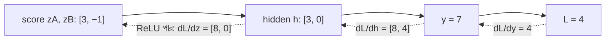

# Lecture 04 — Backpropagation: ছোট Network-এ পুরো Backward Pass

> আগে যা জানা থাকলে ভালো: [Chain rule](lecture-03-chain-rule.md) এবং [`2 → 2 → 1` network-এর forward pass](../module-09-model-architecture/lecture-06-forward-pass.md)। এই lecture শেষে পারবে: ওই network-এর 9টি parameter-এর gradient পেছন থেকে ধাপে ধাপে হাতে বের করতে।

## সমস্যাটা কী?

9টি parameter-এর প্রতিটির gradient আলাদা করে chain rule দিয়ে বের করা যায়। কিন্তু দেখা যাবে, অনেক গুণ বারবার একই হিসাব করতে হচ্ছে (যেমন `dL/dy` সবার জন্য লাগে)। **Backpropagation** হলো এই হিসাব গুছিয়ে করার পদ্ধতি: loss থেকে শুরু করে পেছনের দিকে এগিয়ে প্রতিটি মানের gradient **একবারই** বের করা, তারপর পরের ধাপে সেটা কাজে লাগানো। Deep learning framework-গুলো ঠিক এভাবে কাজ করে। এটা model-এর কোনো অংশ নয়, শুধু হিসাব করার ক্রম।

## ধারণাটা সহজ ভাষায়

Forward pass-এ প্রতিটি ধাপ নিজের input থেকে output বানায়। Backward pass-এ উল্টো: প্রতিটি ধাপ নিজের output-এর gradient নিয়ে নিজের input ও parameter-এর gradient বানায়। একটা নিয়মই বারবার চলে:

**কোনো মানের gradient = (তার পরের মানের gradient) × (এই ধাপের local derivative)**

## ছোট একটা উদাহরণ

Module 09-এর network। Input `x = [2, 1]`, target `5`, loss `L = (y − 5)²`।

| Unit | Weights | Bias | Activation |
|---|---|---|---|
| A | `[1, 1]` | 0 | ReLU |
| B | `[−1, 1]` | 0 | ReLU |
| C | `[2, 1]` (A, B-এর output-এর জন্য) | 1 | নেই |

**Forward pass (মানগুলো লিখে রাখো):**

```text
zA = 1×2 + 1×1 + 0 = 3     hA = ReLU(3) = 3
zB = −1×2 + 1×1 + 0 = −1   hB = ReLU(−1) = 0
y  = 2×3 + 1×0 + 1 = 7     L = (7 − 5)² = 4
```

**Backward pass (পেছন থেকে):**

1. **Loss থেকে output:** `dL/dy = 2 × (y − 5) = 2 × 2 = 4`।

2. **Output unit C-এর parameter:** `y = 2·hA + 1·hB + 1`। তাই
   `dL/d(C-এর w₁) = 4 × hA = 4 × 3 = 12`,
   `dL/d(C-এর w₂) = 4 × hB = 4 × 0 = 0`,
   `dL/d(C-এর bias) = 4 × 1 = 4`।

3. **Hidden output-এর gradient:** `dL/dhA = 4 × (C-এর w₁) = 4 × 2 = 8`, `dL/dhB = 4 × (C-এর w₂) = 4 × 1 = 4`।

4. **ReLU পার হওয়া:** `zA = 3` ধনাত্মক, তাই local derivative `1`: `dL/dzA = 8 × 1 = 8`। `zB = −1` ঋণাত্মক, local derivative `0`: `dL/dzB = 4 × 0 = 0`।

5. **Hidden unit-এর parameter:** `zA = 1·x₁ + 1·x₂ + 0`, তাই A-এর weight-এর gradient `8 × x = [8×2, 8×1] = [16, 8]`, bias-এর `8`। B-এর সব gradient `0`।

সব gradient একসঙ্গে:

| Parameter | Gradient |
|---|---|
| A-এর weights | `[16, 8]` |
| A-এর bias | `8` |
| B-এর weights | `[0, 0]` |
| B-এর bias | `0` |
| C-এর weights | `[12, 0]` |
| C-এর bias | `4` |

B-এর gradient `0` কেন? এই sample-এ B-এর score ঋণাত্মক, ReLU তার output `0` করে দিয়েছে। B-এর weight একটু বদলালেও output `0`-ই থাকবে, তাই loss বদলাবে না। অন্য input-এ B সক্রিয় হলে তখন B-এর gradient `0` নাও হতে পারে। C-এর `w₂`-এর gradient `0` কেন? কারণ `hB = 0`, আর `w₂` গুণ হচ্ছে `hB`-এর সঙ্গে।

Input `x`-এর gradient লাগে না, কারণ input শেখার মান নয়, দেওয়া তথ্য।

## Update করে দেখা

Learning rate `0.01` নিয়ে সব parameter থেকে `0.01 × gradient` বাদ দিলে নতুন মান:

- A-এর weights `[0.84, 0.92]`, bias `−0.08`
- B অপরিবর্তিত: `[−1, 1]`, bias `0`
- C-এর weights `[1.88, 1]`, bias `0.96`

নতুন forward pass: prediction `5.6976`, loss `(5.6976 − 5)² ≈ 0.4866`। Loss `4` থেকে প্রায় `0.49`-এ নেমেছে। এক update-এ সব parameter একসঙ্গে সরেছে।

## কোড

পুরো হিসাব pure Python-এ, সঙ্গে ঠেলা পদ্ধতিতে (Lecture 02) যাচাই:

```python
x, target = [2, 1], 5
P = [1, 1, 0,  -1, 1, 0,  2, 1, 1]   # A:(w1,w2,b)  B:(w1,w2,b)  C:(w1,w2,b)

def forward(P):
    zA = P[0]*x[0] + P[1]*x[1] + P[2]
    zB = P[3]*x[0] + P[4]*x[1] + P[5]
    hA, hB = max(0, zA), max(0, zB)
    y = P[6]*hA + P[7]*hB + P[8]
    return zA, zB, hA, hB, y

def loss(P):
    return (forward(P)[4] - target) ** 2

def backward(P):
    zA, zB, hA, hB, y = forward(P)
    dy = 2 * (y - target)                    # dL/dy
    dhA, dhB = dy * P[6], dy * P[7]          # dL/dh
    dzA = dhA * (1 if zA > 0 else 0)         # ReLU পার হওয়া
    dzB = dhB * (1 if zB > 0 else 0)
    return [dzA*x[0], dzA*x[1], dzA, dzB*x[0], dzB*x[1], dzB, dy*hA, dy*hB, dy]

grad = backward(P)
print("backprop:", grad)

numeric = []
for i in range(9):                           # ঠেলা দিয়ে যাচাই
    up, dn = P[:], P[:]
    up[i] += 1e-6; dn[i] -= 1e-6
    numeric.append(round((loss(up) - loss(dn)) / 2e-6, 3))
print("numeric: ", numeric)

new = [p - 0.01 * g for p, g in zip(P, grad)]
print("loss before/after:", loss(P), round(loss(new), 4))

# output:
# backprop: [16, 8, 8, 0, 0, 0, 12, 0, 4]
# numeric:  [16.0, 8.0, 8.0, 0.0, 0.0, 0.0, 12.0, 0.0, 4.0]
# loss before/after: 4 0.4866
```

Backprop-এর 9টি gradient আর ঠেলা পদ্ধতির ফল একই। এই যাচাইকে বলে **gradient check**। নিজে backward কোড লিখলে এই যাচাই করা ভালো অভ্যাস।

## ছবি



সাবধান: ছবিতে নিচের বিন্দুযুক্ত তীর শুধু gradient-এর চলার পথ। এই পথে data ফিরে যায় না, শুধু "loss কতটা সংবেদনশীল" তার সংখ্যা যায়।

## মনে রাখার সারকথা

- Backpropagation: loss থেকে পেছনে গিয়ে প্রতিটি মানের gradient = পরের gradient × local derivative।
- Forward pass-এ পাওয়া মান (`hA`, `zB` ইত্যাদি) backward-এ লাগে, তাই সেগুলো রেখে দিতে হয়।
- ReLU-এর ঋণাত্মক score-এ gradient থামে (`0`)। Backward pass শেষে সব parameter-এর gradient হাতে থাকে; তারপর optimizer update করে।

## নিজে করো

1. Target `7` হলে (input `[2, 1]`, একই parameter) সব gradient কত?
2. Input `[1, 2]`, target `5` হলে forward pass করে `dL/dy` বের করো। (Module 09-এর অনুশীলনে এই input-এ prediction `8`।)
3. 2 নম্বরের সব 9টি gradient বের করো।

<details><summary>উত্তর</summary>

1. Prediction `7`, target `7`, loss `0`, `dL/dy = 0`। তাই সব gradient `0`। Model ঠিক জায়গায় আছে, কিছু বদলানোর দরকার নেই।

2. `zA = 1×1 + 1×2 = 3`, `zB = −1×1 + 1×2 = 1`, `hA = 3`, `hB = 1`, `y = 2×3 + 1×1 + 1 = 8`, `loss = 9`। `dL/dy = 2 × (8 − 5) = 6`।

3. C-এর weights `[6×3, 6×1] = [18, 6]`, C-এর bias `6`। `dL/dhA = 6×2 = 12`, `dL/dhB = 6×1 = 6`। দুটো score ধনাত্মক, তাই ReLU-র derivative `1`: `dL/dzA = 12`, `dL/dzB = 6`। A-এর weights `[12×1, 12×2] = [12, 24]`, bias `12`। B-এর weights `[6×1, 6×2] = [6, 12]`, bias `6`। (সব ঠেলা পদ্ধতিতে যাচাই করা।)

</details>

## পরের পাঠ

Gradient পাওয়া গেছে। এবার জিজ্ঞাসা: gradient দিয়ে ঠিক কতটা সরব, আর learning rate ভুল হলে কী হয়? এটা [Lecture 05 — Optimizer ও learning rate](lecture-05-optimizer-and-learning-rate.md)-এর বিষয়।
