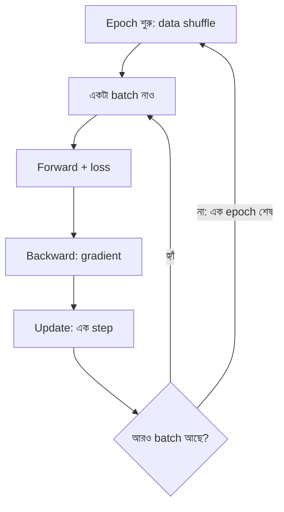

# Lecture 06 — Sample, Batch, Step ও Epoch

> আগে যা জানা থাকলে ভালো: [Optimizer ও learning rate](lecture-05-optimizer-and-learning-rate.md)। এই lecture শেষে পারবে: sample, batch, step ও epoch আলাদা করতে এবং কোনো training-এ মোট কতবার update হবে তা গুনতে।

## সমস্যাটা কী?

এ পর্যন্ত আমরা এক বা দুটো sample দেখেছি। আসল data-তে থাকে হাজার হাজার sample। প্রতিটি update-এ gradient হিসাবের জন্য কয়টা sample ব্যবহার করব?

- **সবগুলো:** প্রতি update-এর আগে পুরো data ঘুরতে হয়। ধীর, আর memory-তেও ধরে না।
- **একটা করে:** দ্রুত, কিন্তু একটা sample-এর gradient খুব এলোমেলো। এক sample-এর ঝোঁকে model এদিক-ওদিক টলে।
- **মাঝামাঝি, ছোট একটা দল:** প্রায় সব বড় training-এ এটাই করা হয়।

## ধারণাটা সহজ ভাষায়

চারটা শব্দ আলাদা করে শিখে নাও:

- **Sample:** একটি উদাহরণ (input আর তার target)।
- **Batch (mini-batch):** একসঙ্গে হিসাব করা কয়েকটা sample-এর দল। দলের সংখ্যাকে বলে **batch size**।
- **Step (iteration):** একটা batch নিয়ে forward, loss, gradient ও **একবার update**। Step মানে parameter একবার বদলানো।
- **Epoch:** পুরো training data একবার ঘুরে আসা।

সম্পর্কটা সহজ:

`এক epoch-এ step = ⌈ sample সংখ্যা ÷ batch size ⌉`
`মোট step = epoch সংখ্যা × এক epoch-এর step`

(`⌈ ⌉` মানে উপরের পূর্ণসংখ্যায় তোলা। শেষ batch ছোট হতে পারে।)

প্রতিটি batch-এর gradient হলো ওই batch-এর sample-গুলোর gradient-এর **গড়**। এটা পুরো data-র আসল gradient-এর আন্দাজ মাত্র। ছোট batch-এ আন্দাজ বেশি এলোমেলো। এভাবে batch ধরে চলা পদ্ধতিকে mini-batch gradient descent বলে; প্রায়ই একে "SGD"-ও বলা হয়।

প্রতি epoch-এর শুরুতে sample-এর ক্রম এলোমেলো করা হয় (**shuffle**), যাতে batch-গুলো প্রতিবার আলাদা হয়। নিচের উদাহরণে বোঝার সুবিধার জন্য ক্রম স্থির রাখা হয়েছে।

## ছোট একটা উদাহরণ

6টি sample, যেখানে `y = 2x + 1`:

| x | 1 | 2 | 3 | 4 | 5 | 6 |
|---|---|---|---|---|---|---|
| y | 3 | 5 | 7 | 9 | 11 | 13 |

Model `ŷ = w·x + b`, শুরুতে `w = 0`, `b = 0`, learning rate `0.02`। শুরুর MSE `75.667`। Batch size `2` হলে এক epoch-এ `⌈6 ÷ 2⌉ = 3` step।

| Step | Batch | `w`-এর gradient | `b`-এর gradient | নতুন `w` | নতুন `b` | পুরো data-য় MSE |
|---|---|---|---|---|---|---|
| 1 | (1,3), (2,5) | −13 | −8 | 0.26 | 0.16 | 56.855 |
| 2 | (3,7), (4,9) | −49.38 | −13.86 | 1.248 | 0.437 | 11.867 |
| 3 | (5,11), (6,13) | −52.087 | −9.402 | 2.289 | 0.625 | 0.651 |

(Gradient-এর সূত্র [Module 02 Lecture 03](../module-02-linear-regression/lecture-03-gradient-descent-training.md)-এর মতোই; শুধু `n` এখন batch-এর sample সংখ্যা, মোট নয়।)

এক epoch-এ তিনবার update, loss `75.667` থেকে `0.651`। তুলনায় পুরো data দিয়ে একটামাত্র gradient নিলে (batch size `6`) এক epoch-এ একটাই step: `w = 1.353`, `b = 0.32`, loss `9.883`।

লক্ষ করো, প্রথম batch-এর `w`-gradient `−13`, অথচ পুরো data-র আসল gradient `−67.667`। Batch ছোট, তাই আন্দাজ কাঁচা। তবু ধাপগুলো মোটের উপর ঠিক দিকে গেছে।

## Batch size বদলালে

একই data, `5` epoch করে চালালে:

| Batch size | এক epoch-এ step | 5 epoch-এ মোট step | 1ম epoch-এর পর loss | 5ম epoch-এর পর loss |
|---|---|---|---|---|
| 6 | 1 | 5 | 9.8829 | 0.0485 |
| 2 | 3 | 15 | 0.6512 | 0.0399 |
| 1 | 6 | 30 | 0.0252 | 0.0142 |

ছোট batch-এ একই epoch-এ বেশি update হয়, তাই এই ছোট সমস্যায় loss আগে নামছে। সাবধান: বড় model-এ হিসাব আলাদা। বড় batch-এর হিসাব hardware-এ একসঙ্গে চলে, আর ছোট batch-এ আন্দাজ কাঁচা হয়। তাই batch size-ও একটা hyperparameter, পরীক্ষা করে বেছে নিতে হয়।

কয়েকটা গণনা: `1000` sample, batch size `32` হলে এক epoch-এ `⌈1000 ÷ 32⌉ = 32` step (শেষ batch-এ 8টা sample)। `5` epoch-এ `160` step।

## কোড

```python
data = [(1, 3), (2, 5), (3, 7), (4, 9), (5, 11), (6, 13)]   # y = 2x + 1
LR = 0.02

def gradient(w, b, batch):
    n = len(batch)
    gw = 2 / n * sum((w * x + b - y) * x for x, y in batch)
    gb = 2 / n * sum((w * x + b - y) for x, y in batch)
    return gw, gb

def mse(w, b):
    return sum((w * x + b - y) ** 2 for x, y in data) / len(data)

def train(batch_size, epochs):
    w = b = 0.0
    steps = 0
    for epoch in range(epochs):
        for i in range(0, len(data), batch_size):
            gw, gb = gradient(w, b, data[i:i + batch_size])
            w -= LR * gw
            b -= LR * gb
            steps += 1
        if epoch in (0, epochs - 1):
            print(f"batch {batch_size}: epoch {epoch + 1}, "
                  f"steps {steps}, loss {mse(w, b):.4f}")

for bs in (6, 2, 1):
    train(bs, 5)

# output:
# batch 6: epoch 1, steps 1, loss 9.8829
# batch 6: epoch 5, steps 5, loss 0.0485
# batch 2: epoch 1, steps 3, loss 0.6512
# batch 2: epoch 5, steps 15, loss 0.0399
# batch 1: epoch 1, steps 6, loss 0.0252
# batch 1: epoch 5, steps 30, loss 0.0142
```

ভেতরের দুই `for`: বাইরেরটা epoch, ভেতরেরটা batch। ভেতরের প্রতিটি পাক একটা step।

## ছবি



## মনে রাখার সারকথা

- Step = এক batch দিয়ে এক update। Epoch = পুরো data একবার ঘোরা।
- এক epoch-এ step = ⌈sample ÷ batch size⌉।
- Batch ছোট হলে gradient কাঁচা কিন্তু update বেশি; বড় হলে gradient পাকা কিন্তু update কম। Batch size নিজেও একটা hyperparameter।

## নিজে করো

1. 10টি sample, batch size 4। এক epoch-এ কয় step? 5 epoch-এ মোট কয় step?
2. 1000 sample, batch size 64, 3 epoch। মোট কয় step?
3. উপরের উদাহরণে `w = 0`, `b = 0` থেকে শুধু batch `(3,7), (4,9)` নিয়ে gradient বের করো। Learning rate `0.02`-এ নতুন `w`, `b` কত?

<details><summary>উত্তর</summary>

1. Batch: `4, 4, 2`, অর্থাৎ `⌈10 ÷ 4⌉ = 3` step। 5 epoch-এ `3 × 5 = 15` step।

2. `⌈1000 ÷ 64⌉ = ⌈15.625⌉ = 16` step প্রতি epoch। 3 epoch-এ `16 × 3 = 48` step।

3. Error `0 − 7 = −7` ও `0 − 9 = −9`। `gw = (2/2) × (−7×3 + −9×4) = −21 − 36 = −57`। `gb = (2/2) × (−7 − 9) = −16`। `নতুন w = 0 − 0.02 × (−57) = 1.14`, `নতুন b = 0 − 0.02 × (−16) = 0.32`।

</details>

## পরের পাঠ

Update-এর সময় ও count নিয়ে আরও খুঁটিনাটি (gradient জমানো, frozen parameter) [Reference — Parameter update-এর সময়](reference-parameter-update-timing.md)-এ আছে। মূল পথে এরপর আসছে [Lecture 07 — Training loop ও validation](lecture-07-training-loop-and-validation.md): training loss কমছে মানেই model ভালো, এমন নয় কেন।
