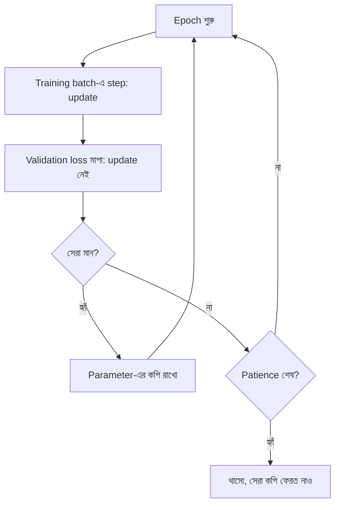

# Lecture 07 — Training Loop ও Validation

> আগে যা জানা থাকলে ভালো: [Batch, step ও epoch](lecture-06-batch-step-and-epoch.md)। Train/validation ভাগের ধারণা: [Train, validation ও test split](../module-05-data-preparation-and-splits/lecture-03-train-validation-test-split.md)। এই lecture শেষে পারবে: training loop-এ validation loss কোথায় বসে তা বলতে এবং training loss কমলেও model খারাপ হতে পারে কেন তা সংখ্যায় দেখাতে।

## সমস্যাটা কী?

Training loss কমছে দেখে খুশি হওয়া সহজ। কিন্তু model-কে training data-র উত্তর হুবহু মুখস্থ করানোও সম্ভব, তখন training loss প্রায় শূন্য হয়, অথচ নতুন data-তে model ভুল করে। Model আসলে কেমন, সেটা জানতে এমন data-তে মাপতে হয় যা training-এ কখনো ব্যবহার হয়নি। ML engineer-রা প্রতিটি training-এ এটা করেন।

## ধারণাটা সহজ ভাষায়

Data আগেই দুই ভাগে ভাগ করা হয়:

- **Training data:** এর উপর gradient হিসাব হয়, parameter update হয়।
- **Validation data:** শুধু loss **মাপা** হয়। এর উপর gradient বা update **চলে না**। Model একে "দেখে শেখে" না।

একটা ধাপ ছাড়া training loop আগের lecture-এর মতোই। প্রতি epoch-এর শেষে validation loss মাপা হয়:

```text
প্রতি epoch:
    training data-র প্রতি batch-এ: forward → loss → backward → update
    validation data-য় শুধু forward চালিয়ে loss মাপো     (কোনো update নয়)
    validation loss এখন পর্যন্ত সেরা হলে parameter-এর কপি রেখে দাও
    আর উন্নতি না হলে থামো
```

**Overfitting** হলো training loss কমতে থাকা কিন্তু validation loss বাড়তে থাকা: model training data-র খুঁটিনাটি, এমনকি noise-ও, মুখস্থ করছে। **Early stopping** হলো validation loss আর কমছে না দেখলে থেমে যাওয়া, আর সবচেয়ে ভালো validation মানের parameter ফেরত নেওয়া। **Patience** হলো "কয় epoch উন্নতি না দেখলে থামব" তার সংখ্যা। আরও ধারণা: [Overfitting](../module-07-generalization-and-overfitting/lecture-01-underfitting-and-overfitting.md) ও [Early stopping](../module-07-generalization-and-overfitting/lecture-03-regularization-and-early-stopping.md)।

## ছোট একটা উদাহরণ

সম্পর্কটা মোটামুটি `y ≈ 2x + 1`, সঙ্গে সামান্য noise। 6টা training point ও 8টা validation point। Model: `ŷ = p₀ + p₁x + p₂x² + p₃x³ + p₄x⁴ + p₅x⁵`, অর্থাৎ 6টা parameter, ঠিক training point-এর সমান। এই model 6টা point হুবহু ছুঁয়ে যেতে পারে। Model-টা neural network নয়, কিন্তু training loop একই। (Neural network-এ একই loop Lecture 08-এ।) Learning rate `0.3`, প্রতি epoch-এ পুরো training data দিয়ে এক step।

প্রতি epoch পরে loss:

| epoch | training loss | validation loss |
|---|---|---|
| 1 | 0.5312 | 0.7171 |
| 10 | 0.0685 | 0.0731 |
| 50 | 0.0405 | 0.0842 |
| 200 | 0.0339 | 0.1000 |
| 1000 | 0.0251 | 0.1411 |
| 5000 | 0.0079 | 0.3092 |
| 20000 | 0.0001 | 0.6334 |

Training loss শুধু কমেই গেছে, শেষে প্রায় শূন্য। কিন্তু validation loss প্রথম 10–14 epoch-এর পরে **বাড়ছে**, `0.07` থেকে `0.63`। Model নতুন data-য় ক্রমশ খারাপ হচ্ছে। শুধু training loss দেখলে এটা ধরা পড়ত না।

Early stopping চালালে (patience `200`):

- সেরা validation loss 14তম epoch-এ: `0.0705`, তখন training loss `0.058`।
- তারপর 200 epoch উন্নতি না হওয়ায় 214তম epoch-এ training থামে।
- ফেরত নেওয়া হয় 14তম epoch-এর parameter।

সাবধান: এখানে data মাত্র কয়েকটা, শেখানোর জন্য ছোট রাখা। আসল validation set অনেক বড় হয়। আর validation দেখে epoch বেছে নেওয়ায় validation loss কিছুটা আশাবাদী হয়ে যায়, তাই চূড়ান্ত মান জানতে আলাদা **test data** লাগে ([Module 06 — Cross-validation ও final test](../module-06-model-evaluation-and-baselines/lecture-05-cross-validation-and-final-test.md))।

## কোড

```python
train = [(-0.9,-0.6),(-0.5,0.4),(-0.1,1.3),(0.3,1.4),(0.7,2.6),(0.9,2.5)]
valid = [(-1.0,-1.1),(-0.7,-0.1),(-0.3,0.2),(0.0,1.2),(0.2,1.5),(0.5,1.9),(0.8,2.8),(1.0,3.2)]
DEG, LR, PATIENCE = 5, 0.3, 200

def feats(x):                       # [1, x, x^2, ..., x^5]
    return [x**k for k in range(DEG + 1)]

def predict(p, x):
    return sum(pi * f for pi, f in zip(p, feats(x)))

def mse(p, data):
    return sum((predict(p, x) - y) ** 2 for x, y in data) / len(data)

def gradient(p, data):
    g = [0.0] * len(p)
    for x, y in data:
        e = predict(p, x) - y
        for k, f in enumerate(feats(x)):
            g[k] += 2 * e * f / len(data)
    return g

p = [0.0] * (DEG + 1)
best_val, best_p, best_ep, bad = float("inf"), p, 0, 0
for epoch in range(1, 20001):
    g = gradient(p, train)                          # 1) gradient (training data)
    p = [pi - LR * gi for pi, gi in zip(p, g)]      # 2) update
    val = mse(p, valid)                             # 3) validation loss (update নয়)
    if val < best_val:
        best_val, best_p, best_ep, bad = val, p, epoch, 0
    else:
        bad += 1
    if epoch in (1, 10, 50, 200, 1000, 5000, 20000):
        print(epoch, round(mse(p, train), 4), round(val, 4))
    if bad == PATIENCE:                              # early stopping
        print("stop at", epoch, "| best epoch", best_ep, "| best val",
              round(best_val, 4), "| train there", round(mse(best_p, train), 4))
        break

# output:
# 1 0.5312 0.7171
# 10 0.0685 0.0731
# 50 0.0405 0.0842
# 200 0.0339 0.1
# stop at 214 | best epoch 14 | best val 0.0705 | train there 0.058
```

উপরের table-এর বাকি সারি (1000, 5000, 20000 epoch) পেতে `PATIENCE = 10**9` করে আবার চালাও।

## ছবি



## মনে রাখার সারকথা

- Training loop = (প্রতি batch-এ forward, loss, backward, update) + প্রতি epoch-এ validation loss মাপা।
- Validation data-র উপর কখনো update চলে না; এটা শুধু মাপার জন্য।
- Training loss কমলেও validation loss বাড়লে overfitting; তখন early stopping দিয়ে সেরা মুহূর্তের parameter রাখা হয়।

## নিজে করো

1. উপরের table-এর epoch গুলোর মধ্যে কোনটার parameter বেছে নেবে? কেন?
2. Epoch-অনুযায়ী validation loss: `0.9, 0.5, 0.4, 0.45, 0.43, 0.46, 0.5`। Patience `2` হলে কোন epoch-এ থামবে? কোন epoch-এর parameter রাখবে?
3. Training loss `0.0001`, validation loss `0.6334` হলে model কি ভালো? কী করবে?

<details><summary>উত্তর</summary>

1. Epoch `10` (validation loss `0.0731`, তালিকার সবচেয়ে কম)। নতুন data-য় ভালো হওয়াটাই লক্ষ্য, training loss নয়।

2. Epoch `3`-এ সেরা (`0.4`)। Epoch `4`-এ `0.45` (উন্নতি নেই, গণনা `1`), epoch `5`-এ `0.43` (উন্নতি নেই, গণনা `2`)। Patience পূর্ণ, তাই epoch `5`-এ থামবে। Epoch `3`-এর parameter রাখবে।

3. না। Training data মুখস্থ হয়ে গেছে, নতুন data-য় ভুল বড় (`0.6334`)। Early stopping, বেশি data বা ছোট model দিয়ে সামলানো যায়; বিস্তারিত Module 07-এ।

</details>

## পরের পাঠ

সব উপাদান এখন হাতে: forward, loss, backpropagation, optimizer, batch ও loop। [Lecture 08 — Pure Python-এ Neural Network](lecture-08-neural-network-in-python.md)-এ একটা ছোট network শুরু থেকে train করে loss কমতে দেখা হবে।
