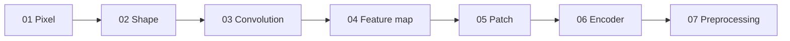

# Module 11 — ছবি থেকে Numerical Representation

[কেন্দ্রীয় Model ও Math Map](../01-learning-map.md) · [Course Outline](../00-course-outline.md) · [লেখার নিয়ম](../00-writing-style-guide.md)

## Status: ৭টি ছোট lecture লেখা হয়েছে — পড়া ও অনুশীলন বাকি

প্রতিটা lecture ছোট ছবি (৪×৪ বা তার কাছাকাছি) ও nested list নিয়ে হাতে মেলানো যায় এমন হিসাবে লেখা; সব সংখ্যা Python চালিয়ে মেলানো হয়েছে। লেখা আছে মানেই শেখা শেষ নয়।

## আগে যা পরিষ্কার থাকা দরকার

[Module 09](../module-09-model-architecture/README.md)-এর vector/shape, unit (weighted sum), activation (ReLU) ও dense layer-এর parameter count। Filter-এর মান কীভাবে শেখা হয় তা এই module-এ নেই; সেটা [Module 10](../module-10-neural-network-training/README.md)-এর বিষয়।

## Lecture ক্রম

| ক্রম | Lecture | এক লাইনে |
|---|---|---|
| 01 | [Pixel ও channel](lecture-01-pixel-and-channel.md) | ছবি মানে সংখ্যার ছক; সাদা-কালো ১ channel, রঙিন ৩ channel |
| 02 | [Image shape ও tensor](lecture-02-image-shape-and-tensor.md) | `(H, W, C)` ও batch `(N, H, W, C)`; flatten করে dense layer-এ দিলে কেন সমস্যা |
| 03 | [Local pattern ও convolution](lecture-03-local-pattern-and-convolution.md) | ৪×৪ ছবিতে ২×২ ও ৩×৩ filter হাতে স্লাইড; output মাপ `n − k + 1` |
| 04 | [Feature map](lecture-04-feature-map.md) | filter-এর output ছক কী বোঝায়; ReLU; একাধিক filter-এর stack |
| 05 | [Patch ও patch embedding](lecture-05-patches-and-patch-embedding.md) | ছবি টুকরো করে vector-এর তালিকা (ViT-র ধারণা, শুধু পরিচয়) |
| 06 | [Encoder](lecture-06-encoder.md) | filter → ReLU → max pooling → representation vector; দুটো ছবির তুলনা |
| 07 | [Resize ও preprocessing](lecture-07-resize-and-preprocessing.md) | resize, normalize, padding; কোনটায় তথ্য বদলায় |

## কোন ক্রমে পড়বে

01 থেকে 07 পর্যন্ত নম্বরের ক্রমেই পড়ো। **05 (patch)** convolution-এর বদলে ছবি দেখার আরেকটা পথের ধারণামূলক পরিচয়; এটা Module 12-এর Transformer-এর আগে লাগবে, তাই 03–04 ভালো করে বুঝে তারপর পড়ো।

## পরের module-এর সঙ্গে সংযোগ

- **[Module 12](../module-12-text-sequences-and-multimodal-models/README.md):** patch-vector-এর তালিকা ও encoder-এর representation লেখার vector-এর সঙ্গে মেলানো হবে।
- **[Module 14](../module-14-ocr-system-case-study/README.md):** OCR-এ ছবি ঢোকা, preprocessing ও ছবি-encoder এই module-এরই বাস্তব রূপ।

## এই module-এ যা নেই

Pooling-এর বিভিন্ন ধরন, stride ও dilation, বড় CNN (ResNet ইত্যাদি), ViT-র position embedding ও Transformer-এর ভেতর, এবং filter শেখার প্রক্রিয়া — এগুলো পরে বা অন্য module-এ।
