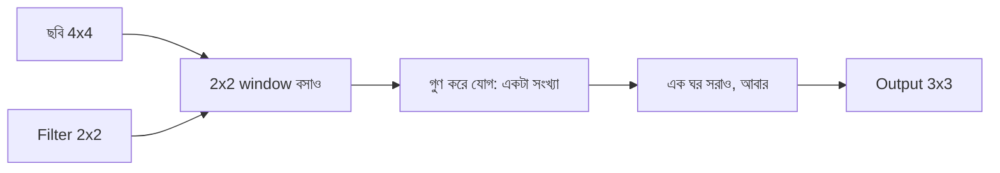

# Lecture 03 — Local Pattern ও Convolution

> আগে যা জানা থাকলে ভালো: [Image shape ও flatten-এর সমস্যা](lecture-02-image-shape-and-tensor.md), আর [একটা unit-এর weighted sum](../module-09-model-architecture/lecture-03-one-neuron.md)। এই lecture শেষে পারবে: একটা ছোট ছবিতে ছোট filter হাতে স্লাইড করে হিসাব করতে।

## সমস্যাটা কী?

আগের lecture-এ দেখেছ, ছবি flatten করে dense layer-এ দিলে দুটো ক্ষতি: parameter অনেক বেড়ে যায়, আর কোন pixel কার পাশে ছিল তা হারায়। অথচ ছবির দরকারি জিনিস — যেমন কোনো অক্ষরের দাগের কিনারা — থাকে **কাছাকাছি কয়েকটা pixel-এর সম্পর্কে**। "এই জায়গায় বাঁ দিক কালো, ডান দিক সাদা" — এই ধরনের **local pattern** একটা ছোট জানালা দিয়ে দেখলেই ধরা যায়। আর সেই একই জানালা ছবির সব জায়গায় ঘুরিয়ে দেখলে একই pattern যেখানেই থাকুক ধরা পড়ে।

## ধারণাটা সহজ ভাষায়

একটা ছোট weight-এর ছক বানাও, যার নাম **filter** (অন্য নাম kernel)। এই filter ছবির উপর বসিয়ে প্রতিটা weight তার নিচের pixel-এর সঙ্গে গুণ করে সব যোগ করলে একটা সংখ্যা আসে — ঠিক Module 09-এর weighted sum। তারপর filter এক ঘর সরিয়ে আবার একই হিসাব। এভাবে পুরো ছবিতে স্লাইড করার কাজটাই **convolution**।

উদাহরণের ছবি (৪×৪, সহজ হিসাবের জন্য pixel মান `0` আর `9`):

```text
0 0 9 9
0 0 9 9
0 0 9 9
0 0 9 9
```

বাঁ অর্ধেক কালো, ডান অর্ধেক উজ্জ্বল; মাঝখানে একটা উল্লম্ব কিনারা। ২×২ filter:

```text
-1  1
-1  1
```

এর কাজ: window-র ডান পাশের pixel যোগ, বাঁ পাশেরগুলো বিয়োগ — অর্থাৎ "ডান পাশ বাঁয়ের চেয়ে কতটা উজ্জ্বল"। এই filter-এর মান আমরা হাতে বেছেছি; বাস্তব model-এ filter-এর মান training-এ শেখা হয় ([Module 10](../module-10-neural-network-training/lecture-01-loss-gradient-and-backpropagation.md))।

## ছোট একটা উদাহরণ: হাতে স্লাইড

প্রথম সারিতে filter তিন জায়গায় বসে:

**জায়গা (সারি 0, কলাম 0)** — window `[[0, 0], [0, 0]]`:
`(-1×0) + (1×0) + (-1×0) + (1×0) = 0`

**জায়গা (সারি 0, কলাম 1)** — window `[[0, 9], [0, 9]]`:
`(-1×0) + (1×9) + (-1×0) + (1×9) = 18`

**জায়গা (সারি 0, কলাম 2)** — window `[[9, 9], [9, 9]]`:
`(-1×9) + (1×9) + (-1×9) + (1×9) = 0`

প্রতিটা সারিতে ছবি একই, তাই ফল একই। ৪×৪ ছবিতে ২×২ filter বসতে পারে `4 − 2 + 1 = 3` জায়গায় (সারি ও কলাম দুই দিকেই), মোট ৯ জায়গা। তাই output ৩×৩:

```text
0 18 0
0 18 0
0 18 0
```

মাঝের কলামে `18`: ঠিক যেখানে কালো থেকে সাদায় বদল, সেখানেই filter "পেয়েছি" বলছে। সমতল জায়গায় (সব `0` বা সব `9`) ফল `0`।

## Formula ও কোড

একই কাজ formula-য়: `out[i][j] = Σ img[i+a][j+b] × k[a][b]`, যেখানে `k` filter, `(a, b)` filter-এর ভেতরের সারি-কলাম, আর `Σ` মানে সব `(a, b)`-র যোগফল। Output-এর মাপ: `n − k + 1` (ছবি `n×n`, filter `k×k`)। এখানে bias ধরা হয়নি।

```python
def conv2d(img, k):
    n, m = len(img), len(k)
    out = []
    for i in range(n - m + 1):
        row = []
        for j in range(n - m + 1):
            s = 0
            for a in range(m):
                for b in range(m):
                    s += img[i + a][j + b] * k[a][b]
            row.append(s)
        out.append(row)
    return out

img = [[0, 0, 9, 9] for _ in range(4)]
k = [[-1, 1],
     [-1, 1]]
print("2x2 filter:", conv2d(img, k))

k3 = [[-1, 0, 1]] * 3
print("3x3 filter:", conv2d(img, k3))

flat = [[5] * 4 for _ in range(4)]
print("flat image:", conv2d(flat, k))
print("conv params:", 2 * 2 + 1, "dense 16->9 params:", (16 + 1) * 9)
```

```text
# output:
2x2 filter: [[0, 18, 0], [0, 18, 0], [0, 18, 0]]
3x3 filter: [[27, 27], [27, 27]]
flat image: [[0, 0, 0], [0, 0, 0], [0, 0, 0]]
conv params: 5 dense 16->9 params: 153
```

হাতের হিসাবের সঙ্গে মিলেছে। ৩×৩ filter `[[-1, 0, 1]]` তিন সারিতে: প্রথম জায়গায় প্রতি সারি `[0, 0, 9]`, তাই `(-1×0) + (0×0) + (1×9) = 9`, তিন সারি মিলে `27`; output `4 − 3 + 1 = 2`, অর্থাৎ ২×২।

শেষ লাইনটাই convolution-এর আসল সুবিধা। ৯টা output জায়গার জন্য filter-এর মাত্র ৪টা weight আর ১টা bias (৫টা parameter) লাগে, কারণ **একই filter সব জায়গায় ব্যবহার হয়**। ১৬ input থেকে ৯ output-এর dense layer লাগত ১৫৩টা।

সাবধান: গণিতের বইয়ের convolution-এ filter আগে উল্টে নিতে হয়; deep learning-এর library-তে উল্টানো হয় না, কিন্তু নাম convolution-ই বলা হয়।

## ছবি



## মনে রাখার সারকথা

- Filter হলো ছোট weight-এর ছক; ছবির উপর স্লাইড করে প্রতি জায়গায় weighted sum বের করাই convolution।
- একই filter সব জায়গায় ব্যবহার হয়, তাই parameter কম এবং pattern ছবির যেখানেই থাকুক ধরা পড়ে।
- Output-এর মাপ `n − k + 1`; filter যে pattern খোঁজে সেখানে বড় মান, না থাকলে `0`-র কাছাকাছি।

## নিজে করো

১. একই ছবিতে filter `[[1, -1], [1, -1]]` (চিহ্ন উল্টানো) দিলে output কী হবে?
২. ৬×৬ ছবিতে ৩×৩ filter বসালে output-এর মাপ কত?
৩. ছবি `[0, 9, 9, 0]` সারি ৪ বার (৪×৪) আর filter `[[-1, 0, 1]]` তিন সারি (৩×৩)। প্রথম জায়গার ফল হাতে বের করো।

<details><summary>উত্তর</summary>

১. প্রতি সারিতে `[0, -18, 0]`, অর্থাৎ ৩×৩ output-এর সব সারি `[0, -18, 0]`। চিহ্ন উল্টালে filter উল্টো কিনারা (সাদা থেকে কালো) খোঁজে, আর এই ছবির কিনারা কালো থেকে সাদা — তাই ঋণাত্মক ফল।
২. `6 − 3 + 1 = 4`, অর্থাৎ ৪×৪।
৩. প্রথম জায়গায় প্রতি সারির window `[0, 9, 9]`; `(-1×0) + (0×9) + (1×9) = 9`; তিন সারি মিলে `27`। (দ্বিতীয় জায়গায় `-27`।)

</details>

## পরের পাঠ

**কোথায় কাজে লাগবে:** অক্ষরের দাগ ও কিনারা এভাবেই খুঁজে বের করা হয় — OCR-এর ছবি-পড়া অংশের ভিত্তি ([Module 14](../module-14-ocr-system-case-study/lecture-03-layout-vs-recognition.md))। Output-এর এই ছকটা আসলে কী, আর একাধিক filter থাকলে কী হয়: [Lecture 04 — Feature map](lecture-04-feature-map.md)।
