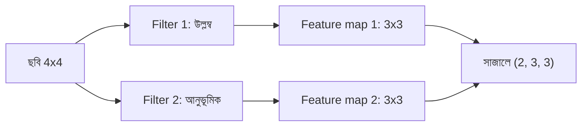

# Lecture 04 — Feature Map

> আগে যা জানা থাকলে ভালো: [filter ও convolution](lecture-03-local-pattern-and-convolution.md) এবং [ReLU activation](../module-09-model-architecture/lecture-04-activation.md)। এই lecture শেষে পারবে: convolution-এর output ছকটা কী বোঝায় তা পড়তে, আর একাধিক filter-এর ফল সাজিয়ে রাখতে।

## সমস্যাটা কী?

আগের lecture-এ একটা filter দিয়ে একটা output ছক পেয়েছি। কিন্তু একটা filter শুধু একটাই pattern খোঁজে — যেমন উল্লম্ব কিনারা। একটা ছবিতে আছে অনেক রকম pattern: উল্লম্ব, আনুভূমিক, কোণা। আবার output ছকের সংখ্যাগুলো কী বোঝায়, সেটাও পরিষ্কার করা দরকার, নাহলে পরের ধাপ কীসের উপর কাজ করবে তা বোঝা যায় না।

## ধারণাটা সহজ ভাষায়

একটা filter স্লাইড করে যে output ছক পাওয়া যায়, সেটাই **feature map**। এটা দেখতে ছবির মতো ছক, কিন্তু প্রতিটা ঘরে লেখা থাকে "এই জায়গায় filter-এর pattern কতটা আছে":

- বড় ধনাত্মক মান: pattern জোরালোভাবে আছে।
- `0`-র কাছে: নেই।
- ঋণাত্মক: উল্টো pattern আছে (যেমন কালো থেকে সাদার বদলে সাদা থেকে কালো)।

ঋণাত্মক মান সাধারণত "পাইনি" হিসেবে ধরা হয়, তাই feature map-এ প্রায়ই ReLU বসানো হয়, যা negative মানকে `0` করে। (ReLU Module 09-এ দেখেছ।)

একাধিক filter থাকলে প্রতিটা একটা করে feature map দেয়। সব map একটার উপর আরেকটা সাজালে একটা বহু-channel ছকের মতো দেখায় — Lecture 02-এর shape-এর ভাষায়, শুধু এখানে channel-এর সংখ্যা = filter-এর সংখ্যা।

## ছোট একটা উদাহরণ

৪×৪ ছবিতে মাঝখানে একটা উজ্জ্বল ২×২ বর্গ:

```text
0 0 0 0
0 9 9 0
0 9 9 0
0 0 0 0
```

দুটো filter:
- **উল্লম্ব কিনারা:** `[[-1, 1], [-1, 1]]` (ডান বিয়োগ বাঁ)
- **আনুভূমিক কিনারা:** `[[-1, -1], [1, 1]]` (নিচ বিয়োগ উপর)

উল্লম্ব filter-এর প্রথম জায়গায় (সারি 0, কলাম 0) window `[[0, 0], [0, 9]]`:
`(-1×0) + (1×0) + (-1×0) + (1×9) = 9`

আনুভূমিক filter-এর একই জায়গায় window একই:
`(-1×0) + (-1×0) + (1×0) + (1×9) = 9`

বাকি জায়গাগুলোও এভাবে হিসাব করে ফল:

```python
def conv2d(img, k):
    n, m = len(img), len(k)
    return [[sum(img[i + a][j + b] * k[a][b] for a in range(m) for b in range(m))
             for j in range(n - m + 1)] for i in range(n - m + 1)]

def relu(grid):
    return [[max(0, v) for v in row] for row in grid]

img = [[0, 0, 0, 0],
       [0, 9, 9, 0],
       [0, 9, 9, 0],
       [0, 0, 0, 0]]
f_vert = [[-1, 1], [-1, 1]]     # right minus left
f_horz = [[-1, -1], [1, 1]]     # bottom minus top

maps = [conv2d(img, f_vert), conv2d(img, f_horz)]
for name, m in zip(["vertical", "horizontal"], maps):
    print(name, m)
    print("  after ReLU:", relu(m))
print("stack shape:", (len(maps), len(maps[0]), len(maps[0][0])))
```

```text
# output:
vertical [[9, 0, -9], [18, 0, -18], [9, 0, -9]]
  after ReLU: [[9, 0, 0], [18, 0, 0], [9, 0, 0]]
horizontal [[9, 18, 9], [0, 0, 0], [-9, -18, -9]]
  after ReLU: [[9, 18, 9], [0, 0, 0], [0, 0, 0]]
stack shape: (2, 3, 3)
```

**উল্লম্ব map পড়া:** প্রথম কলামে `9, 18, 9` — বর্গের বাম কিনারা। সবচেয়ে বড় `18` মাঝের সারিতে, যেখানে window-র দুই সারিই বর্গের উপর। শেষ কলামে `-9, -18, -9` — ডান কিনারায় উজ্জ্বল থেকে কালোয় নামা, উল্টো pattern; ReLU সেটাকে `0` করে দিয়েছে।

**আনুভূমিক map পড়া:** উপরের সারি `9, 18, 9` — বর্গের উপরের কিনারা। নিচের সারির ঋণাত্মক মান — নিচের কিনারা, ReLU-র পরে `0`।

দুটো map সাজালে shape `(2, 3, 3)`: ২টা channel, প্রতিটা ৩×৩।

## ছবি



এই `(2, 3, 3)` ছকটাই পরের convolution layer-এর input হতে পারে, ঠিক যেভাবে ছবি `(H, W, C)` ছক হিসেবে প্রথম layer-এ গিয়েছিল। তখন সেই layer-এর প্রতিটা filter-কে দুটো channel-ই দেখতে হয়, তাই ২×২ filter-এ weight লাগে `2 × 2 × 2 = 8`। সাধারণত প্রথম layer-এর map সহজ কিনারা ধরে, পরের layer সেগুলো জুড়ে কোণা বা আকার ধরে — এই লেখায় সেটা হিসাব করা হয়নি, শুধু ধারণা।

## মনে রাখার সারকথা

- Feature map হলো filter-এর output ছক: প্রতি ঘরে বলা হয় ওই জায়গায় pattern কতটা আছে।
- ReLU ঋণাত্মক মান (উল্টো pattern) `0` করে; একাধিক filter মানে একাধিক map, সাজালে `(filter-সংখ্যা, H', W')`।
- Feature map-ই পরের layer-এর input; ছবির মতোই সেটাও একটা channel-সহ ছক।

## নিজে করো

১. এই বর্গ-ছবিতে filter `[[1, -1], [1, -1]]` (বাঁ বিয়োগ ডান) দিলে প্রথম সারি কী হবে?
২. ৫টা filter থাকলে ৬×৬ ছবির উপর ৩×৩ filter দিয়ে feature map-এর stack-এর shape কী?
৩. ২টা channel-ওয়ালা input-এ ৩×৩ filter-এ কয়টা weight?

<details><summary>উত্তর</summary>

১. পুরো map `[[-9, 0, 9], [-18, 0, 18], [-9, 0, 9]]`, তাই প্রথম সারি `[-9, 0, 9]`। এখানে ডান কিনারা (উজ্জ্বল থেকে কালো) ধনাত্মক হয়েছে, বাম কিনারা ঋণাত্মক।
২. প্রতি map `6 − 3 + 1 = 4`, তাই `(5, 4, 4)`।
৩. `3 × 3 × 2 = 18`।

</details>

## পরের পাঠ

**কোথায় কাজে লাগবে:** OCR-এ অক্ষরের সোজা-বাঁকা দাগের এমন map-ই ছবি-পড়া অংশের মাঝের তথ্য ([Module 14](../module-14-ocr-system-case-study/lecture-04-encoder-decoder-in-recognition.md))। Convolution ছাড়াও ছবিকে সংখ্যার ক্রমে সাজানোর আরেকটা পথ আছে — টুকরো করে: [Lecture 05 — Patch ও patch embedding](lecture-05-patches-and-patch-embedding.md)।
