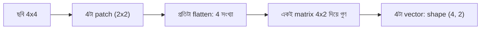

# Lecture 05 — Patch ও Patch Embedding

> আগে যা জানা থাকলে ভালো: [image shape](lecture-02-image-shape-and-tensor.md) ও [filter-এর হিসাব](lecture-03-local-pattern-and-convolution.md), আর [dense layer-এর weight matrix](../module-09-model-architecture/lecture-07-shapes-and-parameter-count.md)। এই lecture শেষে পারবে: একটা ছবি টুকরো করে প্রতি টুকরো থেকে একটা vector বানানোর হিসাব করতে। এটা শুধু ধারণামূলক পরিচয়।

## সমস্যাটা কী?

Convolution ছবিকে খুব ছোট window দিয়ে স্লাইড করে দেখে। কিন্তু পরে আমরা এমন model-এ যাব (Module 12), যে model সংখ্যার একটা **তালিকা** নিয়ে কাজ করে — যেমন লেখার প্রতি শব্দের জন্য একটা vector। ছবিকে সেই তালিকার রূপ দিতে হলে প্রশ্ন ওঠে: ছবি থেকে "তালিকার এক-একটা উপাদান" কীভাবে বানাব? একটা সহজ উত্তর: ছবিটাকে সমান টুকরোয় কেটে প্রতি টুকরো থেকে একটা vector নাও। এই পথেই **Vision Transformer (ViT)** নামের পরিচিত model ছবি নেয়।

## ধারণাটা সহজ ভাষায়

ধাপ তিনটা:

1. **Patch:** ছবিকে সমান মাপের, একে অপরের উপর না পড়া বর্গ টুকরোয় ভাগ করো। বাঁ থেকে ডানে, উপর থেকে নিচে গুনে সাজাও।
2. **Flatten:** প্রতি patch-এর pixel সারি ধরে এক লাইনে লেখো। এখন প্রতি patch একটা vector।
3. **Embedding:** প্রতি patch-vector-কে একটা weight matrix দিয়ে গুণ করো (Module 09-এর dense layer-এর মতো)। এতে প্রতি patch থেকে ছোট একটা নতুন vector আসে — এটাই **patch embedding**। **একই matrix সব patch-এ** ব্যবহার হয়, ঠিক convolution-এর "একই filter সব জায়গায়"-এর মতো।

ফল: patch-এর সংখ্যা × embedding-এর দৈর্ঘ্য মাপের একটা তালিকা। এটাকেই পরের অংশ (Module 12-এর Transformer) এমনভাবে নিতে পারে, যেমন লেখার token-এর তালিকা নেয়।

## ছোট একটা উদাহরণ

৪×৪ ছবি, patch ২×২:

```text
1 2 | 0 1
3 4 | 2 3
----+----
0 1 | 5 6
1 0 | 7 8
```

চারটা patch, flatten করলে:

- patch 0 (উপরে-বাঁয়ে): `[1, 2, 3, 4]`
- patch 1 (উপরে-ডানে): `[0, 1, 2, 3]`
- patch 2 (নিচে-বাঁয়ে): `[0, 1, 1, 0]`
- patch 3 (নিচে-ডানে): `[5, 6, 7, 8]`

Embedding-এর weight matrix ৪×২ (৪ input, ২ output), হাতে বাছা:

```text
 1  -1
 1   1
 1  -1
 1   1
```

প্রথম কলাম সব pixel-এর যোগফল (মোট উজ্জ্বলতা); দ্বিতীয় কলাম `-a + b - c + d` (ডান বিয়োগ বাঁ, মানে Lecture 03-এর উল্লম্ব filter)। Patch 0 `[1, 2, 3, 4]`-এর জন্য:

- প্রথম মান: `1 + 2 + 3 + 4 = 10`
- দ্বিতীয় মান: `-1 + 2 - 3 + 4 = 2`

তাই patch 0-এর embedding `[10, 2]`। বাকি তিনটা কোডে:

```python
img = [[1, 2, 0, 1],
       [3, 4, 2, 3],
       [0, 1, 5, 6],
       [1, 0, 7, 8]]
P = 2   # patch size

patches = []
for i in range(0, len(img), P):
    for j in range(0, len(img[0]), P):
        patches.append([img[i + a][j + b] for a in range(P) for b in range(P)])
print("patches:", patches)

W = [[ 1, -1],
     [ 1,  1],
     [ 1, -1],
     [ 1,  1]]
emb = [[sum(p[i] * W[i][d] for i in range(4)) for d in range(2)] for p in patches]
print("embeddings:", emb)
print("shape:", (len(emb), len(emb[0])))
print("224x224x3, 16x16 patch ->", (224 // 16) ** 2, "patches, numbers per patch:", 16 * 16 * 3)
```

```text
# output:
patches: [[1, 2, 3, 4], [0, 1, 2, 3], [0, 1, 1, 0], [5, 6, 7, 8]]
embeddings: [[10, 2], [6, 2], [2, 0], [26, 2]]
shape: (4, 2)
224x224x3, 16x16 patch -> 196 patches, numbers per patch: 768
```

হাতের হিসাব (`[10, 2]`) কোডের প্রথম সারির সঙ্গে মিলেছে। ১৬ সংখ্যার ছবি এখন ৪টা vector-এর তালিকা, shape `(4, 2)`। বাস্তবের ২২৪×২২৪ রঙিন ছবিকে ১৬×১৬ patch-এ কাটলে ১৯৬টা patch হয়, প্রতিটায় `16 × 16 × 3 = 768` সংখ্যা।

এই W হাতে বাছা; বাস্তবে এই matrix-ও training-এ শেখা হয়।

## ছবি



## দুটো সম্পর্ক

- **Convolution-এর সঙ্গে:** একই ফল আসে ২×২ filter-কে প্রতিবার ২ ঘর করে সরালে (embedding-এর প্রতি মানের জন্য একটা করে filter) — তখন window-গুলো একে অপরের উপর পড়ে না। Patch embedding আসলে এই ধরনের convolution-এর রূপ।
- **সাবধান:** প্রতি patch আলাদা vector হয়ে গেলে "কোন patch কোথায় ছিল" তথ্য আপনাআপনি থাকে না; সেটা আলাদা করে যোগ করতে হয়। সেই অংশ Module 12-এ আসবে।

## মনে রাখার সারকথা

- Patch embedding: ছবি → সমান টুকরো → প্রতিটা flatten → একই weight matrix দিয়ে গুণ → vector-এর তালিকা।
- Patch-এর সংখ্যা `(H/p) × (W/p)`; প্রতি patch-এ `p × p × C` সংখ্যা।
- এটা ViT-র ছবি-ঢোকানোর ধাপ; Transformer-এর বাকি অংশ পরে।

## নিজে করো

১. ৬×৬ সাদা-কালো ছবি ৩×৩ patch-এ কাটলে কয়টা patch, প্রতিটায় কয়টা সংখ্যা?
২. ৮×৮ রঙিন ছবি, ৪×৪ patch, ৫ মাপের embedding: patch-vector-এর দৈর্ঘ্য কত? weight matrix-এ কয়টা weight, bias সহ কয়টা parameter?
৩. উপরের matrix দিয়ে patch `[0, 5, 0, 5]`-এর embedding কত?

<details><summary>উত্তর</summary>

১. `(6/3) × (6/3) = 4` patch; প্রতিটায় `3 × 3 = 9` সংখ্যা।
২. patch-vector `4 × 4 × 3 = 48`; weight `48 × 5 = 240`; bias ৫টা যোগ করে `245` parameter। patch `(8/4)² = 4`টা, কিন্তু একই matrix সব patch-এ ব্যবহার হয়, তাই parameter patch-এর সংখ্যার উপর নির্ভর করে না।
৩. প্রথম মান `0 + 5 + 0 + 5 = 10`; দ্বিতীয় মান `-0 + 5 - 0 + 5 = 10`। embedding `[10, 10]`। এই patch-এ বাঁ কালো, ডান উজ্জ্বল, তাই দ্বিতীয় মান বড়।

</details>

## পরের পাঠ

**কোথায় কাজে লাগবে:** Module 12-এর Transformer ও image-text model এই patch-vector-এর তালিকাই ছবির প্রতিনিধি হিসেবে নেয় ([image ও text একসঙ্গে](../module-12-text-sequences-and-multimodal-models/lecture-08-image-and-text-together.md))। এখন convolution ও patch — দুই পথেরই লক্ষ্য একটা: ছবি থেকে কাজের উপযোগী representation। সেই কাজ করা অংশের নাম: [Lecture 06 — Encoder](lecture-06-encoder.md)।
