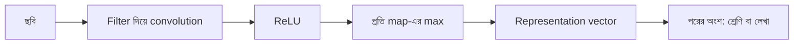

# Lecture 06 — Encoder: ছবি থেকে Representation Vector

> আগে যা জানা থাকলে ভালো: [feature map](lecture-04-feature-map.md) এবং [patch embedding](lecture-05-patches-and-patch-embedding.md)। এই lecture শেষে পারবে: একটা ছোট encoder-এর ধাপগুলো বলতে এবং দুটো ছবির representation vector তুলনা করতে।

## সমস্যাটা কী?

ছবি এখন সংখ্যার ছক, আর আমরা তার feature map বা patch-vector বের করতে পারি। কিন্তু এগুলো ছবির মাপের উপর নির্ভর করে: বড় ছবির map বড়, ছোট ছবির map ছোট। পরের কাজ — ধরো ছবিটা কোন শ্রেণির তা বলা, বা ছবির বর্ণনা লেখা — চায় একটা পরিষ্কার, নির্দিষ্ট দৈর্ঘ্যের সারাংশ: "এই ছবিতে কী কী আছে"। এই সারাংশ বানানোর আলাদা একটা অংশ ভাবলে পরের অংশকে আর pixel নিয়ে মাথা ঘামাতে হয় না।

## ধারণাটা সহজ ভাষায়

**Encoder** হলো model-এর সেই অংশ, যা কাঁচা input (এখানে ছবি) নিয়ে তাকে এমন সংখ্যার vector-এ বদলে দেয়, যা পরের কাজের জন্য দরকারি তথ্য ধরে রাখে। এই vector-কে বলে **representation**। Encoder নিজে চূড়ান্ত উত্তর (শ্রেণি বা লেখা) দেয় না; সে পরের অংশের জন্য তথ্য সাজিয়ে দেয়।

একটা ছোট encoder-এর ধাপ আগের lecture-গুলোরই জোড়া:

1. কয়েকটা filter দিয়ে convolution → feature map
2. ReLU
3. প্রতিটা feature map-কে এক সংখ্যায় সারাংশ করা — আমরা নেব map-এর **সবচেয়ে বড় মান** (একে global max pooling বলে)। এই এক সংখ্যা বলে "এই pattern ছবির কোথাও আছে কি না, আর কতটা জোরালো"।

প্রতিটা filter থেকে একটা সংখ্যা, তাই ছবি যত বড়ই হোক, vector-এর দৈর্ঘ্য = filter-এর সংখ্যা।



## ছোট একটা উদাহরণ

আগের দুটো filter (উল্লম্ব `[[-1, 1], [-1, 1]]`, আনুভূমিক `[[-1, -1], [1, 1]]`) আবার ব্যবহার হবে। ছবি A: বাম কালো, ডান উজ্জ্বল (উল্লম্ব কিনারা)।

```text
0 0 9 9   (৪ সারিই একই)
```

উল্লম্ব filter-এর map: প্রতি সারি `[0, 18, 0]`, ReLU-র পর একই, সর্বোচ্চ `18`।
আনুভূমিক filter: ছবির সারিগুলো একই, তাই উপর-নিচ পার্থক্য নেই, প্রতি জায়গায় `0`; সর্বোচ্চ `0`।
Representation: `[18, 0]` — "উল্লম্ব কিনারা আছে, আনুভূমিক নেই"।

এখন কয়েকটা ছবি আর তাদের vector:

```python
def conv2d(img, k):
    n, m = len(img), len(k)
    return [[sum(img[i + a][j + b] * k[a][b] for a in range(m) for b in range(m))
             for j in range(n - m + 1)] for i in range(n - m + 1)]

def relu(g):
    return [[max(0, v) for v in row] for row in g]

FILTERS = [[[-1, 1], [-1, 1]],    # vertical edge
           [[-1, -1], [1, 1]]]    # horizontal edge

def encode(img):
    vec = []
    for f in FILTERS:
        fmap = relu(conv2d(img, f))
        vec.append(max(max(row) for row in fmap))   # global max pooling
    return vec

A  = [[0, 0, 9, 9] for _ in range(4)]               # vertical edge
A2 = [[0, 0, 8, 8] for _ in range(4)]               # same, slightly dimmer
B  = [[0] * 4, [0] * 4, [9] * 4, [9] * 4]           # horizontal edge
va, va2, vb = encode(A), encode(A2), encode(B)
print("A :", va); print("A2:", va2); print("B :", vb)

def dist(u, v):
    return sum((x - y) ** 2 for x, y in zip(u, v)) ** 0.5
print("dist(A,A2) =", round(dist(va, va2), 2))
print("dist(A,B)  =", round(dist(va, vb), 2))

A_shift = [[0, 9, 9, 0] for _ in range(4)]          # bright stripe moved
print("A_shift:", encode(A_shift))
```

```text
# output:
A : [18, 0]
A2: [16, 0]
B : [0, 18]
dist(A,A2) = 2.0
dist(A,B)  = 25.46
A_shift: [18, 0]
```

- **A ও A2** প্রায় একই ছবি (উজ্জ্বলতা সামান্য আলাদা) → vector কাছাকাছি, দূরত্ব `2.0`।
- **A ও B** আলাদা ধরনের ছবি (উল্লম্ব বনাম আনুভূমিক) → vector দূরে, দূরত্ব `25.46`।
- **A_shift:** উজ্জ্বল দাগ সরে গেলেও vector `[18, 0]`; global max জায়গার তথ্য ফেলে দেয়। সুবিধা — pattern যেখানেই থাক ধরা পড়ে; অসুবিধা — কোথায় ছিল তা বলা যায় না।

এটাই representation-এর মূল কাজ: একই ধরনের ছবি কাছাকাছি vector, ভিন্ন ধরনের ছবি দূরে — আর এটা ছবির আকার নয়, ছবির বিষয়বস্তুর উপর নির্ভর করে।

## বাস্তবের সঙ্গে সম্পর্ক

এখানে filter আমরা হাতে বসিয়েছি, মাত্র দুটো। বাস্তব encoder-এ শত শত filter, অনেক layer, আর সব মান training-এ শেখা। আরেক ধরনের encoder ViT: patch embedding → Transformer ([Module 12](../module-12-text-sequences-and-multimodal-models/lecture-06-transformer-block.md))। দুই ধরনেরই লক্ষ্য এক: ছবি → representation।

## মনে রাখার সারকথা

- Encoder হলো কাঁচা input থেকে representation vector বানানো অংশ; সে চূড়ান্ত উত্তর দেয় না।
- ছোট CNN encoder: filter → ReLU → প্রতি map-এর max → vector (দৈর্ঘ্য = filter-সংখ্যা)।
- ভালো representation-এ একই ধরনের ছবি কাছাকাছি, ভিন্ন ধরনের ছবি দূরে থাকে।

## নিজে করো

১. সব pixel `5` এমন ৪×৪ ছবির encode ফল কী?
২. ছবি `[[9]*4, [9]*4, [0]*4, [0]*4]` (উপরে উজ্জ্বল, নিচে কালো) — ফল কী? কেন?
৩. মাঝখানে উজ্জ্বল ২×২ বর্গ-ছবির (Lecture 04) vector কী?

<details><summary>উত্তর</summary>

১. সমতল ছবিতে কিনারা নেই, দুই filter-এই `0`; ফল `[0, 0]`।
২. ফল `[0, 0]`। আনুভূমিক filter "নিচ বিয়োগ উপর" খোঁজে; এখানে নিচ কালো, উপর উজ্জ্বল, তাই ফল ঋণাত্মক (`-18`), আর ReLU সেটাকে `0` করে। উল্লম্ব filter-এ বাম-ডান পার্থক্য নেই। এই encoder শুধু "কালো থেকে উজ্জ্বল" কিনারা ধরে।
৩. বর্গে বাম কিনারা (উল্লম্ব) আর উপরের কিনারা (আনুভূমিক) দুটোই আছে; Lecture 04-এর map থেকে দুটোর সর্বোচ্চ `18`। ফল `[18, 18]`।

</details>

## পরের পাঠ

**কোথায় কাজে লাগবে:** OCR system-এ ছবি-encoder লেখা-বের-করা অংশকে (decoder) এই representation জোগায় ([Module 14](../module-14-ocr-system-case-study/lecture-04-encoder-decoder-in-recognition.md))। Encoder-এ ছবি ঢোকানোর আগে ছবি ঠিক মাপ ও মানে আনতে হয়: [Lecture 07 — Resize ও preprocessing](lecture-07-resize-and-preprocessing.md)।
