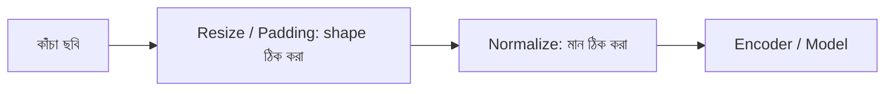

# Lecture 07 — Resize ও Preprocessing

> আগে যা জানা থাকলে ভালো: [image shape](lecture-02-image-shape-and-tensor.md) ও [convolution-এর output মাপ](lecture-03-local-pattern-and-convolution.md), আর [encoder](lecture-06-encoder.md)। এই lecture শেষে পারবে: resize, normalize ও padding হাতে করে দেখাতে এবং প্রতিটা কাজে ছবির কোন তথ্য বদলায় তা বলতে।

## সমস্যাটা কী?

বাস্তবে ছবি আসে নানা মাপে: কোনোটা ফোনের বড় ছবি, কোনোটা ছোট স্ক্যান, কোনোটা লম্বা রসিদ। আবার কোনো model-এর layer চায় নির্দিষ্ট shape, যেমন `(224, 224, 3)`, আর pixel মান `0..1`-এর কাছাকাছি। তাই ছবি model-এ ঢোকানোর আগে একটা ছোট ধাপ লাগে — **preprocessing**। কিন্তু প্রতিটা বদলে ছবির কিছু তথ্য বদলায় বা হারায়; সেটা না জানলে model খারাপ চললে কারণ খুঁজে পাওয়া যায় না। OCR-এ এটা বিশেষভাবে জরুরি, কারণ অক্ষরের দাগ খুব সরু।

## ধারণাটা সহজ ভাষায়

তিনটা সাধারণ কাজ:

- **Resize:** ছবির মাপ বদলানো। ছোট করলে কয়েকটা pixel মিলে একটা হয় (তথ্য হারায়)। বড় করলে নতুন pixel পুরনোগুলো নকল করে বা মিশিয়ে বানানো হয় (নতুন তথ্য আসে না)।
- **Normalize:** pixel-এর মান নির্দিষ্ট পাল্লায় আনা। আগে `255` দিয়ে ভাগ করে `0..1`, তারপর চাইলে গড় বিয়োগ করে আবার একটা মাপ দিয়ে ভাগ। এতে ছবির আকার বা বিন্যাস বদলায় না, শুধু সংখ্যার scale বদলায়।
- **Padding:** ছবির চারপাশে (সাধারণত `0` দিয়ে) বাড়তি সারি-কলাম যোগ করা। এতে ছবির মাপ বাড়ে, কিন্তু আসল pixel-এ হাত পড়ে না।

## ছোট একটা উদাহরণ

**Resize: সরু দাগ হারায়।** ৪×৪ ছবিতে ১ pixel চওড়া উজ্জ্বল দাগ (অক্ষরের সরু দাগের মতো):

```text
0 9 0 0   (৪ সারিই একই)
```

অর্ধেক করতে প্রতি ২×২ block-এর গড় নিই। প্রথম block-এর pixel `0, 9, 0, 9`: গড় `(0 + 9 + 0 + 9) / 4 = 4.5`। দ্বিতীয় block সব `0`: গড় `0`। ফল ২×২ ছবি `[[4.5, 0], [4.5, 0]]` — দাগের উজ্জ্বলতা `9` থেকে `4.5`, মানে অর্ধেক ফ্যাকাসে। আবার বড় করলে (pixel নকল করে) পাওয়া যায় `[4.5, 4.5, 0, 0]` — আসল `[0, 9, 0, 0]` ফেরে না।

```python
def down2(img):          # shrink by half: average each 2x2 block
    n = len(img)
    return [[(img[i][j] + img[i][j+1] + img[i+1][j] + img[i+1][j+1]) / 4
             for j in range(0, n, 2)] for i in range(0, n, 2)]

def up2(img):            # enlarge x2: repeat each pixel (nearest neighbor)
    out = []
    for row in img:
        wide = [v for v in row for _ in range(2)]
        out += [wide, list(wide)]
    return out

thin = [[0, 9, 0, 0] for _ in range(4)]
small = down2(thin)
print("shrunk    :", small)
print("enlarged  :", up2(small)[0], "(original line was [0, 9, 0, 0])")
```

```text
# output:
shrunk    : [[4.5, 0.0], [4.5, 0.0]]
enlarged  : [4.5, 4.5, 0.0, 0.0] (original line was [0, 9, 0, 0])
```

**Normalize:** `255` দিয়ে ভাগ করে `0..1`, তারপর `(মান − 0.5) / 0.5` দিয়ে `-1..1`। যেমন `64`: `64 / 255 = 0.251`, তারপর `(0.251 − 0.5) / 0.5 = −0.498`।

**Padding:** ৩×৩ ছবিতে ১ ঘরের `0`-border দিলে ৫×৫। এর উপকার convolution-এ: ৩×৩ filter `n − k + 1` নিয়মে ৩×৩ ছবিতে মাত্র ১×১ output দেয়, আর ৫×৫ padded ছবিতে `5 − 3 + 1 = 3`, অর্থাৎ ৩×৩ — ছবির মাপ ধরে রাখা যায়।

**মাপের অনুপাত (aspect ratio):** ২×৪ ছবি ৪×৪ করতে হলে দুই পথ। টেনে বড় করলে সারি নকল হয়, ছবির আকার বিকৃত হয়। উপর-নিচে `0`-সারি জুড়ে দিলে (letterbox) আসল ছবি অবিকৃত থাকে, কিন্তু ফাঁকা জায়গা model-কে পেরিয়ে যেতে হয়।

```python
raw = [0, 64, 128, 255]
unit = [round(v / 255, 3) for v in raw]
norm = [round((u - 0.5) / 0.5, 3) for u in unit]
print("raw :", raw); print("0..1:", unit); print("norm:", norm)

wide = [[1, 2, 3, 4], [5, 6, 7, 8]]
stretched = [r for r in wide for _ in range(2)]
letterbox = [[0] * 4] + wide + [[0] * 4]
print("stretched:", stretched)
print("letterbox:", letterbox)
```

```text
# output:
raw : [0, 64, 128, 255]
0..1: [0.0, 0.251, 0.502, 1.0]
norm: [-1.0, -0.498, 0.004, 1.0]
stretched: [[1, 2, 3, 4], [1, 2, 3, 4], [5, 6, 7, 8], [5, 6, 7, 8]]
letterbox: [[0, 0, 0, 0], [1, 2, 3, 4], [5, 6, 7, 8], [0, 0, 0, 0]]
```

## ছবি



## মনে রাখার সারকথা

- Resize আর padding ছবির **shape** বদলায়; ছোট করলে সূক্ষ্ম তথ্য হারায়, বড় করলে নতুন তথ্য আসে না।
- Normalize শুধু সংখ্যার **scale** বদলায়, ছবির বিন্যাস নয়।
- Training আর prediction-এ একই preprocessing ব্যবহার না করলে model অচেনা ধরনের input পায় এবং খারাপ চলে।

## নিজে করো

১. ৪×৪ ছবির উপর ২×২ filter বসালে output ৩×৩। চারপাশে ১ ঘর `0` padding দিয়ে ২×২ filter বসালে output কত?
২. ২×২ block-এ pixel `0, 8, 0, 8` হলে অর্ধেক করার পর মান কত?
৩. pixel `51`-কে `0..1`-এ এনে তারপর `(মান − 0.5) / 0.5` দিলে কত হয়?

<details><summary>উত্তর</summary>

১. padding-এর পর ছবি ৬×৬; output `6 − 2 + 1 = 5`, অর্থাৎ ৫×৫।
২. `(0 + 8 + 0 + 8) / 4 = 4`।
৩. `51 / 255 = 0.2`; `(0.2 − 0.5) / 0.5 = −0.6`।

</details>

## পরের পাঠ

**কোথায় কাজে লাগবে:** Module 14-এ OCR pipeline-এ ছবি ঢোকার আগের এই ধাপগুলোই ([Image enters the pipeline](../module-14-ocr-system-case-study/lecture-02-image-enters-the-pipeline.md)); আর লেখার জন্য একই রকম প্রস্তুতি — token ও tokenizer — শুরু হয় [Module 12-এ](../module-12-text-sequences-and-multimodal-models/lecture-01-token-and-tokenizer.md)। এই module-এর সারসংক্ষেপ: [README](README.md)।
