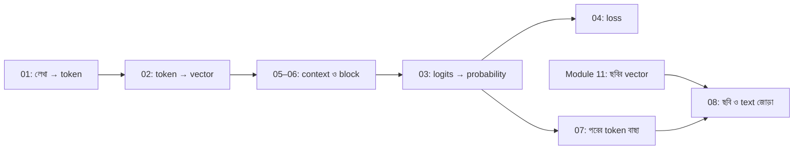

# Module 12 — Text, Sequence ও Vision–Language Model

[কেন্দ্রীয় Model ও Math Map](../01-learning-map.md) · [Course Outline](../00-course-outline.md) · [লেখার নিয়ম](../00-writing-style-guide.md)

## Status: Bridge ও ৮টি lecture লেখা হয়েছে; পড়া ও অনুশীলন সম্পন্ন ধরা হয়নি

প্রতিটা lecture ছোট, এক ধারণার, সংখ্যার হাতে-হিসাবসহ এবং Python-এ যাচাই করা। লেখা আছে মানেই শেখা হয়ে গেছে, এমন নয়।

## আগে যা জানা থাকলে ভালো

- [Module 09](../module-09-model-architecture/README.md): unit, layer, forward pass (বিশেষত [hidden layer](../module-09-model-architecture/lecture-05-hidden-layer.md) ও [forward pass](../module-09-model-architecture/lecture-06-forward-pass.md))।
- [Module 03 — Sigmoid](../module-03-logistic-regression/lecture-01-sigmoid.md): score থেকে probability।
- [Module 10](../module-10-neural-network-training/README.md): loss থেকে weights কীভাবে বদলায় (Lecture 04 পড়ার সময় loss-এর অংশটুকু বুঝতে এটুকুই লাগে যে "loss কমানোই লক্ষ্য")।
- [Module 11](../module-11-image-representation-and-vision/README.md): ছবি থেকে vector। শুধু Lecture 08-এর জন্য।

## কোন ক্রমে পড়বে

প্রথমে Bridge, তারপর 01 থেকে 08 সংখ্যার ক্রমে। প্রতিটা lecture আগেরটার উদাহরণ (পাঁচ token, d = 2) আবার ব্যবহার করে, তাই ক্রম বদলালে হিসাব মিলবে না।

| ক্রম | Lecture | এক লাইনে কী শেখায় |
|---|---|---|
| Bridge | [Output score থেকে একটি ফল বাছাই](bridge-01-output-scores-and-selection.md) | শেষ layer-এর score (logits), argmax, margin |
| 01 | [Token ও Tokenizer](lecture-01-token-and-tokenizer.md) | লেখাকে টুকরো ও id-তে ভাঙা; ছোট BPE |
| 02 | [Embedding](lecture-02-embedding.md) | id থেকে vector: table-এর সারি তোলা |
| 03 | [Logits ও Softmax](lecture-03-logits-and-softmax.md) | Score থেকে probability, temperature |
| 04 | [Next-token ও Cross-entropy](lecture-04-next-token-and-cross-entropy.md) | লেখা থেকে training উদাহরণ; loss = −ln(p) |
| 05 | [Context ও Attention](lecture-05-context-and-attention.md) | তিন token-এ query/key/value ও attention weight |
| 06 | [Transformer Block](lecture-06-transformer-block.md) | Attention, feed-forward, residual, normalization |
| 07 | [Autoregressive Decoder ও Stopping](lecture-07-autoregressive-decoder-and-stopping.md) | একটা একটা token বানানো, stop token, greedy বনাম sampling |
| 08 | [Image ও Text একসঙ্গে](lecture-08-image-and-text-together.md) | Image token বানিয়ে text decoder-এ দেওয়া |

ছবিটা model-এর ভেতরের তথ্যপ্রবাহ: 01 → 02 → 05–06 → 03। পড়ার ক্রম কিন্তু 01 থেকে 08। Output-এর ধারণা (03–04) সহজ এবং পরের সব lecture-এ লাগে, তাই সেগুলো আগে পড়া হয়।

## কিছু সংখ্যা সবখানে একই

Lecture 02 থেকে 08 পর্যন্ত একই ছোট vocabulary: আমি, ভাত, খাই, পানি, `<end>`। Embedding, weights ও attention-এর সংখ্যা শেখানোর জন্য হাতে বসানো; training-এ শেখা সংখ্যা নয়।

## এরপর

- [Module 13](../module-13-pretraining-finetuning-and-lora/README.md): আগে-শেখা model আরও শেখানো (fine-tuning, LoRA, quantization)।
- [Module 14](../module-14-ocr-system-case-study/README.md): ছবি থেকে লেখা পড়ার বাস্তব system। ভিত্তি তৈরি হলে এখানে আসা।
