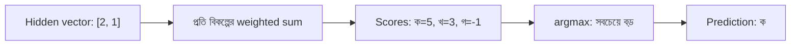

# Bridge 01 — Output Score থেকে একটি ফল বাছাই

> আগে যা জানা থাকলে ভালো: [Forward pass](../module-09-model-architecture/lecture-06-forward-pass.md) (weighted sum ও bias)। এই পাঠ শেষে পারবে: শেষ layer-এর কয়েকটি সংখ্যা থেকে একটি উত্তর বেছে নিতে, এবং বলতে পারবে কেন সবচেয়ে বড় সংখ্যা মানেই "সঠিক উত্তর" নয়।
> Map-এ অবস্থান: [Learning Map](../01-learning-map.md) → output-এর হিসাব। এখানে loss বা update নেই।

## সমস্যাটা কী?

বাড়ির দাম predict করতে model একটাই সংখ্যা দেয়। কিন্তু একটা অক্ষরের ছবি দেখে "ক", "খ" নাকি "গ" বলতে হলে একটা সংখ্যায় চলে না। তিনটি বিকল্পের প্রত্যেকের জন্য আলাদা সংখ্যা লাগে, তারপর তার মধ্যে একটা বেছে নিতে হয়।

Text তৈরির model-ও ঠিক এই কাজ করে: প্রতিবার অনেকগুলো সম্ভাব্য পরের অংশের মধ্যে একটা বাছে। তাই এই পাঠ পুরো Module 12-এর প্রথম ধাপ।

## ধারণাটা সহজ ভাষায়

শেষ layer-এ প্রতিটি বিকল্পের জন্য একটি করে unit থাকে। সব unit একই hidden vector নেয়, কিন্তু প্রত্যেকের নিজের weights আছে। তাই প্রত্যেকে আলাদা একটা সংখ্যা বের করে। এই সংখ্যাগুলোকে বলে **logits**, অর্থাৎ বিকল্পগুলোর কাঁচা score।

সবচেয়ে বড় score-এর বিকল্পটা বেছে নেওয়াকে বলে **argmax**। যেমন score যদি `ক=5, খ=3, গ=-1` হয়, argmax-এর উত্তর "ক"।

দুটো কথা পরিষ্কার রাখো:
- Weights ও bias হলো **parameter**, training-এ শেখা হয়। Logits parameter নয়; নতুন input এলে logits নতুন করে হিসাব হয়।
- Score negative হতে পারে। 5 মানে "৫%" নয়, আর "পাঁচ গুণ নিশ্চিত"-ও নয়।

## ছোট একটা উদাহরণ

ধরো hidden layer থেকে `h = [2, 1]` এসেছে। শেষ layer-এর weights নিচে দেওয়া (শেখানোর জন্য বেছে নেওয়া, বাস্তব OCR-এর নয়), bias সবার 0।

| বিকল্প | Weights | Score-এর হিসাব | Score |
|---|---|---|---:|
| ক | [2, 1] | 2×2 + 1×1 | 5 |
| খ | [1, 1] | 1×2 + 1×1 | 3 |
| গ | [-1, 1] | (-1)×2 + 1×1 | -1 |

সবচেয়ে বড় score 5, তাই prediction "ক"। আসল অক্ষর দেখে তবেই বোঝা যায় prediction ঠিক কি না।

## Score থেকে Probability

Score-কে এমন সংখ্যায় বদলানো যায় যা সব 0-এর বেশি এবং মোট 1। এই কাজের function-এর নাম **softmax**। `[5, 3, -1]` থেকে পাওয়া যায় প্রায় `[87.89%, 11.89%, 0.22%]`। বড় score বড় probability পায়, আর বিকল্পের ক্রম বদলায় না।

সাবধান: এটা model-এর নিজের হিসাব। বাস্তবে model কতবার ঠিক হয়, এই শতাংশ তা বলে না। Softmax-এর হাতে-হিসাব [Lecture 03](lecture-03-logits-and-softmax.md)-এ।

Prediction শুধু argmax দিয়ে চাইলে softmax লাগে না। কিন্তু probability অনুযায়ী লটারি করে বাছলে (sampling) সবসময় সবচেয়ে বড় score-এরটা আসবে না। এটা [Lecture 07](lecture-07-autoregressive-decoder-and-stopping.md)-এ আসবে।

## ছবি

## Text তৈরির সঙ্গে সম্পর্ক

Text model পুরো অনুচ্ছেদ এক ধাক্কায় score করে না। লেখা তৈরি হয় ছোট ছোট অংশ ধরে। এই অংশকে বলে **token** (পুরো শব্দ, শব্দের টুকরো বা punctuation)। প্রতি ধাপে model সম্ভাব্য সব token-এর logits দেয়, একটা token বাছা হয়, সেটা লেখার সঙ্গে যোগ হয়, তারপর পরের ধাপ। Token আসলে কী, তা [Lecture 01](lecture-01-token-and-tokenizer.md)-এ।

## Score-এর ব্যবধান (margin)

উদাহরণে সবচেয়ে বড় score 5, দ্বিতীয়টা 3। ব্যবধান 2। একে **margin** বলে। Score-এ ছোট কোনো সংখ্যাগত বিচ্যুতি এলেও যদি margin তার চেয়ে বড় থাকে, তাহলে বাছাই একই থাকে। সংখ্যার precision কমালে (quantization) কেন এটা কাজে লাগে, তা [quantization lecture](../module-13-pretraining-finetuning-and-lora/lecture-05-quantization-and-qlora.md)-এ আছে।

## মনে রাখার সারকথা

- শেষ layer প্রতি বিকল্পের জন্য একটা করে score (logit) দেয়; argmax সবচেয়ে বড়টা বাছে।
- Logits হলো input-এর জন্য হিসাব করা ফল, parameter নয়।
- Softmax score-কে probability-র মতো সংখ্যায় বদলায়, কিন্তু বেশি score মানেই সঠিক উত্তর নয়।

## নিজে করো

১. উপরের উদাহরণে "খ"-এর bias 3 করলে "খ"-এর score কত? prediction কী হবে?
২. "গ"-এর weights `[3, 1]` (bias 0) করলে "গ"-এর score কত? prediction কী?
৩. তিনটি score-এই 10 যোগ করে `[15, 13, 9]` করলে prediction ও probability কি বদলায়?

উত্তর

১. নতুন score = 1×2 + 1×1 + 3 = 6। এখন 6 > 5, তাই prediction "খ"।
২. 3×2 + 1×1 = 7। 7 > 5, তাই prediction "গ"।
৩. Prediction একই থাকে ("ক")। Probability-ও একই থাকে: `[87.89%, 11.89%, 0.22%]`। কারণ softmax শুধু score-এর **ব্যবধান** দেখে, সবার সঙ্গে একই সংখ্যা যোগ করলে ব্যবধান বদলায় না।

## পরের পাঠ

[Lossless compression ও সংখ্যার representation](../module-13-pretraining-finetuning-and-lora/bridge-01-lossless-compression.md), তারপর quantization। Text-এর পথ ধরে এগোতে চাইলে [Lecture 01 — Token ও Tokenizer](lecture-01-token-and-tokenizer.md)।

**Reference:** [Google ML glossary — logits ও softmax](https://developers.google.com/machine-learning/glossary#logits)।
