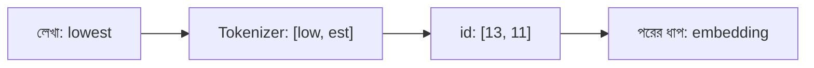

# Lecture 01 — Token ও Tokenizer: লেখাকে সংখ্যায় ভাঙা

> আগে যা জানা থাকলে ভালো: [Model শুধু সংখ্যা নিয়ে কাজ করে](../module-09-model-architecture/lecture-01-input-computation-output.md) এবং [Bridge 01](bridge-01-output-scores-and-selection.md)-এ "token" শব্দের পরিচয়। এই lecture শেষে পারবে: ছোট একটা BPE-ধরনের tokenizer হাতে চালিয়ে একটা নতুন শব্দকে token ও id-তে ভাঙতে।
> Map-এ অবস্থান: [Learning Map](../01-learning-map.md) → text model-এর input তৈরি।

## সমস্যাটা কী?

Model যোগ-গুণ করে, তাই তাকে দিতে হয় সংখ্যা। কিন্তু আমাদের হাতে আছে লেখা: "আমি ভাত খাই"। লেখাকে সংখ্যায় বদলাতে হলে প্রথমে ঠিক করতে হবে লেখাটাকে কোন টুকরোয় ভাঙব।

## ধারণাটা সহজ ভাষায়

**Token** হলো লেখার একটা টুকরো, যাকে model একটা একক হিসেবে দেখে। টুকরো কেমন হবে, সেটা বেছে নেওয়ার তিনটা উপায় ভাবা যায়।

- **পুরো শব্দ ধরে:** "খাই", "খাচ্ছি", "খাবো" সবই আলাদা শব্দ, তাই শব্দতালিকা বিশাল হয়ে যায়। আর তালিকায় নেই এমন নতুন শব্দ এলে model কিছুই জানে না।
- **একটা একটা অক্ষর ধরে:** তালিকা খুব ছোট, নতুন শব্দও সামলানো যায়। কিন্তু বাক্য অনেক লম্বা হয়। "lowest" শব্দেই 6টা token, আর model-কে প্রতিটার জন্য আলাদা ধাপ চলতে হয়।
- **মাঝামাঝি, শব্দের টুকরো (subword):** যে টুকরো ঘন ঘন আসে সেটা একটাই token। বিরল শব্দ ছোট টুকরোয় ভাঙে।

তৃতীয় উপায়টাই এখন প্রায় সব text model ব্যবহার করে। লেখাকে token-এ ভাঙা, আর token থেকে লেখা ফিরিয়ে আনার যন্ত্রের নাম **tokenizer**। Model train করার আগে tokenizer একবার বানিয়ে নেওয়া হয়।

**BPE (Byte Pair Encoding)** টুকরো বানানোর একটা সহজ পদ্ধতি:

1. প্রতিটি শব্দকে অক্ষরে ভাঙো।
2. পাশাপাশি সবচেয়ে বেশিবার আসা জোড়া খুঁজে বের করো। সেটাকে জুড়ে একটা নতুন টুকরো বানাও।
3. যতবার ইচ্ছা, ধাপ ২ আবার করো।

## ছোট একটা উদাহরণ

ছোট একটা লেখার ভাণ্ডার (corpus): "low" 5 বার, "lower" 2 বার, "newest" 6 বার, "widest" 3 বার।

**প্রথম ধাপ:** জোড়াগুলো গুনি। `e`-এর পরে `s` আসে newest-এ 6 বার, widest-এ 3 বার, মোট 9। `s`-এর পরে `t`-ও একইভাবে 9। `l`-এর পরে `o` আছে low-তে 5 আর lower-এ 2, মোট 7। সবচেয়ে বেশি 9, দুটো জোড়ার। সমান হলে আগে যেটা দেখা গেছে সেটা নিই: `e+s`। নতুন টুকরো **es**।

**পরের ধাপগুলো:** এখন newest = `n e w es t`। জোড়া `es+t` আসে 9 বার, তাই **est**। তারপর `l+o` (7 বার) থেকে **lo**, আর `lo+w` (7 বার) থেকে **low**। চার ধাপে নিয়ম (merge) শেষ।

**শব্দতালিকা (vocabulary):** আগে অক্ষরগুলো, তারপর নতুন টুকরোগুলো, প্রতিটির একটা নম্বর বা **id**।

| id | 0 | 1 | 2 | 3 | 4 | 5 | 6 | 7 | 8 | 9 | 10 | 11 | 12 | 13 |
|---|---|---|---|---|---|---|---|---|---|---|---|---|---|---|
| token | d | e | i | l | n | o | r | s | t | w | es | est | lo | low |

**নতুন শব্দ ভাঙা:** "lowest" corpus-এ ছিলই না। অক্ষরে ভেঙে শেখা নিয়মগুলো একই ক্রমে চালালে হয় `l o w e s t → l o w es t → l o w est → lo w est → low est`। ফল: **[low, est]**, id **[13, 11]**। অচেনা শব্দ তাই পুরোপুরি অচেনা থাকে না; চেনা টুকরো দিয়ে গড়া হয়।

## কোড

```python
from collections import Counter

corpus = {"low": 5, "lower": 2, "newest": 6, "widest": 3}   # শব্দ -> কতবার
words = {tuple(w): c for w, c in corpus.items()}             # প্রতিটি শব্দ অক্ষরের তালিকা

def merge(symbols, pair):
    out, i = [], 0
    while i < len(symbols):
        if tuple(symbols[i:i + 2]) == pair:
            out.append(symbols[i] + symbols[i + 1]); i += 2
        else:
            out.append(symbols[i]); i += 1
    return tuple(out)

merges = []
for _ in range(4):
    pairs = Counter()
    for symbols, c in words.items():
        for a, b in zip(symbols, symbols[1:]):
            pairs[(a, b)] += c
    best = max(pairs, key=pairs.get)       # সবচেয়ে বেশি আসা জোড়া
    merges.append(best)
    print("merge:", best, "->", best[0] + best[1], "| count:", pairs[best])
    words = {merge(s, best): c for s, c in words.items()}

vocab = sorted({ch for w in corpus for ch in w}) + [a + b for a, b in merges]
ids = {tok: i for i, tok in enumerate(vocab)}
print("vocab:", ids)

def encode(word):
    symbols = tuple(word)
    for pair in merges:                    # শেখা ক্রমে merge প্রয়োগ
        symbols = merge(symbols, pair)
    return list(symbols), [ids[t] for t in symbols]

print(encode("lowest"))
print(encode("newer"))
```

```text
# output:
merge: ('e', 's') -> es | count: 9
merge: ('es', 't') -> est | count: 9
merge: ('l', 'o') -> lo | count: 7
merge: ('lo', 'w') -> low | count: 7
vocab: {'d': 0, 'e': 1, 'i': 2, 'l': 3, 'n': 4, 'o': 5, 'r': 6, 's': 7, 't': 8, 'w': 9, 'es': 10, 'est': 11, 'lo': 12, 'low': 13}
(['low', 'est'], [13, 11])
(['n', 'e', 'w', 'e', 'r'], [4, 1, 9, 1, 6])
```

"newer"-এর জন্য কোনো merge খাটেনি, তাই সে অক্ষরেই থেকে গেছে।

## বাস্তব tokenizer-এ কী আলাদা

- Vocabulary হয় কয়েক হাজার থেকে লক্ষাধিক token-এর। আমাদের 14টা শুধু শেখার জন্য।
- শব্দের মাঝের ফাঁকা জায়গা (space) আর অচেনা অক্ষরের জন্যও ব্যবস্থা থাকে।
- **Special token** থাকে, যেমন লেখা শেষ বোঝানোর `<end>`। এটা [Lecture 07](lecture-07-autoregressive-decoder-and-stopping.md)-এ কাজে লাগবে।
- অনেক tokenizer ইংরেজি লেখা দিয়ে বেশি বানানো হয়, তাই বাংলা বাক্য প্রায়ই বেশি টুকরোয় ভাঙে। বাক্য যত বেশি token-এর, তত বেশি হিসাব।

## ছবি



## মনে রাখার সারকথা

- Token হলো লেখার টুকরো; subword token পুরো-শব্দ ও অক্ষর-ধরার মাঝের ভালো সমঝোতা।
- BPE বারবার সবচেয়ে বেশি আসা পাশাপাশি জোড়া জুড়ে নতুন টুকরো বানায়।
- Id শুধু token-এর ঠিকানা, তার নিজের কোনো অর্থ নেই; অর্থ আসে [Lecture 02](lecture-02-embedding.md)-এ।

## নিজে করো

১. একই শেখা নিয়মে "slow" কোন token ও কোন id হবে?
২. "widest"-এর token ও id কী?
৩. ছোট corpus: "aab" 2 বার, "ab" 3 বার। প্রথম merge কোনটা, কতবার?

<details><summary>উত্তর</summary>

১. `s l o w`-তে `l+o` থেকে lo, তারপর `lo+w` থেকে low। `s` একা থাকে। ফল **[s, low]**, id **[7, 13]**।
২. `w i d e s t → w i d es t → w i d est`। ফল **[w, i, d, est]**, id **[9, 2, 0, 11]**।
৩. জোড়া গুনি: `a+a` = 2 (শুধু "aab"-এ), `a+b` = 2 + 3 = 5। সবচেয়ে বেশি `a+b`, 5 বার। প্রথম merge **ab**।

</details>

## পরের পাঠ

Token-এর এখন id আছে, কিন্তু id শুধু একটা নম্বর, তা দিয়ে হিসাব চলে না। [Lecture 02 — Embedding](lecture-02-embedding.md) id-কে এমন vector-এ বদলায় যা দিয়ে model হিসাব করতে পারে।
