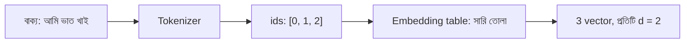

# Lecture 02 — Embedding: Token id থেকে Vector

> আগে যা জানা থাকলে ভালো: [Lecture 01 — Token ও id](lecture-01-token-and-tokenizer.md) এবং [parameter কী](../module-09-model-architecture/lecture-02-parameters-and-hyperparameters.md)। এই lecture শেষে পারবে: embedding table থেকে id দিয়ে vector তুলে আনতে এবং table-এ কয়টা parameter আছে গুনতে।
> Map-এ অবস্থান: [Learning Map](../01-learning-map.md) → text model-এর input → token থেকে vector।

## সমস্যাটা কী?

Tokenizer আমাদের দিল id, যেমন "আমি" = 0, "ভাত" = 1, "খাই" = 2। কিন্তু id আসলে একটা ঠিকানা-নম্বর, বাড়ির নম্বরের মতো। 13 নম্বর বাড়ি 11 নম্বরের চেয়ে "বড়" বা "বেশি" কিছু নয়। id সরাসরি weighted sum-এ দিলে model ধরে নেবে id 2 মানে id 1-এর দ্বিগুণ কিছু, যার কোনো অর্থ নেই।

আমাদের চাই প্রতিটি token-এর জন্য কয়েকটা সংখ্যার একটা তালিকা (**vector**), যা training-এ বদলাতে পারে, আর যাতে কাছাকাছি কাজের token কাছাকাছি সংখ্যা পায়।

## ধারণাটা সহজ ভাষায়

**Embedding table** হলো একটা সারণি। প্রতিটা token-এর জন্য একটা সারি (row), আর সারির সংখ্যাগুলোই তার vector। Token-এর id বলে দেয় কোন সারি। তাই কাজটা শুধু সারি তুলে আনা: id 1 হলে table-এর 1 নম্বর সারি। এই কাজের নাম **lookup**।

Table-এর সংখ্যাগুলো **parameter**। শুরুতে এলোমেলো থাকে, training-এ [Module 10](../module-10-neural-network-training/README.md)-এর পদ্ধতিতে weights-এর মতোই বদলায়। ফলে যে token-গুলো একই ধরনের কাজে আসে, শিখতে শিখতে তাদের vector কাছাকাছি চলে আসে। Vector-এর দৈর্ঘ্যকে বলে **d** (embedding dimension)। d একটা hyperparameter: আমরা আগে থেকে ঠিক করি।

প্রায় সব text model, এমনকি image-text model-এর text অংশও, প্রথম ধাপে এটাই করে।

## ছোট একটা উদাহরণ

পাঁচ token-এর ছোট vocabulary আর d = 2। সংখ্যাগুলো শেখানোর জন্য হাতে বসানো, training-এ পাওয়া নয়।

| id | token | vector |
|---|---|---|
| 0 | আমি | [1.0, 0.0] |
| 1 | ভাত | [0.0, 1.0] |
| 2 | খাই | [1.0, 1.0] |
| 3 | পানি | [0.2, 0.9] |
| 4 | `<end>` | [-1.0, 0.0] |

**বাক্য "আমি ভাত খাই"।** Tokenizer দিল ids `[0, 1, 2]`। প্রতিটা id দিয়ে সারি তুলি:

- 0 → `[1.0, 0.0]`
- 1 → `[0.0, 1.0]`
- 2 → `[1.0, 1.0]`

তিন token থেকে তিনটা vector, অর্থাৎ 3 সারি আর 2 কলামের একটা ছোট matrix। পরের lecture-গুলোতে এই `[[1,0],[0,1],[1,1]]`-ই আমাদের input।

**কাছে-দূরে:** "ভাত" থেকে "পানি"-র দূরত্ব √(0.2² + 0.1²) ≈ 0.224। "ভাত" থেকে "খাই"-এর দূরত্ব 1.0, আর "আমি"-র দূরত্ব √2 ≈ 1.414। খাবার-জাতীয় দুটো শব্দ কাছাকাছি, এই ধারণাটাই embedding-এর লক্ষ্য। এখানে সংখ্যা আমরা বসিয়েছি; বাস্তবে training নিজে এই কাছাকাছি-ভাব শেখে।

## Formula / কোড

Lookup আসলে একটা পরিচিত হিসাবেরই সংক্ষেপ। 5 token-এর জন্য "ভাত" (id 1)-এর **one-hot** vector হলো `[0, 1, 0, 0, 0]`, অর্থাৎ নিজের জায়গায় 1, বাকি সব 0। এটাকে table দিয়ে গুণ করলে ([Module 09](../module-09-model-architecture/lecture-06-forward-pass.md)-এর weighted sum-এর মতোই) শুধু 1 নম্বর সারিটা থাকে, বাকিগুলো 0-এর সঙ্গে গুণ হয়ে মুছে যায়: `[0, 1, 0, 0, 0] × table = [0.0, 1.0]`। বাস্তবে কম্পিউটার এত গুণ না করে সরাসরি সারিটা তুলে আনে, ফল একই।

```python
import math

vocab = ["আমি", "ভাত", "খাই", "পানি", "<end>"]
ids = {t: i for i, t in enumerate(vocab)}
E = [[1.0, 0.0],     # id 0: আমি
     [0.0, 1.0],     # id 1: ভাত
     [1.0, 1.0],     # id 2: খাই
     [0.2, 0.9],     # id 3: পানি
     [-1.0, 0.0]]    # id 4: <end>

token_ids = [ids[t] for t in ["আমি", "ভাত", "খাই"]]
print("ids:", token_ids)
print("vectors:", [E[i] for i in token_ids])   # lookup = row তুলে আনা

def dist(a, b):
    return math.sqrt(sum((x - y) ** 2 for x, y in zip(a, b)))

for t in ["পানি", "খাই", "আমি"]:
    print("ভাত থেকে", t, "দূরত্ব:", round(dist(E[1], E[ids[t]]), 3))
```

```text
# output:
ids: [0, 1, 2]
vectors: [[1.0, 0.0], [0.0, 1.0], [1.0, 1.0]]
ভাত থেকে পানি দূরত্ব: 0.224
ভাত থেকে খাই দূরত্ব: 1.0
ভাত থেকে আমি দূরত্ব: 1.414
```

**Parameter গোনা:** table-এর আকার (vocab-এর সংখ্যা) × d। আমাদের উদাহরণে 5 × 2 = 10। বাস্তব একটা উদাহরণ: 50,000 token আর d = 768 হলে 50,000 × 768 = 38,400,000। বড় model-এ শুধু embedding table-ই কয়েক কোটি parameter।

## ছবি



সাবধান: Embedding একা জানে না কোন token বাক্যের কোথায় আছে। "ভাত আমি খাই" আর "আমি ভাত খাই"-এর vector-সেট এক। অবস্থানের তথ্য আলাদা করে vector-এর সঙ্গে যোগ করা হয়; আমরা সরলতার জন্য এখানে সেটা বাদ রাখছি।

## মনে রাখার সারকথা

- Embedding table প্রতি token-এর জন্য একটা vector (সারি) রাখে; id বলে কোন সারি।
- Table-এর সংখ্যাগুলো parameter: training-এ শেখা হয়, আর সংখ্যা = vocab × d।
- Lookup মানে one-hot × table, অর্থাৎ একটা সারি বেছে নেওয়া।

## নিজে করো

১. Vocab 1,000 token আর d = 4 হলে table-এর আকার ও parameter-সংখ্যা কত?
২. উপরের table দিয়ে ids `[2, 0]`-এর vector কী?
৩. "আমি" ও "খাই"-এর vector-এর দূরত্ব কত?

<details><summary>উত্তর</summary>

১. আকার 1,000 সারি × 4 কলাম; parameter 1,000 × 4 = **4,000**।
২. id 2 → `[1.0, 1.0]`, id 0 → `[1.0, 0.0]`। উত্তর **`[[1.0, 1.0], [1.0, 0.0]]`**।
৩. `[1,0]` ও `[1,1]`: পার্থক্য `[0, -1]`, দূরত্ব √(0² + 1²) = **1.0**।

</details>

## পরের পাঠ

Embedding vector-এর তালিকা model-এর ভেতরে অনেক ধাপ পেরিয়ে শেষে প্রতিটা সম্ভাব্য token-এর জন্য score হয়ে বের হবে। সেই score থেকে probability বানানো দিয়ে শুরু করা যাক: [Lecture 03 — Logits ও Softmax](lecture-03-logits-and-softmax.md)।
