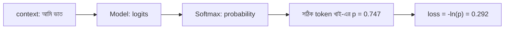

# Lecture 04 — Next-token Prediction ও Cross-entropy

> আগে যা জানা থাকলে ভালো: [Lecture 03 — Softmax](lecture-03-logits-and-softmax.md) এবং [Module 03-এর log loss](../module-03-logistic-regression/lecture-03-log-loss.md) (পড়া না থাকলেও চলবে, নিচে সংক্ষেপে আছে)। এই lecture শেষে পারবে: একটা বাক্য থেকে training উদাহরণ বানাতে এবং cross-entropy loss হাতে বের করতে।
> Map-এ অবস্থান: [Learning Map](../01-learning-map.md) → শেখার লক্ষ্য (objective)। এখানে শুধু "ভুল কত" মাপা হচ্ছে; weights কীভাবে বদলায় তা [Module 10](../module-10-neural-network-training/README.md)-এর বিষয়।

## সমস্যাটা কী?

Model-কে শেখাতে প্রতিটা উদাহরণের একটা "সঠিক উত্তর" লাগে। ছবি চেনার জন্য মানুষ label দেয়। কিন্তু বিশাল পরিমাণ লেখার জন্য কে label দেবে? আর model-এর ভুল কীভাবে মাপব?

## ধারণাটা সহজ ভাষায়

**Next-token prediction:** model-এর কাজ হলো এ পর্যন্ত লেখা দেখে পরের token কী হবে অনুমান করা। এখানে মজার ব্যাপার হলো, লেখাটাই নিজের উত্তর বলে দেয়। "আমি ভাত খাই `<end>`" বাক্য থেকে তিনটা উদাহরণ বেরোয়:

| context (এ পর্যন্ত) | সঠিক পরের token |
|---|---|
| আমি | ভাত |
| আমি ভাত | খাই |
| আমি ভাত খাই | `<end>` |

কোনো মানুষকে label দিতে হয়নি, তাই ইন্টারনেটের মতো বিশাল লেখা থেকেও শেখানো যায়। এ কারণেই বড় language model-এর প্রথম পর্যায়ের training এভাবে হয়।

**ভুল মাপা:** model প্রতিটা context-এ সব token-এর probability দেয় ([Lecture 03](lecture-03-logits-and-softmax.md))। আমরা দেখি **সঠিক token-কে সে কত probability দিয়েছে**। বেশি দিলে ভালো, কম দিলে খারাপ। এই "ভুল"-এর মাপের নাম **cross-entropy loss**:

`loss = −ln(p)`, যেখানে p হলো সঠিক token-এর probability। (`ln` হলো স্বাভাবিক logarithm।)

## ছোট একটা উদাহরণ

ধরো Lecture 03-এর হিসাবটা context "আমি ভাত"-এর জন্য ছিল। Model দিয়েছিল `[আমি 0.101, ভাত 0.037, খাই 0.747, পানি 0.101, <end> 0.014]`। সঠিক token "খাই"।

- সঠিক token-এর probability p = 0.747
- loss = −ln(0.747) = **0.292**

p-এর সঙ্গে loss কেমন বদলায় দেখো:

| সঠিক token-এর p | 0.99 | 0.747 | 0.5 | 0.1 | 0.01 |
|---|---:|---:|---:|---:|---:|
| loss = −ln(p) | 0.010 | 0.292 | 0.693 | 2.303 | 4.605 |

Model সঠিক token-এ যত বেশি probability দেয়, loss তত কম। p যত 0-এর দিকে যায়, loss তত দ্রুত বাড়ে। অর্থাৎ "ভুল উত্তরে অনেক নিশ্চিত" হলে সবচেয়ে বড় শাস্তি।

**পুরো বাক্যের loss:** তিনটা অবস্থানে সঠিক token-এর probability ধরো 0.5, 0.747, 0.8। loss 0.693, 0.292, 0.223। গড় = (0.693 + 0.292 + 0.223) ÷ 3 = **0.403**। Training-এ এই গড়টাই কমানোর লক্ষ্য। Training-এ প্রতিটা অবস্থানে বাক্যের সঠিক আগের অংশই context হিসেবে দেওয়া হয়, তাই সবগুলো অবস্থান একসঙ্গে হিসাব করা যায়।

## Module 03-এর log loss-এর সঙ্গে যোগ

Logistic regression-এ দুই class ছিল। সঠিক class-এর probability p হলে (y = 1), log loss = −ln(p)। এখানেও হুবহু তাই। পার্থক্য শুধু class-এর সংখ্যায়: Text-এ বিকল্প অনেক, সব token মিলিয়ে হাজার-হাজার।

সূত্রে লিখলে লক্ষ্য-vector হলো **one-hot**: সঠিক token-এর জায়গায় 1, বাকি সব 0। প্রতিটা token-এর জন্য `−y × ln(p)` যোগ করলে 0-গুলো কেটে যায়, থাকে শুধু `−ln(p_সঠিক)`। দুই class আর p = 0.8 নিলে binary log loss = −ln(0.8) = 0.223, আর দুই-token cross-entropy-ও 0.223। একই জিনিস, শুধু বেশি বিকল্পে।

## কোড

```python
import math

def softmax(z):
    e = [math.exp(x) for x in z]
    s = sum(e)
    return [x / s for x in e]

vocab = ["আমি", "ভাত", "খাই", "পানি", "<end>"]
p = softmax([1, 0, 3, 1, -1])
target = vocab.index("খাই")
loss = -math.log(p[target])
print("p(খাই) =", round(p[target], 3), " loss =", round(loss, 3))

probs = [0.5, 0.747, 0.8]                   # তিন অবস্থানের সঠিক token-এর p
losses = [-math.log(x) for x in probs]
print([round(l, 3) for l in losses], "গড়:", round(sum(losses) / 3, 3))
```

```text
# output:
p(খাই) = 0.747  loss = 0.292
[0.693, 0.292, 0.223] গড়: 0.403
```

## ছবি



এই diagram-এ শুধু "ভুল মাপা" দেখানো হয়েছে। Loss কমাতে weights বদলানো আলাদা ধাপ (update)। আর prediction-এর সময় সঠিক উত্তর বা loss লাগে না; সেটা শুধু training-এ।

## মনে রাখার সারকথা

- লেখা থেকেই training উদাহরণ পাওয়া যায়: প্রতিটা অবস্থানে পরের token-ই লক্ষ্য।
- Cross-entropy loss = −ln(সঠিক token-এর probability); p বড় হলে loss ছোট।
- এটা Module 03-এর log loss-এরই সাধারণ রূপ, শুধু বিকল্প অনেক বেশি।

## নিজে করো

১. সঠিক token-এর p = 0.25 হলে loss কত?
২. দুই অবস্থানের p 0.9 আর 0.5 হলে গড় loss কত?
৩. সঠিক token-এর p 0.8 থেকে 0.9 হলে loss কত কমে?

<details><summary>উত্তর</summary>

১. −ln(0.25) = ln 4 = **1.386**।
২. loss 0.105 আর 0.693। গড় (0.105 + 0.693) ÷ 2 = **0.399**।
৩. −ln(0.8) = 0.223, −ln(0.9) = 0.105। কমে 0.223 − 0.105 = **0.118**।

</details>

## পরের পাঠ

এখন পর্যন্ত model-কে একটা "বাক্সের" মতো ধরেছি। বাক্সের ভেতরে context কীভাবে কাজে লাগে? [Lecture 05 — Context ও Attention](lecture-05-context-and-attention.md)।
