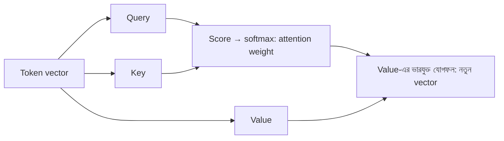

# Lecture 05 — Context ও Attention

> আগে যা জানা থাকলে ভালো: [Lecture 02 — embedding vector](lecture-02-embedding.md), [Lecture 03 — softmax](lecture-03-logits-and-softmax.md) এবং [dot product ও weighted sum](../module-09-model-architecture/lecture-03-one-neuron.md)। এই lecture শেষে পারবে: তিন token-এর ছোট উদাহরণে attention weight হাতে বের করে নতুন vector তৈরি করতে।
> Map-এ অবস্থান: [Learning Map](../01-learning-map.md) → Transformer-এর ভেতরের একটা output-হিসাব। Loss বা update এখানে নেই।

## সমস্যাটা কী?

"আমি ভাত খাই"-এর শেষ token "খাই"। এরপর কী আসবে তা অনুমান করতে শুধু "খাই" শব্দটা যথেষ্ট নয়। আগে কী খাওয়া হলো, অর্থাৎ "ভাত" ছিল, সেটা জানলে অনুমান অনেক ভালো হয়।

সমস্যা হলো, [Lecture 02](lecture-02-embedding.md)-এর vector-গুলো আলাদা আলাদা। "খাই"-এর vector `[1, 1]` জানে না যে তার আগে "ভাত" ছিল। প্রতিটা token-কে আশেপাশের token থেকে তথ্য নিতে পারতে হবে। আগের token-গুলোর এই তথ্যকে বলে **context**। Token-দের মধ্যে context আদান-প্রদানের কাজটা করে **attention**।

## ধারণাটা সহজ ভাষায়

Attention-এর মূল কথা: প্রতিটা token নিজের আগের token-গুলোকে "দেখে", ঠিক করে কাকে কতটা গুরুত্ব দেবে, তারপর তাদের তথ্যের **ভারযুক্ত গড়** নিয়ে নিজের নতুন vector বানায়।

এই কাজের জন্য প্রতিটা token-এর embedding থেকে তিনটা vector বানানো হয়। এটুকু উপমা কাজে দেবে: লাইব্রেরিতে বই খোঁজার কথা ভাবো।

- **Query (q):** আমি কী খুঁজছি। যেটা খুঁজছে সেই token-এর প্রশ্ন।
- **Key (k):** আমি কীসের জন্য মিলতে পারি। প্রতিটা token-এর "লেবেল", যার সঙ্গে প্রশ্ন মেলানো হয়।
- **Value (v):** আমাকে বেছে নিলে আমি কী তথ্য দেব। প্রতিটা token-এর ভেতরের মাল।

তিনটাই embedding-কে একটা করে ছোট weight matrix (`W_q`, `W_k`, `W_v`) দিয়ে গুণ করে পাওয়া যায়। এই matrix-গুলো **parameter**, training-এ শেখা হয়।

হিসাবের ধাপ পাঁচটা:

1. `q`, `k`, `v` বানাও।
2. Query আর প্রতিটা key-এর dot product করো। এটাই **score**: কতটা মিলল।
3. Score-কে √d_k দিয়ে ভাগ করো (d_k = key-এর দৈর্ঘ্য)। এতে সংখ্যা বেশি বড় হয়ে softmax একটাতে আটকে যায় না।
4. Softmax করো ([Lecture 03](lecture-03-logits-and-softmax.md))। ফলই **attention weight**; মোট 1।
5. Weight দিয়ে value-গুলোর ভারযুক্ত যোগফল নাও। এটাই token-এর নতুন vector।

## ছোট একটা উদাহরণ

Token তিনটা: আমি, ভাত, খাই। Embedding আগের মতো `x₁ = [1, 0]`, `x₂ = [0, 1]`, `x₃ = [1, 1]`। শেখানোর জন্য বেছে নেওয়া weight matrix, প্রতিটা 2×2:

`W_q = [[0, 1], [0, 1]]`, `W_k = [[1, -1], [0, 1]]`, `W_v = [[1, 0], [0, 2]]`

নিয়ম: `[a, b]`-কে `[[p, q], [r, s]]` দিয়ে গুণ করলে `[a·p + b·r, a·q + b·s]`। আমরা দেখব "খাই" (token 3) অন্য token-গুলো থেকে কী নেয়।

**ধাপ ১ — q, k, v:**

- `q₃ = [1, 1] × W_q = [1·0 + 1·0, 1·1 + 1·1] = [0, 2]`
- `k₁ = [1, 0] × W_k = [1·1 + 0·0, 1·(−1) + 0·1] = [1, −1]`
- `k₂ = [0, 1] × W_k = [0, 1]`, `k₃ = [1, 1] × W_k = [1, 0]`
- `v₁ = [1, 0] × W_v = [1, 0]`, `v₂ = [0, 1] × W_v = [0, 2]`, `v₃ = [1, 1] × W_v = [1, 2]`

**ধাপ ২ — score:** `q₃` আর প্রতিটা key-এর dot product।

- আমি: 0·1 + 2·(−1) = **−2**
- ভাত: 0·0 + 2·1 = **2**
- খাই: 0·1 + 2·0 = **0**

**ধাপ ৩ — √2 দিয়ে ভাগ** (√2 ≈ 1.414): `[−1.414, 1.414, 0]`।

**ধাপ ৪ — softmax:** e ঘাত = `[0.243, 4.113, 1.000]`, যোগফল 5.356। Attention weight = **[0.045, 0.768, 0.187]**। "খাই" সবচেয়ে বেশি মনোযোগ দিল "ভাত"-কে (76.8%)।

**ধাপ ৫ — নতুন vector:**

- প্রথম সংখ্যা: 0.045×1 + 0.768×0 + 0.187×1 = 0.232
- দ্বিতীয় সংখ্যা: 0.045×0 + 0.768×2 + 0.187×2 ≈ 1.91

"খাই"-এর নতুন vector প্রায় **[0.23, 1.91]**। আগে ছিল `[1, 1]`। এখন এতে "ভাত"-এর value-এর প্রভাব বেশি, অর্থাৎ বাক্যের প্রসঙ্গ ঢুকেছে।

**Mask:** লেখা তৈরির সময় token শুধু নিজের আগের token আর নিজেকে দেখতে পারে, পরের token তখনো তৈরিই হয়নি। তাই token 1 শুধু নিজেকে দেখে (weight `[1.0]`), token 2 দেখে দুটো (weight `[0.196, 0.804]`)। এই নিয়মের নাম **causal mask**।

## Formula / কোড

পাঁচ ধাপের সংক্ষিপ্ত রূপ: `Attention = softmax(Q·Kᵀ ÷ √d_k) × V`। এখানে Q, K, V হলো সব token-এর q, k, v সারি করে সাজানো matrix। উপরের হিসাবে এর একটা সারি বের করলাম।

```python
import math

X = [[1, 0], [0, 1], [1, 1]]        # আমি, ভাত, খাই-এর embedding
Wq = [[0, 1], [0, 1]]
Wk = [[1, -1], [0, 1]]
Wv = [[1, 0], [0, 2]]

def vecmat(v, M):
    return [sum(v[i] * M[i][j] for i in range(len(v))) for j in range(len(M[0]))]
def dot(a, b): return sum(x * y for x, y in zip(a, b))
def softmax(z):
    e = [math.exp(x) for x in z]; s = sum(e)
    return [x / s for x in e]

Q = [vecmat(x, Wq) for x in X]
K = [vecmat(x, Wk) for x in X]
V = [vecmat(x, Wv) for x in X]
print("Q:", Q); print("K:", K); print("V:", V)

scale = math.sqrt(2)                  # sqrt(d_k), d_k = 2
for i in range(3):                    # i = বর্তমান token; কেবল 0..i দেখতে পারে
    scores = [dot(Q[i], K[j]) for j in range(i + 1)]
    w = softmax([s / scale for s in scores])
    out = [sum(w[j] * V[j][d] for j in range(i + 1)) for d in range(2)]
    print("token", i + 1, "scores", scores, "weights", [round(x, 3) for x in w],
          "out", [round(o, 3) for o in out])
```

```text
# output:
Q: [[0, 1], [0, 1], [0, 2]]
K: [[1, -1], [0, 1], [1, 0]]
V: [[1, 0], [0, 2], [1, 2]]
token 1 scores [-1] weights [1.0] out [1.0, 0.0]
token 2 scores [-1, 1] weights [0.196, 0.804] out [0.196, 1.609]
token 3 scores [-2, 2, 0] weights [0.045, 0.768, 0.187] out [0.232, 1.909]
```

হাতের হিসাব আর code মিলে গেছে (দ্বিতীয় সংখ্যা 1.91 আর 1.909 শুধু গোল করার পার্থক্য)।

## ছবি



সাবধান: বাস্তব model-এ (ক) একই কাজ কয়েকটা আলাদা `W` দিয়ে একসঙ্গে করা হয়, যাকে **multi-head attention** বলে; (খ) token-এর অবস্থান-তথ্যও embedding-এর সঙ্গে যোগ করা থাকে, নইলে "ভাত আমি খাই" আর "আমি ভাত খাই" attention-এর কাছে একই। আমরা এখানে এক head আর অবস্থান-তথ্য ছাড়া দেখলাম।

## মনে রাখার সারকথা

- Attention প্রতিটা token-কে আগের token-গুলো থেকে তথ্য নিতে দেয়, weight বলে কাকে কতটা।
- Query আর key-এর মিল (dot product → softmax) দিয়ে weight আসে; value-এর ভারযুক্ত যোগফলে নতুন vector।
- Attention-এর ফল এখনো next-token নয়, শুধু প্রসঙ্গসহ নতুন vector; এটা [Transformer block](lecture-06-transformer-block.md)-এর একটা অংশ।

## নিজে করো

১. উপরের উদাহরণে √2 দিয়ে ভাগ না করলে "খাই"-এর weight কত হতো? (score `[−2, 2, 0]`)
২. Token 2 ("ভাত")-এর weight কত? (`q₂ = [0, 1]`, শুধু token 1 আর 2 দেখে)
৩. "খাই"-এর weight `[0.5, 0.25, 0.25]` হলে নতুন vector কত? (value আগের মতো)

<details><summary>উত্তর</summary>

১. e⁻² = 0.135, e² = 7.389, e⁰ = 1, যোগফল 8.524। Weight **[0.016, 0.867, 0.117]**। ভাগ না করলে weight আরও একদিকে ঝুঁকে যায়।
২. Score: q₂·k₁ = 0·1 + 1·(−1) = −1; q₂·k₂ = 0·0 + 1·1 = 1। √2 দিয়ে ভাগ: −0.707, 0.707। Softmax **[0.196, 0.804]**।
৩. প্রথম সংখ্যা 0.5·1 + 0.25·0 + 0.25·1 = 0.75; দ্বিতীয় 0.5·0 + 0.25·2 + 0.25·2 = 1.0। নতুন vector **[0.75, 1.0]**।

</details>

## পরের পাঠ

Attention একা পুরো কাজ করে না। তার পাশে আরও তিনটা ছোট অংশ বসে; সব মিলিয়ে একটা "Transformer block" হয়। দেখো [Lecture 06 — Transformer Block](lecture-06-transformer-block.md)।
