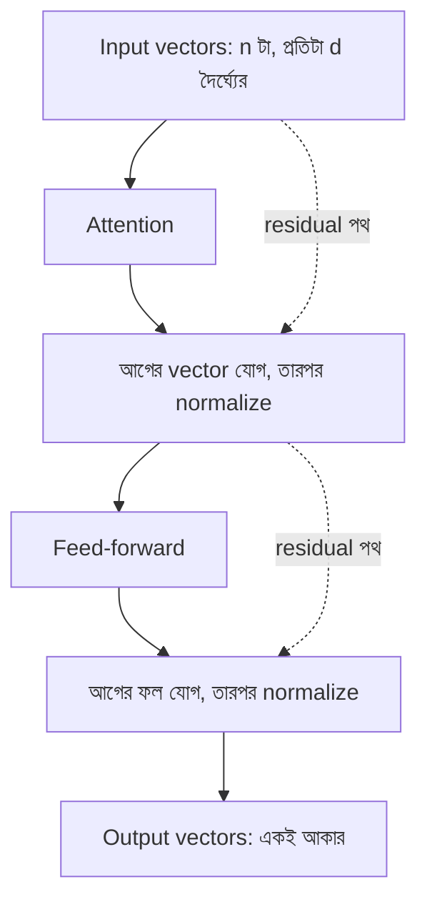

# Lecture 06 — Transformer Block: Attention-এর সঙ্গে বাকি অংশ

> আগে যা জানা থাকলে ভালো: [Lecture 05 — Attention](lecture-05-context-and-attention.md) এবং [hidden layer](../module-09-model-architecture/lecture-05-hidden-layer.md)। এই lecture শেষে পারবে: একটা Transformer block-এর চারটা অংশের নাম ও কাজ বলতে, এবং প্রতিটার ছোট হিসাব হাতে করতে।
> Map-এ অবস্থান: [Learning Map](../01-learning-map.md) → architecture। এখানে কোনো নতুন প্রধান formula নেই; পরিচিত অংশগুলো কীভাবে সাজানো তা দেখা হচ্ছে।

## সমস্যাটা কী?

Attention একটা কাজ ভালো করে: token-দের মধ্যে তথ্য মেশানো। কিন্তু শুধু attention দিয়ে model তৈরি করলে দুটো অসুবিধা থাকে।

- Attention-এর ফল ভারযুক্ত গড় ছাড়া কিছু নয়। মিশ্রিত তথ্য নিয়ে আলাদাভাবে "ভাবার" জায়গা নেই (hidden layer-এর nonlinear হিসাব)।
- Layer পরপর অনেক বসালে আগের তথ্য হারিয়ে যেতে পারে, আর সংখ্যাগুলো বড়-ছোট হয়ে হিসাব অস্থির হয়।

সমাধান: কয়েকটা অংশ নিয়ে একটা **block** বানানো, আর সেই block-কেই বারবার সাজানো।

## ধারণাটা সহজ ভাষায়

**Transformer block**-এ চারটা অংশ থাকে, প্রতিটার আলাদা কাজ।

| অংশ | কাজ | কোথায় পরিচিত |
|---|---|---|
| Attention | Token-দের মধ্যে তথ্য আদান-প্রদান | [Lecture 05](lecture-05-context-and-attention.md) |
| Feed-forward | প্রতিটা token-এর vector আলাদাভাবে একটা ছোট network দিয়ে চালানো | [Module 09 hidden layer ও activation](../module-09-model-architecture/lecture-05-hidden-layer.md) |
| Residual যোগ | নতুন ফলের সঙ্গে আগের vector যোগ করা, যাতে আগের তথ্য হারায় না | সাধারণ যোগ |
| Normalization | Vector-এর সংখ্যাগুলো এক মাপে রাখা | নতুন, নিচে |

ক্রমটা এমন: Attention চালাও, আগের vector যোগ করো, normalize করো। তারপর feed-forward চালাও, আবার যোগ ও normalize। ফল একটা নতুন vector-তালিকা।

গুরুত্বপূর্ণ কথা: block-এর **ভেতরে-বাইরে vector-তালিকার আকার একই থাকে**। n টা token, প্রতিটা d দৈর্ঘ্যের vector ঢুকলে n টা, d দৈর্ঘ্যের vector-ই বের হয়। তাই block-এর ফল আবার পরের block-এ ঢোকানো যায়। এভাবে block-এর উপর block সাজিয়ে model গভীর হয়। ছোট model-এ প্রায় 12টা, বড় model-এ কয়েক ডজন। প্রতিটা block-এর নিজের আলাদা weights।

**সাবধান:** অনেক নতুন model normalization আগে করে, sub-layer-এর পরে নয়। অংশগুলো একই, শুধু ক্রম আলাদা। এখানে সহজ ক্রমটা দেখানো হলো।

## ছোট একটা উদাহরণ

তিনটা অংশের তিনটা আলাদা ছোট হিসাব।

**১. Residual:** "খাই"-এর আগের vector `x = [1, 1]`, [Lecture 05](lecture-05-context-and-attention.md)-এর attention ফল `a ≈ [0.23, 1.91]`। যোগ: `x + a = [1.23, 2.91]`। আগের তথ্য (`x`) নতুন তথ্যের সঙ্গে থেকেই গেল।

**২. Layer normalization:** vector `[2, 4, 6, 8]`।

- গড় = (2+4+6+8) ÷ 4 = 5
- প্রতিটা থেকে গড় বাদ: `[−3, −1, 1, 3]`
- ছড়ানো (variance) = (9+1+1+9) ÷ 4 = 5; তার বর্গমূল ≈ 2.236
- প্রতিটাকে ভাগ: `[−1.342, −0.447, 0.447, 1.342]`

ফলের গড় 0 আর ছড়ানো 1। সংখ্যা যত বড়ই আসুক, মাপ একই থাকে। এতে পরের হিসাব স্থির থাকে।

**৩. Feed-forward:** দুই ধাপের network `2 → 3 → 2`, মাঝে ReLU। `x = [1, 2]`, `W1 = [[1, −1, 0], [−1, 1, 1]]`, `W2 = [[1, 0], [0, 1], [1, 1]]`।

- `x × W1 = [1·1 + 2·(−1), 1·(−1) + 2·1, 1·0 + 2·1] = [−1, 1, 2]`
- ReLU (negative হলে 0): `[0, 1, 2]`
- `× W2 = [0·1 + 1·0 + 2·1, 0·0 + 1·1 + 2·1] = [2, 3]`

এটা Module 09-এর hidden layer-ই। একটা block-এর feed-forward **প্রতিটা token-এ আলাদাভাবে একই weights দিয়ে** চলে। আর attention-ই একমাত্র অংশ যেখানে token-রা একে অপরকে দেখে।

## কোড

```python
import math

def vecmat(v, M):
    return [sum(v[i] * M[i][j] for i in range(len(v))) for j in range(len(M[0]))]

x, a = [1, 1], [0.23, 1.91]
print("residual:", [round(p + q, 2) for p, q in zip(x, a)])

v = [2, 4, 6, 8]
mean = sum(v) / len(v)
var = sum((t - mean) ** 2 for t in v) / len(v)
print("mean", mean, "var", var, [round((t - mean) / math.sqrt(var), 3) for t in v])

W1 = [[1, -1, 0], [-1, 1, 1]]
W2 = [[1, 0], [0, 1], [1, 1]]
pre = vecmat([1, 2], W1)
hid = [max(0, t) for t in pre]
print("pre", pre, "relu", hid, "out", vecmat(hid, W2))
```

```text
# output:
residual: [1.23, 2.91]
mean 5.0 var 5.0 [-1.342, -0.447, 0.447, 1.342]
pre [-1, 1, 2] relu [0, 1, 2] out [2, 3]
```

## ছবি



## পুরো model-এর মধ্যে block-এর জায়গা

Text model-এর সম্পূর্ণ পথ এখন আমরা চিনি: token id → [embedding](lecture-02-embedding.md) (সঙ্গে অবস্থান-তথ্য) → Transformer block × N → শেষ token-এর vector থেকে [logits](lecture-03-logits-and-softmax.md) → softmax → পরের token। Block-এর ভেতরের অংশগুলোর weights আর embedding table সব training-এ শেখা হয়।

## মনে রাখার সারকথা

- Block = attention (token-রা কথা বলে) + feed-forward (প্রতি token আলাদাভাবে ভাবে) + residual যোগ (আগের তথ্য রাখে) + normalization (মাপ স্থির রাখে)।
- Block-এর input ও output-এর আকার এক, তাই block-এর উপর block সাজানো যায়।
- Block-গুলো নিজে next token দেয় না; শেষে logits ও softmax লাগে।

## নিজে করো

১. উপরের feed-forward-এ `x = [2, 1]` হলে ফল কত?
২. Residual-এ `x = [1, 1]` আর attention ফল `[−1, 2]` হলে যোগফল কত?
৩. `[1, 3]`-কে layer normalize করলে কী পাওয়া যায়?

<details><summary>উত্তর</summary>

১. `x × W1 = [2·1 + 1·(−1), 2·(−1) + 1·1, 2·0 + 1·1] = [1, −1, 1]`। ReLU: `[1, 0, 1]`। `× W2 = [1·1 + 0·0 + 1·1, 1·0 + 0·1 + 1·1] = ` **[2, 1]**।
২. `[1 + (−1), 1 + 2] = ` **[0, 3]**।
৩. গড় 2, বিয়োগ করে `[−1, 1]`, variance (1+1)÷2 = 1, বর্গমূল 1। ফল **[−1, 1]**। (দুটো সংখ্যার ক্ষেত্রে ফল সবসময় প্রায় ±1 হয়।)

</details>

## পরের পাঠ

Block সাজিয়ে model এখন এক ধাপের জন্য পরের token-এর probability দিতে পারে। পুরো বাক্য তৈরি করতে কী করতে হয়, আর কখন থামতে হয়: [Lecture 07 — Autoregressive Decoder ও Stopping](lecture-07-autoregressive-decoder-and-stopping.md)।
