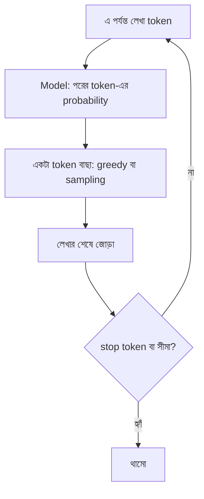

# Lecture 07 — Autoregressive Decoder: একটা একটা করে token তৈরি ও থামা

> আগে যা জানা থাকলে ভালো: [Lecture 03 — softmax ও temperature](lecture-03-logits-and-softmax.md), [Lecture 04 — next-token](lecture-04-next-token-and-cross-entropy.md) এবং [Lecture 06 — Transformer block](lecture-06-transformer-block.md)। এই lecture শেষে পারবে: একটা ছোট loop চালিয়ে বাক্য তৈরি করতে, থামার দুই উপায় বলতে, আর greedy ও sampling-এর পার্থক্য বুঝিয়ে বলতে।
> Map-এ অবস্থান: [Learning Map](../01-learning-map.md) → inference-এর পথ। Loss বা update এখানে নেই; এটা শেখা model দিয়ে লেখা তৈরি।

## সমস্যাটা কী?

আমরা দেখলাম model এক ধাপে শুধু বলে "পরের token কী হতে পারে, কার কত probability"। কিন্তু আমরা চাই পুরো বাক্য। আর model-কে কেউ বলে দেয় না কখন থামতে হবে। এই দুটোর উত্তর একটা সাধারণ loop।

## ধারণাটা সহজ ভাষায়

**Autoregressive** মানে model নিজের আগের ফলকেই পরের ধাপের input করে। Loop-টা এমন:

1. এ পর্যন্ত লেখা token-গুলো (শুরুতে শুধু prompt) model-কে দাও।
2. শেষ অবস্থানের logits থেকে softmax দিয়ে probability নাও।
3. একটা token বেছে নাও।
4. সেটা লেখার শেষে জুড়ে দাও।
5. থামার শর্ত পূরণ হলে থামো, না হলে ধাপ ১-এ ফিরে যাও।

**থামার দুটো উপায়:**

- **Stop token:** vocabulary-তে বিশেষ একটা token (আমাদের `<end>`) থাকে। Training-এর সময় প্রতিটা বাক্যের শেষে এটা জুড়ে দেওয়া হয় ([Lecture 04](lecture-04-next-token-and-cross-entropy.md)-এর তৃতীয় সারি)। তাই model শেখে কখন বাক্য শেষ। Model `<end>` বাছলেই loop থামে।
- **সর্বোচ্চ দৈর্ঘ্য:** model যদি কখনো `<end>` না বাছে, loop যেন অনন্তকাল না চলে, তাই আগে থেকে একটা সীমা (max new tokens) ঠিক করা থাকে। সীমায় পৌঁছালে লেখা মাঝপথেই কেটে যায়।

**কোন token বাছব (ধাপ ৩)?** দুটো প্রধান নিয়ম:

- **Greedy:** প্রতিবার সবচেয়ে বেশি probability-র token। ফল প্রতিবার একই (নির্ধারিত)। কিন্তু প্রতি ধাপে সেরাটা নিলেই পুরো বাক্য সেরা হয় না, আর লেখা একঘেয়ে বা পুনরাবৃত্তিমূলক হতে পারে।
- **Sampling:** probability অনুযায়ী লটারি। 60% probability-র token প্রতি 10 বারে মোটামুটি 6 বার আসে। ফল প্রতিবার আলাদা হতে পারে।

Sampling-এ [Lecture 03](lecture-03-logits-and-softmax.md)-এর **temperature** কাজে লাগে: T কম হলে লটারি greedy-র কাছাকাছি, T বেশি হলে বেশি বৈচিত্র্য। আরেকটা ধারণা **top-k**: লটারির আগে শুধু সবচেয়ে সম্ভাব্য k টা token রাখা, বাকিদের বাদ। সাধারণত যেখানে একটাই সঠিক উত্তর (যেমন OCR-এর লেখা), সেখানে greedy বা কম temperature চলে। সৃজনশীল লেখায় sampling বেশি দেখা যায়।

**Training আর তৈরির পার্থক্য:** training-এ প্রতিটা অবস্থানে আগের **সঠিক** token দেওয়া থাকে। লেখা তৈরির সময় model-কে আগের নিজের বাছা token-ই ব্যবহার করতে হয়। তাই একবার ভুল token বেছে নিলে পরের ধাপগুলো সেই ভুলের উপর ভর করে।

## ছোট একটা উদাহরণ

আসল model-এর বদলে একটা খেলনা সারণি ধরি। সে শুধু শেষ token দেখে পরের token-এর probability বলে (বাস্তব model পুরো context দেখে; loop কিন্তু একই)।

| শেষ token | পরের token: probability |
|---|---|
| আমি | ভাত 0.6, পানি 0.4 |
| ভাত | খাই 0.8, `<end>` 0.2 |
| পানি | খাই 0.6, `<end>` 0.4 |
| খাই | `<end>` 0.9, ভাত 0.1 |

Prompt "আমি"।

**Greedy:** আমি → (ভাত 0.6 সবচেয়ে বড়) ভাত → (খাই 0.8) খাই → (`<end>` 0.9) `<end>`। থামল। ফল: **আমি ভাত খাই**। এই পুরো পথের probability = 0.6 × 0.8 × 0.9 = **0.432**।

**Sampling:** একই prompt, কিন্তু লটারি। এই code-এ seed 1, 2, 3 নিলে তিন রকম ফল (নিচে)। যেমন "আমি পানি `<end>`"-এর probability 0.4 × 0.4 = 0.16; সম্ভাবনা কম, কিন্তু অসম্ভব নয়।

**সীমা:** max new tokens = 2 হলে লেখা `আমি ভাত খাই`-তেই কেটে যায়, `<end>` আর আসে না।

## কোড

```python
import random

# খেলনা model: শেষ token দেখে পরের token-এর probability দেয়
table = {
    "আমি":   {"ভাত": 0.6, "পানি": 0.4},
    "ভাত":   {"খাই": 0.8, "<end>": 0.2},
    "পানি":  {"খাই": 0.6, "<end>": 0.4},
    "খাই":   {"<end>": 0.9, "ভাত": 0.1},
}

def next_probs(context):
    return table[context[-1]]

def generate(prompt, pick, max_new=10):
    tokens = list(prompt)
    for _ in range(max_new):
        probs = next_probs(tokens)
        tok = pick(probs)
        tokens.append(tok)
        if tok == "<end>":          # থামার token
            break
    return tokens

def greedy(probs):
    return max(probs, key=probs.get)

def sample(rng):
    def pick(probs):
        return rng.choices(list(probs), weights=list(probs.values()))[0]
    return pick

print("greedy :", generate(["আমি"], greedy))
for seed in (1, 2, 3):
    print("sample", seed, ":", generate(["আমি"], sample(random.Random(seed))))
print("সীমা ২ :", generate(["আমি"], greedy, max_new=2))
```

```text
# output:
greedy : ['আমি', 'ভাত', 'খাই', '<end>']
sample 1 : ['আমি', 'ভাত', '<end>']
sample 2 : ['আমি', 'পানি', '<end>']
sample 3 : ['আমি', 'ভাত', 'খাই', '<end>']
সীমা ২ : ['আমি', 'ভাত', 'খাই']
```

Sampling-এর ফল seed-এর উপর নির্ভর করে; অন্য seed দিলে অন্য ফল আসতে পারে।

## ছবি



## মনে রাখার সারকথা

- Autoregressive loop: model চালাও → একটা token বাছো → জুড়ে দাও → আবার; নিজের ফলই পরের input।
- থামার উপায় দুটো: stop token (model নিজে শেখে) আর সর্বোচ্চ দৈর্ঘ্য (নিরাপত্তার সীমা)।
- Greedy সবসময় সবচেয়ে সম্ভাব্যটা নেয় (নির্ধারিত); sampling probability অনুযায়ী লটারি করে (বৈচিত্র্য), temperature তার ঝোঁক বদলায়।

## নিজে করো

১. উপরের table-এ "আমি পানি খাই `<end>`" পথের probability কত?
২. max new tokens = 1 হলে greedy-র লেখা কী হবে?
৩. "আমি ভাত `<end>`" পথের probability কত?

<details><summary>উত্তর</summary>

১. 0.4 × 0.6 × 0.9 = **0.216**। (Greedy পথের 0.432-এর অর্ধেক।)
২. একটাই নতুন token: ভাত। লেখা **আমি ভাত**।
৩. 0.6 × 0.2 = **0.12**। (উপরে sample 1-এ এটাই এসেছিল।)

</details>

## পরের পাঠ

এতক্ষণ শুধু লেখা থেকে লেখা। এখন ইনপুট যদি ছবি হয়, যেমন কোনো ছবির লেখা পড়া? [Lecture 08 — Image ও Text একসঙ্গে](lecture-08-image-and-text-together.md)।
