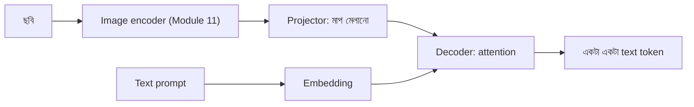

# Lecture 08 — Image ও Text একসঙ্গে: Vision-Language Model

> আগে যা জানা থাকলে ভালো: [Patch embedding](../module-11-image-representation-and-vision/lecture-05-patches-and-patch-embedding.md) ও [Encoder](../module-11-image-representation-and-vision/lecture-06-encoder.md) (Module 11), [Lecture 05 — Attention](lecture-05-context-and-attention.md) এবং [Lecture 07 — লেখা তৈরির loop](lecture-07-autoregressive-decoder-and-stopping.md)। এই lecture শেষে পারবে: ছবি থেকে text তৈরির পুরো পথটা ধাপে ধাপে বলতে এবং text token কীভাবে ছবির অংশের দিকে "তাকায়" তা হাতে হিসাব করতে।
> Map-এ অবস্থান: [Learning Map](../01-learning-map.md) → input-এর representation + text decoder। নতুন কোনো গাণিতিক operation নেই; আগের অংশগুলো জোড়া লাগছে।

## সমস্যাটা কী?

একটা ছবিতে হাতে লেখা লাইন আছে, model-কে সেটা পড়ে text বের করতে হবে। কিন্তু আমাদের text model কেবল token-এর vector বোঝে ([Lecture 02](lecture-02-embedding.md))। ছবি হলো pixel-এর সংখ্যা। তাছাড়া ছবির আকার আর text-এর vector-এর দৈর্ঘ্য মেলে না। ছবির তথ্য text model-এর কাছে পৌঁছানোর একটা সেতু লাগবে।

## ধারণাটা সহজ ভাষায়

মূল বুদ্ধি: **ছবিকেও token-এর মতো একটা vector-তালিকা বানিয়ে ফেলো।** Text model তখন সেই তালিকা দেখে, যেমন সে আগের শব্দ দেখে। ধাপগুলো:

1. **Image encoder:** ছবি অংশে (patch) ভাগ হয়, প্রতিটা patch vector হয়, আর encoder সেগুলোকে আরও কাজের vector-এ বদলায়। এটা [Module 11](../module-11-image-representation-and-vision/README.md)-এর কাজ। ফল: প্রতি patch-এর একটা vector।
2. **Projector:** Encoder-এর vector-এর দৈর্ঘ্য text-এর d-এর সঙ্গে না মিললে একটা ছোট linear layer (weighted sum, [Module 09](../module-09-model-architecture/lecture-03-one-neuron.md)-এর মতো) দিয়ে মাপ মিলিয়ে নেওয়া হয়। এখন এগুলো **image token**।
3. **Text prompt:** প্রশ্ন বা শুরুর লেখা সাধারণ নিয়মে token → embedding।
4. **Decoder:** image token আর text token একসঙ্গে decoder-এ যায়। Decoder [Lecture 07](lecture-07-autoregressive-decoder-and-stopping.md)-এর মতো একটা একটা করে text token বের করে। প্রতিবার text token [attention](lecture-05-context-and-attention.md) দিয়ে image token-গুলোর দিকেও "তাকায়" এবং বাছাই করে ছবির কোন অংশ এখন দরকার।

যে image-text model ছবি দেখে caption লেখে, ছবি নিয়ে প্রশ্নের উত্তর দেয়, বা লেখা পড়ে (OCR), সবার গঠন মূলত এই। তাকানোর ব্যবস্থা দুই ধরনের হয়: (ক) image token আর text token **একই তালিকায় পাশাপাশি** বসানো, (খ) আলাদা **cross-attention**: query আসে text থেকে, key ও value আসে ছবি থেকে। দুটোতেই text token ছবির vector দেখে, আর হিসাব [Lecture 05](lecture-05-context-and-attention.md)-এর মতোই।

**Training:** লক্ষ্য একই next-token cross-entropy ([Lecture 04](lecture-04-next-token-and-cross-entropy.md))। সাধারণত শুধু text token-গুলোর পরের token অনুমানের loss মাপা হয়; ছবির অংশ "অনুমান" করতে হয় না। কোন অংশ train হবে আর কোনটা আগের শেখা অবস্থায় থাকবে, সেই সিদ্ধান্ত [Module 13](../module-13-pretraining-finetuning-and-lora/lecture-02-finetuning-methods-map.md)-এর বিষয়।

## ছোট একটা উদাহরণ

ছবির দুটো patch। Encoder প্রতিটার জন্য 3 সংখ্যার vector দিয়েছে (শেখানোর জন্য বসানো): `p₁ = [2, 0, 1]`, `p₂ = [0, 1, 1]`। Text-এর d = 2, তাই projector 3 → 2: `W_p = [[1, 0], [0, 1], [0, 1]]`।

**ধাপ ১ — projector:**

- `p₁ × W_p = [2·1 + 0·0 + 1·0, 2·0 + 0·1 + 1·1] = [2, 1]`
- `p₂ × W_p = [0·1 + 1·0 + 1·0, 0·0 + 1·1 + 1·1] = [0, 2]`

**ধাপ ২ — একই তালিকায়:** Text-এর বর্তমান token-এর embedding `[1, 1]` (যেমন "খাই")। তালিকা: `[ছবি-১: [2,1], ছবি-২: [0,2], text: [1,1]]`।

**ধাপ ৩ — attention:** [Lecture 05](lecture-05-context-and-attention.md)-এর একই `W_q`, `W_k`, `W_v` ব্যবহার করি। Text token-এর `q = [0, 2]`। Key: ছবি-১ → `[2, −1]`, ছবি-২ → `[0, 2]`, text নিজে → `[1, 0]`। Value: `[2, 2]`, `[0, 4]`, `[1, 2]`।

- Score = `q · k`: ছবি-১ = −2, ছবি-২ = 4, text = 0
- √2 দিয়ে ভাগ: `[−1.414, 2.828, 0]`; e ঘাত: `[0.243, 16.919, 1.000]`; যোগফল 18.162
- Weight = **[0.013, 0.932, 0.055]**

Text token সবচেয়ে বেশি তাকাল ছবি-২-এর দিকে (93.2%)।

**ধাপ ৪ — নতুন vector:** প্রথম সংখ্যা 0.013×2 + 0.932×0 + 0.055×1 ≈ 0.08; দ্বিতীয় 0.013×2 + 0.932×4 + 0.055×2 ≈ 3.86। নতুন vector প্রায় **[0.08, 3.86]**: এতে ছবির তথ্য মিশে আছে। এরপর যথারীতি Transformer block, logits ও softmax চলে।

## কোড

```python
import math

def vecmat(v, M):
    return [sum(v[i] * M[i][j] for i in range(len(v))) for j in range(len(M[0]))]
def dot(a, b): return sum(x * y for x, y in zip(a, b))
def softmax(z):
    e = [math.exp(x) for x in z]; s = sum(e)
    return [x / s for x in e]

patches = [[2, 0, 1], [0, 1, 1]]            # encoder-এর ফল, প্রতিটি 3 সংখ্যা
Wp = [[1, 0], [0, 1], [0, 1]]               # projector: 3 -> 2
img_tokens = [vecmat(p, Wp) for p in patches]
seq = img_tokens + [[1, 1]]                 # শেষে text token
print("image tokens:", img_tokens)

Wq = [[0, 1], [0, 1]]; Wk = [[1, -1], [0, 1]]; Wv = [[1, 0], [0, 2]]   # Lecture 05-এর মান
q = vecmat(seq[-1], Wq)
K = [vecmat(x, Wk) for x in seq]
V = [vecmat(x, Wv) for x in seq]
scores = [dot(q, k) for k in K]
w = softmax([s / math.sqrt(2) for s in scores])
out = [sum(w[j] * V[j][d] for j in range(3)) for d in range(2)]
print("scores:", scores, "weights:", [round(x, 3) for x in w], "out:", [round(o, 3) for o in out])
```

```text
# output:
image tokens: [[2, 1], [0, 2]]
scores: [-2, 4, 0] weights: [0.013, 0.932, 0.055] out: [0.082, 3.863]
```

## ছবি



সাবধান: ছবি ও text-এর তথ্য সংখ্যায় এক তালিকায় এলেই model ছবিটা "বোঝে" এমন নয়। বাস্তবে ছবির অংশ কতটা কাজে লাগছে, তা আলাদাভাবে যাচাই করতে হয়। আর ছবি বেশি ছোট (resize) করলে বা অংশ কেটে গেলে encoder-এর কাছে তথ্য কম পৌঁছায়: [resize ও preprocessing](../module-11-image-representation-and-vision/lecture-07-resize-and-preprocessing.md)।

## মনে রাখার সারকথা

- ছবিকে encoder ও projector দিয়ে text-এর মাপের vector-তালিকা ("image token") বানানো হয়।
- Text decoder সেই তালিকাকে attention দিয়ে দেখে; হিসাব আগের lecture-এর attention-ই।
- Text তৈরির loop, stop token আর loss একই; শুধু input-এ ছবির vector যোগ হয়েছে।

## নিজে করো

১. Patch vector `[1, 1, 1]` একই `W_p` দিয়ে কী হবে?
২. ছবির 4টা patch আর text prompt-এর 3টা token হলে তালিকায় মোট কয়টা token?
৩. Projector 768 → 4096 হলে weights-এর সংখ্যা কত? (bias বাদে ও bias সহ)

<details><summary>উত্তর</summary>

১. `[1·1 + 1·0 + 1·0, 1·0 + 1·1 + 1·1] = ` **[1, 2]**।
২. 4 + 3 = **7**।
৩. 768 × 4096 = **3,145,728**। Bias সহ 4096 বেশি: **3,149,824**।

</details>

## পরের পাঠ

Module 12-এর মূল ধারণা এখানে শেষ। এই পথ বাস্তব OCR project-এ কীভাবে কাজে লাগে, তা পরে [Module 14](../module-14-ocr-system-case-study/README.md)-এ। তার আগে আগে-শেখা model আরও শেখানোর পদ্ধতি [Module 13](../module-13-pretraining-finetuning-and-lora/README.md)-এ।
