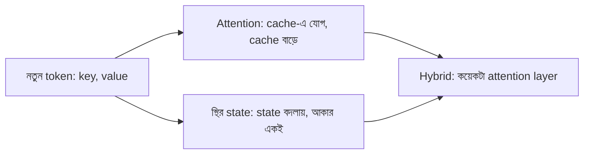

# Lecture 09 — স্থির state: attention-এর সস্তা বিকল্প ও hybrid model

> আগে যা জানা থাকলে ভালো: [Context ও Attention](lecture-05-context-and-attention.md), [Transformer Block](lecture-06-transformer-block.md) আর [Autoregressive Decoder](lecture-07-autoregressive-decoder-and-stopping.md)। এই lecture শেষে পারবে: attention-এর cache আর স্থির state-এর memory তুলনা করতে, আর hybrid model-এ কতটা cache বাঁচে তা হিসাব করতে।

## সমস্যাটা কী?

Decoder একটা একটা token বানায়। প্রতিটা নতুন token-এর জন্য attention আগের **সব** token-এর key আর value দেখে। তাই সেগুলো জমিয়ে রাখতে হয়। এই জমানো তালিকার নাম **KV cache**। Token যত বাড়ে, cache তত বাড়ে। ১ লাখ token-এর লেখায় cache বিশাল হয়ে যায়, memory-তে আঁটে না।

## ধারণাটা সহজ ভাষায়

সব token আলাদা করে না রেখে একটা ছোট, **স্থির আকারের state**-এ সব মিশিয়ে রাখা যায়। **State** মানে কয়েকটা সংখ্যার একটা table, যার আকার লেখা যত লম্বাই হোক বদলায় না। প্রতিটা নতুন token এলে state একটু বদলায়, আর query দিয়ে state থেকে উত্তর পড়া হয়।

এই ধারণার সবচেয়ে সরল রূপ **linear attention**: নতুন token-এর value, তার key-র জায়গায় state-এ **যোগ** হয়। সমস্যা হলো, যোগ শুধু জমায়, কখনো মোছে না। একই key-তে নতুন value এলে পুরোনোটা মিশে থেকে যায়।

**Delta rule** এটা ঠিক করে। যোগ করার আগে দেখে state এই key-র জন্য এখন কী মনে রেখেছে, তারপর শুধু পার্থক্যটুকু যোগ করে। ফলে পুরোনো value নতুনটায় বদলে যায়। এই নিয়মের layer-এর নাম **DeltaNet**। এর সাথে "পুরো state কতটা ফিকে করবে" বলার একটা gate যোগ করলে হয় **Gated DeltaNet**। SSM (যেমন Mamba)-ও একই পরিবারের: সেখানেও স্থির state ধাপে ধাপে বদলায়।

দাম আছে। ছোট state-এ সব কিছু আলাদা করে রাখা যায় না। তাই "অনেক আগের ঠিক এই তথ্যটা দাও" ধরনের কাজে attention ভালো, স্থির state দুর্বল। এজন্য নতুন model-গুলো দুটো মেশায়। বেশির ভাগ layer স্থির state দিয়ে, আর কয়েকটা layer পুরো attention দিয়ে। এর নাম **hybrid**। যেমন Surya OCR 2-এর লেখা-তৈরির অংশে ২৪টা layer: ১৮টা linear attention, ৬টা full attention।

## ছোট একটা উদাহরণ

দুটো key: "ক" = (1, 0), "খ" = (0, 1)। প্রতিটা value একটা সংখ্যা। State দুই ঘরের: [ক-এর ঘর, খ-এর ঘর]। তিনটা token আসে: (ক, 3), (খ, 2), (ক, 5)।

**শুধু যোগ (linear attention):**
- (ক, 3): state = [3, 0]
- (খ, 2): state = [3, 2]
- (ক, 5): state = [3 + 5, 2] = [8, 2]
- "ক" দিয়ে পড়লে পাই 8। অথচ ক-এর সর্বশেষ value 5। পুরোনো 3 মিশে আছে।

**Delta rule:**
- (ক, 3): মনে আছে 0, পার্থক্য 3 − 0 = 3, state = [3, 0]
- (খ, 2): মনে আছে 0, পার্থক্য 2, state = [3, 2]
- (ক, 5): মনে আছে 3, পার্থক্য 5 − 3 = 2, state = [3 + 2, 2] = [5, 2]
- "ক" দিয়ে পড়লে পাই 5, ঠিক সর্বশেষ value।

**Memory:** তিন token পরে KV cache-এ ৩টা key (২টা করে সংখ্যা) আর ৩টা value, মোট ৯টা সংখ্যা। State-এ সবসময় ২টা। প্রতি নতুন token-এ cache বাড়ে ৩টা করে, state একই থাকে।

## Formula / কোড

Delta rule-এর এক লাইনের রূপ: **নতুন state = পুরোনো state + (v − state·k) × k**। এখানে `state·k` মানে key k দিয়ে state থেকে পড়া মান। শুধু-যোগের নিয়মে `(v − state·k)`-এর জায়গায় থাকে শুধু `v`।

```python
KEYS = {"ka": (1, 0), "kha": (0, 1)}
tokens = [("ka", 3), ("kha", 2), ("ka", 5)]

def read(S, k):                      # output = S . k
    return S[0] * k[0] + S[1] * k[1]

S_add = [0, 0]                       # linear attention: only adds
S_delta = [0, 0]                     # delta rule
cache = []                           # attention keeps every (key, value)
for name, v in tokens:
    k = KEYS[name]
    S_add = [S_add[i] + v * k[i] for i in range(2)]
    old = read(S_delta, k)           # what the state remembers for this key
    S_delta = [S_delta[i] + (v - old) * k[i] for i in range(2)]
    cache.append((k, v))
    print(name, v, "add:", S_add, "delta:", S_delta, "cache numbers:", 3 * len(cache))

print("read ka -> add:", read(S_add, KEYS["ka"]), " delta:", read(S_delta, KEYS["ka"]))
# output:
# ka 3 add: [3, 0] delta: [3, 0] cache numbers: 3
# kha 2 add: [3, 2] delta: [3, 2] cache numbers: 6
# ka 5 add: [8, 2] delta: [5, 2] cache numbers: 9
# read ka -> add: 8  delta: 5
```

Hybrid-এ cache শুধু attention layer-গুলোর লাগে। Surya OCR 2-এ ২৪টার ৬টা attention, তাই সব-attention model-এর তুলনায় cache 6 / 24 = 0.25, অর্থাৎ এক-চতুর্থাংশ।

## ছবি



## মনে রাখার সারকথা

- Attention সব token-এর key-value রাখে, তাই লম্বা লেখায় cache বাড়তেই থাকে।
- স্থির state সব মিশিয়ে রাখে; delta rule পুরোনো value-কে নতুনটায় বদলায়, শুধু যোগ করে না।
- Hybrid model বেশির ভাগ layer-এ স্থির state, কয়েকটায় attention রাখে: cache কম, দরকারি মনে-রাখা থাকে।

## নিজে করো

১. উদাহরণের পরে চতুর্থ token (খ, 4) এল। শুধু-যোগ আর delta rule-এ state কত হবে? "খ" দিয়ে পড়লে দুই নিয়মে কত পাবে?
২. এক layer-এ ১,০০০ token পরে উদাহরণের মাপে KV cache-এ কয়টা সংখ্যা, আর state-এ কয়টা?
৩. একটা model-এ ৪৮টা layer, তার ৩৬টা Gated DeltaNet আর ১২টা attention। সব-attention model-এর তুলনায় cache কত ভাগ?

<details><summary>উত্তর</summary>

১. শুধু-যোগ: [8, 2 + 4] = [8, 6], "খ" পড়লে 6। Delta rule: মনে আছে 2, পার্থক্য 4 − 2 = 2, state = [5, 4], "খ" পড়লে 4।

২. Cache: প্রতি token-এ ৩টা সংখ্যা, তাই 3 × 1000 = 3000। State: সবসময় ২টা।

৩. 12 / 48 = 0.25, অর্থাৎ এক-চতুর্থাংশ। (Qwen3-Next-80B-A3B-এর ছক ঠিক এমনই: প্রতি ৪ layer-এ ৩টা Gated DeltaNet, ১টা attention।)

</details>

## পরের পাঠ

এই module এখানে শেষ। কোন layer-এ attention রাখবে, আর পুরোনো Transformer থেকে hybrid কীভাবে বানানো যায় (distillation দিয়ে), তা [Module 18 — Teacher ও Student](../module-18-knowledge-distillation/lecture-01-teacher-and-student.md) থেকে শুরু হওয়া পথে আর ML Learning Atlas-এর "Hybrid" ও "রূপান্তর" শাখায় পাবে।
