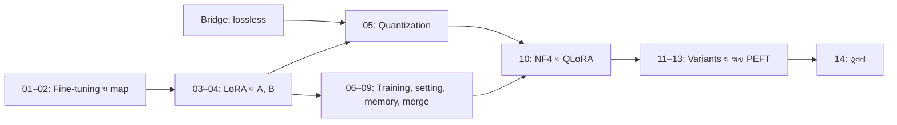

# Module 13 — Fine-Tuning, PEFT, LoRA ও Quantization

[কেন্দ্রীয় map](../01-learning-map.md) · [Course outline](../00-course-outline.md) · [লেখার নিয়ম](../00-writing-style-guide.md)

## Status

**লেখা প্রস্তুত; শেখা নয়।** ১৪টা lecture আর দুটো bridge/reference লেখা আছে। পড়া, হাতে হিসাব আর ব্যবহার শেখা শেষ ধরা হয়নি। প্রতিটা lecture-এ ছোট সংখ্যার উদাহরণ, Python (standard library) আর অনুশীলন আছে; Torch/PEFT-এর আসল code এখানে চালানো হয়নি, তাই সেগুলো "ধারণা বোঝানোর pseudo-code" বলে চিহ্নিত।

## আগে কী পড়া থাকলে ভালো

- [Module 09](../module-09-model-architecture/README.md): unit, layer, shape, parameter count।
- [Module 10](../module-10-neural-network-training/README.md): loss, gradient, backpropagation, optimizer।
- [Module 12](../module-12-text-sequences-and-multimodal-models/README.md): output score ([bridge](../module-12-text-sequences-and-multimodal-models/bridge-01-output-scores-and-selection.md)); attention ও Transformer block (Lecture 08-এর `q_proj` পরিচয়ের জন্য)।

## Lecture-এর তালিকা

| # | Lecture | এক লাইনে |
|---|---|---|
| Bridge | [একই তথ্য কম জায়গায় রাখা](bridge-01-lossless-compression.md) | Lossless compression বনাম lossy quantization |
| 01 | [Training ও fine-tuning](lecture-01-training-and-finetuning.md) | From scratch, pretraining, fine-tuning, inference; শুরুর মানের পার্থক্য |
| 02 | [Fine-tuning পদ্ধতির মানচিত্র](lecture-02-finetuning-methods-map.md) | "কোন parameter বদলাবে" আর "কী থেকে শিখবে", দুটো আলাদা প্রশ্ন |
| 03 | [LoRA-র forward pass ও activation](lecture-03-lora-forward-pass-and-activation.md) | `z = Wx + b + s·B(Ax)`; activation কোথায় বসে |
| 04 | [A, B-র আকার ও effective weights](lecture-04-lora-matrix-pairs-and-effective-weights.md) | Shape, `r × (d + m)`, `ΔW = s·B·A` |
| 05 | [Quantization ও QLoRA পরিচয়](lecture-05-quantization-and-qlora.md) | একই shape, কাছাকাছি মান; margin > 2ε |
| 06 | [Full, selective ও head-only training](lecture-06-full-selective-and-head-training.md) | Trainable বনাম frozen; এক update হাতে মেলানো |
| 07 | [Rank, alpha, শুরুর মান, dropout](lecture-07-lora-rank-alpha-init-dropout.md) | কোন setting formula-র কোন অংশ বদলায়; B কেন শূন্য |
| 08 | [Target selection, gradient ও memory](lecture-08-target-selection-gradient-and-memory.md) | Unit/module/block; frozen-এর ভেতর দিয়ে gradient; memory-র হিসাব |
| 09 | [Merge, save ও load](lecture-09-merge-save-load.md) | Merge/unmerge, adapter বনাম merged file, আবার training |
| 10 | [Precision, NF4 ও QLoRA practice](lecture-10-precision-nf4-and-qlora-practice.md) | কম bit-এ weight রাখার বাস্তব হিসাব |
| 11 | [rsLoRA, AdaLoRA, DoRA](lecture-11-lora-variants-rslora-adalora-dora.md) | LoRA-র কোন অংশ বদলে তিনটা variant |
| 12 | [PiSSA ও LoftQ](lecture-12-init-variants-pissa-loftq.md) | শুরুর মান বদলানো |
| 13 | [অন্য PEFT: adapter, soft prompt, prefix, IA³](lecture-13-other-peft-adapters-prompts-ia3.md) | কোথায় বসে, merge হয় কি না |
| 14 | [Full, LoRA ও QLoRA-র ন্যায্য তুলনা](lecture-14-controlled-comparison.md) | একই শর্তে quality, memory, speed |

Lecture 10–14 অন্য লেখকের কাজ; এখানে শুধু নাম আর link রাখা হয়েছে।

## কোন ক্রমে পড়বে

প্রধান পথ: **Bridge → 01 → 02 → 03 → 04 → 05 → 06 → 07 → 08 → 09 → 10 → 11 → 12 → 13 → 14**।

- Lecture 05-এর আগে [output score-এর bridge](../module-12-text-sequences-and-multimodal-models/bridge-01-output-scores-and-selection.md) আর এই module-এর lossless bridge পড়ে নাও।
- শুধু LoRA বুঝতে চাইলে 01–04 আর 06–09 যথেষ্ট; quantization (05, 10) আলাদা শাখা।
- Lecture 11–13 ঐচ্ছিক শাখা: LoRA জানা থাকলে যেকোনো ক্রমে পড়া যায়।

## পরের Module

- [14: OCR case study](../module-14-ocr-system-case-study/README.md) (এই module-এর ভিত্তির পরে)
- [15: SFT ও domain adaptation](../module-15-domain-and-task-adaptation/README.md)
- [16: Preference ও DPO](../module-16-preference-learning-and-dpo/README.md)
- [17: RL ও feedback](../module-17-reinforcement-learning-and-feedback/README.md)
- [18: Distillation](../module-18-knowledge-distillation/README.md)
