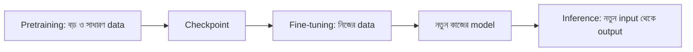

# Lecture 01 — Training আর Fine-Tuning: শুরুর মানটাই আলাদা

> আগে যা জানা থাকলে ভালো: weight, loss আর [gradient descent-এর এক ধাপ](../module-02-linear-regression/lecture-03-gradient-descent-training.md)। এই lecture শেষে পারবে: from scratch training, fine-tuning আর inference-এর পার্থক্য বলতে, আর কেন fine-tuning কম ধাপে শেষ হয় তা ছোট সংখ্যায় দেখাতে। ([Map-এ অবস্থান](../01-learning-map.md): শেখানোর পদ্ধতি → শুরুর parameter কোথা থেকে আসছে)

## সমস্যাটা কী?

একটা বড় model শূন্য থেকে শেখাতে অনেক data, সময় আর টাকা লাগে। এখন ধরো তোমার দরকার একটা নির্দিষ্ট কাজ, যেমন ঢাকার বাড়ির দাম অনুমান করা। কেউ আগেই অনেক এলাকার বাড়ির data দিয়ে একটা model শিখিয়ে রেখেছে। সেই শেখা মান ফেলে দিয়ে আবার শূন্য থেকে শুরু করা অপচয়। বরং সেখান থেকে শুরু করে নিজের data দিয়ে একটু বদলে নেওয়াই বুদ্ধিমানের কাজ।

## ধারণাটা সহজ ভাষায়

**Training** মানে data আর একটা loss ব্যবহার করে model-এর parameters-এর মান ঠিক করা। তিনটা পরিস্থিতিতে model-কে ব্যবহার করা যায়:

- **From scratch training:** শুরুর মান আন্দাজমতো (অনেক weight random)। কোনো আগে শেখা জ্ঞান নেই। এই মান থেকে data দিয়ে শেখানো হয়।
- **Fine-tuning:** আগে শেখানো model-এর parameters থেকে শুরু। নতুন কাজ বা নতুন data দিয়ে আরও শেখানো হয়।
- **Inference:** শেখানো model-কে input দিয়ে output নেওয়া। কোনো parameter বদলায় না।

আগে শেখানো model-এর সেই প্রথম বড় training-কে বলে **pretraining**। সাধারণত অনেক বেশি আর সাধারণ ধরনের data-তে হয়। তার শেষে parameters-এর সংরক্ষিত কপিকে বলে **checkpoint**। Fine-tuning শুরু হয় সেই checkpoint থেকে।

| কাজ | শুরুতে parameters কেমন? | কী ঘটে? |
|---|---|---|
| From scratch | আন্দাজমতো শুরুর মান | data থেকে parameters শেখা হয় |
| Fine-tuning | checkpoint-এর শেখা মান | নতুন data-তে আরও শেখা হয় |
| Inference | শেখা মান | শুধু output আসে, update নেই |

Fine-tuning-ও training। একই loss, gradient আর update চলে। পার্থক্য শুধু শুরুর মান আর শেখানোর উদ্দেশ্যে।

## ছোট একটা উদাহরণ

খুব ছোট model: `y = w × x`। এখানে parameter মাত্র একটা, `w`। নতুন কাজের data: `x = [1, 2, 3]`, `y = [3, 6, 9]`। বোঝা যাচ্ছে সঠিক `w = 3`।

- From scratch: শুরুতে `w = 0.0`।
- Fine-tuning: একটা প্রায় একই ধরনের কাজে আগে শেখা `w = 2.8` থেকে শুরু।

দুই ক্ষেত্রেই learning rate `0.05`, আর loss (MSE) `0.01`-এর নিচে নামলে থামি। নিচের কোড প্রতি ধাপের loss ছাপে।

```python
xs = [1, 2, 3]
ys = [3, 6, 9]

def loss(w):                      # MSE
    return sum((w * x - y) ** 2 for x, y in zip(xs, ys)) / len(xs)

def grad(w):                      # loss-এর ঢাল
    return sum(2 * (w * x - y) * x for x, y in zip(xs, ys)) / len(xs)

def train(w, lr=0.05):
    history = [round(loss(w), 3)]
    while loss(w) >= 0.01:
        w = w - lr * grad(w)      # update
        history.append(round(loss(w), 3))
    return w, history

for name, w0 in [("from scratch (w=0.0)", 0.0), ("fine-tune   (w=2.8)", 2.8)]:
    w, history = train(w0)
    print(name, "| loss প্রতি step-এ:", history, "| steps:", len(history) - 1)
# output:
# from scratch (w=0.0) | loss প্রতি step-এ: [42.0, 11.947, 3.398, 0.967, 0.275, 0.078, 0.022, 0.006] | steps: 7
# fine-tune   (w=2.8) | loss প্রতি step-এ: [0.187, 0.053, 0.015, 0.004] | steps: 3
```

From scratch শুরুই হয় loss `42.0` থেকে, শেষ করতে 7 ধাপ লাগে। Fine-tuning শুরু হয় loss `0.187` থেকে, 3 ধাপেই শেষ। আগে শেখা মান নতুন কাজের কাছাকাছি ছিল বলে এত কম পথ বাকি ছিল। এটা এক parameter-এর খেলনা model। বাস্তবে সুবিধাটা হলো কম data আর কম সময়ে ভালো শুরু পাওয়া।

## ছবি



## মনে রাখার সারকথা

- Fine-tuning হলো training-ই, শুধু শুরু হয় আগে শেখানো checkpoint থেকে।
- Inference-এ parameter বদলায় না; training আর fine-tuning-এ বদলায়।
- Fine-tuning মানেই সব parameter বদলানো নয়। কোন parameter বদলাবে সেটা [পরের lecture](lecture-02-finetuning-methods-map.md)-এর বিষয়।

## নিজে করো

১. ওপরের উদাহরণে `w = 2.9` থেকে শুরু করলে প্রথম loss কত?
২. এগুলো কোনটা: (ক) নতুন architecture-এ random মান বসিয়ে শেখানো (খ) ডাউনলোড করা model-এ নিজের data দিয়ে আরও training (গ) শেখানো model-কে ছবি দিয়ে উত্তর নেওয়া?
৩. `w = 2.9` থেকে learning rate `0.05`-এ এক update করলে নতুন `w` কত?

<details><summary>উত্তর</summary>

১. প্রতিটা ভুল `(2.9 − 3) × x = −0.1x`। বর্গ করে গড়: `0.01 × (1 + 4 + 9) / 3 ≈ 0.047`।
২. (ক) from scratch training, (খ) fine-tuning, (গ) inference।
৩. Gradient = `2 × (−0.1) × (1 + 4 + 9) / 3 ≈ −0.933`। নতুন `w = 2.9 − 0.05 × (−0.933) ≈ 2.947`। আগের চেয়ে 3-এর আরও কাছে।

</details>

## পরের পাঠ

Fine-tuning-এ সব parameter বদলানো যায়, আবার কয়েকটা মাত্র। সেই বিকল্পগুলোর মানচিত্র: [Lecture 02 — Fine-tuning পদ্ধতির মানচিত্র](lecture-02-finetuning-methods-map.md)।
