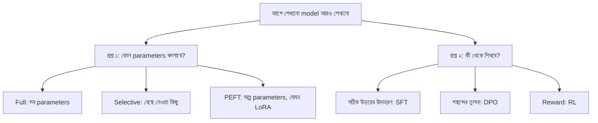

# Lecture 02 — Fine-Tuning পদ্ধতির মানচিত্র: দুটো আলাদা প্রশ্ন

> আগে যা জানা থাকলে ভালো: [Training আর fine-tuning](lecture-01-training-and-finetuning.md), আর [`2 → 2 → 1` network-এর ৯টি parameter](../module-09-model-architecture/lecture-07-shapes-and-parameter-count.md)। এই lecture শেষে পারবে: LoRA, SFT, DPO-র মতো নাম দেখলে বলতে সেটা "কোন parameter বদলায়" নাকি "কী থেকে শেখে" প্রশ্নের উত্তর। ([Map-এ অবস্থান](../01-learning-map.md): আগে শেখানো model → trainable parameter নির্বাচন ও শেখার লক্ষ্য)

## সমস্যাটা কী?

Fine-tuning নিয়ে পড়তে গেলে একগাদা নাম সামনে আসে: full fine-tuning, LoRA, QLoRA, SFT, DPO, RLHF। নামগুলো এক সারিতে সাজালে মনে হয় সবাই একে অন্যের বিকল্প। কিন্তু তা নয়। কিছু নাম বলে **কোন parameter বদলাবে**, আর কিছু নাম বলে **কোন data বা feedback থেকে শিখবে**। এই দুটো আলাদা সিদ্ধান্ত। আলাদা করে চিনতে পারলে নামের ভিড় থেকে দিশা পাওয়া যায়।



দুই দিক থেকে একটা করে বেছে মেলানো যায়। যেমন **LoRA + SFT**: parameter বদলানোর পথ LoRA, শেখার উৎস সঠিক উত্তরের উদাহরণ।

## প্রশ্ন ১: কোন parameters বদলাবে?

যে parameter-এর মান optimizer বদলাতে পারে সেটা **trainable**। যার মান স্থির রাখা হয় সেটা **frozen**। Frozen parameter শুধু মান বদলানো থেকে বাদ পড়ে; input থেকে output হিসাব করতে সে তবুও অংশ নেয়।

| পদ্ধতি | কোন parameters trainable | কেন বেছে নেয় |
|---|---|---|
| Full fine-tuning | সবগুলো | পুরো model-কে নতুন কাজে মানাতে; memory বেশি লাগে |
| Selective fine-tuning | বেছে নেওয়া কিছু layer বা parameter | কম অংশ বদলে কাজ চালাতে |
| Head-only training | শুধু শেষের output অংশ (head); বাকি frozen | আগে শেখা features ব্যবহার করে নতুন category শেখাতে |
| PEFT | অল্প পুরোনো parameter, অথবা ছোট নতুন trainable অংশ | বড় model কম trainable parameter দিয়ে মানাতে |

**PEFT** মানে Parameter-Efficient Fine-Tuning, অর্থাৎ কম parameter শেখানো fine-tuning। এর কয়েকটা শাখা আছে। আপাতত শুধু নামগুলো চিনে রাখো; প্রতিটা পরে আলাদা lecture-এ আসবে।

| নাম | এক লাইনে | কোথায় শেখা হবে |
|---|---|---|
| LoRA | বড় weight matrix স্থির রেখে দুটো ছোট matrix শেখা | [Lecture 03–09](lecture-03-lora-forward-pass-and-activation.md) |
| QLoRA | LoRA, কিন্তু frozen base weights কম bit-এ রাখা | [Lecture 05](lecture-05-quantization-and-qlora.md), [10](lecture-10-precision-nf4-and-qlora-practice.md) |
| LoRA-র variant (rsLoRA, AdaLoRA, DoRA, PiSSA, LoftQ) | LoRA-র কোনো এক অংশ বদলানো | [Lecture 11](lecture-11-lora-variants-rslora-adalora-dora.md), [12](lecture-12-init-variants-pissa-loftq.md) |
| Adapter, soft prompt, prefix tuning, IA³ | অন্য ধরনের ছোট trainable অংশ | [Lecture 13](lecture-13-other-peft-adapters-prompts-ia3.md) |
| Bias-only (BitFit) | শুধু bias শেখানো | [Lecture 06](lecture-06-full-selective-and-head-training.md) |

Bias-only একই সঙ্গে selective আর PEFT। অর্থাৎ ওপরের পদ্ধতিগুলো একেবারে আলাদা বাক্স নয়, কিছু জায়গায় মেশে।

## প্রশ্ন ২: কী থেকে শিখবে?

| নাম | শেখার উৎস | কোথায় |
|---|---|---|
| **SFT** (Supervised Fine-Tuning) | input আর তার সঠিক output-এর জোড়া | Module 15 |
| Instruction tuning | নির্দেশ আর ভালো উত্তরের জোড়া; সাধারণত SFT-এরই একটা ব্যবহার | Module 15 |
| **Preference optimization**, যেমন DPO | একই input-এর দুটো উত্তরের মধ্যে কোনটা পছন্দের | Module 16 |
| **RL-based tuning** | model নিজে output বানায়, সেটা reward বা score পায় | Module 17 |
| Distillation | অন্য model-এর output থেকে শেখা | Module 18 |

RLHF, RLAIF, RLVR হলো feedback কোথা থেকে আসে তার নাম (মানুষ, AI, যাচাইযোগ্য নিয়ম)। PPO ও GRPO হলো RL-এ update করার algorithm-এর নাম। এই সব নাম এখন মুখস্থ করার দরকার নেই।

কাছাকাছি আরও কয়েকটা নাম আলাদা করে রাখো:

- **Domain adaptation:** একটা বিষয়ের data-তে মানানো, যেমন চিকিৎসার ভাষা। full বা PEFT, যেকোনো পথে হতে পারে।
- **Continued pretraining:** আরও text দিয়ে pretraining-এর মতোই training চালানো; আলাদা করে লেখা answer লাগে না।
- **Prompt engineering আর RAG:** শুধু prompt বা বাইরের তথ্য দিয়ে inference করা। parameter শেখানো হয় না, তাই এগুলো fine-tuning নয়।

## ছোট একটা উদাহরণ: trainable কয়টা?

Module 09-এর `2 → 2 → 1` network-এ মোট ৯টা parameter: A, B, C unit-এর weights আর bias। তিন রকম পছন্দে কয়টা trainable:

```python
params = ["A.w1", "A.w2", "A.b", "B.w1", "B.w2", "B.b", "C.w1", "C.w2", "C.b"]

full      = params
head_only = [p for p in params if p.startswith("C.")]       # শেষ layer
bias_only = [p for p in params if p.endswith(".b")]         # শুধু bias

for name, chosen in [("full", full), ("head-only", head_only), ("bias-only", bias_only)]:
    print(f"{name:9s}: trainable {len(chosen)} / {len(params)} ->", chosen)
# output:
# full     : trainable 9 / 9 -> ['A.w1', 'A.w2', 'A.b', 'B.w1', 'B.w2', 'B.b', 'C.w1', 'C.w2', 'C.b']
# head-only: trainable 3 / 9 -> ['C.w1', 'C.w2', 'C.b']
# bias-only: trainable 3 / 9 -> ['A.b', 'B.b', 'C.b']
```

এই তিন পছন্দ কীভাবে একটা update-এ আলাদা ফল দেয়, তা [Lecture 06](lecture-06-full-selective-and-head-training.md)-এ সংখ্যায় দেখা হবে।

## একই কাজে দুই দিক

একটা আগে শেখানো OCR model-কে বাংলা লেখা পড়া শেখাতে training জোড়া: ছবিতে লেখা "বই", সঠিক উত্তর `বই`। সঠিক উত্তর দেওয়া আছে, তাই শেখার উৎস **SFT**। এখন parameter বদলানোর পথ বেছে নাও:

- সব parameter বদলালে: **full fine-tuning + SFT**।
- মূল weights frozen রেখে LoRA শেখালে: **LoRA + SFT**।
- frozen base কম bit-এ রেখে LoRA শেখালে: **QLoRA + SFT**।

বাংলা OCR হলো কাজ বা domain। LoRA শেখার লক্ষ্য ঠিক করে না, শুধু বলে কোন parameter বদলাবে।

## মনে রাখার সারকথা

- Fine-tuning-এর নামগুলো দুই প্রশ্নের উত্তর: "কোন parameter বদলাবে" (full, selective, head-only, PEFT) আর "কী থেকে শিখবে" (SFT, DPO, RL)।
- LoRA ও QLoRA প্রথম প্রশ্নের উত্তর; SFT, DPO দ্বিতীয় প্রশ্নের। তাই LoRA + SFT একসঙ্গে সম্ভব।
- কম parameter শেখানো মানে এই নয় যে সব কাজে ফল ভালো হবে, বা forward আর backward হিসাব বাদ যাবে।

## নিজে করো

১. এগুলো কোন প্রশ্নের উত্তর (parameter নাকি শেখার উৎস)? (ক) head-only (খ) DPO (গ) LoRA (ঘ) SFT
২. `3 → 4 → 1` network-এ (মোট ২১টা parameter) head-only আর bias-only-তে কয়টা করে trainable?
৩. "QLoRA বনাম SFT, কোনটা ভালো?" প্রশ্নটার সমস্যা কী?

<details><summary>উত্তর</summary>

১. (ক) parameter, (খ) শেখার উৎস, (গ) parameter, (ঘ) শেখার উৎস।
২. Head-only: শেষ layer `(4 + 1) × 1 = 5`। Bias-only: hidden-এর 4টা আর output-এর 1টা, মোট 5।
৩. দুটো আলাদা প্রশ্নের উত্তর, তাই তুলনা চলে না। QLoRA বলে কোন parameter কীভাবে রাখা ও শেখানো হবে, SFT বলে কোন উদাহরণ থেকে শেখা হবে। একসঙ্গে QLoRA + SFT করা যায়।

</details>

## পরের পাঠ

প্রশ্ন ১-এর সবচেয়ে বিখ্যাত উত্তর LoRA। প্রথমে দেখো একই input কীভাবে দুই পথে গিয়ে যোগ হয়: [Lecture 03 — LoRA-র forward pass](lecture-03-lora-forward-pass-and-activation.md)। এই module-এর শেষ দিকে আছে [precision ও QLoRA (10)](lecture-10-precision-nf4-and-qlora-practice.md), [LoRA-র variant (11)](lecture-11-lora-variants-rslora-adalora-dora.md), [শুরুর মান বদলানো (12)](lecture-12-init-variants-pissa-loftq.md), [অন্য PEFT (13)](lecture-13-other-peft-adapters-prompts-ia3.md) আর [ন্যায্য তুলনা (14)](lecture-14-controlled-comparison.md)।

Sources: [PEFT LoRA documentation](https://huggingface.co/docs/peft/en/package_reference/lora), [QLoRA paper](https://arxiv.org/abs/2305.14314), [TRL documentation](https://huggingface.co/docs/trl/index)।
